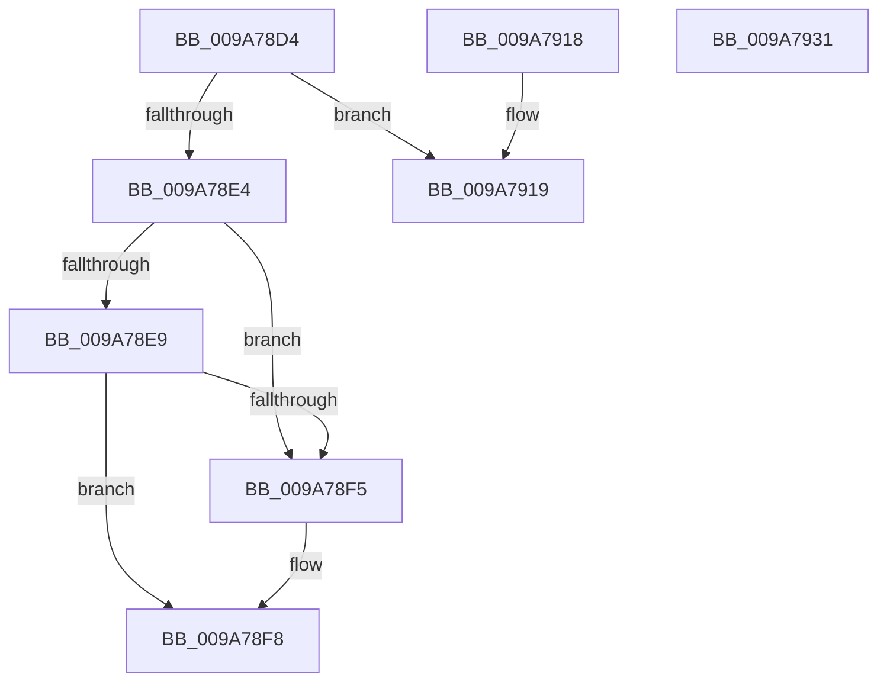

# sub_009A78D4

- RVA: `0x009A78D4`–`0x009A7932` (길이 `94` bytes)
- VA: `0x00000001409A78D4`
- 실행 섹션: `PAGE`
- PDB 이름 있음: `아니요`; PDB Function 태그: `아니요`
- unwind 정보 RVA: `0x0009CBB0`
- 디코드: `33`개 명령, `94/94` bytes 표시
- 미해석 바이트: `0` (있으면 어셈블리에 `.byte`로 보존)

> 이 문서는 커널 이미지의 기계어와 PDB 기호를 분석해 생성했습니다. 4번과 5번은 함수 원형과 자료형을 바이너리 사용 방식에서 추정한 C 해석이며 원본 소스 복구 결과는 아닙니다.

## 1. Dependencies

- 직접 호출 지점: **4**; 고유 호출 대상: **3**
- 직접 호출자로 확인된 함수: **0**
- RIP 상대 이미지 참조: **0**

### Outgoing calls
- `0x009A78EC` → [KeAbIsValidUserModeLockAddress](../../text/43/KeAbIsValidUserModeLockAddress_function_004333F0.md) (function, `0x004333F0`)
- `0x009A78FE` → [KeAlertThreadByThreadIdEx](../../text/39/KeAlertThreadByThreadIdEx_function_003984BC.md) (function, `0x003984BC`)
- `0x009A7906` → [ObfDereferenceObject](../../text/2F/ObfDereferenceObject_function_002F9350.md) (function, `0x002F9350`)
- `0x009A791C` → [ObfDereferenceObject](../../text/2F/ObfDereferenceObject_function_002F9350.md) (function, `0x002F9350`)

### Direct callers
- 이 함수 시작 RVA로 연결되는 직접 call은 확인되지 않았습니다. 간접 호출은 완전히 역산할 수 없습니다.

### Static image references
- 디코드된 RIP-relative 메모리 참조가 없습니다.

## 2. Other-region calls and transfers

- 다른 실행 섹션으로 향하는 call: **4**
  - `0x009A78EC` → [KeAbIsValidUserModeLockAddress](../../text/43/KeAbIsValidUserModeLockAddress_function_004333F0.md) (`PAGE` → `.text`)
  - `0x009A78FE` → [KeAlertThreadByThreadIdEx](../../text/39/KeAlertThreadByThreadIdEx_function_003984BC.md) (`PAGE` → `.text`)
  - `0x009A7906` → [ObfDereferenceObject](../../text/2F/ObfDereferenceObject_function_002F9350.md) (`PAGE` → `.text`)
  - `0x009A791C` → [ObfDereferenceObject](../../text/2F/ObfDereferenceObject_function_002F9350.md) (`PAGE` → `.text`)
- 별도 외부 분기/꼬리 이동을 확인하지 못했습니다.

## 3. Assembly (complete function range)

```asm
009A78D4  49 8B 87 20 02 00 00            mov rax, qword ptr [r15 + 0x220]
009A78DB  48 39 86 20 02 00 00            cmp qword ptr [rsi + 0x220], rax
009A78E2  75 35                           jne 0x1409a7919
009A78E4  4C 3B FE                        cmp r15, rsi
009A78E7  74 0C                           je 0x1409a78f5
009A78E9  49 8B CE                        mov rcx, r14
009A78EC  E8 FF BA A8 FF                  call 0x1404333f0
009A78F1  85 C0                           test eax, eax
009A78F3  75 03                           jne 0x1409a78f8
009A78F5  45 33 F6                        xor r14d, r14d
009A78F8  49 8B D6                        mov rdx, r14
009A78FB  48 8B CE                        mov rcx, rsi
009A78FE  E8 B9 0B 9F FF                  call 0x1403984bc
009A7903  48 8B CE                        mov rcx, rsi
009A7906  E8 45 1A 95 FF                  call 0x1402f9350
009A790B  33 C0                           xor eax, eax
009A790D  48 83 C4 48                     add rsp, 0x48
009A7911  41 5F                           pop r15
009A7913  41 5E                           pop r14
009A7915  5F                              pop rdi
009A7916  5E                              pop rsi
009A7917  C3                              ret
009A7918  CC                              int3
009A7919  48 8B CE                        mov rcx, rsi
009A791C  E8 2F 1A 95 FF                  call 0x1402f9350
009A7921  B8 22 00 00 C0                  mov eax, 0xc0000022
009A7926  48 83 C4 48                     add rsp, 0x48
009A792A  41 5F                           pop r15
009A792C  41 5E                           pop r14
009A792E  5F                              pop rdi
009A792F  5E                              pop rsi
009A7930  C3                              ret
009A7931  CC                              int3
```

## 4. C-style interpretation (structured pseudocode)

```c
__int64 __fastcall sub_009A78D4(void)
{
    __int64 result;
    __int64 v_r14;
    __int64 v_rsp;

    if ((*(unsigned __int64 *)(v_rsi + 544)) != (*(unsigned __int64 *)(v_r15 + 544))) goto loc_009A7919;
    if (v_r15 == v_rsi) goto loc_009A78F5;
    result = KeAbIsValidUserModeLockAddress(v_r14, a2, a3, a4);
    if ((unsigned int)(result) == 0) {
        v_r14 = 0;
    }
    result = KeAlertThreadByThreadIdEx(v_rsi, 0, a3, a4);
    result = ObfDereferenceObject(v_rsi, 0, a3, a4);
    result = 0;
    v_rsp = (v_rsp) + (72);
    return result;
loc_009A7919:
    result = ObfDereferenceObject(v_rsi, 0, a3, a4);
    v_rsp = (v_rsp) + (72);
    return (unsigned int)(0xC0000022ULL);
}
```

## 5. (Beta) C Style

```c
void sub_009A78D4(void)
{
    int64_t result;
    int64_t local_r14;
    int64_t local_rsp;

    if ((*(uint64_t *)(local_rsi + 0x220)) != (*(uint64_t *)(local_r15 + 0x220))) goto loc_009A7919;
    if (local_r15 == local_rsi) goto loc_009A78F5;
    result = KeAbIsValidUserModeLockAddress(local_r14, a2, a3, a4);
    if ((uint32_t)(result) == 0) {
        local_r14 = 0;
    }
    result = KeAlertThreadByThreadIdEx(local_rsi, 0, a3, a4);
    result = ObfDereferenceObject(local_rsi, 0, a3, a4);
    result = 0;
    local_rsp = (local_rsp) + (72);
    return result;
loc_009A7919:
    result = ObfDereferenceObject(local_rsi, 0, a3, a4);
    local_rsp = (local_rsp) + (72);
    return (uint32_t)(0xC0000022ULL);
}
```

## 6. Execution-region graph

[열기: 2D/3D 그래프와 함수 탐색 컨트롤 패널](../../../control-panel.html?section=page&rva=0x009A78D4&view=graph)

- 2D 그래프는 위에서 아래로 흐르고, 3D 그래프는 빈 공간을 드래그해 회전합니다. Shift+드래그는 이동, 휠은 확대·축소, 함수 노드 선택은 대상 보고서 이동입니다.

### Static fallback


