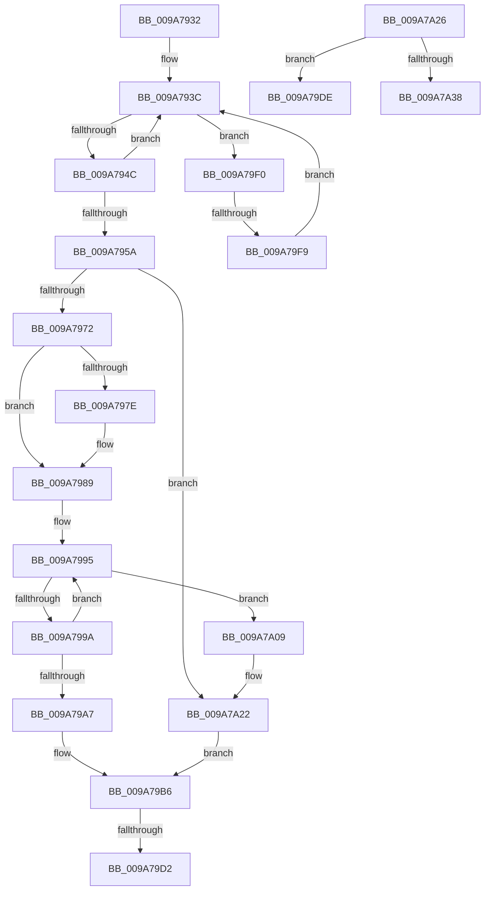

# sub_009A7932

- RVA: `0x009A7932`–`0x009A7A3D` (길이 `267` bytes)
- VA: `0x00000001409A7932`
- 실행 섹션: `PAGE`
- PDB 이름 있음: `아니요`; PDB Function 태그: `아니요`
- unwind 정보 RVA: `0x0009CBC8`
- 디코드: `69`개 명령, `267/267` bytes 표시
- 미해석 바이트: `0` (있으면 어셈블리에 `.byte`로 보존)

> 이 문서는 커널 이미지의 기계어와 PDB 기호를 분석해 생성했습니다. 4번과 5번은 함수 원형과 자료형을 바이너리 사용 방식에서 추정한 C 해석이며 원본 소스 복구 결과는 아닙니다.

## 1. Dependencies

- 직접 호출 지점: **7**; 고유 호출 대상: **7**
- 직접 호출자로 확인된 함수: **0**
- RIP 상대 이미지 참조: **1**

### Outgoing calls
- `0x009A795D` → [ExGetHandlePointer](../../text/43/ExGetHandlePointer_function_00430C90.md) (function, `0x00430C90`)
- `0x009A7981` → [ExSlowReplenishHandleTableEntry](../../text/44/ExSlowReplenishHandleTableEntry_function_0044BEF0.md) (function, `0x0044BEF0`)
- `0x009A79B1` → [ObpTraceObjectReferenceIfActive](../../text/21/ObpTraceObjectReferenceIfActive_function_00210780.md) (function, `0x00210780`)
- `0x009A79D4` → [ExfUnblockPushLock](../../text/2A/ExfUnblockPushLock_function_002A3FE0.md) (function, `0x002A3FE0`)
- `0x009A79E6` → [ObfDereferenceObject](../../text/2F/ObfDereferenceObject_function_002F9350.md) (function, `0x002F9350`)
- `0x009A79FF` → [ExpBlockOnLockedHandleEntry](../86/ExpBlockOnLockedHandleEntry_function_00868838.md) (function, `0x00868838`)
- `0x009A7A29` → [PspLockUnlockThreadSecurityExclusiveUnsafe](../../text/4E/PspLockUnlockThreadSecurityExclusiveUnsafe_function_004E96AC.md) (function, `0x004E96AC`)

### Direct callers
- 이 함수 시작 RVA로 연결되는 직접 call은 확인되지 않았습니다. 간접 호출은 완전히 역산할 수 없습니다.

### Static image references
- `0x009A7932` → RVA `0x00FC6CA8` (`ALMOSTRO`; read)

## 2. Other-region calls and transfers

- 다른 실행 섹션으로 향하는 call: **6**
  - `0x009A795D` → [ExGetHandlePointer](../../text/43/ExGetHandlePointer_function_00430C90.md) (`PAGE` → `.text`)
  - `0x009A7981` → [ExSlowReplenishHandleTableEntry](../../text/44/ExSlowReplenishHandleTableEntry_function_0044BEF0.md) (`PAGE` → `.text`)
  - `0x009A79B1` → [ObpTraceObjectReferenceIfActive](../../text/21/ObpTraceObjectReferenceIfActive_function_00210780.md) (`PAGE` → `.text`)
  - `0x009A79D4` → [ExfUnblockPushLock](../../text/2A/ExfUnblockPushLock_function_002A3FE0.md) (`PAGE` → `.text`)
  - `0x009A79E6` → [ObfDereferenceObject](../../text/2F/ObfDereferenceObject_function_002F9350.md) (`PAGE` → `.text`)
  - `0x009A7A29` → [PspLockUnlockThreadSecurityExclusiveUnsafe](../../text/4E/PspLockUnlockThreadSecurityExclusiveUnsafe_function_004E96AC.md) (`PAGE` → `.text`)
- call이 아닌 외부 분기/꼬리 이동: **5**
  - `0x009A79CC` → [sub_009A7748 + 0xF8](Unknown_function_009A7748.md) (`tail-transfer`)
  - `0x009A79D9` → [sub_009A7748 + 0xF8](Unknown_function_009A7748.md) (`tail-transfer`)
  - `0x009A79EB` → [sub_009A7748 + 0x150](Unknown_function_009A7748.md) (`tail-transfer`)
  - `0x009A79F3` → [sub_009A7748 + 0x14B](Unknown_function_009A7748.md) (`tail-transfer`)
  - `0x009A7A38` → [sub_009A7748 + 0x120](Unknown_function_009A7748.md) (`tail-transfer`)

## 3. Assembly (complete function range)

```asm
009A7932  48 8B 1D 6F F3 61 00            mov rbx, qword ptr [rip + 0x61f36f]
009A7939  45 33 ED                        xor r13d, r13d
009A793C  0F 0D 0F                        prefetchw byte ptr [rdi]
009A793F  4C 8B 07                        mov r8, qword ptr [rdi]
009A7942  41 F6 C0 01                     test r8b, 1
009A7946  0F 84 A4 00 00 00               je 0x1409a79f0
009A794C  49 8D 48 FF                     lea rcx, [r8 - 1]
009A7950  49 8B C0                        mov rax, r8
009A7953  F0 48 0F B1 0F                  lock cmpxchg qword ptr [rdi], rcx
009A7958  75 E2                           jne 0x1409a793c
009A795A  48 8B CF                        mov rcx, rdi
009A795D  E8 2E 93 A8 FF                  call 0x140430c90
009A7962  48 8B D8                        mov rbx, rax
009A7965  0F B6 00                        movzx eax, byte ptr [rax]
009A7968  24 7F                           and al, 0x7f
009A796A  3C 06                           cmp al, 6
009A796C  0F 85 B0 00 00 00               jne 0x1409a7a22
009A7972  8B 83 A0 05 00 00               mov eax, dword ptr [rbx + 0x5a0]
009A7978  24 03                           and al, 3
009A797A  3C 02                           cmp al, 2
009A797C  75 0B                           jne 0x1409a7989
009A797E  48 8B CF                        mov rcx, rdi
009A7981  E8 6A 45 AA FF                  call 0x14044bef0
009A7986  44 8B E8                        mov r13d, eax
009A7989  41 8D 55 01                     lea edx, [r13 + 1]
009A798D  0F 0D 4B D0                     prefetchw byte ptr [rbx - 0x30]
009A7991  48 8B 43 D0                     mov rax, qword ptr [rbx - 0x30]
009A7995  48 85 C0                        test rax, rax
009A7998  74 6F                           je 0x1409a7a09
009A799A  8B CA                           mov ecx, edx
009A799C  48 03 C8                        add rcx, rax
009A799F  F0 48 0F B1 4B D0               lock cmpxchg qword ptr [rbx - 0x30], rcx
009A79A5  75 EE                           jne 0x1409a7995
009A79A7  41 B8 44 66 6C 74               mov r8d, 0x746c6644
009A79AD  48 8D 4B D0                     lea rcx, [rbx - 0x30]
009A79B1  E8 CA 8D 86 FF                  call 0x140210780
009A79B6  48 8B 0D EB F2 61 00            mov rcx, qword ptr [rip + 0x61f2eb]
009A79BD  F0 48 FF 07                     lock inc qword ptr [rdi]
009A79C1  48 83 C1 30                     add rcx, 0x30
009A79C5  F0 09 34 24                     lock or dword ptr [rsp], esi
009A79C9  48 39 31                        cmp qword ptr [rcx], rsi
009A79CC  0F 84 6E FE FF FF               je 0x1409a7840
009A79D2  33 D2                           xor edx, edx
009A79D4  E8 07 C6 8F FF                  call 0x1402a3fe0
009A79D9  E9 62 FE FF FF                  jmp 0x1409a7840
009A79DE  BF 0B 00 00 C0                  mov edi, 0xc000000b
009A79E3  48 8B CB                        mov rcx, rbx
009A79E6  E8 65 19 95 FF                  call 0x1402f9350
009A79EB  E9 A8 FE FF FF                  jmp 0x1409a7898
009A79F0  4D 85 C0                        test r8, r8
009A79F3  0F 84 9A FE FF FF               je 0x1409a7893
009A79F9  48 8B D7                        mov rdx, rdi
009A79FC  48 8B CB                        mov rcx, rbx
009A79FF  E8 34 0E EC FF                  call 0x140868838
009A7A04  E9 33 FF FF FF                  jmp 0x1409a793c
009A7A09  48 8B 07                        mov rax, qword ptr [rdi]
009A7A0C  0F 57 C0                        xorps xmm0, xmm0
009A7A0F  48 25 01 00 FE FF               and rax, 0xfffffffffffe0001
009A7A15  0F 11 44 24 30                  movups xmmword ptr [rsp + 0x30], xmm0
009A7A1A  48 89 44 24 30                  mov qword ptr [rsp + 0x30], rax
009A7A1F  48 89 07                        mov qword ptr [rdi], rax
009A7A22  33 DB                           xor ebx, ebx
009A7A24  EB 90                           jmp 0x1409a79b6
009A7A26  48 8B CB                        mov rcx, rbx
009A7A29  E8 7E 1C B4 FF                  call 0x1404e96ac
009A7A2E  8B 83 A0 05 00 00               mov eax, dword ptr [rbx + 0x5a0]
009A7A34  A8 02                           test al, 2
009A7A36  74 A6                           je 0x1409a79de
009A7A38  E9 2B FE FF FF                  jmp 0x1409a7868
```

## 4. C-style interpretation (structured pseudocode)

```c
__int64 __fastcall sub_009A7932(__int64 a1, __int64 a2, __int64 a3, __int64 a4, __int64 a5, __int64 a6)
{
    __int64 result;
    __int64 v_r13;
    __int64 v_rbx;
    unsigned int v_stack_p0;
    unsigned __int64 v_stack_p30;

    v_r13 = 0;
loc_009A793C:
    if ((((unsigned __int8)(*(unsigned __int64 *)(v_rdi))) & (1)) == 0) goto loc_009A79F0;
    if ((((unsigned __int8)(*(unsigned __int64 *)(v_rdi))) & (1)) != 0) goto loc_009A793C;
    result = ExGetHandlePointer(v_rdi, a2, *(unsigned __int64 *)(v_rdi), a4);
    result = (unsigned __int8)((*(unsigned __int8 *)(result)) & (127));
    if (((unsigned __int8)(result)) != 6) goto loc_009A7A22;
    result = (unsigned __int8)(((unsigned int)(*(unsigned int *)(result + 1440))) & (3));
    if (((unsigned __int8)(result)) == 2) {
        a1 = v_rdi;
        result = ExSlowReplenishHandleTableEntry(a1, a2, *(unsigned __int64 *)(v_rdi), a4);
        v_r13 = (unsigned int)(result);
    }
loc_009A7995:
    if (*(unsigned __int64 *)(result - 48) == 0) goto loc_009A7A09;
    a1 = ((unsigned int)((unsigned int)(v_r13 + 1))) + (*(unsigned __int64 *)(result - 48));
    if (condition_is_not_equal) goto loc_009A7995;
    result = ObpTraceObjectReferenceIfActive(result - 48, v_r13 + 1, (unsigned int)(0x746C6644ULL), a4);
loc_009A79B6:
    a1 = (*(unsigned __int64 *)(v_rip + 6419179)) + (48);
    a2 = 0;
    result = ExfUnblockPushLock(a1, a2, (unsigned int)(0x746C6644ULL), a4);
loc_009A79F0:
    result = ExpBlockOnLockedHandleEntry(result, v_rdi, (unsigned int)(0x746C6644ULL), a4);
    goto loc_009A793C;
loc_009A7A09:
    result = (*(unsigned __int64 *)(v_rdi)) & (0xFFFFFFFFFFFE0001ULL);
    a6 = v_xmm0;
    v_stack_p30 = result;
    *(unsigned __int64 *)(v_rdi) = result;
loc_009A7A22:
    v_rbx = 0;
    goto loc_009A79B6;
}
```

## 5. (Beta) C Style

```c
int64_t sub_009A7932(int64_t Arg1, int64_t Arg2, int64_t Arg3, int64_t Arg4, uint64_t Arg5, int64_t Arg6)
{
    int64_t result;
    int64_t local_r13;
    int64_t local_rbx;
    uint32_t v_stack_p0;
    uint64_t v_stack_p30;

    local_r13 = 0;
loc_009A793C:
    if ((((uint8_t)(*(uint64_t *)(local_rdi))) & (1)) == 0) goto loc_009A79F0;
    if ((((uint8_t)(*(uint64_t *)(local_rdi))) & (1)) != 0) goto loc_009A793C;
    result = ExGetHandlePointer(local_rdi, Arg2, *(uint64_t *)(local_rdi), Arg4);
    result = (uint8_t)((*(uint8_t *)(result)) & (127));
    if (((uint8_t)(result)) != 6) goto loc_009A7A22;
    result = (uint8_t)(((uint32_t)(*(uint32_t *)(result + 0x5A0))) & (3));
    if (((uint8_t)(result)) == 2) {
        Arg1 = local_rdi;
        result = ExSlowReplenishHandleTableEntry(Arg1, Arg2, *(uint64_t *)(local_rdi), Arg4);
        local_r13 = (uint32_t)(result);
    }
loc_009A7995:
    if (*(uint64_t *)(result - 0x30) == 0) goto loc_009A7A09;
    Arg1 = ((uint32_t)((uint32_t)(local_r13 + 1))) + (*(uint64_t *)(result - 0x30));
    if (condition_is_not_equal) goto loc_009A7995;
    result = ObpTraceObjectReferenceIfActive(result - 48, local_r13 + 1, (uint32_t)(0x746C6644ULL), Arg4);
loc_009A79B6:
    Arg1 = (*(uint64_t *)(v_rip + 0x61F2EB)) + (48);
    Arg2 = 0;
    result = ExfUnblockPushLock(Arg1, Arg2, (uint32_t)(0x746C6644ULL), Arg4);
loc_009A79F0:
    result = ExpBlockOnLockedHandleEntry(result, local_rdi, (uint32_t)(0x746C6644ULL), Arg4);
    goto loc_009A793C;
loc_009A7A09:
    result = (*(uint64_t *)(local_rdi)) & (0xFFFFFFFFFFFE0001ULL);
    Arg6 = v_xmm0;
    v_stack_p30 = result;
    *(uint64_t *)(local_rdi) = result;
loc_009A7A22:
    local_rbx = 0;
    goto loc_009A79B6;
}
```

## 6. Execution-region graph

[열기: 2D/3D 그래프와 함수 탐색 컨트롤 패널](../../../control-panel.html?section=page&rva=0x009A7932&view=graph)

- 2D 그래프는 위에서 아래로 흐르고, 3D 그래프는 빈 공간을 드래그해 회전합니다. Shift+드래그는 이동, 휠은 확대·축소, 함수 노드 선택은 대상 보고서 이동입니다.

### Static fallback


