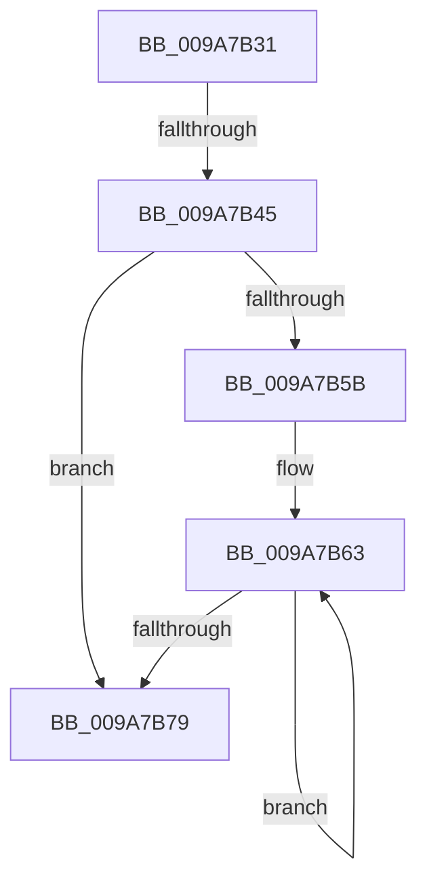

# sub_009A7B31

- RVA: `0x009A7B31`–`0x009A7B8A` (길이 `89` bytes)
- VA: `0x00000001409A7B31`
- 실행 섹션: `PAGE`
- PDB 이름 있음: `아니요`; PDB Function 태그: `아니요`
- unwind 정보 RVA: `0x0009CCA4`
- 디코드: `27`개 명령, `89/89` bytes 표시
- 미해석 바이트: `0` (있으면 어셈블리에 `.byte`로 보존)

> 이 문서는 커널 이미지의 기계어와 PDB 기호를 분석해 생성했습니다. 4번과 5번은 함수 원형과 자료형을 바이너리 사용 방식에서 추정한 C 해석이며 원본 소스 복구 결과는 아닙니다.

## 1. Dependencies

- 직접 호출 지점: **0**; 고유 호출 대상: **0**
- 직접 호출자로 확인된 함수: **0**
- RIP 상대 이미지 참조: **0**

### Outgoing calls
- 직접 디코드된 call 명령이 없습니다.

### Direct callers
- 이 함수 시작 RVA로 연결되는 직접 call은 확인되지 않았습니다. 간접 호출은 완전히 역산할 수 없습니다.

### Static image references
- 디코드된 RIP-relative 메모리 참조가 없습니다.

## 2. Other-region calls and transfers

- 다른 실행 섹션으로 향하는 call: **0**
- call이 아닌 외부 분기/꼬리 이동: **1**
  - `0x009A7B43` → [sub_009A7B9B](Unknown_function_009A7B9B.md) (`tail-transfer`)

## 3. Assembly (complete function range)

```asm
009A7B31  48 89 7C 24 30                  mov qword ptr [rsp + 0x30], rdi
009A7B36  33 FF                           xor edi, edi
009A7B38  89 43 08                        mov dword ptr [rbx + 8], eax
009A7B3B  44 89 43 0C                     mov dword ptr [rbx + 0xc], r8d
009A7B3F  F6 42 02 20                     test byte ptr [rdx + 2], 0x20
009A7B43  74 56                           je 0x1409a7b9b
009A7B45  0F B7 42 48                     movzx eax, word ptr [rdx + 0x48]
009A7B49  44 8B C7                        mov r8d, edi
009A7B4C  41 D1 E9                        shr r9d, 1
009A7B4F  44 3B C8                        cmp r9d, eax
009A7B52  44 0F 43 C8                     cmovae r9d, eax
009A7B56  45 85 C9                        test r9d, r9d
009A7B59  74 1E                           je 0x1409a7b79
009A7B5B  48 83 C2 4C                     add rdx, 0x4c
009A7B5F  48 8D 43 10                     lea rax, [rbx + 0x10]
009A7B63  0F B6 0A                        movzx ecx, byte ptr [rdx]
009A7B66  41 FF C0                        inc r8d
009A7B69  66 89 08                        mov word ptr [rax], cx
009A7B6C  48 8D 40 02                     lea rax, [rax + 2]
009A7B70  48 8D 52 01                     lea rdx, [rdx + 1]
009A7B74  45 3B C1                        cmp r8d, r9d
009A7B77  72 EA                           jb 0x1409a7b63
009A7B79  B8 05 00 00 80                  mov eax, 0x80000005
009A7B7E  3B F5                           cmp esi, ebp
009A7B80  0F 42 F8                        cmovb edi, eax
009A7B83  8B C7                           mov eax, edi
009A7B85  48 8B 7C 24 30                  mov rdi, qword ptr [rsp + 0x30]
```

## 4. C-style interpretation (structured pseudocode)

```c
__int64 __fastcall sub_009A7B31(__int64 a1, __int64 a2, int a3, int a4, __int64 a5, __int64 a6)
{
    __int64 v_rdi;
    unsigned __int64 v_stack_p30;

    v_stack_p30 = v_rdi;
    v_rdi = 0;
    *(unsigned int *)(v_rbx + 8) = (unsigned int)(result);
    *(unsigned int *)(v_rbx + 12) = a3;
    a4 = (unsigned int)((a4) >> (1));
    if (a4 >= ((unsigned int)(*(unsigned __int16 *)(a2 + 72)))) { a4 = (unsigned int)(*(unsigned __int16 *)(a2 + 72)); }
    if (a4 == 0) goto loc_009A7B79;
    a2 = (a2) + (76);
loc_009A7B63:
    a3 = (unsigned int)((0) + 1);
    *(unsigned __int16 *)(v_rbx + 16) = (unsigned __int16)(*(unsigned __int8 *)(a2));
    if (a3 < a4) goto loc_009A7B63;
loc_009A7B79:
    if (((unsigned int)(v_rsi)) < ((unsigned int)(v_rbp))) { v_rdi = (unsigned int)((unsigned int)(0x80000005ULL)); }
    return (unsigned int)((unsigned int)(v_rdi));
}
```

## 5. (Beta) C Style

```c
int64_t sub_009A7B31(int64_t Arg1, void *Arg2, int32_t Arg3, int32_t Arg4, uint64_t Arg5, int64_t Arg6)
{
    uint8_t *arg2 = (uint8_t *)Arg2;

    int64_t local_rdi;
    uint64_t v_stack_p30;

    v_stack_p30 = local_rdi;
    local_rdi = 0;
    *(uint32_t *)(local_rbx + 0x8) = (uint32_t)(result);
    *(uint32_t *)(local_rbx + 0xC) = Arg3;
    Arg4 = (uint32_t)((Arg4) >> (1));
    if (Arg4 >= ((uint32_t)(*(uint16_t *)(arg2 + 0x48)))) { Arg4 = (uint32_t)(*(uint16_t *)(arg2 + 0x48)); }
    if (Arg4 == 0) goto loc_009A7B79;
    Arg2 = (Arg2) + (76);
loc_009A7B63:
    Arg3 = (uint32_t)((0) + 1);
    *(uint16_t *)(local_rbx + 0x10) = (uint16_t)(*(uint8_t *)(arg2));
    if (Arg3 < Arg4) goto loc_009A7B63;
loc_009A7B79:
    if (((uint32_t)(local_rsi)) < ((uint32_t)(local_rbp))) { local_rdi = (uint32_t)((uint32_t)(0x80000005ULL)); }
    return (uint32_t)((uint32_t)(local_rdi));
}
```

### 관측된 메모리 오프셋

구조체 형식이 확인되지 않은 접근은 인자 기준의 오프셋으로만 기록했습니다.

| 기준 인자 | 오프셋 표현 | 폭 (bit) | 접근 |
|---|---:|---:|---|
| `Arg2` | `+ 0x0` | `8` | `R` |
| `Arg2` | `+ 0x1` | `64` | `R` |
| `Arg2` | `+ 0x2` | `8` | `R` |
| `Arg2` | `+ 0x48` | `16` | `R` |

## 6. Execution-region graph

[열기: 2D/3D 그래프와 함수 탐색 컨트롤 패널](../../../control-panel.html?section=page&rva=0x009A7B31&view=graph)

- 2D 그래프는 위에서 아래로 흐르고, 3D 그래프는 빈 공간을 드래그해 회전합니다. Shift+드래그는 이동, 휠은 확대·축소, 함수 노드 선택은 대상 보고서 이동입니다.

### Static fallback


