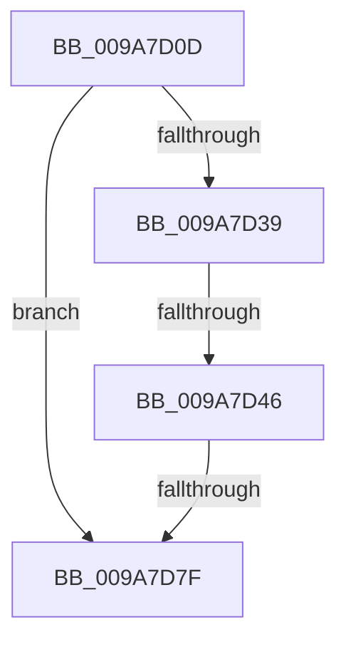

# sub_009A7D0D

- RVA: `0x009A7D0D`–`0x009A7D89` (길이 `124` bytes)
- VA: `0x00000001409A7D0D`
- 실행 섹션: `PAGE`
- PDB 이름 있음: `아니요`; PDB Function 태그: `아니요`
- unwind 정보 RVA: `0x0009CD1C`
- 디코드: `30`개 명령, `124/124` bytes 표시
- 미해석 바이트: `0` (있으면 어셈블리에 `.byte`로 보존)

> 이 문서는 커널 이미지의 기계어와 PDB 기호를 분석해 생성했습니다. 4번과 5번은 함수 원형과 자료형을 바이너리 사용 방식에서 추정한 C 해석이며 원본 소스 복구 결과는 아닙니다.

## 1. Dependencies

- 직접 호출 지점: **2**; 고유 호출 대상: **2**
- 직접 호출자로 확인된 함수: **0**
- RIP 상대 이미지 참조: **0**

### Outgoing calls
- `0x009A7D29` → [ObReferenceObjectByHandle](../86/ObReferenceObjectByHandle_function_00868DB0.md) (function, `0x00868DB0`)
- `0x009A7D74` → [IoSetIoCompletionEx](../../text/24/IoSetIoCompletionEx_function_0024FA80.md) (function, `0x0024FA80`)

### Direct callers
- 이 함수 시작 RVA로 연결되는 직접 call은 확인되지 않았습니다. 간접 호출은 완전히 역산할 수 없습니다.

### Static image references
- 디코드된 RIP-relative 메모리 참조가 없습니다.

## 2. Other-region calls and transfers

- 다른 실행 섹션으로 향하는 call: **1**
  - `0x009A7D74` → [IoSetIoCompletionEx](../../text/24/IoSetIoCompletionEx_function_0024FA80.md) (`PAGE` → `.text`)
- call이 아닌 외부 분기/꼬리 이동: **3**
  - `0x009A7D44` → [sub_009A7DAB](Unknown_function_009A7DAB.md) (`tail-transfer`)
  - `0x009A7D7D` → [sub_009A7DAB + 0x14](Unknown_function_009A7DAB.md) (`tail-transfer`)
  - `0x009A7D87` → [sub_009A7D89 + 0x8](Unknown_function_009A7D89.md) (`tail-transfer`)

## 3. Assembly (complete function range)

```asm
009A7D0D  48 89 74 24 70                  mov qword ptr [rsp + 0x70], rsi
009A7D12  44 0F B6 88 32 02 00 00         movzx r9d, byte ptr [rax + 0x232]
009A7D1A  48 8D 44 24 48                  lea rax, [rsp + 0x48]
009A7D1F  48 89 44 24 20                  mov qword ptr [rsp + 0x20], rax
009A7D24  4C 89 7C 24 48                  mov qword ptr [rsp + 0x48], r15
009A7D29  E8 82 10 EC FF                  call 0x140868db0
009A7D2E  48 8B 74 24 48                  mov rsi, qword ptr [rsp + 0x48]
009A7D33  8B D8                           mov ebx, eax
009A7D35  85 C0                           test eax, eax
009A7D37  78 46                           js 0x1409a7d7f
009A7D39  B9 01 00 00 00                  mov ecx, 1
009A7D3E  33 C0                           xor eax, eax
009A7D40  F0 0F B1 0E                     lock cmpxchg dword ptr [rsi], ecx
009A7D44  75 65                           jne 0x1409a7dab
009A7D46  44 8B 8C 24 90 00 00 00         mov r9d, dword ptr [rsp + 0x90]
009A7D4E  48 8D 46 08                     lea rax, [rsi + 8]
009A7D52  48 8B 4C 24 40                  mov rcx, qword ptr [rsp + 0x40]
009A7D57  4C 8B C5                        mov r8, rbp
009A7D5A  48 89 44 24 30                  mov qword ptr [rsp + 0x30], rax
009A7D5F  49 8B D6                        mov rdx, r14
009A7D62  48 8B 84 24 98 00 00 00         mov rax, qword ptr [rsp + 0x98]
009A7D6A  44 88 7C 24 28                  mov byte ptr [rsp + 0x28], r15b
009A7D6F  48 89 44 24 20                  mov qword ptr [rsp + 0x20], rax
009A7D74  E8 07 7D 8A FF                  call 0x14024fa80
009A7D79  8B D8                           mov ebx, eax
009A7D7B  85 C0                           test eax, eax
009A7D7D  78 40                           js 0x1409a7dbf
009A7D7F  48 8B 74 24 70                  mov rsi, qword ptr [rsp + 0x70]
009A7D84  48 85 FF                        test rdi, rdi
009A7D87  74 08                           je 0x1409a7d91
```

## 4. C-style interpretation (structured pseudocode)

```c
__int64 __fastcall sub_009A7D0D(__int64 a1, __int64 a2, __int64 a3, __int64 a4, __int64 a5, __int64 a6, __int64 a7, __int64 a8, __int64 a9, __int64 a10, __int64 a11, __int64 a12, __int64 a13, __int64 a14, __int64 a15, __int64 a16, __int64 a17, unsigned int a18, __int64 a19)
{
    __int64 result;
    unsigned __int64 v_stack_p20;
    unsigned __int8 v_stack_p28;
    unsigned __int64 v_stack_p30;
    unsigned __int64 v_stack_p48;
    unsigned __int64 v_stack_p70;

    v_stack_p70 = v_rsi;
    v_stack_p20 = a9;
    v_stack_p48 = v_r15;
    result = ObReferenceObjectByHandle(a1, a2, a3, *(unsigned __int8 *)(result + 562));
    if (sign_flag) goto loc_009A7D7F;
    result = 0;
    v_stack_p30 = a9 + 8;
    v_stack_p28 = (unsigned __int8)(v_r15);
    v_stack_p20 = a19;
    result = IoSetIoCompletionEx(a8, v_r14, v_rbp, (unsigned int)(a18));
loc_009A7D7F:
}
```

## 5. (Beta) C Style

```c
int64_t sub_009A7D0D(int64_t Arg1, int64_t Arg2, int64_t Arg3, int64_t Arg4, uint64_t Arg5, uint64_t Arg6, uint64_t Arg7, int64_t Arg8, void *Arg9, uint64_t Arg10, uint64_t Arg11, uint64_t Arg12, uint64_t Arg13, int64_t Arg14, uint64_t Arg15, uint64_t Arg16, uint64_t Arg17, uint32_t Arg18, int64_t Arg19)
{
    uint8_t *arg9 = (uint8_t *)Arg9;

    int64_t result;
    uint64_t v_stack_p20;
    uint8_t v_stack_p28;
    uint64_t v_stack_p30;
    uint64_t v_stack_p48;
    uint64_t v_stack_p70;

    v_stack_p70 = local_rsi;
    v_stack_p20 = Arg9;
    v_stack_p48 = local_r15;
    result = ObReferenceObjectByHandle(Arg1, Arg2, Arg3, *(uint8_t *)(result + 0x232));
    if (sign_flag) goto loc_009A7D7F;
    result = 0;
    v_stack_p30 = Arg9 + 8;
    v_stack_p28 = (uint8_t)(local_r15);
    v_stack_p20 = Arg19;
    result = IoSetIoCompletionEx(Arg8, local_r14, local_rbp, (uint32_t)(Arg18));
loc_009A7D7F:
}
```

### 관측된 메모리 오프셋

구조체 형식이 확인되지 않은 접근은 인자 기준의 오프셋으로만 기록했습니다.

| 기준 인자 | 오프셋 표현 | 폭 (bit) | 접근 |
|---|---:|---:|---|
| `Arg9` | `+ 0x0` | `32` | `R` |
| `Arg9` | `+ 0x8` | `64` | `R` |

## 6. Execution-region graph

[열기: 2D/3D 그래프와 함수 탐색 컨트롤 패널](../../../control-panel.html?section=page&rva=0x009A7D0D&view=graph)

- 2D 그래프는 위에서 아래로 흐르고, 3D 그래프는 빈 공간을 드래그해 회전합니다. Shift+드래그는 이동, 휠은 확대·축소, 함수 노드 선택은 대상 보고서 이동입니다.

### Static fallback


