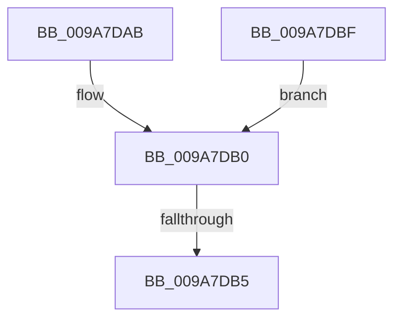

# sub_009A7DAB

- RVA: `0x009A7DAB`–`0x009A7DC9` (길이 `30` bytes)
- VA: `0x00000001409A7DAB`
- 실행 섹션: `PAGE`
- PDB 이름 있음: `아니요`; PDB Function 태그: `아니요`
- unwind 정보 RVA: `0x0009CD44`
- 디코드: `9`개 명령, `30/30` bytes 표시
- 미해석 바이트: `0` (있으면 어셈블리에 `.byte`로 보존)

> 이 문서는 커널 이미지의 기계어와 PDB 기호를 분석해 생성했습니다. 4번과 5번은 함수 원형과 자료형을 바이너리 사용 방식에서 추정한 C 해석이며 원본 소스 복구 결과는 아닙니다.

## 1. Dependencies

- 직접 호출 지점: **1**; 고유 호출 대상: **1**
- 직접 호출자로 확인된 함수: **0**
- RIP 상대 이미지 참조: **0**

### Outgoing calls
- `0x009A7DB8` → [ObfDereferenceObject](../../text/2F/ObfDereferenceObject_function_002F9350.md) (function, `0x002F9350`)

### Direct callers
- 이 함수 시작 RVA로 연결되는 직접 call은 확인되지 않았습니다. 간접 호출은 완전히 역산할 수 없습니다.

### Static image references
- 디코드된 RIP-relative 메모리 참조가 없습니다.

## 2. Other-region calls and transfers

- 다른 실행 섹션으로 향하는 call: **1**
  - `0x009A7DB8` → [ObfDereferenceObject](../../text/2F/ObfDereferenceObject_function_002F9350.md) (`PAGE` → `.text`)
- call이 아닌 외부 분기/꼬리 이동: **2**
  - `0x009A7DB3` → [sub_009A7D0D + 0x72](Unknown_function_009A7D0D.md) (`tail-transfer`)
  - `0x009A7DBD` → [sub_009A7D0D + 0x72](Unknown_function_009A7D0D.md) (`tail-transfer`)

## 3. Assembly (complete function range)

```asm
009A7DAB  BB F0 00 00 C0                  mov ebx, 0xc00000f0
009A7DB0  48 85 F6                        test rsi, rsi
009A7DB3  74 CA                           je 0x1409a7d7f
009A7DB5  48 8B CE                        mov rcx, rsi
009A7DB8  E8 93 15 95 FF                  call 0x1402f9350
009A7DBD  EB C0                           jmp 0x1409a7d7f
009A7DBF  48 8B 44 24 48                  mov rax, qword ptr [rsp + 0x48]
009A7DC4  44 89 38                        mov dword ptr [rax], r15d
009A7DC7  EB E7                           jmp 0x1409a7db0
```

## 4. C-style interpretation (structured pseudocode)

```c
__int64 __fastcall sub_009A7DAB(void)
{
    __int64 result;
    unsigned __int64 v_stack_p48;

loc_009A7DB0:
    result = ObfDereferenceObject(v_rsi, a2, a3, a4);
}
```

## 5. (Beta) C Style

```c
void sub_009A7DAB(void)
{
    int64_t result;
    uint64_t v_stack_p48;

loc_009A7DB0:
    result = ObfDereferenceObject(local_rsi, a2, a3, a4);
}
```

## 6. Execution-region graph

[열기: 2D/3D 그래프와 함수 탐색 컨트롤 패널](../../../control-panel.html?section=page&rva=0x009A7DAB&view=graph)

- 2D 그래프는 위에서 아래로 흐르고, 3D 그래프는 빈 공간을 드래그해 회전합니다. Shift+드래그는 이동, 휠은 확대·축소, 함수 노드 선택은 대상 보고서 이동입니다.

### Static fallback


