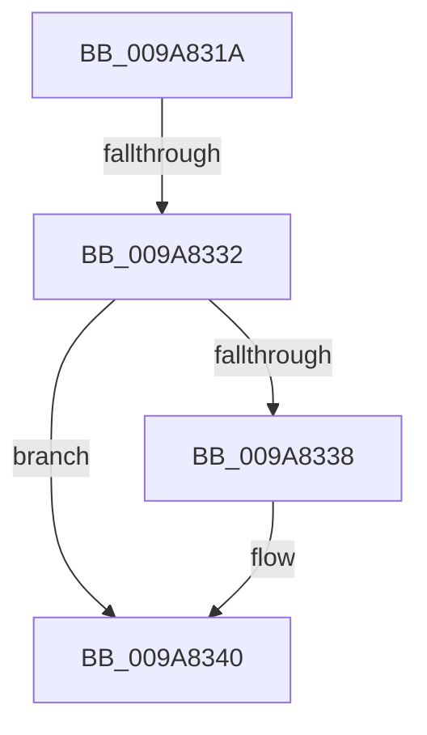

# sub_009A831A

- RVA: `0x009A831A`–`0x009A8352` (길이 `56` bytes)
- VA: `0x00000001409A831A`
- 실행 섹션: `PAGE`
- PDB 이름 있음: `아니요`; PDB Function 태그: `아니요`
- unwind 정보 RVA: `0x0009CE3C`
- 디코드: `15`개 명령, `56/56` bytes 표시
- 미해석 바이트: `0` (있으면 어셈블리에 `.byte`로 보존)

> 이 문서는 커널 이미지의 기계어와 PDB 기호를 분석해 생성했습니다. 4번과 5번은 함수 원형과 자료형을 바이너리 사용 방식에서 추정한 C 해석이며 원본 소스 복구 결과는 아닙니다.

## 1. Dependencies

- 직접 호출 지점: **2**; 고유 호출 대상: **2**
- 직접 호출자로 확인된 함수: **0**
- RIP 상대 이미지 참조: **0**

### Outgoing calls
- `0x009A833B` → [ExReturnPoolQuota](../../text/2F/ExReturnPoolQuota_function_002F0230.md) (function, `0x002F0230`)
- `0x009A8346` → [ExpInterlockedPushEntrySList](../../text/6B/ExpInterlockedPushEntrySList_function_006BA5B0.md) (function, `0x006BA5B0`)

### Direct callers
- 이 함수 시작 RVA로 연결되는 직접 call은 확인되지 않았습니다. 간접 호출은 완전히 역산할 수 없습니다.

### Static image references
- 디코드된 RIP-relative 메모리 참조가 없습니다.

## 2. Other-region calls and transfers

- 다른 실행 섹션으로 향하는 call: **2**
  - `0x009A833B` → [ExReturnPoolQuota](../../text/2F/ExReturnPoolQuota_function_002F0230.md) (`PAGE` → `.text`)
  - `0x009A8346` → [ExpInterlockedPushEntrySList](../../text/6B/ExpInterlockedPushEntrySList_function_006BA5B0.md) (`PAGE` → `.text`)
- call이 아닌 외부 분기/꼬리 이동: **2**
  - `0x009A8330` → [sub_009A8388](Unknown_function_009A8388.md) (`tail-transfer`)
  - `0x009A8350` → [IopFreeMiniCompletionPacket + 0x3A](IopFreeMiniCompletionPacket_function_009A82D0.md) (`tail-transfer`)

## 3. Assembly (complete function range)

```asm
009A831A  48 89 7C 24 30                  mov qword ptr [rsp + 0x30], rdi
009A831F  48 8B B9 70 08 00 00            mov rdi, qword ptr [rcx + 0x870]
009A8326  FF 47 1C                        inc dword ptr [rdi + 0x1c]
009A8329  0F B7 47 10                     movzx eax, word ptr [rdi + 0x10]
009A832D  66 39 07                        cmp word ptr [rdi], ax
009A8330  73 56                           jae 0x1409a8388
009A8332  80 7B 10 03                     cmp byte ptr [rbx + 0x10], 3
009A8336  75 08                           jne 0x1409a8340
009A8338  48 8B CB                        mov rcx, rbx
009A833B  E8 F0 7E 94 FF                  call 0x1402f0230
009A8340  48 8B D3                        mov rdx, rbx
009A8343  48 8B CF                        mov rcx, rdi
009A8346  E8 65 22 D1 FF                  call 0x1406ba5b0
009A834B  48 8B 7C 24 30                  mov rdi, qword ptr [rsp + 0x30]
009A8350  EB B8                           jmp 0x1409a830a
```

## 4. C-style interpretation (structured pseudocode)

```c
__int64 __fastcall sub_009A831A(__int64 a1, __int64 a2, __int64 a3, __int64 a4, __int64 a5, __int64 a6)
{
    __int64 result;
    unsigned __int64 v_stack_p30;

    v_stack_p30 = v_rdi;
    result = *(unsigned __int16 *)(*(unsigned __int64 *)(a1 + 2160) + 16);
    if ((*(unsigned __int8 *)(v_rbx + 16)) == 3) {
        a1 = v_rbx;
        result = ExReturnPoolQuota(a1, a2, a3, a4);
    }
    result = ExpInterlockedPushEntrySList(*(unsigned __int64 *)(a1 + 2160), v_rbx, a3, a4);
}
```

## 5. (Beta) C Style

```c
int64_t sub_009A831A(void *Arg1, int64_t Arg2, int64_t Arg3, int64_t Arg4, uint64_t Arg5, int64_t Arg6)
{
    uint8_t *arg1 = (uint8_t *)Arg1;

    int64_t result;
    uint64_t v_stack_p30;

    v_stack_p30 = local_rdi;
    result = *(uint16_t *)(*(uint64_t *)(arg1 + 0x870) + 0x10);
    if ((*(uint8_t *)(local_rbx + 0x10)) == 3) {
        Arg1 = local_rbx;
        result = ExReturnPoolQuota(Arg1, Arg2, Arg3, Arg4);
    }
    result = ExpInterlockedPushEntrySList(*(uint64_t *)(arg1 + 0x870), local_rbx, Arg3, Arg4);
}
```

### 관측된 메모리 오프셋

구조체 형식이 확인되지 않은 접근은 인자 기준의 오프셋으로만 기록했습니다.

| 기준 인자 | 오프셋 표현 | 폭 (bit) | 접근 |
|---|---:|---:|---|
| `Arg1` | `+ 0x870` | `64` | `R` |

## 6. Execution-region graph

[열기: 2D/3D 그래프와 함수 탐색 컨트롤 패널](../../../control-panel.html?section=page&rva=0x009A831A&view=graph)

- 2D 그래프는 위에서 아래로 흐르고, 3D 그래프는 빈 공간을 드래그해 회전합니다. Shift+드래그는 이동, 휠은 확대·축소, 함수 노드 선택은 대상 보고서 이동입니다.

### Static fallback


