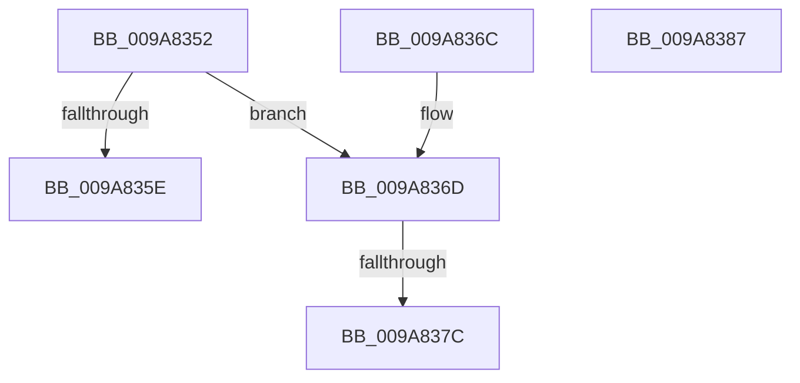

# sub_009A8352

- RVA: `0x009A8352`–`0x009A8388` (길이 `54` bytes)
- VA: `0x00000001409A8352`
- 실행 섹션: `PAGE`
- PDB 이름 있음: `아니요`; PDB Function 태그: `아니요`
- unwind 정보 RVA: `0x0009CE50`
- 디코드: `18`개 명령, `54/54` bytes 표시
- 미해석 바이트: `0` (있으면 어셈블리에 `.byte`로 보존)

> 이 문서는 커널 이미지의 기계어와 PDB 기호를 분석해 생성했습니다. 4번과 5번은 함수 원형과 자료형을 바이너리 사용 방식에서 추정한 C 해석이며 원본 소스 복구 결과는 아닙니다.

## 1. Dependencies

- 직접 호출 지점: **2**; 고유 호출 대상: **2**
- 직접 호출자로 확인된 함수: **0**
- RIP 상대 이미지 참조: **2**

### Outgoing calls
- `0x009A8361` → [AlpcpLookasidePacketCallbackRoutine](../../text/41/AlpcpLookasidePacketCallbackRoutine_function_00419D50.md) (function, `0x00419D50`)
- `0x009A837C` → [ExpWorkerFactoryCompletionPacketRoutine](../../text/34/ExpWorkerFactoryCompletionPacketRoutine_function_00344810.md) (function, `0x00344810`)

### Direct callers
- 이 함수 시작 RVA로 연결되는 직접 call은 확인되지 않았습니다. 간접 호출은 완전히 역산할 수 없습니다.

### Static image references
- `0x009A8352` → RVA `0x00419D50` (`AlpcpLookasidePacketCallbackRoutine`; read)
- `0x009A836D` → RVA `0x00344810` (`ExpWorkerFactoryCompletionPacketRoutine`; read)

## 2. Other-region calls and transfers

- 다른 실행 섹션으로 향하는 call: **2**
  - `0x009A8361` → [AlpcpLookasidePacketCallbackRoutine](../../text/41/AlpcpLookasidePacketCallbackRoutine_function_00419D50.md) (`PAGE` → `.text`)
  - `0x009A837C` → [ExpWorkerFactoryCompletionPacketRoutine](../../text/34/ExpWorkerFactoryCompletionPacketRoutine_function_00344810.md) (`PAGE` → `.text`)
- call이 아닌 외부 분기/꼬리 이동: **1**
  - `0x009A837A` → [sub_009A83B5 + 0x18](Unknown_function_009A83B5.md) (`tail-transfer`)

## 3. Assembly (complete function range)

```asm
009A8352  48 8D 0D F7 19 A7 FF            lea rcx, [rip - 0x58e609]
009A8359  48 3B C1                        cmp rax, rcx
009A835C  75 0F                           jne 0x1409a836d
009A835E  48 8B CB                        mov rcx, rbx
009A8361  E8 EA 19 A7 FF                  call 0x140419d50
009A8366  48 83 C4 20                     add rsp, 0x20
009A836A  5B                              pop rbx
009A836B  C3                              ret
009A836C  CC                              int3
009A836D  48 8D 0D 9C C4 99 FF            lea rcx, [rip - 0x663b64]
009A8374  48 3B C1                        cmp rax, rcx
009A8377  48 8B CB                        mov rcx, rbx
009A837A  75 51                           jne 0x1409a83cd
009A837C  E8 8F C4 99 FF                  call 0x140344810
009A8381  48 83 C4 20                     add rsp, 0x20
009A8385  5B                              pop rbx
009A8386  C3                              ret
009A8387  CC                              int3
```

## 4. C-style interpretation (structured pseudocode)

```c
__int64 __fastcall sub_009A8352(void)
{
    __int64 result;
    __int64 v_rsp;

    if (result != (v_rip - 5826057)) goto loc_009A836D;
    result = AlpcpLookasidePacketCallbackRoutine(v_rbx, a2, a3, a4);
    v_rsp = (v_rsp) + (32);
    return result;
loc_009A836D:
    result = ExpWorkerFactoryCompletionPacketRoutine(v_rbx, a2, a3, a4);
    v_rsp = (v_rsp) + (32);
    return result;
}
```

## 5. (Beta) C Style

```c
void sub_009A8352(void)
{
    int64_t result;
    int64_t local_rsp;

    if (result != (v_rip - 5826057)) goto loc_009A836D;
    result = AlpcpLookasidePacketCallbackRoutine(local_rbx, a2, a3, a4);
    local_rsp = (local_rsp) + (32);
    return result;
loc_009A836D:
    result = ExpWorkerFactoryCompletionPacketRoutine(local_rbx, a2, a3, a4);
    local_rsp = (local_rsp) + (32);
    return result;
}
```

## 6. Execution-region graph

[열기: 2D/3D 그래프와 함수 탐색 컨트롤 패널](../../../control-panel.html?section=page&rva=0x009A8352&view=graph)

- 2D 그래프는 위에서 아래로 흐르고, 3D 그래프는 빈 공간을 드래그해 회전합니다. Shift+드래그는 이동, 휠은 확대·축소, 함수 노드 선택은 대상 보고서 이동입니다.

### Static fallback


