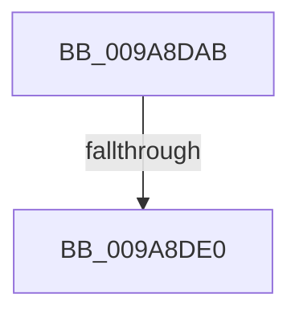

# sub_009A8DAB

- RVA: `0x009A8DAB`–`0x009A8DF3` (길이 `72` bytes)
- VA: `0x00000001409A8DAB`
- 실행 섹션: `PAGE`
- PDB 이름 있음: `아니요`; PDB Function 태그: `아니요`
- unwind 정보 RVA: `0x0009D1B8`
- 디코드: `13`개 명령, `72/72` bytes 표시
- 미해석 바이트: `0` (있으면 어셈블리에 `.byte`로 보존)

> 이 문서는 커널 이미지의 기계어와 PDB 기호를 분석해 생성했습니다. 4번과 5번은 함수 원형과 자료형을 바이너리 사용 방식에서 추정한 C 해석이며 원본 소스 복구 결과는 아닙니다.

## 1. Dependencies

- 직접 호출 지점: **0**; 고유 호출 대상: **0**
- 직접 호출자로 확인된 함수: **0**
- RIP 상대 이미지 참조: **0**

### Outgoing calls
- 직접 디코드된 call 명령이 없습니다.

### Direct callers
- 이 함수 시작 RVA로 연결되는 직접 call은 확인되지 않았습니다. 간접 호출은 완전히 역산할 수 없습니다.

### Static image references
- 디코드된 RIP-relative 메모리 참조가 없습니다.

## 2. Other-region calls and transfers

- 다른 실행 섹션으로 향하는 call: **0**
- call이 아닌 외부 분기/꼬리 이동: **1**
  - `0x009A8DDA` → [sub_009A8FB0](Unknown_function_009A8FB0.md) (`tail-transfer`)

## 3. Assembly (complete function range)

```asm
009A8DAB  4C 89 B4 24 B8 00 00 00         mov qword ptr [rsp + 0xb8], r14
009A8DB3  89 44 24 60                     mov dword ptr [rsp + 0x60], eax
009A8DB7  48 8B F1                        mov rsi, rcx
009A8DBA  65 48 8B 04 25 88 01 00 00      mov rax, qword ptr gs:[0x188]
009A8DC3  0F 11 44 24 20                  movups xmmword ptr [rsp + 0x20], xmm0
009A8DC8  0F 11 44 24 30                  movups xmmword ptr [rsp + 0x30], xmm0
009A8DCD  0F 11 44 24 40                  movups xmmword ptr [rsp + 0x40], xmm0
009A8DD2  0F 11 44 24 50                  movups xmmword ptr [rsp + 0x50], xmm0
009A8DD7  48 3B D8                        cmp rbx, rax
009A8DDA  0F 85 D0 01 00 00               jne 0x1409a8fb0
009A8DE0  48 8B A8 B8 00 00 00            mov rbp, qword ptr [rax + 0xb8]
009A8DE7  8B 83 A0 05 00 00               mov eax, dword ptr [rbx + 0x5a0]
009A8DED  41 BC 02 00 00 00               mov r12d, 2
```

## 4. C-style interpretation (structured pseudocode)

```c
__int64 __fastcall sub_009A8DAB(__int64 a1, __int64 a2, __int64 a3, __int64 a4, __int64 a5, __int64 a6, __int64 a7, __int64 a8, __int64 a9, __int64 a10)
{
    unsigned __int64 v_stack_p20;
    unsigned int v_stack_p60;
    unsigned __int64 v_stack_pB8;

    v_stack_pB8 = v_r14;
    v_stack_p60 = (unsigned int)(result);
    v_stack_p20 = v_xmm0;
    a6 = v_xmm0;
    a8 = v_xmm0;
    a10 = v_xmm0;
    return (unsigned int)(*(unsigned int *)(v_rbx + 1440));
}
```

## 5. (Beta) C Style

```c
int64_t sub_009A8DAB(int64_t Arg1, int64_t Arg2, int64_t Arg3, int64_t Arg4, uint64_t Arg5, int64_t Arg6, uint64_t Arg7, int64_t Arg8, uint64_t Arg9, int64_t Arg10)
{
    uint64_t v_stack_p20;
    uint32_t v_stack_p60;
    uint64_t v_stack_pB8;

    v_stack_pB8 = local_r14;
    v_stack_p60 = (uint32_t)(result);
    v_stack_p20 = v_xmm0;
    Arg6 = v_xmm0;
    Arg8 = v_xmm0;
    Arg10 = v_xmm0;
    return (uint32_t)(*(uint32_t *)(local_rbx + 0x5A0));
}
```

## 6. Execution-region graph

[열기: 2D/3D 그래프와 함수 탐색 컨트롤 패널](../../../control-panel.html?section=page&rva=0x009A8DAB&view=graph)

- 2D 그래프는 위에서 아래로 흐르고, 3D 그래프는 빈 공간을 드래그해 회전합니다. Shift+드래그는 이동, 휠은 확대·축소, 함수 노드 선택은 대상 보고서 이동입니다.

### Static fallback


