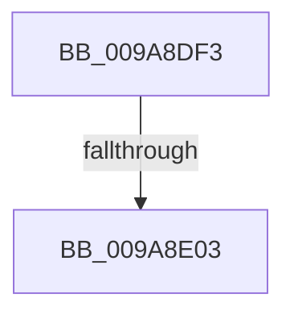

# sub_009A8DF3

- RVA: `0x009A8DF3`–`0x009A8E57` (길이 `100` bytes)
- VA: `0x00000001409A8DF3`
- 실행 섹션: `PAGE`
- PDB 이름 있음: `아니요`; PDB Function 태그: `아니요`
- unwind 정보 RVA: `0x0009D1CC`
- 디코드: `21`개 명령, `100/100` bytes 표시
- 미해석 바이트: `0` (있으면 어셈블리에 `.byte`로 보존)

> 이 문서는 커널 이미지의 기계어와 PDB 기호를 분석해 생성했습니다. 4번과 5번은 함수 원형과 자료형을 바이너리 사용 방식에서 추정한 C 해석이며 원본 소스 복구 결과는 아닙니다.

## 1. Dependencies

- 직접 호출 지점: **2**; 고유 호출 대상: **2**
- 직접 호출자로 확인된 함수: **0**
- RIP 상대 이미지 참조: **0**

### Outgoing calls
- `0x009A8E0B` → [PsReferencePrimaryTokenWithTag](../../text/20/PsReferencePrimaryTokenWithTag_function_0020FF80.md) (function, `0x0020FF80`)
- `0x009A8E30` → [ExAcquireResourceSharedLite](../../text/21/ExAcquireResourceSharedLite_function_00211BC0.md) (function, `0x00211BC0`)

### Direct callers
- 이 함수 시작 RVA로 연결되는 직접 call은 확인되지 않았습니다. 간접 호출은 완전히 역산할 수 없습니다.

### Static image references
- 디코드된 RIP-relative 메모리 참조가 없습니다.

## 2. Other-region calls and transfers

- 다른 실행 섹션으로 향하는 call: **2**
  - `0x009A8E0B` → [PsReferencePrimaryTokenWithTag](../../text/20/PsReferencePrimaryTokenWithTag_function_0020FF80.md) (`PAGE` → `.text`)
  - `0x009A8E30` → [ExAcquireResourceSharedLite](../../text/21/ExAcquireResourceSharedLite_function_00211BC0.md) (`PAGE` → `.text`)
- call이 아닌 외부 분기/꼬리 이동: **2**
  - `0x009A8DFD` → [sub_009A8F31](Unknown_function_009A8F31.md) (`tail-transfer`)
  - `0x009A8E55` → [sub_009A8E57 + 0xD](Unknown_function_009A8E57.md) (`tail-transfer`)

## 3. Assembly (complete function range)

```asm
009A8DF3  4C 89 BC 24 C0 00 00 00         mov qword ptr [rsp + 0xc0], r15
009A8DFB  A8 08                           test al, 8
009A8DFD  0F 85 2E 01 00 00               jne 0x1409a8f31
009A8E03  BA 53 68 72 74                  mov edx, 0x74726853
009A8E08  48 8B CD                        mov rcx, rbp
009A8E0B  E8 70 71 86 FF                  call 0x14020ff80
009A8E10  48 8B F8                        mov rdi, rax
009A8E13  41 BE 01 00 00 00               mov r14d, 1
009A8E19  65 48 8B 04 25 88 01 00 00      mov rax, qword ptr gs:[0x188]
009A8E22  B2 01                           mov dl, 1
009A8E24  66 FF 88 E4 01 00 00            dec word ptr [rax + 0x1e4]
009A8E2B  90                              nop
009A8E2C  48 8B 4F 30                     mov rcx, qword ptr [rdi + 0x30]
009A8E30  E8 8B 8D 86 FF                  call 0x140211bc0
009A8E35  48 8B 87 98 00 00 00            mov rax, qword ptr [rdi + 0x98]
009A8E3C  4C 8B BC 24 C0 00 00 00         mov r15, qword ptr [rsp + 0xc0]
009A8E44  48 8B 10                        mov rdx, qword ptr [rax]
009A8E47  0F B6 42 01                     movzx eax, byte ptr [rdx + 1]
009A8E4B  8D 2C 85 08 00 00 00            lea ebp, [rax*4 + 8]
009A8E52  83 FD 44                        cmp ebp, 0x44
009A8E55  77 0D                           ja 0x1409a8e64
```

## 4. C-style interpretation (structured pseudocode)

```c
__int64 __fastcall sub_009A8DF3(__int64 a1, __int64 a2, __int64 a3, __int64 a4, __int64 a5, __int64 a6, __int64 a7, __int64 a8, __int64 a9, __int64 a10, __int64 a11, __int64 a12, __int64 a13, __int64 a14, __int64 a15, __int64 a16, __int64 a17, __int64 a18, __int64 a19, __int64 a20, __int64 a21, __int64 a22, __int64 a23, __int64 a24)
{
    __int64 result;
    unsigned __int64 v_stack_pC0;

    v_stack_pC0 = v_r15;
    result = PsReferencePrimaryTokenWithTag(v_rbp, (unsigned int)(0x74726853ULL), a3, a4);
    result = ExAcquireResourceSharedLite(*(unsigned __int64 *)(result + 48), 1, a3, a4);
}
```

## 5. (Beta) C Style

```c
int64_t sub_009A8DF3(int64_t Arg1, int64_t Arg2, int64_t Arg3, int64_t Arg4, uint64_t Arg5, uint64_t Arg6, uint64_t Arg7, uint64_t Arg8, uint64_t Arg9, uint64_t Arg10, uint64_t Arg11, uint64_t Arg12, uint64_t Arg13, uint64_t Arg14, uint64_t Arg15, uint64_t Arg16, uint64_t Arg17, uint64_t Arg18, uint64_t Arg19, uint64_t Arg20, uint64_t Arg21, uint64_t Arg22, uint64_t Arg23, int64_t Arg24)
{
    int64_t result;
    uint64_t v_stack_pC0;

    v_stack_pC0 = local_r15;
    result = PsReferencePrimaryTokenWithTag(local_rbp, (uint32_t)(0x74726853ULL), Arg3, Arg4);
    result = ExAcquireResourceSharedLite(*(uint64_t *)(result + 0x30), 1, Arg3, Arg4);
}
```

## 6. Execution-region graph

[열기: 2D/3D 그래프와 함수 탐색 컨트롤 패널](../../../control-panel.html?section=page&rva=0x009A8DF3&view=graph)

- 2D 그래프는 위에서 아래로 흐르고, 3D 그래프는 빈 공간을 드래그해 회전합니다. Shift+드래그는 이동, 휠은 확대·축소, 함수 노드 선택은 대상 보고서 이동입니다.

### Static fallback


