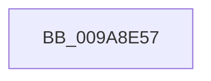

# sub_009A8E57

- RVA: `0x009A8E57`–`0x009A8E8D` (길이 `54` bytes)
- VA: `0x00000001409A8E57`
- 실행 섹션: `PAGE`
- PDB 이름 있음: `아니요`; PDB Function 태그: `아니요`
- unwind 정보 RVA: `0x0009D1E0`
- 디코드: `10`개 명령, `54/54` bytes 표시
- 미해석 바이트: `0` (있으면 어셈블리에 `.byte`로 보존)

> 이 문서는 커널 이미지의 기계어와 PDB 기호를 분석해 생성했습니다. 4번과 5번은 함수 원형과 자료형을 바이너리 사용 방식에서 추정한 C 해석이며 원본 소스 복구 결과는 아닙니다.

## 1. Dependencies

- 직접 호출 지점: **3**; 고유 호출 대상: **3**
- 직접 호출자로 확인된 함수: **0**
- RIP 상대 이미지 참조: **0**

### Outgoing calls
- `0x009A8E5F` → [memcpy](../../text/6C/memcpy_function_006C6840.md) (function, `0x006C6840`)
- `0x009A8E68` → [ExReleaseResourceLite](../../text/25/ExReleaseResourceLite_function_0025FA10.md) (function, `0x0025FA10`)
- `0x009A8E76` → [KeLeaveCriticalRegionThread](../../text/25/KeLeaveCriticalRegionThread_function_0025EFF0.md) (function, `0x0025EFF0`)

### Direct callers
- 이 함수 시작 RVA로 연결되는 직접 call은 확인되지 않았습니다. 간접 호출은 완전히 역산할 수 없습니다.

### Static image references
- 디코드된 RIP-relative 메모리 참조가 없습니다.

## 2. Other-region calls and transfers

- 다른 실행 섹션으로 향하는 call: **3**
  - `0x009A8E5F` → [memcpy](../../text/6C/memcpy_function_006C6840.md) (`PAGE` → `.text`)
  - `0x009A8E68` → [ExReleaseResourceLite](../../text/25/ExReleaseResourceLite_function_0025FA10.md) (`PAGE` → `.text`)
  - `0x009A8E76` → [KeLeaveCriticalRegionThread](../../text/25/KeLeaveCriticalRegionThread_function_0025EFF0.md) (`PAGE` → `.text`)
- call이 아닌 외부 분기/꼬리 이동: **1**
  - `0x009A8E87` → [sub_009A8FBC](Unknown_function_009A8FBC.md) (`tail-transfer`)

## 3. Assembly (complete function range)

```asm
009A8E57  44 8B C5                        mov r8d, ebp
009A8E5A  48 8D 4C 24 20                  lea rcx, [rsp + 0x20]
009A8E5F  E8 DC D9 D1 FF                  call 0x1406c6840
009A8E64  48 8B 4F 30                     mov rcx, qword ptr [rdi + 0x30]
009A8E68  E8 A3 6B 8B FF                  call 0x14025fa10
009A8E6D  65 48 8B 0C 25 88 01 00 00      mov rcx, qword ptr gs:[0x188]
009A8E76  E8 75 61 8B FF                  call 0x14025eff0
009A8E7B  41 83 FE 01                     cmp r14d, 1
009A8E7F  4C 8B B4 24 B8 00 00 00         mov r14, qword ptr [rsp + 0xb8]
009A8E87  0F 85 2F 01 00 00               jne 0x1409a8fbc
```

## 4. C-style interpretation (structured pseudocode)

```c
__int64 __fastcall sub_009A8E57(__int64 a1, __int64 a2, __int64 a3, __int64 a4, __int64 a5, __int64 a6, __int64 a7, __int64 a8, __int64 a9, __int64 a10, __int64 a11, __int64 a12, __int64 a13, __int64 a14, __int64 a15, __int64 a16, __int64 a17, __int64 a18, __int64 a19, __int64 a20, __int64 a21, __int64 a22, __int64 a23)
{
    __int64 result;
    unsigned __int64 v_stack_p20;

    result = memcpy(v_stack_p20, a2, (unsigned int)((unsigned int)(v_rbp)), a4);
    result = ExReleaseResourceLite(*(unsigned __int64 *)(v_rdi + 48), a2, (unsigned int)((unsigned int)(v_rbp)), a4);
    result = KeLeaveCriticalRegionThread(*(unsigned __int64 *)(gs_base + (0 + 392)), a2, (unsigned int)((unsigned int)(v_rbp)), a4);
}
```

## 5. (Beta) C Style

```c
int64_t sub_009A8E57(int64_t Arg1, int64_t Arg2, int64_t Arg3, int64_t Arg4, uint64_t Arg5, uint64_t Arg6, uint64_t Arg7, uint64_t Arg8, uint64_t Arg9, uint64_t Arg10, uint64_t Arg11, uint64_t Arg12, uint64_t Arg13, uint64_t Arg14, uint64_t Arg15, uint64_t Arg16, uint64_t Arg17, uint64_t Arg18, uint64_t Arg19, uint64_t Arg20, uint64_t Arg21, uint64_t Arg22, int64_t Arg23)
{
    int64_t result;
    uint64_t v_stack_p20;

    result = memcpy(v_stack_p20, Arg2, (uint32_t)((uint32_t)(local_rbp)), Arg4);
    result = ExReleaseResourceLite(*(uint64_t *)(local_rdi + 0x30), Arg2, (uint32_t)((uint32_t)(local_rbp)), Arg4);
    result = KeLeaveCriticalRegionThread(*(uint64_t *)(gs_base + (0 + 0x188)), Arg2, (uint32_t)((uint32_t)(local_rbp)), Arg4);
}
```

## 6. Execution-region graph

[열기: 2D/3D 그래프와 함수 탐색 컨트롤 패널](../../../control-panel.html?section=page&rva=0x009A8E57&view=graph)

- 2D 그래프는 위에서 아래로 흐르고, 3D 그래프는 빈 공간을 드래그해 회전합니다. Shift+드래그는 이동, 휠은 확대·축소, 함수 노드 선택은 대상 보고서 이동입니다.

### Static fallback


