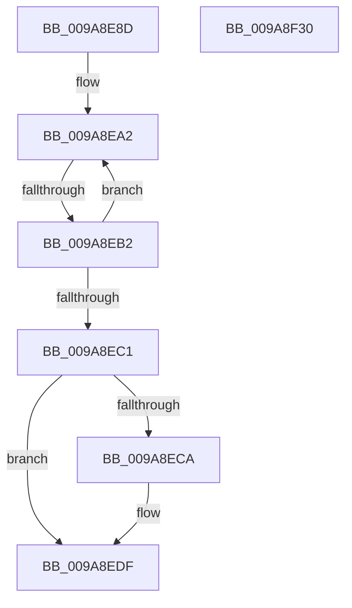

# sub_009A8E8D

- RVA: `0x009A8E8D`–`0x009A8F31` (길이 `164` bytes)
- VA: `0x00000001409A8E8D`
- 실행 섹션: `PAGE`
- PDB 이름 있음: `아니요`; PDB Function 태그: `아니요`
- unwind 정보 RVA: `0x0009D1F0`
- 디코드: `44`개 명령, `164/164` bytes 표시
- 미해석 바이트: `0` (있으면 어셈블리에 `.byte`로 보존)

> 이 문서는 커널 이미지의 기계어와 PDB 기호를 분석해 생성했습니다. 4번과 5번은 함수 원형과 자료형을 바이너리 사용 방식에서 추정한 C 해석이며 원본 소스 복구 결과는 아닙니다.

## 1. Dependencies

- 직접 호출 지점: **4**; 고유 호출 대상: **4**
- 직접 호출자로 확인된 함수: **0**
- RIP 상대 이미지 참조: **1**

### Outgoing calls
- `0x009A8EDA` → [ObpPushStackInfo](../../text/21/ObpPushStackInfo_function_002109E4.md) (function, `0x002109E4`)
- `0x009A8EFF` → [memcpy](../../text/6C/memcpy_function_006C6840.md) (function, `0x006C6840`)
- `0x009A8F10` → [memset](../../text/6C/memset_function_006C6C40.md) (function, `0x006C6C40`)
- `0x009A8F1D` → [_security_check_cookie](../../text/6A/_security_check_cookie_function_006AC640.md) (function, `0x006AC640`)

### Direct callers
- 이 함수 시작 RVA로 연결되는 직접 call은 확인되지 않았습니다. 간접 호출은 완전히 역산할 수 없습니다.

### Static image references
- `0x009A8EC1` → RVA `0x00FC5010` (`ALMOSTRO`; read)

## 2. Other-region calls and transfers

- 다른 실행 섹션으로 향하는 call: **4**
  - `0x009A8EDA` → [ObpPushStackInfo](../../text/21/ObpPushStackInfo_function_002109E4.md) (`PAGE` → `.text`)
  - `0x009A8EFF` → [memcpy](../../text/6C/memcpy_function_006C6840.md) (`PAGE` → `.text`)
  - `0x009A8F10` → [memset](../../text/6C/memset_function_006C6C40.md) (`PAGE` → `.text`)
  - `0x009A8F1D` → [_security_check_cookie](../../text/6A/_security_check_cookie_function_006AC640.md) (`PAGE` → `.text`)
- call이 아닌 외부 분기/꼬리 이동: **1**
  - `0x009A8EAC` → [sub_009A8FBC](Unknown_function_009A8FBC.md) (`tail-transfer`)

## 3. Assembly (complete function range)

```asm
009A8E8D  48 8B 93 20 02 00 00            mov rdx, qword ptr [rbx + 0x220]
009A8E94  0F 0D 8A 48 02 00 00            prefetchw byte ptr [rdx + 0x248]
009A8E9B  48 8B 82 48 02 00 00            mov rax, qword ptr [rdx + 0x248]
009A8EA2  48 8B C8                        mov rcx, rax
009A8EA5  48 33 CF                        xor rcx, rdi
009A8EA8  48 83 F9 0F                     cmp rcx, 0xf
009A8EAC  0F 83 0A 01 00 00               jae 0x1409a8fbc
009A8EB2  48 8D 48 01                     lea rcx, [rax + 1]
009A8EB6  F0 48 0F B1 8A 48 02 00 00      lock cmpxchg qword ptr [rdx + 0x248], rcx
009A8EBF  75 E1                           jne 0x1409a8ea2
009A8EC1  83 3D 48 C1 61 00 00            cmp dword ptr [rip + 0x61c148], 0
009A8EC8  74 15                           je 0x1409a8edf
009A8ECA  33 D2                           xor edx, edx
009A8ECC  48 8D 4F D0                     lea rcx, [rdi - 0x30]
009A8ED0  41 B9 53 68 72 74               mov r9d, 0x74726853
009A8ED6  44 8D 42 01                     lea r8d, [rdx + 1]
009A8EDA  E8 05 7B 86 FF                  call 0x1402109e4
009A8EDF  8D 7D 08                        lea edi, [rbp + 8]
009A8EE2  44 8B C5                        mov r8d, ebp
009A8EE5  8D 5F 07                        lea ebx, [rdi + 7]
009A8EE8  44 89 66 02                     mov dword ptr [rsi + 2], r12d
009A8EEC  83 E3 F8                        and ebx, 0xfffffff8
009A8EEF  66 89 6E 06                     mov word ptr [rsi + 6], bp
009A8EF3  48 8D 4E 08                     lea rcx, [rsi + 8]
009A8EF7  66 89 1E                        mov word ptr [rsi], bx
009A8EFA  48 8D 54 24 20                  lea rdx, [rsp + 0x20]
009A8EFF  E8 3C D9 D1 FF                  call 0x1406c6840
009A8F04  2B DF                           sub ebx, edi
009A8F06  8B CF                           mov ecx, edi
009A8F08  48 03 CE                        add rcx, rsi
009A8F0B  44 8B C3                        mov r8d, ebx
009A8F0E  33 D2                           xor edx, edx
009A8F10  E8 2B DD D1 FF                  call 0x1406c6c40
009A8F15  48 8B 4C 24 70                  mov rcx, qword ptr [rsp + 0x70]
009A8F1A  48 33 CC                        xor rcx, rsp
009A8F1D  E8 1E 37 D0 FF                  call 0x1406ac640
009A8F22  48 81 C4 80 00 00 00            add rsp, 0x80
009A8F29  41 5C                           pop r12
009A8F2B  5F                              pop rdi
009A8F2C  5E                              pop rsi
009A8F2D  5D                              pop rbp
009A8F2E  5B                              pop rbx
009A8F2F  C3                              ret
009A8F30  CC                              int3
```

## 4. C-style interpretation (structured pseudocode)

```c
__int64 __fastcall sub_009A8E8D(__int64 a1, __int64 a2, __int64 a3, __int64 a4, __int64 a5, __int64 a6, __int64 a7, __int64 a8, __int64 a9, __int64 a10, __int64 a11, __int64 a12, __int64 a13, __int64 a14)
{
    __int64 result;
    __int64 v_rbx;
    __int64 v_rsp;
    unsigned __int64 v_stack_p20;

loc_009A8EA2:
    a1 = (*(unsigned __int64 *)(*(unsigned __int64 *)(v_rbx + 544) + 584)) ^ (v_rdi);
    if (a1 != 15) goto loc_009A8EA2;
    result = *(unsigned __int64 *)(*(unsigned __int64 *)(v_rbx + 544) + 584);
    if ((*(unsigned int *)(v_rip + 6406472)) != 0) {
        a2 = 0;
        a1 = v_rdi - 48;
        a4 = 0x74726853ULL;
        a3 = a2 + 1;
        result = ObpPushStackInfo(a1, a2, a3, a4);
    }
    *(unsigned int *)(v_rsi + 2) = (unsigned int)(v_r12);
    v_rbx = (unsigned int)((v_rbp + 8 + 7) & (0xFFFFFFF8ULL));
    *(unsigned __int16 *)(v_rsi + 6) = (unsigned __int16)(v_rbp);
    *(unsigned __int16 *)(v_rsi) = (unsigned __int16)(v_rbx);
    result = memcpy(v_rsi + 8, v_stack_p20, (unsigned int)((unsigned int)(v_rbp)), a4);
    v_rbx = (unsigned int)((v_rbx) - ((unsigned int)(v_rbp + 8)));
    a1 = ((unsigned int)((unsigned int)(v_rbp + 8))) + (v_rsi);
    a2 = 0;
    result = memset(a1, a2, (unsigned int)((unsigned int)(v_rbx)), a4);
    a1 = (a14) ^ (v_rsp);
    result = _security_check_cookie(a1, a2, (unsigned int)((unsigned int)(v_rbx)), a4);
    v_rsp = (v_rsp) + (128);
    return result;
}
```

## 5. (Beta) C Style

```c
int64_t sub_009A8E8D(int64_t Arg1, int64_t Arg2, int64_t Arg3, int64_t Arg4, uint64_t Arg5, uint64_t Arg6, uint64_t Arg7, uint64_t Arg8, uint64_t Arg9, uint64_t Arg10, uint64_t Arg11, uint64_t Arg12, uint64_t Arg13, int64_t Arg14)
{
    int64_t result;
    int64_t local_rbx;
    int64_t local_rsp;
    uint64_t v_stack_p20;

loc_009A8EA2:
    Arg1 = (*(uint64_t *)(*(uint64_t *)(local_rbx + 0x220) + 0x248)) ^ (local_rdi);
    if (Arg1 != 15) goto loc_009A8EA2;
    result = *(uint64_t *)(*(uint64_t *)(local_rbx + 0x220) + 0x248);
    if ((*(uint32_t *)(v_rip + 0x61C148)) != 0) {
        Arg2 = 0;
        Arg1 = local_rdi - 48;
        Arg4 = 0x74726853ULL;
        Arg3 = Arg2 + 1;
        result = ObpPushStackInfo(Arg1, Arg2, Arg3, Arg4);
    }
    *(uint32_t *)(local_rsi + 0x2) = (uint32_t)(local_r12);
    local_rbx = (uint32_t)((local_rbp + 8 + 7) & (0xFFFFFFF8ULL));
    *(uint16_t *)(local_rsi + 0x6) = (uint16_t)(local_rbp);
    *(uint16_t *)(local_rsi) = (uint16_t)(local_rbx);
    result = memcpy(local_rsi + 8, v_stack_p20, (uint32_t)((uint32_t)(local_rbp)), Arg4);
    local_rbx = (uint32_t)((local_rbx) - ((uint32_t)(local_rbp + 8)));
    Arg1 = ((uint32_t)((uint32_t)(local_rbp + 8))) + (local_rsi);
    Arg2 = 0;
    result = memset(Arg1, Arg2, (uint32_t)((uint32_t)(local_rbx)), Arg4);
    Arg1 = (Arg14) ^ (local_rsp);
    result = _security_check_cookie(Arg1, Arg2, (uint32_t)((uint32_t)(local_rbx)), Arg4);
    local_rsp = (local_rsp) + (128);
    return result;
}
```

## 6. Execution-region graph

[열기: 2D/3D 그래프와 함수 탐색 컨트롤 패널](../../../control-panel.html?section=page&rva=0x009A8E8D&view=graph)

- 2D 그래프는 위에서 아래로 흐르고, 3D 그래프는 빈 공간을 드래그해 회전합니다. Shift+드래그는 이동, 휠은 확대·축소, 함수 노드 선택은 대상 보고서 이동입니다.

### Static fallback


