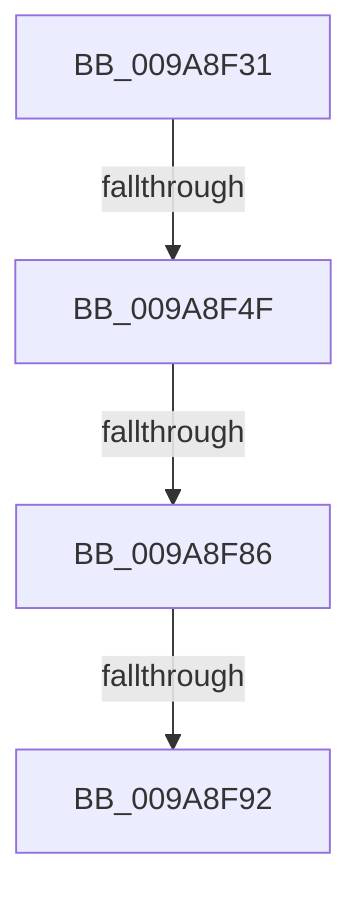

# sub_009A8F31

- RVA: `0x009A8F31`–`0x009A8FB0` (길이 `127` bytes)
- VA: `0x00000001409A8F31`
- 실행 섹션: `PAGE`
- PDB 이름 있음: `아니요`; PDB Function 태그: `아니요`
- unwind 정보 RVA: `0x0009D204`
- 디코드: `28`개 명령, `127/127` bytes 표시
- 미해석 바이트: `0` (있으면 어셈블리에 `.byte`로 보존)

> 이 문서는 커널 이미지의 기계어와 PDB 기호를 분석해 생성했습니다. 4번과 5번은 함수 원형과 자료형을 바이너리 사용 방식에서 추정한 C 해석이며 원본 소스 복구 결과는 아닙니다.

## 1. Dependencies

- 직접 호출 지점: **4**; 고유 호출 대상: **4**
- 직접 호출자로 확인된 함수: **0**
- RIP 상대 이미지 참조: **0**

### Outgoing calls
- `0x009A8F40` → [PspLockThreadSecurityShared](../../text/3C/PspLockThreadSecurityShared_function_003C4720.md) (function, `0x003C4720`)
- `0x009A8F62` → [ObfReferenceObjectWithTag](../../text/21/ObfReferenceObjectWithTag_function_00210710.md) (function, `0x00210710`)
- `0x009A8F78` → [PspUnlockThreadSecurityShared](../../text/3C/PspUnlockThreadSecurityShared_function_003C2E40.md) (function, `0x003C2E40`)
- `0x009A8F9A` → [ObfDereferenceObjectWithTag](../../text/2F/ObfDereferenceObjectWithTag_function_002F78E0.md) (function, `0x002F78E0`)

### Direct callers
- 이 함수 시작 RVA로 연결되는 직접 call은 확인되지 않았습니다. 간접 호출은 완전히 역산할 수 없습니다.

### Static image references
- 디코드된 RIP-relative 메모리 참조가 없습니다.

## 2. Other-region calls and transfers

- 다른 실행 섹션으로 향하는 call: **4**
  - `0x009A8F40` → [PspLockThreadSecurityShared](../../text/3C/PspLockThreadSecurityShared_function_003C4720.md) (`PAGE` → `.text`)
  - `0x009A8F62` → [ObfReferenceObjectWithTag](../../text/21/ObfReferenceObjectWithTag_function_00210710.md) (`PAGE` → `.text`)
  - `0x009A8F78` → [PspUnlockThreadSecurityShared](../../text/3C/PspUnlockThreadSecurityShared_function_003C2E40.md) (`PAGE` → `.text`)
  - `0x009A8F9A` → [ObfDereferenceObjectWithTag](../../text/2F/ObfDereferenceObjectWithTag_function_002F78E0.md) (`PAGE` → `.text`)
- call이 아닌 외부 분기/꼬리 이동: **4**
  - `0x009A8F4D` → [sub_009A8FCE](Unknown_function_009A8FCE.md) (`tail-transfer`)
  - `0x009A8F80` → [sub_009A8DF3 + 0x10](Unknown_function_009A8DF3.md) (`tail-transfer`)
  - `0x009A8F8C` → [sub_009A8DF3 + 0x26](Unknown_function_009A8DF3.md) (`tail-transfer`)
  - `0x009A8FAB` → [sub_009A8DF3 + 0x18](Unknown_function_009A8DF3.md) (`tail-transfer`)

## 3. Assembly (complete function range)

```asm
009A8F31  65 4C 8B 34 25 88 01 00 00      mov r14, qword ptr gs:[0x188]
009A8F3A  48 8B CB                        mov rcx, rbx
009A8F3D  49 8B D6                        mov rdx, r14
009A8F40  E8 DB B7 A1 FF                  call 0x1403c4720
009A8F45  8B 83 A0 05 00 00               mov eax, dword ptr [rbx + 0x5a0]
009A8F4B  A8 08                           test al, 8
009A8F4D  74 7F                           je 0x1409a8fce
009A8F4F  48 8B BB 38 05 00 00            mov rdi, qword ptr [rbx + 0x538]
009A8F56  BA 53 68 72 74                  mov edx, 0x74726853
009A8F5B  48 83 E7 F8                     and rdi, 0xfffffffffffffff8
009A8F5F  48 8B CF                        mov rcx, rdi
009A8F62  E8 A9 77 86 FF                  call 0x140210710
009A8F67  44 8B BB 38 05 00 00            mov r15d, dword ptr [rbx + 0x538]
009A8F6E  49 8B D6                        mov rdx, r14
009A8F71  48 8B CB                        mov rcx, rbx
009A8F74  41 83 E7 03                     and r15d, 3
009A8F78  E8 C3 9E A1 FF                  call 0x1403c2e40
009A8F7D  48 85 FF                        test rdi, rdi
009A8F80  0F 84 7D FE FF FF               je 0x1409a8e03
009A8F86  45 8B F4                        mov r14d, r12d
009A8F89  45 3B FC                        cmp r15d, r12d
009A8F8C  0F 83 87 FE FF FF               jae 0x1409a8e19
009A8F92  BA 44 66 6C 74                  mov edx, 0x746c6644
009A8F97  48 8B CF                        mov rcx, rdi
009A8F9A  E8 41 E9 94 FF                  call 0x1402f78e0
009A8F9F  48 8B 8B 20 02 00 00            mov rcx, qword ptr [rbx + 0x220]
009A8FA6  BA 44 66 6C 74                  mov edx, 0x746c6644
009A8FAB  E9 5B FE FF FF                  jmp 0x1409a8e0b
```

## 4. C-style interpretation (structured pseudocode)

```c
__int64 __fastcall sub_009A8F31(void)
{
    __int64 result;
    __int64 v_r15;
    __int64 v_rdi;

    result = PspLockThreadSecurityShared(v_rbx, *(unsigned __int64 *)(gs_base + (0 + 392)), a3, a4);
    v_rdi = (*(unsigned __int64 *)(v_rbx + 1336)) & (-8);
    result = ObfReferenceObjectWithTag(v_rdi, (unsigned int)(0x74726853ULL), a3, a4);
    v_r15 = (unsigned int)(((unsigned int)(*(unsigned int *)(v_rbx + 1336))) & (3));
    result = PspUnlockThreadSecurityShared(v_rbx, *(unsigned __int64 *)(gs_base + (0 + 392)), a3, a4);
    result = ObfDereferenceObjectWithTag(v_rdi, (unsigned int)(0x746C6644ULL), a3, a4);
}
```

## 5. (Beta) C Style

```c
void sub_009A8F31(void)
{
    int64_t result;
    int64_t local_r15;
    int64_t local_rdi;

    result = PspLockThreadSecurityShared(local_rbx, *(uint64_t *)(gs_base + (0 + 0x188)), a3, a4);
    local_rdi = (*(uint64_t *)(local_rbx + 0x538)) & (-8);
    result = ObfReferenceObjectWithTag(local_rdi, (uint32_t)(0x74726853ULL), a3, a4);
    local_r15 = (uint32_t)(((uint32_t)(*(uint32_t *)(local_rbx + 0x538))) & (3));
    result = PspUnlockThreadSecurityShared(local_rbx, *(uint64_t *)(gs_base + (0 + 0x188)), a3, a4);
    result = ObfDereferenceObjectWithTag(local_rdi, (uint32_t)(0x746C6644ULL), a3, a4);
}
```

## 6. Execution-region graph

[열기: 2D/3D 그래프와 함수 탐색 컨트롤 패널](../../../control-panel.html?section=page&rva=0x009A8F31&view=graph)

- 2D 그래프는 위에서 아래로 흐르고, 3D 그래프는 빈 공간을 드래그해 회전합니다. Shift+드래그는 이동, 휠은 확대·축소, 함수 노드 선택은 대상 보고서 이동입니다.

### Static fallback


