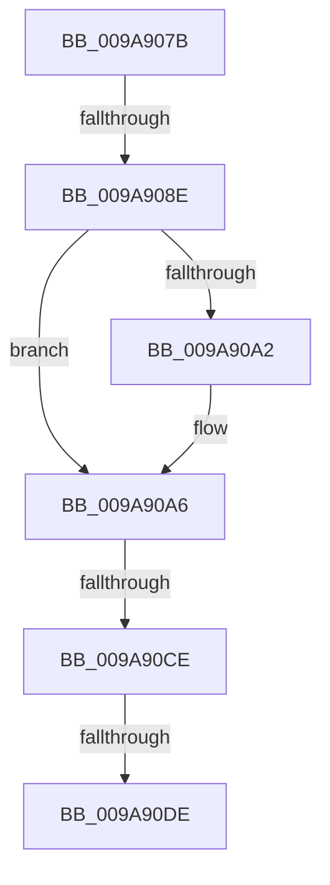

# sub_009A907B

- RVA: `0x009A907B`–`0x009A90F3` (길이 `120` bytes)
- VA: `0x00000001409A907B`
- 실행 섹션: `PAGE`
- PDB 이름 있음: `아니요`; PDB Function 태그: `아니요`
- unwind 정보 RVA: `0x0009D2B8`
- 디코드: `31`개 명령, `120/120` bytes 표시
- 미해석 바이트: `0` (있으면 어셈블리에 `.byte`로 보존)

> 이 문서는 커널 이미지의 기계어와 PDB 기호를 분석해 생성했습니다. 4번과 5번은 함수 원형과 자료형을 바이너리 사용 방식에서 추정한 C 해석이며 원본 소스 복구 결과는 아닙니다.

## 1. Dependencies

- 직접 호출 지점: **2**; 고유 호출 대상: **2**
- 직접 호출자로 확인된 함수: **0**
- RIP 상대 이미지 참조: **0**

### Outgoing calls
- `0x009A90BB` → [SepFilterCheck](../../text/30/SepFilterCheck_function_00301B60.md) (function, `0x00301B60`)
- `0x009A90D1` → [SeGetTrustLabelAce](../../text/3F/SeGetTrustLabelAce_function_003FDB20.md) (function, `0x003FDB20`)

### Direct callers
- 이 함수 시작 RVA로 연결되는 직접 call은 확인되지 않았습니다. 간접 호출은 완전히 역산할 수 없습니다.

### Static image references
- 디코드된 RIP-relative 메모리 참조가 없습니다.

## 2. Other-region calls and transfers

- 다른 실행 섹션으로 향하는 call: **2**
  - `0x009A90BB` → [SepFilterCheck](../../text/30/SepFilterCheck_function_00301B60.md) (`PAGE` → `.text`)
  - `0x009A90D1` → [SeGetTrustLabelAce](../../text/3F/SeGetTrustLabelAce_function_003FDB20.md) (`PAGE` → `.text`)
- call이 아닌 외부 분기/꼬리 이동: **4**
  - `0x009A9088` → [sub_009A9159](Unknown_function_009A9159.md) (`tail-transfer`)
  - `0x009A90C8` → [sub_009A9159 + 0x1F](Unknown_function_009A9159.md) (`tail-transfer`)
  - `0x009A90DC` → [sub_009A911A](Unknown_function_009A911A.md) (`tail-transfer`)
  - `0x009A90F1` → [sub_009A9101](Unknown_function_009A9101.md) (`tail-transfer`)

## 3. Assembly (complete function range)

```asm
009A907B  4C 89 64 24 70                  mov qword ptr [rsp + 0x70], r12
009A9080  4C 89 7C 24 30                  mov qword ptr [rsp + 0x30], r15
009A9085  83 F8 01                        cmp eax, 1
009A9088  0F 85 CB 00 00 00               jne 0x1409a9159
009A908E  BB 89 00 12 01                  mov ebx, 0x1120089
009A9093  41 BF 16 01 1F 01               mov r15d, 0x11f0116
009A9099  4D 8B 40 20                     mov r8, qword ptr [r8 + 0x20]
009A909D  4D 85 C0                        test r8, r8
009A90A0  75 04                           jne 0x1409a90a6
009A90A2  4C 8B 47 30                     mov r8, qword ptr [rdi + 0x30]
009A90A6  48 8D 84 24 88 00 00 00         lea rax, [rsp + 0x88]
009A90AE  41 B1 01                        mov r9b, 1
009A90B1  33 D2                           xor edx, edx
009A90B3  48 89 44 24 20                  mov qword ptr [rsp + 0x20], rax
009A90B8  49 8B CE                        mov rcx, r14
009A90BB  E8 A0 8A 95 FF                  call 0x140301b60
009A90C0  80 BC 24 8C 00 00 00 00         cmp byte ptr [rsp + 0x8c], 0
009A90C8  0F 85 AA 00 00 00               jne 0x1409a9178
009A90CE  49 8B CE                        mov rcx, r14
009A90D1  E8 4A 4A A5 FF                  call 0x1403fdb20
009A90D6  4C 8B F0                        mov r14, rax
009A90D9  48 85 C0                        test rax, rax
009A90DC  75 3C                           jne 0x1409a911a
009A90DE  4C 8B 64 24 70                  mov r12, qword ptr [rsp + 0x70]
009A90E3  8B C5                           mov eax, ebp
009A90E5  23 C6                           and eax, esi
009A90E7  F7 D0                           not eax
009A90E9  23 D8                           and ebx, eax
009A90EB  44 23 F8                        and r15d, eax
009A90EE  83 FE FF                        cmp esi, -1
009A90F1  75 0E                           jne 0x1409a9101
```

## 4. C-style interpretation (structured pseudocode)

```c
__int64 __fastcall sub_009A907B(__int64 a1, int a2, __int64 a3, __int64 a4, __int64 a5, __int64 a6, __int64 a7, __int64 a8, __int64 a9, __int64 a10, __int64 a11, __int64 a12, __int64 a13, __int64 a14, __int64 a15, __int64 a16, __int64 a17)
{
    __int64 result;
    __int64 v_r15;
    __int64 v_rbx;
    unsigned __int64 v_stack_p20;
    unsigned __int64 v_stack_p30;
    unsigned __int64 v_stack_p70;
    unsigned __int8 v_stack_p8C;

    v_stack_p70 = v_r12;
    v_stack_p30 = v_r15;
    if (*(unsigned __int64 *)(a3 + 32) == 0) {
        a3 = *(unsigned __int64 *)(v_rdi + 48);
    }
    a2 = 0;
    v_stack_p20 = a17;
    result = SepFilterCheck(v_r14, a2, a3, 1);
    result = SeGetTrustLabelAce(v_r14, a2, a3, 1);
    result = (unsigned int)(((unsigned int)((unsigned int)(v_rbp))) & ((unsigned int)(v_rsi)));
    result = (unsigned int)(~(result));
    v_rbx = (unsigned int)(((unsigned int)(0x1120089ULL)) & ((unsigned int)(result)));
    v_r15 = (unsigned int)(((unsigned int)(0x11F0116ULL)) & ((unsigned int)(result)));
}
```

## 5. (Beta) C Style

```c
int64_t sub_009A907B(int64_t Arg1, int32_t Arg2, void *Arg3, int64_t Arg4, uint64_t Arg5, uint64_t Arg6, uint64_t Arg7, uint64_t Arg8, uint64_t Arg9, uint64_t Arg10, uint64_t Arg11, uint64_t Arg12, uint64_t Arg13, int64_t Arg14, uint64_t Arg15, uint64_t Arg16, int64_t Arg17)
{
    uint8_t *arg3 = (uint8_t *)Arg3;

    int64_t result;
    int64_t local_r15;
    int64_t local_rbx;
    uint64_t v_stack_p20;
    uint64_t v_stack_p30;
    uint64_t v_stack_p70;
    uint8_t v_stack_p8C;

    v_stack_p70 = local_r12;
    v_stack_p30 = local_r15;
    if (*(uint64_t *)(arg3 + 0x20) == 0) {
        Arg3 = *(uint64_t *)(local_rdi + 0x30);
    }
    Arg2 = 0;
    v_stack_p20 = Arg17;
    result = SepFilterCheck(local_r14, Arg2, Arg3, 1);
    result = SeGetTrustLabelAce(local_r14, Arg2, Arg3, 1);
    result = (uint32_t)(((uint32_t)((uint32_t)(local_rbp))) & ((uint32_t)(local_rsi)));
    result = (uint32_t)(~(result));
    local_rbx = (uint32_t)(((uint32_t)(0x1120089ULL)) & ((uint32_t)(result)));
    local_r15 = (uint32_t)(((uint32_t)(0x11F0116ULL)) & ((uint32_t)(result)));
}
```

### 관측된 메모리 오프셋

구조체 형식이 확인되지 않은 접근은 인자 기준의 오프셋으로만 기록했습니다.

| 기준 인자 | 오프셋 표현 | 폭 (bit) | 접근 |
|---|---:|---:|---|
| `Arg3` | `+ 0x20` | `64` | `R` |

## 6. Execution-region graph

[열기: 2D/3D 그래프와 함수 탐색 컨트롤 패널](../../../control-panel.html?section=page&rva=0x009A907B&view=graph)

- 2D 그래프는 위에서 아래로 흐르고, 3D 그래프는 빈 공간을 드래그해 회전합니다. Shift+드래그는 이동, 휠은 확대·축소, 함수 노드 선택은 대상 보고서 이동입니다.

### Static fallback


