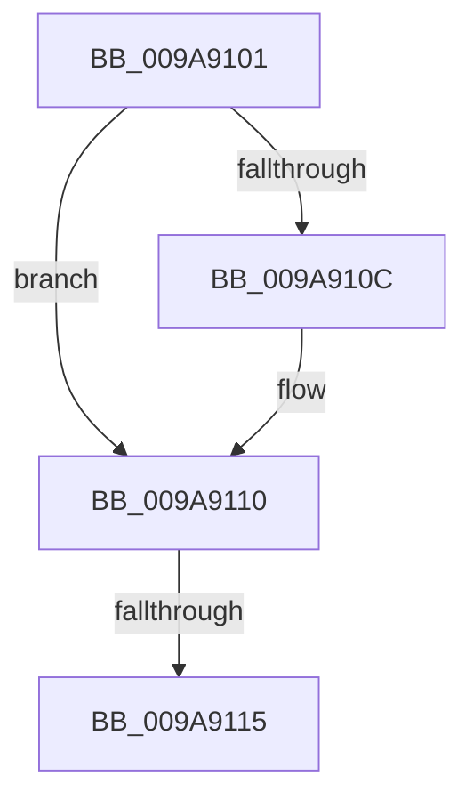

# sub_009A9101

- RVA: `0x009A9101`–`0x009A911A` (길이 `25` bytes)
- VA: `0x00000001409A9101`
- 실행 섹션: `PAGE`
- PDB 이름 있음: `아니요`; PDB Function 태그: `아니요`
- unwind 정보 RVA: `0x0009D2E4`
- 디코드: `10`개 명령, `25/25` bytes 표시
- 미해석 바이트: `0` (있으면 어셈블리에 `.byte`로 보존)

> 이 문서는 커널 이미지의 기계어와 PDB 기호를 분석해 생성했습니다. 4번과 5번은 함수 원형과 자료형을 바이너리 사용 방식에서 추정한 C 해석이며 원본 소스 복구 결과는 아닙니다.

## 1. Dependencies

- 직접 호출 지점: **0**; 고유 호출 대상: **0**
- 직접 호출자로 확인된 함수: **0**
- RIP 상대 이미지 참조: **0**

### Outgoing calls
- 직접 디코드된 call 명령이 없습니다.

### Direct callers
- 이 함수 시작 RVA로 연결되는 직접 call은 확인되지 않았습니다. 간접 호출은 완전히 역산할 수 없습니다.

### Static image references
- 디코드된 RIP-relative 메모리 참조가 없습니다.

## 2. Other-region calls and transfers

- 다른 실행 섹션으로 향하는 call: **0**
- call이 아닌 외부 분기/꼬리 이동: **2**
  - `0x009A9113` → [sub_009A9184](Unknown_function_009A9184.md) (`tail-transfer`)
  - `0x009A9118` → [sub_009A90F3 + 0x4](Unknown_function_009A90F3.md) (`tail-transfer`)

## 3. Assembly (complete function range)

```asm
009A9101  8B 4F 0C                        mov ecx, dword ptr [rdi + 0xc]
009A9104  8B 47 14                        mov eax, dword ptr [rdi + 0x14]
009A9107  F6 C1 02                        test cl, 2
009A910A  74 04                           je 0x1409a9110
009A910C  F7 D3                           not ebx
009A910E  23 C3                           and eax, ebx
009A9110  F6 C1 04                        test cl, 4
009A9113  75 6F                           jne 0x1409a9184
009A9115  89 47 14                        mov dword ptr [rdi + 0x14], eax
009A9118  EB DD                           jmp 0x1409a90f7
```

## 4. C-style interpretation (structured pseudocode)

```c
__int64 __fastcall sub_009A9101(void)
{
    __int64 result;
    __int64 v_rbx;

    result = (unsigned int)(*(unsigned int *)(v_rdi + 20));
    if ((((unsigned __int8)((unsigned int)(*(unsigned int *)(v_rdi + 12)))) & (2)) != 0) {
        v_rbx = (unsigned int)(~(v_rbx));
        result = (unsigned int)(((unsigned int)(*(unsigned int *)(v_rdi + 20))) & ((unsigned int)(v_rbx)));
    }
    *(unsigned int *)(v_rdi + 20) = (unsigned int)(result);
}
```

## 5. (Beta) C Style

```c
void sub_009A9101(void)
{
    int64_t result;
    int64_t local_rbx;

    result = (uint32_t)(*(uint32_t *)(local_rdi + 0x14));
    if ((((uint8_t)((uint32_t)(*(uint32_t *)(local_rdi + 0xC)))) & (2)) != 0) {
        local_rbx = (uint32_t)(~(local_rbx));
        result = (uint32_t)(((uint32_t)(*(uint32_t *)(local_rdi + 0x14))) & ((uint32_t)(local_rbx)));
    }
    *(uint32_t *)(local_rdi + 0x14) = (uint32_t)(result);
}
```

## 6. Execution-region graph

[열기: 2D/3D 그래프와 함수 탐색 컨트롤 패널](../../../control-panel.html?section=page&rva=0x009A9101&view=graph)

- 2D 그래프는 위에서 아래로 흐르고, 3D 그래프는 빈 공간을 드래그해 회전합니다. Shift+드래그는 이동, 휠은 확대·축소, 함수 노드 선택은 대상 보고서 이동입니다.

### Static fallback


