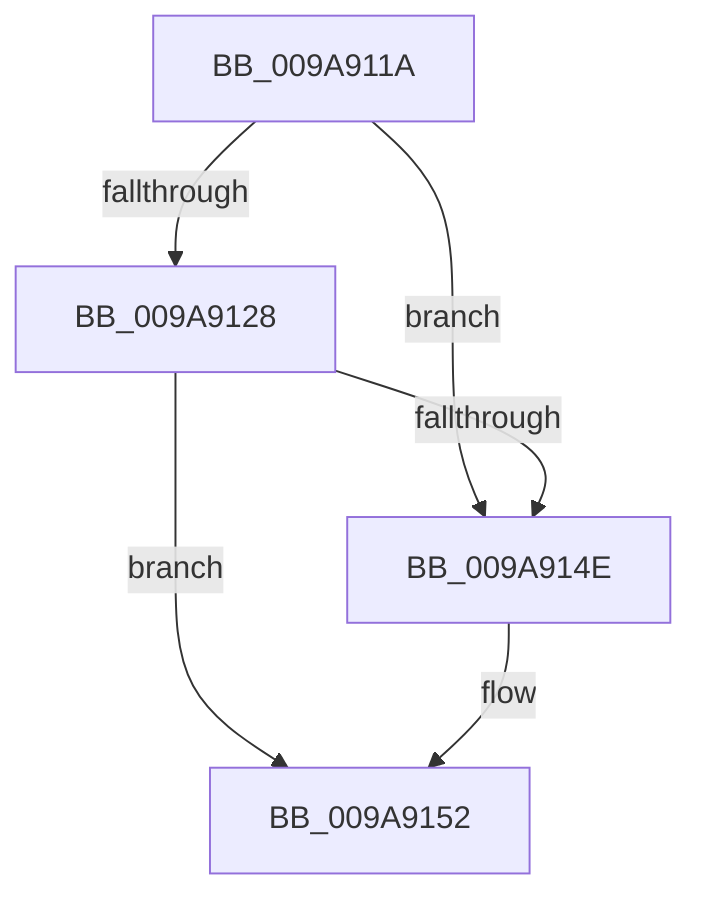

# sub_009A911A

- RVA: `0x009A911A`–`0x009A9159` (길이 `63` bytes)
- VA: `0x00000001409A911A`
- 실행 섹션: `PAGE`
- PDB 이름 있음: `아니요`; PDB Function 태그: `아니요`
- unwind 정보 RVA: `0x0009D2F8`
- 디코드: `15`개 명령, `63/63` bytes 표시
- 미해석 바이트: `0` (있으면 어셈블리에 `.byte`로 보존)

> 이 문서는 커널 이미지의 기계어와 PDB 기호를 분석해 생성했습니다. 4번과 5번은 함수 원형과 자료형을 바이너리 사용 방식에서 추정한 C 해석이며 원본 소스 복구 결과는 아닙니다.

## 1. Dependencies

- 직접 호출 지점: **2**; 고유 호출 대상: **2**
- 직접 호출자로 확인된 함수: **0**
- RIP 상대 이미지 참조: **0**

### Outgoing calls
- `0x009A912C` → [SepLocateTokenTrustLevel](../../text/3E/SepLocateTokenTrustLevel_function_003EDA40.md) (function, `0x003EDA40`)
- `0x009A913F` → [RtlSidDominatesForTrust](../../text/3E/RtlSidDominatesForTrust_function_003EDFE0.md) (function, `0x003EDFE0`)

### Direct callers
- 이 함수 시작 RVA로 연결되는 직접 call은 확인되지 않았습니다. 간접 호출은 완전히 역산할 수 없습니다.

### Static image references
- 디코드된 RIP-relative 메모리 참조가 없습니다.

## 2. Other-region calls and transfers

- 다른 실행 섹션으로 향하는 call: **2**
  - `0x009A912C` → [SepLocateTokenTrustLevel](../../text/3E/SepLocateTokenTrustLevel_function_003EDA40.md) (`PAGE` → `.text`)
  - `0x009A913F` → [RtlSidDominatesForTrust](../../text/3E/RtlSidDominatesForTrust_function_003EDFE0.md) (`PAGE` → `.text`)
- call이 아닌 외부 분기/꼬리 이동: **1**
  - `0x009A9157` → [sub_009A907B + 0x63](Unknown_function_009A907B.md) (`tail-transfer`)

## 3. Assembly (complete function range)

```asm
009A911A  4C 89 6C 24 38                  mov qword ptr [rsp + 0x38], r13
009A911F  4C 8D 68 08                     lea r13, [rax + 8]
009A9123  4D 85 ED                        test r13, r13
009A9126  74 26                           je 0x1409a914e
009A9128  48 8D 4F 20                     lea rcx, [rdi + 0x20]
009A912C  E8 0F 49 A4 FF                  call 0x1403eda40
009A9131  4C 8D 84 24 80 00 00 00         lea r8, [rsp + 0x80]
009A9139  49 8B D5                        mov rdx, r13
009A913C  48 8B C8                        mov rcx, rax
009A913F  E8 9C 4E A4 FF                  call 0x1403edfe0
009A9144  80 BC 24 80 00 00 00 00         cmp byte ptr [rsp + 0x80], 0
009A914C  75 04                           jne 0x1409a9152
009A914E  41 8B 6E 04                     mov ebp, dword ptr [r14 + 4]
009A9152  4C 8B 6C 24 38                  mov r13, qword ptr [rsp + 0x38]
009A9157  EB 85                           jmp 0x1409a90de
```

## 4. C-style interpretation (structured pseudocode)

```c
__int64 __fastcall sub_009A911A(__int64 a1, __int64 a2, __int64 a3, __int64 a4, __int64 a5, __int64 a6, __int64 a7, __int64 a8, __int64 a9, __int64 a10, __int64 a11, __int64 a12, __int64 a13, __int64 a14, __int64 a15, unsigned __int8 a16)
{
    __int64 result;
    __int64 v_rbp;
    unsigned __int64 v_stack_p38;

    v_stack_p38 = v_r13;
    if (result + 8 == 0) goto loc_009A914E;
    result = SepLocateTokenTrustLevel(v_rdi + 32, a2, a3, a4);
    result = RtlSidDominatesForTrust(result, result + 8, a16, a4);
    if (a16 == 0) {
        v_rbp = *(unsigned int *)(v_r14 + 4);
    }
}
```

## 5. (Beta) C Style

```c
int64_t sub_009A911A(int64_t Arg1, int64_t Arg2, int64_t Arg3, int64_t Arg4, uint64_t Arg5, uint64_t Arg6, int64_t Arg7, uint64_t Arg8, uint64_t Arg9, uint64_t Arg10, uint64_t Arg11, uint64_t Arg12, uint64_t Arg13, uint64_t Arg14, uint64_t Arg15, uint8_t Arg16)
{
    int64_t result;
    int64_t local_rbp;
    uint64_t v_stack_p38;

    v_stack_p38 = local_r13;
    if (result + 8 == 0) goto loc_009A914E;
    result = SepLocateTokenTrustLevel(local_rdi + 32, Arg2, Arg3, Arg4);
    result = RtlSidDominatesForTrust(result, result + 8, Arg16, Arg4);
    if (Arg16 == 0) {
        local_rbp = *(uint32_t *)(local_r14 + 0x4);
    }
}
```

## 6. Execution-region graph

[열기: 2D/3D 그래프와 함수 탐색 컨트롤 패널](../../../control-panel.html?section=page&rva=0x009A911A&view=graph)

- 2D 그래프는 위에서 아래로 흐르고, 3D 그래프는 빈 공간을 드래그해 회전합니다. Shift+드래그는 이동, 휠은 확대·축소, 함수 노드 선택은 대상 보고서 이동입니다.

### Static fallback


