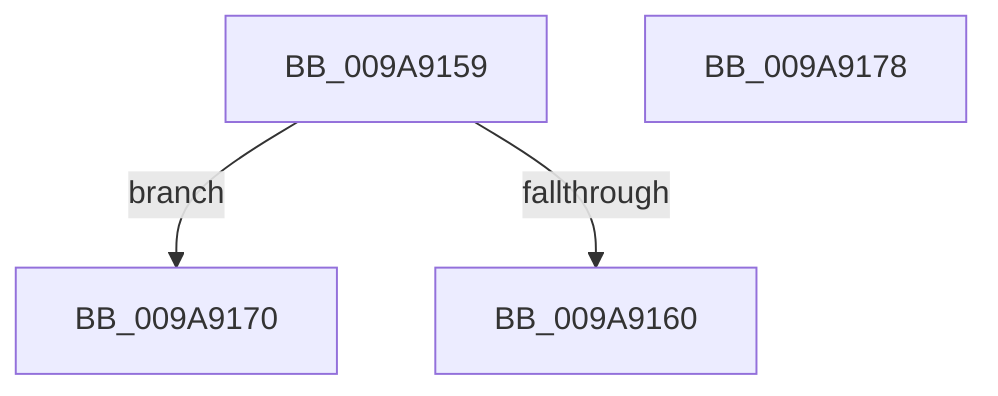

# sub_009A9159

- RVA: `0x009A9159`–`0x009A9184` (길이 `43` bytes)
- VA: `0x00000001409A9159`
- 실행 섹션: `PAGE`
- PDB 이름 있음: `아니요`; PDB Function 태그: `아니요`
- unwind 정보 RVA: `0x0009D30C`
- 디코드: `9`개 명령, `43/43` bytes 표시
- 미해석 바이트: `0` (있으면 어셈블리에 `.byte`로 보존)

> 이 문서는 커널 이미지의 기계어와 PDB 기호를 분석해 생성했습니다. 4번과 5번은 함수 원형과 자료형을 바이너리 사용 방식에서 추정한 C 해석이며 원본 소스 복구 결과는 아닙니다.

## 1. Dependencies

- 직접 호출 지점: **0**; 고유 호출 대상: **0**
- 직접 호출자로 확인된 함수: **0**
- RIP 상대 이미지 참조: **0**

### Outgoing calls
- 직접 디코드된 call 명령이 없습니다.

### Direct callers
- 이 함수 시작 RVA로 연결되는 직접 call은 확인되지 않았습니다. 간접 호출은 완전히 역산할 수 없습니다.

### Static image references
- 디코드된 RIP-relative 메모리 참조가 없습니다.

## 2. Other-region calls and transfers

- 다른 실행 섹션으로 향하는 call: **0**
- call이 아닌 외부 분기/꼬리 이동: **3**
  - `0x009A916B` → [sub_009A907B + 0x1E](Unknown_function_009A907B.md) (`tail-transfer`)
  - `0x009A9173` → [sub_009A907B + 0x1E](Unknown_function_009A907B.md) (`tail-transfer`)
  - `0x009A917F` → [sub_009A907B + 0x53](Unknown_function_009A907B.md) (`tail-transfer`)

## 3. Assembly (complete function range)

```asm
009A9159  3D 00 01 00 00                  cmp eax, 0x100
009A915E  75 10                           jne 0x1409a9170
009A9160  BB 19 00 02 01                  mov ebx, 0x1020019
009A9165  41 BF 06 00 0F 01               mov r15d, 0x10f0006
009A916B  E9 29 FF FF FF                  jmp 0x1409a9099
009A9170  44 8B FB                        mov r15d, ebx
009A9173  E9 21 FF FF FF                  jmp 0x1409a9099
009A9178  8B B4 24 88 00 00 00            mov esi, dword ptr [rsp + 0x88]
009A917F  E9 4A FF FF FF                  jmp 0x1409a90ce
```

## 4. C-style interpretation (structured pseudocode)

```c
void __fastcall sub_009A9159(void)
{
    unsigned int v_stack_p88;

    if (((unsigned int)(result)) != 256) goto loc_009A9170;
loc_009A9170:
}
```

## 5. (Beta) C Style

```c
void sub_009A9159(void)
{
    uint32_t v_stack_p88;

    if (((uint32_t)(result)) != 256) goto loc_009A9170;
loc_009A9170:
}
```

## 6. Execution-region graph

[열기: 2D/3D 그래프와 함수 탐색 컨트롤 패널](../../../control-panel.html?section=page&rva=0x009A9159&view=graph)

- 2D 그래프는 위에서 아래로 흐르고, 3D 그래프는 빈 공간을 드래그해 회전합니다. Shift+드래그는 이동, 휠은 확대·축소, 함수 노드 선택은 대상 보고서 이동입니다.

### Static fallback


