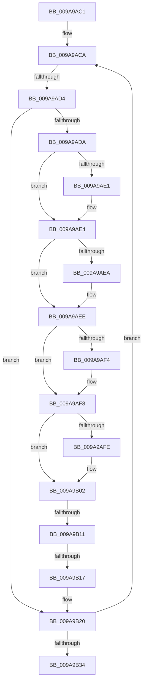

# sub_009A9AC1

- RVA: `0x009A9AC1`–`0x009A9B38` (길이 `119` bytes)
- VA: `0x00000001409A9AC1`
- 실행 섹션: `PAGE`
- PDB 이름 있음: `아니요`; PDB Function 태그: `아니요`
- unwind 정보 RVA: `0x0009D730`
- 디코드: `36`개 명령, `119/119` bytes 표시
- 미해석 바이트: `0` (있으면 어셈블리에 `.byte`로 보존)

> 이 문서는 커널 이미지의 기계어와 PDB 기호를 분석해 생성했습니다. 4번과 5번은 함수 원형과 자료형을 바이너리 사용 방식에서 추정한 C 해석이며 원본 소스 복구 결과는 아닙니다.

## 1. Dependencies

- 직접 호출 지점: **0**; 고유 호출 대상: **0**
- 직접 호출자로 확인된 함수: **0**
- RIP 상대 이미지 참조: **0**

### Outgoing calls
- 직접 디코드된 call 명령이 없습니다.

### Direct callers
- 이 함수 시작 RVA로 연결되는 직접 call은 확인되지 않았습니다. 간접 호출은 완전히 역산할 수 없습니다.

### Static image references
- 디코드된 RIP-relative 메모리 참조가 없습니다.

## 2. Other-region calls and transfers

- 다른 실행 섹션으로 향하는 call: **0**
- call이 아닌 외부 분기/꼬리 이동: **3**
  - `0x009A9AD2` → [sub_009A9B3E](Unknown_function_009A9B3E.md) (`tail-transfer`)
  - `0x009A9B0F` → [sub_009A9B3E + 0xB](Unknown_function_009A9B3E.md) (`tail-transfer`)
  - `0x009A9B15` → [sub_009A9B3E + 0xB](Unknown_function_009A9B3E.md) (`tail-transfer`)

## 3. Assembly (complete function range)

```asm
009A9AC1  48 89 1C 24                     mov qword ptr [rsp], rbx
009A9AC5  BB 73 06 00 00                  mov ebx, 0x673
009A9ACA  44 0F B6 08                     movzx r9d, byte ptr [rax]
009A9ACE  41 80 F9 0A                     cmp r9b, 0xa
009A9AD2  77 6A                           ja 0x1409a9b3e
009A9AD4  F6 40 01 08                     test byte ptr [rax + 1], 8
009A9AD8  75 46                           jne 0x1409a9b20
009A9ADA  8B 50 04                        mov edx, dword ptr [rax + 4]
009A9ADD  85 D2                           test edx, edx
009A9ADF  79 03                           jns 0x1409a9ae4
009A9AE1  41 0B 13                        or edx, dword ptr [r11]
009A9AE4  0F BA E2 1E                     bt edx, 0x1e
009A9AE8  73 04                           jae 0x1409a9aee
009A9AEA  41 0B 53 04                     or edx, dword ptr [r11 + 4]
009A9AEE  0F BA E2 1D                     bt edx, 0x1d
009A9AF2  73 04                           jae 0x1409a9af8
009A9AF4  41 0B 53 08                     or edx, dword ptr [r11 + 8]
009A9AF8  0F BA E2 1C                     bt edx, 0x1c
009A9AFC  73 04                           jae 0x1409a9b02
009A9AFE  41 0B 53 0C                     or edx, dword ptr [r11 + 0xc]
009A9B02  81 E2 FF FF FF 0F               and edx, 0xfffffff
009A9B08  89 50 04                        mov dword ptr [rax + 4], edx
009A9B0B  41 80 F9 0A                     cmp r9b, 0xa
009A9B0F  77 38                           ja 0x1409a9b49
009A9B11  44 0F A3 CB                     bt ebx, r9d
009A9B15  73 32                           jae 0x1409a9b49
009A9B17  41 8B 4B 0C                     mov ecx, dword ptr [r11 + 0xc]
009A9B1B  23 CA                           and ecx, edx
009A9B1D  89 48 04                        mov dword ptr [rax + 4], ecx
009A9B20  0F B7 48 02                     movzx ecx, word ptr [rax + 2]
009A9B24  41 FF C0                        inc r8d
009A9B27  48 03 C1                        add rax, rcx
009A9B2A  41 0F B7 4A 04                  movzx ecx, word ptr [r10 + 4]
009A9B2F  44 3B C1                        cmp r8d, ecx
009A9B32  72 96                           jb 0x1409a9aca
009A9B34  48 8B 1C 24                     mov rbx, qword ptr [rsp]
```

## 4. C-style interpretation (structured pseudocode)

```c
__int64 __fastcall sub_009A9AC1(__int64 a1, __int64 a2, int a3)
{
    __int64 result;
    unsigned __int64 v_stack_p0;

    v_stack_p0 = v_rbx;
loc_009A9ACA:
    if (((*(unsigned __int8 *)(result + 1)) & (8)) != 0) goto loc_009A9B20;
    if (sign_flag) {
        a2 = (unsigned int)(((unsigned int)(*(unsigned int *)(result + 4))) | (*(unsigned int *)(v_r11)));
    }
    if (!(condition_is_above_or_equal)) {
        a2 = (unsigned int)((a2) | (*(unsigned int *)(v_r11 + 4)));
    }
    if (!(condition_is_above_or_equal)) {
        a2 = (unsigned int)((a2) | (*(unsigned int *)(v_r11 + 8)));
    }
    if (!(condition_is_above_or_equal)) {
        a2 = (unsigned int)((a2) | (*(unsigned int *)(v_r11 + 12)));
    }
    a2 = (unsigned int)((a2) & (0xFFFFFFFULL));
    *(unsigned int *)(result + 4) = (unsigned int)(a2);
    a1 = (unsigned int)(((unsigned int)(*(unsigned int *)(v_r11 + 12))) & ((unsigned int)(a2)));
    *(unsigned int *)(result + 4) = (unsigned int)(a1);
loc_009A9B20:
    a3 = (unsigned int)((a3) + 1);
    result = (result) + (*(unsigned __int16 *)(result + 2));
    if (a3 < ((unsigned int)(*(unsigned __int16 *)(v_r10 + 4)))) goto loc_009A9ACA;
    return result;
}
```

## 5. (Beta) C Style

```c
int64_t sub_009A9AC1(int64_t Arg1, int64_t Arg2, int32_t Arg3)
{
    int64_t result;
    uint64_t v_stack_p0;

    v_stack_p0 = local_rbx;
loc_009A9ACA:
    if (((*(uint8_t *)(result + 0x1)) & (8)) != 0) goto loc_009A9B20;
    if (sign_flag) {
        Arg2 = (uint32_t)(((uint32_t)(*(uint32_t *)(result + 0x4))) | (*(uint32_t *)(local_r11)));
    }
    if (!(condition_is_above_or_equal)) {
        Arg2 = (uint32_t)((Arg2) | (*(uint32_t *)(local_r11 + 0x4)));
    }
    if (!(condition_is_above_or_equal)) {
        Arg2 = (uint32_t)((Arg2) | (*(uint32_t *)(local_r11 + 0x8)));
    }
    if (!(condition_is_above_or_equal)) {
        Arg2 = (uint32_t)((Arg2) | (*(uint32_t *)(local_r11 + 0xC)));
    }
    Arg2 = (uint32_t)((Arg2) & (0xFFFFFFFULL));
    *(uint32_t *)(result + 0x4) = (uint32_t)(Arg2);
    Arg1 = (uint32_t)(((uint32_t)(*(uint32_t *)(local_r11 + 0xC))) & ((uint32_t)(Arg2)));
    *(uint32_t *)(result + 0x4) = (uint32_t)(Arg1);
loc_009A9B20:
    Arg3 = (uint32_t)((Arg3) + 1);
    result = (result) + (*(uint16_t *)(result + 0x2));
    if (Arg3 < ((uint32_t)(*(uint16_t *)(local_r10 + 0x4)))) goto loc_009A9ACA;
    return result;
}
```

## 6. Execution-region graph

[열기: 2D/3D 그래프와 함수 탐색 컨트롤 패널](../../../control-panel.html?section=page&rva=0x009A9AC1&view=graph)

- 2D 그래프는 위에서 아래로 흐르고, 3D 그래프는 빈 공간을 드래그해 회전합니다. Shift+드래그는 이동, 휠은 확대·축소, 함수 노드 선택은 대상 보고서 이동입니다.

### Static fallback


