# sub_009A9D17

- RVA: `0x009A9D17`–`0x009AA100` (길이 `1,001` bytes)
- VA: `0x00000001409A9D17`
- 실행 섹션: `PAGE`
- PDB 이름 있음: `아니요`; PDB Function 태그: `아니요`
- unwind 정보 RVA: `0x0009D844`
- 디코드: `216`개 명령, `1,001/1,001` bytes 표시
- 미해석 바이트: `0` (있으면 어셈블리에 `.byte`로 보존)

> 이 문서는 커널 이미지의 기계어와 PDB 기호를 분석해 생성했습니다. 4번과 5번은 함수 원형과 자료형을 바이너리 사용 방식에서 추정한 C 해석이며 원본 소스 복구 결과는 아닙니다.

## 1. Dependencies

- 직접 호출 지점: **7**; 고유 호출 대상: **5**
- 직접 호출자로 확인된 함수: **0**
- RIP 상대 이미지 참조: **0**

### Outgoing calls
- `0x009A9D21` → [memset](../../text/6C/memset_function_006C6C40.md) (function, `0x006C6C40`)
- `0x009A9D43` → [KeAbPreAcquire](../../text/21/KeAbPreAcquire_function_00210230.md) (function, `0x00210230`)
- `0x009A9D68` → [ExfAcquirePushLockExclusiveEx](../../text/20/ExfAcquirePushLockExclusiveEx_function_0020FC90.md) (function, `0x0020FC90`)
- `0x009AA006` → [KeAbPreAcquire](../../text/21/KeAbPreAcquire_function_00210230.md) (function, `0x00210230`)
- `0x009AA01F` → [ExfAcquirePushLockExclusiveEx](../../text/20/ExfAcquirePushLockExclusiveEx_function_0020FC90.md) (function, `0x0020FC90`)
- `0x009AA095` → [KeAbPostRelease](../../text/2E/KeAbPostRelease_function_002E1600.md) (function, `0x002E1600`)
- `0x009AA0A3` → [KeLeaveCriticalRegionThread](../../text/25/KeLeaveCriticalRegionThread_function_0025EFF0.md) (function, `0x0025EFF0`)

### Direct callers
- 이 함수 시작 RVA로 연결되는 직접 call은 확인되지 않았습니다. 간접 호출은 완전히 역산할 수 없습니다.

### Static image references
- 디코드된 RIP-relative 메모리 참조가 없습니다.

## 2. Other-region calls and transfers

- 다른 실행 섹션으로 향하는 call: **7**
  - `0x009A9D21` → [memset](../../text/6C/memset_function_006C6C40.md) (`PAGE` → `.text`)
  - `0x009A9D43` → [KeAbPreAcquire](../../text/21/KeAbPreAcquire_function_00210230.md) (`PAGE` → `.text`)
  - `0x009A9D68` → [ExfAcquirePushLockExclusiveEx](../../text/20/ExfAcquirePushLockExclusiveEx_function_0020FC90.md) (`PAGE` → `.text`)
  - `0x009AA006` → [KeAbPreAcquire](../../text/21/KeAbPreAcquire_function_00210230.md) (`PAGE` → `.text`)
  - `0x009AA01F` → [ExfAcquirePushLockExclusiveEx](../../text/20/ExfAcquirePushLockExclusiveEx_function_0020FC90.md) (`PAGE` → `.text`)
  - `0x009AA095` → [KeAbPostRelease](../../text/2E/KeAbPostRelease_function_002E1600.md) (`PAGE` → `.text`)
  - `0x009AA0A3` → [KeLeaveCriticalRegionThread](../../text/25/KeLeaveCriticalRegionThread_function_0025EFF0.md) (`PAGE` → `.text`)
- call이 아닌 외부 분기/꼬리 이동: **4**
  - `0x009A9FC3` → [sub_009AA147 + 0xD](Unknown_function_009AA147.md) (`tail-transfer`)
  - `0x009AA081` → [sub_009AA147](Unknown_function_009AA147.md) (`tail-transfer`)
  - `0x009AA08C` → [sub_009AA147](Unknown_function_009AA147.md) (`tail-transfer`)
  - `0x009AA0FA` → [sub_009AA21F](Unknown_function_009AA21F.md) (`tail-transfer`)

## 3. Assembly (complete function range)

```asm
009A9D17  4C 89 6C 24 38                  mov qword ptr [rsp + 0x38], r13
009A9D1C  4C 89 74 24 30                  mov qword ptr [rsp + 0x30], r14
009A9D21  E8 1A CF D1 FF                  call 0x1406c6c40
009A9D26  65 48 8B 04 25 88 01 00 00      mov rax, qword ptr gs:[0x188]
009A9D2F  48 8D 8F 98 02 00 00            lea rcx, [rdi + 0x298]
009A9D36  45 33 C0                        xor r8d, r8d
009A9D39  33 D2                           xor edx, edx
009A9D3B  66 FF 88 E4 01 00 00            dec word ptr [rax + 0x1e4]
009A9D42  90                              nop
009A9D43  E8 E8 64 86 FF                  call 0x140210230
009A9D48  F0 48 0F BA AF 98 02 00 00 00   lock bts qword ptr [rdi + 0x298], 0
009A9D52  48 8B D8                        mov rbx, rax
009A9D55  73 16                           jae 0x1409a9d6d
009A9D57  4C 8D 87 98 02 00 00            lea r8, [rdi + 0x298]
009A9D5E  48 8B D0                        mov rdx, rax
009A9D61  48 8D 8F 98 02 00 00            lea rcx, [rdi + 0x298]
009A9D68  E8 23 5F 86 FF                  call 0x14020fc90
009A9D6D  48 85 DB                        test rbx, rbx
009A9D70  74 04                           je 0x1409a9d76
009A9D72  C6 43 0A 01                     mov byte ptr [rbx + 0xa], 1
009A9D76  65 48 8B 04 25 88 01 00 00      mov rax, qword ptr gs:[0x188]
009A9D7F  48 89 87 A0 02 00 00            mov qword ptr [rdi + 0x2a0], rax
009A9D86  41 83 FC 04                     cmp r12d, 4
009A9D8A  72 06                           jb 0x1409a9d92
009A9D8C  C7 06 10 00 00 00               mov dword ptr [rsi], 0x10
009A9D92  48 8D 46 04                     lea rax, [rsi + 4]
009A9D96  41 83 FC 24                     cmp r12d, 0x24
009A9D9A  72 19                           jb 0x1409a9db5
009A9D9C  0F 10 87 80 00 00 00            movups xmm0, xmmword ptr [rdi + 0x80]
009A9DA3  0F 11 00                        movups xmmword ptr [rax], xmm0
009A9DA6  0F 10 8F 90 00 00 00            movups xmm1, xmmword ptr [rdi + 0x90]
009A9DAD  0F 11 48 10                     movups xmmword ptr [rax + 0x10], xmm1
009A9DB1  48 83 C0 20                     add rax, 0x20
009A9DB5  41 83 FC 44                     cmp r12d, 0x44
009A9DB9  72 19                           jb 0x1409a9dd4
009A9DBB  0F 10 87 A0 00 00 00            movups xmm0, xmmword ptr [rdi + 0xa0]
009A9DC2  0F 11 00                        movups xmmword ptr [rax], xmm0
009A9DC5  0F 10 8F B0 00 00 00            movups xmm1, xmmword ptr [rdi + 0xb0]
009A9DCC  0F 11 48 10                     movups xmmword ptr [rax + 0x10], xmm1
009A9DD0  48 83 C0 20                     add rax, 0x20
009A9DD4  41 83 FC 64                     cmp r12d, 0x64
009A9DD8  72 19                           jb 0x1409a9df3
009A9DDA  0F 10 87 C0 00 00 00            movups xmm0, xmmword ptr [rdi + 0xc0]
009A9DE1  0F 11 00                        movups xmmword ptr [rax], xmm0
009A9DE4  0F 10 8F D0 00 00 00            movups xmm1, xmmword ptr [rdi + 0xd0]
009A9DEB  0F 11 48 10                     movups xmmword ptr [rax + 0x10], xmm1
009A9DEF  48 83 C0 20                     add rax, 0x20
009A9DF3  41 81 FC 84 00 00 00            cmp r12d, 0x84
009A9DFA  72 19                           jb 0x1409a9e15
009A9DFC  0F 10 87 E0 00 00 00            movups xmm0, xmmword ptr [rdi + 0xe0]
009A9E03  0F 11 00                        movups xmmword ptr [rax], xmm0
009A9E06  0F 10 8F F0 00 00 00            movups xmm1, xmmword ptr [rdi + 0xf0]
009A9E0D  0F 11 48 10                     movups xmmword ptr [rax + 0x10], xmm1
009A9E11  48 83 C0 20                     add rax, 0x20
009A9E15  41 81 FC A4 00 00 00            cmp r12d, 0xa4
009A9E1C  72 19                           jb 0x1409a9e37
009A9E1E  0F 10 87 00 01 00 00            movups xmm0, xmmword ptr [rdi + 0x100]
009A9E25  0F 11 00                        movups xmmword ptr [rax], xmm0
009A9E28  0F 10 8F 10 01 00 00            movups xmm1, xmmword ptr [rdi + 0x110]
009A9E2F  0F 11 48 10                     movups xmmword ptr [rax + 0x10], xmm1
009A9E33  48 83 C0 20                     add rax, 0x20
009A9E37  41 81 FC C4 00 00 00            cmp r12d, 0xc4
009A9E3E  72 19                           jb 0x1409a9e59
009A9E40  0F 10 87 20 01 00 00            movups xmm0, xmmword ptr [rdi + 0x120]
009A9E47  0F 11 00                        movups xmmword ptr [rax], xmm0
009A9E4A  0F 10 8F 30 01 00 00            movups xmm1, xmmword ptr [rdi + 0x130]
009A9E51  0F 11 48 10                     movups xmmword ptr [rax + 0x10], xmm1
009A9E55  48 83 C0 20                     add rax, 0x20
009A9E59  41 81 FC E4 00 00 00            cmp r12d, 0xe4
009A9E60  72 19                           jb 0x1409a9e7b
009A9E62  0F 10 87 40 01 00 00            movups xmm0, xmmword ptr [rdi + 0x140]
009A9E69  0F 11 00                        movups xmmword ptr [rax], xmm0
009A9E6C  0F 10 8F 50 01 00 00            movups xmm1, xmmword ptr [rdi + 0x150]
009A9E73  0F 11 48 10                     movups xmmword ptr [rax + 0x10], xmm1
009A9E77  48 83 C0 20                     add rax, 0x20
009A9E7B  41 81 FC 04 01 00 00            cmp r12d, 0x104
009A9E82  72 19                           jb 0x1409a9e9d
009A9E84  0F 10 87 60 01 00 00            movups xmm0, xmmword ptr [rdi + 0x160]
009A9E8B  0F 11 00                        movups xmmword ptr [rax], xmm0
009A9E8E  0F 10 8F 70 01 00 00            movups xmm1, xmmword ptr [rdi + 0x170]
009A9E95  0F 11 48 10                     movups xmmword ptr [rax + 0x10], xmm1
009A9E99  48 83 C0 20                     add rax, 0x20
009A9E9D  41 81 FC 24 01 00 00            cmp r12d, 0x124
009A9EA4  72 19                           jb 0x1409a9ebf
009A9EA6  0F 10 87 80 01 00 00            movups xmm0, xmmword ptr [rdi + 0x180]
009A9EAD  0F 11 00                        movups xmmword ptr [rax], xmm0
009A9EB0  0F 10 8F 90 01 00 00            movups xmm1, xmmword ptr [rdi + 0x190]
009A9EB7  0F 11 48 10                     movups xmmword ptr [rax + 0x10], xmm1
009A9EBB  48 83 C0 20                     add rax, 0x20
009A9EBF  41 81 FC 44 01 00 00            cmp r12d, 0x144
009A9EC6  72 19                           jb 0x1409a9ee1
009A9EC8  0F 10 87 A0 01 00 00            movups xmm0, xmmword ptr [rdi + 0x1a0]
009A9ECF  0F 11 00                        movups xmmword ptr [rax], xmm0
009A9ED2  0F 10 8F B0 01 00 00            movups xmm1, xmmword ptr [rdi + 0x1b0]
009A9ED9  0F 11 48 10                     movups xmmword ptr [rax + 0x10], xmm1
009A9EDD  48 83 C0 20                     add rax, 0x20
009A9EE1  41 81 FC 64 01 00 00            cmp r12d, 0x164
009A9EE8  72 19                           jb 0x1409a9f03
009A9EEA  0F 10 87 C0 01 00 00            movups xmm0, xmmword ptr [rdi + 0x1c0]
009A9EF1  0F 11 00                        movups xmmword ptr [rax], xmm0
009A9EF4  0F 10 8F D0 01 00 00            movups xmm1, xmmword ptr [rdi + 0x1d0]
009A9EFB  0F 11 48 10                     movups xmmword ptr [rax + 0x10], xmm1
009A9EFF  48 83 C0 20                     add rax, 0x20
009A9F03  41 81 FC 84 01 00 00            cmp r12d, 0x184
009A9F0A  72 19                           jb 0x1409a9f25
009A9F0C  0F 10 87 E0 01 00 00            movups xmm0, xmmword ptr [rdi + 0x1e0]
009A9F13  0F 11 00                        movups xmmword ptr [rax], xmm0
009A9F16  0F 10 8F F0 01 00 00            movups xmm1, xmmword ptr [rdi + 0x1f0]
009A9F1D  0F 11 48 10                     movups xmmword ptr [rax + 0x10], xmm1
009A9F21  48 83 C0 20                     add rax, 0x20
009A9F25  41 81 FC A4 01 00 00            cmp r12d, 0x1a4
009A9F2C  72 19                           jb 0x1409a9f47
009A9F2E  0F 10 87 00 02 00 00            movups xmm0, xmmword ptr [rdi + 0x200]
009A9F35  0F 11 00                        movups xmmword ptr [rax], xmm0
009A9F38  0F 10 8F 10 02 00 00            movups xmm1, xmmword ptr [rdi + 0x210]
009A9F3F  0F 11 48 10                     movups xmmword ptr [rax + 0x10], xmm1
009A9F43  48 83 C0 20                     add rax, 0x20
009A9F47  41 81 FC C4 01 00 00            cmp r12d, 0x1c4
009A9F4E  72 19                           jb 0x1409a9f69
009A9F50  0F 10 87 20 02 00 00            movups xmm0, xmmword ptr [rdi + 0x220]
009A9F57  0F 11 00                        movups xmmword ptr [rax], xmm0
009A9F5A  0F 10 8F 30 02 00 00            movups xmm1, xmmword ptr [rdi + 0x230]
009A9F61  0F 11 48 10                     movups xmmword ptr [rax + 0x10], xmm1
009A9F65  48 83 C0 20                     add rax, 0x20
009A9F69  41 81 FC E4 01 00 00            cmp r12d, 0x1e4
009A9F70  72 19                           jb 0x1409a9f8b
009A9F72  0F 10 87 40 02 00 00            movups xmm0, xmmword ptr [rdi + 0x240]
009A9F79  0F 11 00                        movups xmmword ptr [rax], xmm0
009A9F7C  0F 10 8F 50 02 00 00            movups xmm1, xmmword ptr [rdi + 0x250]
009A9F83  0F 11 48 10                     movups xmmword ptr [rax + 0x10], xmm1
009A9F87  48 83 C0 20                     add rax, 0x20
009A9F8B  41 81 FC 04 02 00 00            cmp r12d, 0x204
009A9F92  72 15                           jb 0x1409a9fa9
009A9F94  0F 10 87 60 02 00 00            movups xmm0, xmmword ptr [rdi + 0x260]
009A9F9B  0F 11 00                        movups xmmword ptr [rax], xmm0
009A9F9E  0F 10 8F 70 02 00 00            movups xmm1, xmmword ptr [rdi + 0x270]
009A9FA5  0F 11 48 10                     movups xmmword ptr [rax + 0x10], xmm1
009A9FA9  4C 8D 6F 38                     lea r13, [rdi + 0x38]
009A9FAD  BD 08 02 00 00                  mov ebp, 0x208
009A9FB2  49 8B 7D 00                     mov rdi, qword ptr [r13]
009A9FB6  4C 8D B6 08 02 00 00            lea r14, [rsi + 0x208]
009A9FBD  0F 1F 00                        nop dword ptr [rax]
009A9FC0  49 3B FD                        cmp rdi, r13
009A9FC3  0F 84 8B 01 00 00               je 0x1409aa154
009A9FC9  8D 45 10                        lea eax, [rbp + 0x10]
009A9FCC  3B C5                           cmp eax, ebp
009A9FCE  0F 82 E0 00 00 00               jb 0x1409aa0b4
009A9FD4  41 FF C7                        inc r15d
009A9FD7  8B E8                           mov ebp, eax
009A9FD9  41 3B C4                        cmp eax, r12d
009A9FDC  0F 87 CA 00 00 00               ja 0x1409aa0ac
009A9FE2  65 48 8B 04 25 88 01 00 00      mov rax, qword ptr gs:[0x188]
009A9FEB  45 33 C0                        xor r8d, r8d
009A9FEE  33 D2                           xor edx, edx
009A9FF0  66 FF 88 E4 01 00 00            dec word ptr [rax + 0x1e4]
009A9FF7  90                              nop
009A9FF8  48 8B 5F 10                     mov rbx, qword ptr [rdi + 0x10]
009A9FFC  48 81 C3 98 02 00 00            add rbx, 0x298
009AA003  48 8B CB                        mov rcx, rbx
009AA006  E8 25 62 86 FF                  call 0x140210230
009AA00B  F0 48 0F BA 2B 00               lock bts qword ptr [rbx], 0
009AA011  48 8B F0                        mov rsi, rax
009AA014  73 0E                           jae 0x1409aa024
009AA016  4C 8B C3                        mov r8, rbx
009AA019  48 8B D0                        mov rdx, rax
009AA01C  48 8B CB                        mov rcx, rbx
009AA01F  E8 6C 5C 86 FF                  call 0x14020fc90
009AA024  48 85 F6                        test rsi, rsi
009AA027  74 04                           je 0x1409aa02d
009AA029  C6 46 0A 01                     mov byte ptr [rsi + 0xa], 1
009AA02D  65 48 8B 0C 25 88 01 00 00      mov rcx, qword ptr gs:[0x188]
009AA036  45 33 C0                        xor r8d, r8d
009AA039  48 8B 47 10                     mov rax, qword ptr [rdi + 0x10]
009AA03D  48 89 88 A0 02 00 00            mov qword ptr [rax + 0x2a0], rcx
009AA044  48 8B 47 10                     mov rax, qword ptr [rdi + 0x10]
009AA048  0F 10 40 28                     movups xmm0, xmmword ptr [rax + 0x28]
009AA04C  41 0F 11 06                     movups xmmword ptr [r14], xmm0
009AA050  48 8B 47 10                     mov rax, qword ptr [rdi + 0x10]
009AA054  4C 89 80 A0 02 00 00            mov qword ptr [rax + 0x2a0], r8
009AA05B  48 8B 5F 10                     mov rbx, qword ptr [rdi + 0x10]
009AA05F  48 81 C3 98 02 00 00            add rbx, 0x298
009AA066  0F 0D 0B                        prefetchw byte ptr [rbx]
009AA069  48 8B 03                        mov rax, qword ptr [rbx]
009AA06C  48 8B C8                        mov rcx, rax
009AA06F  48 83 E1 F0                     and rcx, 0xfffffffffffffff0
009AA073  48 83 F9 10                     cmp rcx, 0x10
009AA077  48 8D 50 F0                     lea rdx, [rax - 0x10]
009AA07B  49 0F 46 D0                     cmovbe rdx, r8
009AA07F  A8 02                           test al, 2
009AA081  0F 85 C0 00 00 00               jne 0x1409aa147
009AA087  F0 48 0F B1 13                  lock cmpxchg qword ptr [rbx], rdx
009AA08C  0F 85 B5 00 00 00               jne 0x1409aa147
009AA092  48 8B CB                        mov rcx, rbx
009AA095  E8 66 75 93 FF                  call 0x1402e1600
009AA09A  65 48 8B 0C 25 88 01 00 00      mov rcx, qword ptr gs:[0x188]
009AA0A3  E8 48 4F 8B FF                  call 0x14025eff0
009AA0A8  49 83 C6 10                     add r14, 0x10
009AA0AC  48 8B 3F                        mov rdi, qword ptr [rdi]
009AA0AF  E9 0C FF FF FF                  jmp 0x1409a9fc0
009AA0B4  BD FF FF FF FF                  mov ebp, 0xffffffff
009AA0B9  BE 05 00 00 80                  mov esi, 0x80000005
009AA0BE  48 8B 5C 24 28                  mov rbx, qword ptr [rsp + 0x28]
009AA0C3  45 33 C0                        xor r8d, r8d
009AA0C6  4C 89 83 A0 02 00 00            mov qword ptr [rbx + 0x2a0], r8
009AA0CD  4C 8D 8B 98 02 00 00            lea r9, [rbx + 0x298]
009AA0D4  41 0F 0D 09                     prefetchw byte ptr [r9]
009AA0D8  49 8B 01                        mov rax, qword ptr [r9]
009AA0DB  4C 8B 74 24 30                  mov r14, qword ptr [rsp + 0x30]
009AA0E0  48 8B C8                        mov rcx, rax
009AA0E3  4C 8B 6C 24 38                  mov r13, qword ptr [rsp + 0x38]
009AA0E8  48 83 E1 F0                     and rcx, 0xfffffffffffffff0
009AA0EC  48 83 F9 10                     cmp rcx, 0x10
009AA0F0  48 8D 50 F0                     lea rdx, [rax - 0x10]
009AA0F4  49 0F 46 D0                     cmovbe rdx, r8
009AA0F8  A8 02                           test al, 2
009AA0FA  0F 85 1F 01 00 00               jne 0x1409aa21f
```

## 4. C-style interpretation (structured pseudocode)

```c
__int64 __fastcall sub_009A9D17(__int64 a1, int a2, int a3, __int64 a4, __int64 a5, __int64 a6, __int64 a7)
{
    __int64 result;
    __int64 v_r14;
    __int64 v_r15;
    __int64 v_rbx;
    unsigned __int64 v_stack_p30;
    unsigned __int64 v_stack_p38;

    v_stack_p38 = v_r13;
    v_stack_p30 = v_r14;
    result = memset(a1, a2, a3, a4);
    a3 = 0;
    a2 = 0;
    result = KeAbPreAcquire(v_rdi + 664, a2, a3, a4);
    if (!(condition_is_above_or_equal)) {
        a3 = v_rdi + 664;
        a2 = result;
        a1 = v_rdi + 664;
        result = ExfAcquirePushLockExclusiveEx(a1, a2, a3, a4);
    }
    if (result != 0) {
        *(unsigned __int8 *)(result + 10) = 1;
    }
    *(unsigned __int64 *)(v_rdi + 672) = *(unsigned __int64 *)(gs_base + (0 + 392));
    if (((unsigned int)(v_r12)) >= 4) {
        *(unsigned int *)(v_rsi) = 16;
    }
    result = v_rsi + 4;
    if (((unsigned int)(v_r12)) >= 36) {
        *(unsigned __int64 *)(v_rsi + 4) = v_xmm0;
        *(unsigned __int64 *)(v_rsi + 4 + 16) = v_xmm1;
        result = (v_rsi + 4) + (32);
    }
    if (((unsigned int)(v_r12)) >= 68) {
        *(unsigned __int64 *)(result) = v_xmm0;
        *(unsigned __int64 *)(result + 16) = v_xmm1;
        result = (result) + (32);
    }
    if (((unsigned int)(v_r12)) >= 100) {
        *(unsigned __int64 *)(result) = v_xmm0;
        *(unsigned __int64 *)(result + 16) = v_xmm1;
        result = (result) + (32);
    }
    if (((unsigned int)(v_r12)) >= 132) {
        *(unsigned __int64 *)(result) = v_xmm0;
        *(unsigned __int64 *)(result + 16) = v_xmm1;
        result = (result) + (32);
    }
    if (((unsigned int)(v_r12)) >= 164) {
        *(unsigned __int64 *)(result) = v_xmm0;
        *(unsigned __int64 *)(result + 16) = v_xmm1;
        result = (result) + (32);
    }
    if (((unsigned int)(v_r12)) >= 196) {
        *(unsigned __int64 *)(result) = v_xmm0;
        *(unsigned __int64 *)(result + 16) = v_xmm1;
        result = (result) + (32);
    }
    if (((unsigned int)(v_r12)) >= 228) {
        *(unsigned __int64 *)(result) = v_xmm0;
        *(unsigned __int64 *)(result + 16) = v_xmm1;
        result = (result) + (32);
    }
    if (((unsigned int)(v_r12)) >= 260) {
        *(unsigned __int64 *)(result) = v_xmm0;
        *(unsigned __int64 *)(result + 16) = v_xmm1;
        result = (result) + (32);
    }
    if (((unsigned int)(v_r12)) >= 292) {
        *(unsigned __int64 *)(result) = v_xmm0;
        *(unsigned __int64 *)(result + 16) = v_xmm1;
        result = (result) + (32);
    }
    if (((unsigned int)(v_r12)) >= 324) {
        *(unsigned __int64 *)(result) = v_xmm0;
        *(unsigned __int64 *)(result + 16) = v_xmm1;
        result = (result) + (32);
    }
    if (((unsigned int)(v_r12)) >= 356) {
        *(unsigned __int64 *)(result) = v_xmm0;
        *(unsigned __int64 *)(result + 16) = v_xmm1;
        result = (result) + (32);
    }
    if (((unsigned int)(v_r12)) >= 388) {
        *(unsigned __int64 *)(result) = v_xmm0;
        *(unsigned __int64 *)(result + 16) = v_xmm1;
        result = (result) + (32);
    }
    if (((unsigned int)(v_r12)) >= 420) {
        *(unsigned __int64 *)(result) = v_xmm0;
        *(unsigned __int64 *)(result + 16) = v_xmm1;
        result = (result) + (32);
    }
    if (((unsigned int)(v_r12)) >= 452) {
        *(unsigned __int64 *)(result) = v_xmm0;
        *(unsigned __int64 *)(result + 16) = v_xmm1;
        result = (result) + (32);
    }
    if (((unsigned int)(v_r12)) >= 484) {
        *(unsigned __int64 *)(result) = v_xmm0;
        *(unsigned __int64 *)(result + 16) = v_xmm1;
        result = (result) + (32);
    }
    if (((unsigned int)(v_r12)) >= 516) {
        *(unsigned __int64 *)(result) = v_xmm0;
        *(unsigned __int64 *)(result + 16) = v_xmm1;
    }
loc_009A9FC0:
    if (((unsigned int)(520 + 16)) < 520) goto loc_009AA0B4;
    v_r15 = (unsigned int)((v_r15) + 1);
    if (((unsigned int)(520 + 16)) > ((unsigned int)(v_r12))) goto loc_009AA0AC;
    a3 = 0;
    a2 = 0;
    v_rbx = (*(unsigned __int64 *)(*(unsigned __int64 *)(v_rdi + 56) + 16)) + (664);
    result = KeAbPreAcquire(v_rbx, a2, a3, a4);
    if (!(condition_is_above_or_equal)) {
        a3 = v_rbx;
        a2 = result;
        a1 = v_rbx;
        result = ExfAcquirePushLockExclusiveEx(a1, a2, a3, a4);
    }
    if (result != 0) {
        *(unsigned __int8 *)(result + 10) = 1;
    }
    a3 = 0;
    *(unsigned __int64 *)(*(unsigned __int64 *)(*(unsigned __int64 *)(v_rdi + 56) + 16) + 672) = *(unsigned __int64 *)(gs_base + (0 + 392));
    *(unsigned __int64 *)(v_rsi + 520) = v_xmm0;
    *(unsigned __int64 *)(*(unsigned __int64 *)(*(unsigned __int64 *)(v_rdi + 56) + 16) + 672) = 0;
    v_rbx = (*(unsigned __int64 *)(*(unsigned __int64 *)(v_rdi + 56) + 16)) + (664);
    a1 = (*(unsigned __int64 *)(v_rbx)) & (-16);
    a2 = *(unsigned __int64 *)(v_rbx) - 16;
    if (a1 <= 16) { a2 = 0; }
    result = KeAbPostRelease(v_rbx, a2, a3, a4);
    result = KeLeaveCriticalRegionThread(*(unsigned __int64 *)(gs_base + (0 + 392)), a2, a3, a4);
    v_r14 = (v_rsi + 520) + (16);
loc_009AA0AC:
    goto loc_009A9FC0;
loc_009AA0B4:
    a3 = 0;
    *(unsigned __int64 *)(a5 + 672) = 0;
    a1 = (*(unsigned __int64 *)(a5 + 664)) & (-16);
    a2 = *(unsigned __int64 *)(a5 + 664) - 16;
    if (a1 <= 16) { a2 = 0; }
}
```

## 5. (Beta) C Style

```c
int64_t sub_009A9D17(int64_t Arg1, int32_t Arg2, int32_t Arg3, int64_t Arg4, void *Arg5, int64_t Arg6, int64_t Arg7)
{
    uint8_t *arg5 = (uint8_t *)Arg5;

    int64_t result;
    int64_t local_r14;
    int64_t local_r15;
    int64_t local_rbx;
    uint64_t v_stack_p30;
    uint64_t v_stack_p38;

    v_stack_p38 = local_r13;
    v_stack_p30 = local_r14;
    result = memset(Arg1, Arg2, Arg3, Arg4);
    Arg3 = 0;
    Arg2 = 0;
    result = KeAbPreAcquire(local_rdi + 664, Arg2, Arg3, Arg4);
    if (!(condition_is_above_or_equal)) {
        Arg3 = local_rdi + 664;
        Arg2 = result;
        Arg1 = local_rdi + 664;
        result = ExfAcquirePushLockExclusiveEx(Arg1, Arg2, Arg3, Arg4);
    }
    if (result != 0) {
        *(uint8_t *)(result + 0xA) = 1;
    }
    *(uint64_t *)(local_rdi + 0x2A0) = *(uint64_t *)(gs_base + (0 + 0x188));
    if (((uint32_t)(local_r12)) >= 4) {
        *(uint32_t *)(local_rsi) = 16;
    }
    result = local_rsi + 4;
    if (((uint32_t)(local_r12)) >= 36) {
        *(uint64_t *)(local_rsi + 0x4) = v_xmm0;
        *(uint64_t *)(local_rsi + 0x4 + 0x10) = v_xmm1;
        result = (local_rsi + 4) + (32);
    }
    if (((uint32_t)(local_r12)) >= 68) {
        *(uint64_t *)(result) = v_xmm0;
        *(uint64_t *)(result + 0x10) = v_xmm1;
        result = (result) + (32);
    }
    if (((uint32_t)(local_r12)) >= 100) {
        *(uint64_t *)(result) = v_xmm0;
        *(uint64_t *)(result + 0x10) = v_xmm1;
        result = (result) + (32);
    }
    if (((uint32_t)(local_r12)) >= 132) {
        *(uint64_t *)(result) = v_xmm0;
        *(uint64_t *)(result + 0x10) = v_xmm1;
        result = (result) + (32);
    }
    if (((uint32_t)(local_r12)) >= 164) {
        *(uint64_t *)(result) = v_xmm0;
        *(uint64_t *)(result + 0x10) = v_xmm1;
        result = (result) + (32);
    }
    if (((uint32_t)(local_r12)) >= 196) {
        *(uint64_t *)(result) = v_xmm0;
        *(uint64_t *)(result + 0x10) = v_xmm1;
        result = (result) + (32);
    }
    if (((uint32_t)(local_r12)) >= 228) {
        *(uint64_t *)(result) = v_xmm0;
        *(uint64_t *)(result + 0x10) = v_xmm1;
        result = (result) + (32);
    }
    if (((uint32_t)(local_r12)) >= 260) {
        *(uint64_t *)(result) = v_xmm0;
        *(uint64_t *)(result + 0x10) = v_xmm1;
        result = (result) + (32);
    }
    if (((uint32_t)(local_r12)) >= 292) {
        *(uint64_t *)(result) = v_xmm0;
        *(uint64_t *)(result + 0x10) = v_xmm1;
        result = (result) + (32);
    }
    if (((uint32_t)(local_r12)) >= 324) {
        *(uint64_t *)(result) = v_xmm0;
        *(uint64_t *)(result + 0x10) = v_xmm1;
        result = (result) + (32);
    }
    if (((uint32_t)(local_r12)) >= 356) {
        *(uint64_t *)(result) = v_xmm0;
        *(uint64_t *)(result + 0x10) = v_xmm1;
        result = (result) + (32);
    }
    if (((uint32_t)(local_r12)) >= 388) {
        *(uint64_t *)(result) = v_xmm0;
        *(uint64_t *)(result + 0x10) = v_xmm1;
        result = (result) + (32);
    }
    if (((uint32_t)(local_r12)) >= 420) {
        *(uint64_t *)(result) = v_xmm0;
        *(uint64_t *)(result + 0x10) = v_xmm1;
        result = (result) + (32);
    }
    if (((uint32_t)(local_r12)) >= 452) {
        *(uint64_t *)(result) = v_xmm0;
        *(uint64_t *)(result + 0x10) = v_xmm1;
        result = (result) + (32);
    }
    if (((uint32_t)(local_r12)) >= 484) {
        *(uint64_t *)(result) = v_xmm0;
        *(uint64_t *)(result + 0x10) = v_xmm1;
        result = (result) + (32);
    }
    if (((uint32_t)(local_r12)) >= 516) {
        *(uint64_t *)(result) = v_xmm0;
        *(uint64_t *)(result + 0x10) = v_xmm1;
    }
loc_009A9FC0:
    if (((uint32_t)(520 + 16)) < 520) goto loc_009AA0B4;
    local_r15 = (uint32_t)((local_r15) + 1);
    if (((uint32_t)(520 + 16)) > ((uint32_t)(local_r12))) goto loc_009AA0AC;
    Arg3 = 0;
    Arg2 = 0;
    local_rbx = (*(uint64_t *)(*(uint64_t *)(local_rdi + 0x38) + 0x10)) + (664);
    result = KeAbPreAcquire(local_rbx, Arg2, Arg3, Arg4);
    if (!(condition_is_above_or_equal)) {
        Arg3 = local_rbx;
        Arg2 = result;
        Arg1 = local_rbx;
        result = ExfAcquirePushLockExclusiveEx(Arg1, Arg2, Arg3, Arg4);
    }
    if (result != 0) {
        *(uint8_t *)(result + 0xA) = 1;
    }
    Arg3 = 0;
    *(uint64_t *)(*(uint64_t *)(*(uint64_t *)(local_rdi + 0x38) + 0x10) + 0x2A0) = *(uint64_t *)(gs_base + (0 + 0x188));
    *(uint64_t *)(local_rsi + 0x208) = v_xmm0;
    *(uint64_t *)(*(uint64_t *)(*(uint64_t *)(local_rdi + 0x38) + 0x10) + 0x2A0) = 0;
    local_rbx = (*(uint64_t *)(*(uint64_t *)(local_rdi + 0x38) + 0x10)) + (664);
    Arg1 = (*(uint64_t *)(local_rbx)) & (-16);
    Arg2 = *(uint64_t *)(local_rbx) - 16;
    if (Arg1 <= 16) { Arg2 = 0; }
    result = KeAbPostRelease(local_rbx, Arg2, Arg3, Arg4);
    result = KeLeaveCriticalRegionThread(*(uint64_t *)(gs_base + (0 + 0x188)), Arg2, Arg3, Arg4);
    local_r14 = (local_rsi + 520) + (16);
loc_009AA0AC:
    goto loc_009A9FC0;
loc_009AA0B4:
    Arg3 = 0;
    *(uint64_t *)(arg5 + 0x2A0) = 0;
    Arg1 = (*(uint64_t *)(arg5 + 0x298)) & (-16);
    Arg2 = *(uint64_t *)(arg5 + 0x298) - 16;
    if (Arg1 <= 16) { Arg2 = 0; }
}
```

### 관측된 메모리 오프셋

구조체 형식이 확인되지 않은 접근은 인자 기준의 오프셋으로만 기록했습니다.

| 기준 인자 | 오프셋 표현 | 폭 (bit) | 접근 |
|---|---:|---:|---|
| `Arg5` | `+ 0x0` | `8` | `R` |
| `Arg5` | `+ 0x0` | `64` | `R` |
| `Arg5` | `+ 0x298` | `64` | `R` |
| `Arg5` | `+ 0x2A0` | `64` | `W` |

## 6. Execution-region graph

[열기: 2D/3D 그래프와 함수 탐색 컨트롤 패널](../../../control-panel.html?section=page&rva=0x009A9D17&view=graph)

- 2D 그래프는 위에서 아래로 흐르고, 3D 그래프는 빈 공간을 드래그해 회전합니다. Shift+드래그는 이동, 휠은 확대·축소, 함수 노드 선택은 대상 보고서 이동입니다.

### Static fallback

```mermaid
flowchart TD
  bb_009A9D17[BB_009A9D17]
  bb_009A9D57[BB_009A9D57]
  bb_009A9D6D[BB_009A9D6D]
  bb_009A9D72[BB_009A9D72]
  bb_009A9D76[BB_009A9D76]
  bb_009A9D8C[BB_009A9D8C]
  bb_009A9D92[BB_009A9D92]
  bb_009A9D9C[BB_009A9D9C]
  bb_009A9DB5[BB_009A9DB5]
  bb_009A9DBB[BB_009A9DBB]
  bb_009A9DD4[BB_009A9DD4]
  bb_009A9DDA[BB_009A9DDA]
  bb_009A9DF3[BB_009A9DF3]
  bb_009A9DFC[BB_009A9DFC]
  bb_009A9E15[BB_009A9E15]
  bb_009A9E1E[BB_009A9E1E]
  bb_009A9E37[BB_009A9E37]
  bb_009A9E40[BB_009A9E40]
  bb_009A9E59[BB_009A9E59]
  bb_009A9E62[BB_009A9E62]
  bb_009A9E7B[BB_009A9E7B]
  bb_009A9E84[BB_009A9E84]
  bb_009A9E9D[BB_009A9E9D]
  bb_009A9EA6[BB_009A9EA6]
  bb_009A9EBF[BB_009A9EBF]
  bb_009A9EC8[BB_009A9EC8]
  bb_009A9EE1[BB_009A9EE1]
  bb_009A9EEA[BB_009A9EEA]
  bb_009A9F03[BB_009A9F03]
  bb_009A9F0C[BB_009A9F0C]
  bb_009A9F25[BB_009A9F25]
  bb_009A9F2E[BB_009A9F2E]
  bb_009A9F47[BB_009A9F47]
  bb_009A9F50[BB_009A9F50]
  bb_009A9F69[BB_009A9F69]
  bb_009A9F72[BB_009A9F72]
  bb_009A9F8B[BB_009A9F8B]
  bb_009A9F94[BB_009A9F94]
  bb_009A9FA9[BB_009A9FA9]
  bb_009A9FC0[BB_009A9FC0]
  bb_009A9FC9[BB_009A9FC9]
  bb_009A9FD4[BB_009A9FD4]
  bb_009A9FE2[BB_009A9FE2]
  bb_009AA016[BB_009AA016]
  bb_009AA024[BB_009AA024]
  bb_009AA029[BB_009AA029]
  bb_009AA02D[BB_009AA02D]
  bb_009AA087[BB_009AA087]
  bb_009AA092[BB_009AA092]
  bb_009AA0AC[BB_009AA0AC]
  bb_009AA0B4[BB_009AA0B4]
  bb_009A9D17 -->|branch| bb_009A9D6D
  bb_009A9D17 -->|fallthrough| bb_009A9D57
  bb_009A9D57 -->|flow| bb_009A9D6D
  bb_009A9D6D -->|branch| bb_009A9D76
  bb_009A9D6D -->|fallthrough| bb_009A9D72
  bb_009A9D72 -->|flow| bb_009A9D76
  bb_009A9D76 -->|branch| bb_009A9D92
  bb_009A9D76 -->|fallthrough| bb_009A9D8C
  bb_009A9D8C -->|flow| bb_009A9D92
  bb_009A9D92 -->|branch| bb_009A9DB5
  bb_009A9D92 -->|fallthrough| bb_009A9D9C
  bb_009A9D9C -->|flow| bb_009A9DB5
  bb_009A9DB5 -->|branch| bb_009A9DD4
  bb_009A9DB5 -->|fallthrough| bb_009A9DBB
  bb_009A9DBB -->|flow| bb_009A9DD4
  bb_009A9DD4 -->|branch| bb_009A9DF3
  bb_009A9DD4 -->|fallthrough| bb_009A9DDA
  bb_009A9DDA -->|flow| bb_009A9DF3
  bb_009A9DF3 -->|branch| bb_009A9E15
  bb_009A9DF3 -->|fallthrough| bb_009A9DFC
  bb_009A9DFC -->|flow| bb_009A9E15
  bb_009A9E15 -->|branch| bb_009A9E37
  bb_009A9E15 -->|fallthrough| bb_009A9E1E
  bb_009A9E1E -->|flow| bb_009A9E37
  bb_009A9E37 -->|branch| bb_009A9E59
  bb_009A9E37 -->|fallthrough| bb_009A9E40
  bb_009A9E40 -->|flow| bb_009A9E59
  bb_009A9E59 -->|branch| bb_009A9E7B
  bb_009A9E59 -->|fallthrough| bb_009A9E62
  bb_009A9E62 -->|flow| bb_009A9E7B
  bb_009A9E7B -->|branch| bb_009A9E9D
  bb_009A9E7B -->|fallthrough| bb_009A9E84
  bb_009A9E84 -->|flow| bb_009A9E9D
  bb_009A9E9D -->|branch| bb_009A9EBF
  bb_009A9E9D -->|fallthrough| bb_009A9EA6
  bb_009A9EA6 -->|flow| bb_009A9EBF
  bb_009A9EBF -->|branch| bb_009A9EE1
  bb_009A9EBF -->|fallthrough| bb_009A9EC8
  bb_009A9EC8 -->|flow| bb_009A9EE1
  bb_009A9EE1 -->|branch| bb_009A9F03
  bb_009A9EE1 -->|fallthrough| bb_009A9EEA
  bb_009A9EEA -->|flow| bb_009A9F03
  bb_009A9F03 -->|branch| bb_009A9F25
  bb_009A9F03 -->|fallthrough| bb_009A9F0C
  bb_009A9F0C -->|flow| bb_009A9F25
  bb_009A9F25 -->|branch| bb_009A9F47
  bb_009A9F25 -->|fallthrough| bb_009A9F2E
  bb_009A9F2E -->|flow| bb_009A9F47
  bb_009A9F47 -->|branch| bb_009A9F69
  bb_009A9F47 -->|fallthrough| bb_009A9F50
  bb_009A9F50 -->|flow| bb_009A9F69
  bb_009A9F69 -->|branch| bb_009A9F8B
  bb_009A9F69 -->|fallthrough| bb_009A9F72
  bb_009A9F72 -->|flow| bb_009A9F8B
  bb_009A9F8B -->|branch| bb_009A9FA9
  bb_009A9F8B -->|fallthrough| bb_009A9F94
  bb_009A9F94 -->|flow| bb_009A9FA9
  bb_009A9FA9 -->|flow| bb_009A9FC0
  bb_009A9FC0 -->|fallthrough| bb_009A9FC9
  bb_009A9FC9 -->|branch| bb_009AA0B4
  bb_009A9FC9 -->|fallthrough| bb_009A9FD4
  bb_009A9FD4 -->|branch| bb_009AA0AC
  bb_009A9FD4 -->|fallthrough| bb_009A9FE2
  bb_009A9FE2 -->|branch| bb_009AA024
  bb_009A9FE2 -->|fallthrough| bb_009AA016
  bb_009AA016 -->|flow| bb_009AA024
  bb_009AA024 -->|branch| bb_009AA02D
  bb_009AA024 -->|fallthrough| bb_009AA029
  bb_009AA029 -->|flow| bb_009AA02D
  bb_009AA02D -->|fallthrough| bb_009AA087
  bb_009AA087 -->|fallthrough| bb_009AA092
  bb_009AA092 -->|flow| bb_009AA0AC
  bb_009AA0AC -->|branch| bb_009A9FC0
```


