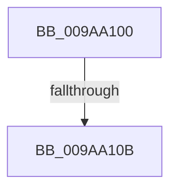

# sub_009AA100

- RVA: `0x009AA100`–`0x009AA146` (길이 `70` bytes)
- VA: `0x00000001409AA100`
- 실행 섹션: `PAGE`
- PDB 이름 있음: `아니요`; PDB Function 태그: `아니요`
- unwind 정보 RVA: `0x0009D85C`
- 디코드: `19`개 명령, `70/70` bytes 표시
- 미해석 바이트: `0` (있으면 어셈블리에 `.byte`로 보존)

> 이 문서는 커널 이미지의 기계어와 PDB 기호를 분석해 생성했습니다. 4번과 5번은 함수 원형과 자료형을 바이너리 사용 방식에서 추정한 C 해석이며 원본 소스 복구 결과는 아닙니다.

## 1. Dependencies

- 직접 호출 지점: **3**; 고유 호출 대상: **3**
- 직접 호출자로 확인된 함수: **0**
- RIP 상대 이미지 참조: **0**

### Outgoing calls
- `0x009AA10E` → [KeAbPostRelease](../../text/2E/KeAbPostRelease_function_002E1600.md) (function, `0x002E1600`)
- `0x009AA11C` → [KeLeaveCriticalRegionThread](../../text/25/KeLeaveCriticalRegionThread_function_0025EFF0.md) (function, `0x0025EFF0`)
- `0x009AA124` → [EtwpUnreferenceGuidEntry](../8C/EtwpUnreferenceGuidEntry_function_008C3320.md) (function, `0x008C3320`)

### Direct callers
- 이 함수 시작 RVA로 연결되는 직접 call은 확인되지 않았습니다. 간접 호출은 완전히 역산할 수 없습니다.

### Static image references
- 디코드된 RIP-relative 메모리 참조가 없습니다.

## 2. Other-region calls and transfers

- 다른 실행 섹션으로 향하는 call: **2**
  - `0x009AA10E` → [KeAbPostRelease](../../text/2E/KeAbPostRelease_function_002E1600.md) (`PAGE` → `.text`)
  - `0x009AA11C` → [KeLeaveCriticalRegionThread](../../text/25/KeLeaveCriticalRegionThread_function_0025EFF0.md) (`PAGE` → `.text`)
- call이 아닌 외부 분기/꼬리 이동: **1**
  - `0x009AA105` → [sub_009AA21F](Unknown_function_009AA21F.md) (`tail-transfer`)

## 3. Assembly (complete function range)

```asm
009AA100  F0 49 0F B1 11                  lock cmpxchg qword ptr [r9], rdx
009AA105  0F 85 14 01 00 00               jne 0x1409aa21f
009AA10B  49 8B C9                        mov rcx, r9
009AA10E  E8 ED 74 93 FF                  call 0x1402e1600
009AA113  65 48 8B 0C 25 88 01 00 00      mov rcx, qword ptr gs:[0x188]
009AA11C  E8 CF 4E 8B FF                  call 0x14025eff0
009AA121  48 8B CB                        mov rcx, rbx
009AA124  E8 F7 91 F1 FF                  call 0x1408c3320
009AA129  48 8B 84 24 88 00 00 00         mov rax, qword ptr [rsp + 0x88]
009AA131  89 28                           mov dword ptr [rax], ebp
009AA133  8B C6                           mov eax, esi
009AA135  48 8B 6C 24 70                  mov rbp, qword ptr [rsp + 0x70]
009AA13A  48 83 C4 40                     add rsp, 0x40
009AA13E  41 5F                           pop r15
009AA140  41 5C                           pop r12
009AA142  5F                              pop rdi
009AA143  5E                              pop rsi
009AA144  5B                              pop rbx
009AA145  C3                              ret
```

## 4. C-style interpretation (structured pseudocode)

```c
__int64 __fastcall sub_009AA100(__int64 a1, __int64 a2, __int64 a3, __int64 a4, __int64 a5, __int64 a6, __int64 a7, __int64 a8, __int64 a9, __int64 a10, __int64 a11, __int64 a12, __int64 a13, __int64 a14, __int64 a15, __int64 a16, __int64 a17)
{
    __int64 result;
    __int64 v_rsp;

    result = KeAbPostRelease(a4, a2, a3, a4);
    result = KeLeaveCriticalRegionThread(*(unsigned __int64 *)(gs_base + (0 + 392)), a2, a3, a4);
    result = EtwpUnreferenceGuidEntry(v_rbx, a2, a3, a4);
    *(unsigned int *)(a17) = (unsigned int)(v_rbp);
    v_rsp = (v_rsp) + (64);
    return (unsigned int)((unsigned int)(v_rsi));
}
```

## 5. (Beta) C Style

```c
int64_t sub_009AA100(int64_t Arg1, int64_t Arg2, int64_t Arg3, void *Arg4, uint64_t Arg5, uint64_t Arg6, uint64_t Arg7, uint64_t Arg8, uint64_t Arg9, uint64_t Arg10, uint64_t Arg11, uint64_t Arg12, uint64_t Arg13, int64_t Arg14, uint64_t Arg15, uint64_t Arg16, void *Arg17)
{
    uint8_t *arg4 = (uint8_t *)Arg4;
    uint8_t *arg17 = (uint8_t *)Arg17;

    int64_t result;
    int64_t local_rsp;

    result = KeAbPostRelease(Arg4, Arg2, Arg3, Arg4);
    result = KeLeaveCriticalRegionThread(*(uint64_t *)(gs_base + (0 + 0x188)), Arg2, Arg3, Arg4);
    result = EtwpUnreferenceGuidEntry(local_rbx, Arg2, Arg3, Arg4);
    *(uint32_t *)(arg17) = (uint32_t)(local_rbp);
    local_rsp = (local_rsp) + (64);
    return (uint32_t)((uint32_t)(local_rsi));
}
```

### 관측된 메모리 오프셋

구조체 형식이 확인되지 않은 접근은 인자 기준의 오프셋으로만 기록했습니다.

| 기준 인자 | 오프셋 표현 | 폭 (bit) | 접근 |
|---|---:|---:|---|
| `Arg4` | `+ 0x0` | `64` | `R` |
| `Arg17` | `+ 0x0` | `32` | `W` |

## 6. Execution-region graph

[열기: 2D/3D 그래프와 함수 탐색 컨트롤 패널](../../../control-panel.html?section=page&rva=0x009AA100&view=graph)

- 2D 그래프는 위에서 아래로 흐르고, 3D 그래프는 빈 공간을 드래그해 회전합니다. Shift+드래그는 이동, 휠은 확대·축소, 함수 노드 선택은 대상 보고서 이동입니다.

### Static fallback


