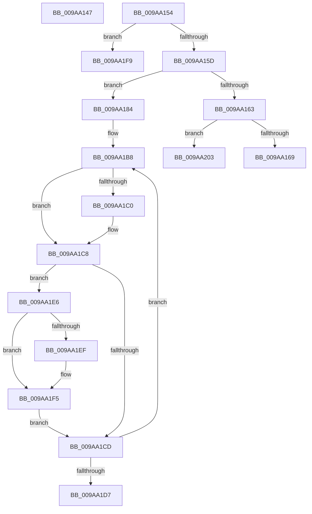

# sub_009AA147

- RVA: `0x009AA147`–`0x009AA21F` (길이 `216` bytes)
- VA: `0x00000001409AA147`
- 실행 섹션: `PAGE`
- PDB 이름 있음: `아니요`; PDB Function 태그: `아니요`
- unwind 정보 RVA: `0x0009D880`
- 디코드: `50`개 명령, `216/216` bytes 표시
- 미해석 바이트: `0` (있으면 어셈블리에 `.byte`로 보존)

> 이 문서는 커널 이미지의 기계어와 PDB 기호를 분석해 생성했습니다. 4번과 5번은 함수 원형과 자료형을 바이너리 사용 방식에서 추정한 C 해석이며 원본 소스 복구 결과는 아닙니다.

## 1. Dependencies

- 직접 호출 지점: **2**; 고유 호출 대상: **2**
- 직접 호출자로 확인된 함수: **0**
- RIP 상대 이미지 참조: **1**

### Outgoing calls
- `0x009AA14A` → [ExfReleasePushLock](../../text/26/ExfReleasePushLock_function_002638D0.md) (function, `0x002638D0`)
- `0x009AA1A6` → [qsort](../../text/50/qsort_function_005009F0.md) (function, `0x005009F0`)

### Direct callers
- 이 함수 시작 RVA로 연결되는 직접 call은 확인되지 않았습니다. 간접 호출은 완전히 역산할 수 없습니다.

### Static image references
- `0x009AA18C` → RVA `0x009E4860` (`EtwpCompareGuid`; read)

## 2. Other-region calls and transfers

- 다른 실행 섹션으로 향하는 call: **2**
  - `0x009AA14A` → [ExfReleasePushLock](../../text/26/ExfReleasePushLock_function_002638D0.md) (`PAGE` → `.text`)
  - `0x009AA1A6` → [qsort](../../text/50/qsort_function_005009F0.md) (`PAGE` → `.text`)
- call이 아닌 외부 분기/꼬리 이동: **5**
  - `0x009AA14F` → [sub_009A9D17 + 0x37B](Unknown_function_009A9D17.md) (`tail-transfer`)
  - `0x009AA17F` → [sub_009A9D17 + 0x3A7](Unknown_function_009A9D17.md) (`tail-transfer`)
  - `0x009AA1E1` → [sub_009A9D17 + 0x3A7](Unknown_function_009A9D17.md) (`tail-transfer`)
  - `0x009AA1FE` → [sub_009A9D17 + 0x3A7](Unknown_function_009A9D17.md) (`tail-transfer`)
  - `0x009AA21A` → [sub_009A9D17 + 0x3A7](Unknown_function_009A9D17.md) (`tail-transfer`)

## 3. Assembly (complete function range)

```asm
009AA147  48 8B CB                        mov rcx, rbx
009AA14A  E8 81 97 8B FF                  call 0x1402638d0
009AA14F  E9 3E FF FF FF                  jmp 0x1409aa092
009AA154  41 3B EC                        cmp ebp, r12d
009AA157  0F 87 9C 00 00 00               ja 0x1409aa1f9
009AA15D  41 83 FF 01                     cmp r15d, 1
009AA161  77 21                           ja 0x1409aa184
009AA163  0F 84 9A 00 00 00               je 0x1409aa203
009AA169  8B 74 24 20                     mov esi, dword ptr [rsp + 0x20]
009AA16D  48 8B BC 24 80 00 00 00         mov rdi, qword ptr [rsp + 0x80]
009AA175  89 B7 04 02 00 00               mov dword ptr [rdi + 0x204], esi
009AA17B  8B 74 24 24                     mov esi, dword ptr [rsp + 0x24]
009AA17F  E9 3A FF FF FF                  jmp 0x1409aa0be
009AA184  48 8B BC 24 80 00 00 00         mov rdi, qword ptr [rsp + 0x80]
009AA18C  4C 8D 0D CD A6 03 00            lea r9, [rip + 0x3a6cd]
009AA193  41 8B D7                        mov edx, r15d
009AA196  41 B8 10 00 00 00               mov r8d, 0x10
009AA19C  48 8D 9F 08 02 00 00            lea rbx, [rdi + 0x208]
009AA1A3  48 8B CB                        mov rcx, rbx
009AA1A6  E8 45 68 B5 FF                  call 0x1405009f0
009AA1AB  48 8D 53 10                     lea rdx, [rbx + 0x10]
009AA1AF  BE 01 00 00 00                  mov esi, 1
009AA1B4  45 8D 47 FF                     lea r8d, [r15 - 1]
009AA1B8  48 8B 0A                        mov rcx, qword ptr [rdx]
009AA1BB  48 2B 0B                        sub rcx, qword ptr [rbx]
009AA1BE  75 08                           jne 0x1409aa1c8
009AA1C0  48 8B 4A 08                     mov rcx, qword ptr [rdx + 8]
009AA1C4  48 2B 4B 08                     sub rcx, qword ptr [rbx + 8]
009AA1C8  48 85 C9                        test rcx, rcx
009AA1CB  75 19                           jne 0x1409aa1e6
009AA1CD  48 83 C2 10                     add rdx, 0x10
009AA1D1  49 83 E8 01                     sub r8, 1
009AA1D5  75 E1                           jne 0x1409aa1b8
009AA1D7  89 B7 04 02 00 00               mov dword ptr [rdi + 0x204], esi
009AA1DD  8B 74 24 24                     mov esi, dword ptr [rsp + 0x24]
009AA1E1  E9 D8 FE FF FF                  jmp 0x1409aa0be
009AA1E6  48 83 C3 10                     add rbx, 0x10
009AA1EA  48 3B DA                        cmp rbx, rdx
009AA1ED  74 06                           je 0x1409aa1f5
009AA1EF  0F 10 02                        movups xmm0, xmmword ptr [rdx]
009AA1F2  0F 11 03                        movups xmmword ptr [rbx], xmm0
009AA1F5  FF C6                           inc esi
009AA1F7  EB D4                           jmp 0x1409aa1cd
009AA1F9  BE 23 00 00 C0                  mov esi, 0xc0000023
009AA1FE  E9 BB FE FF FF                  jmp 0x1409aa0be
009AA203  48 8B BC 24 80 00 00 00         mov rdi, qword ptr [rsp + 0x80]
009AA20B  BE 01 00 00 00                  mov esi, 1
009AA210  89 B7 04 02 00 00               mov dword ptr [rdi + 0x204], esi
009AA216  8B 74 24 24                     mov esi, dword ptr [rsp + 0x24]
009AA21A  E9 9F FE FF FF                  jmp 0x1409aa0be
```

## 4. C-style interpretation (structured pseudocode)

```c
__int64 __fastcall sub_009AA147(void)
{
    __int64 result;
    unsigned int v_stack_p20;
    unsigned int v_stack_p24;
    unsigned __int64 v_stack_p80;

    result = ExfReleasePushLock(v_rbx, a2, a3, a4);
}
```

## 5. (Beta) C Style

```c
void sub_009AA147(void)
{
    int64_t result;
    uint32_t v_stack_p20;
    uint32_t v_stack_p24;
    uint64_t v_stack_p80;

    result = ExfReleasePushLock(local_rbx, a2, a3, a4);
}
```

## 6. Execution-region graph

[열기: 2D/3D 그래프와 함수 탐색 컨트롤 패널](../../../control-panel.html?section=page&rva=0x009AA147&view=graph)

- 2D 그래프는 위에서 아래로 흐르고, 3D 그래프는 빈 공간을 드래그해 회전합니다. Shift+드래그는 이동, 휠은 확대·축소, 함수 노드 선택은 대상 보고서 이동입니다.

### Static fallback


