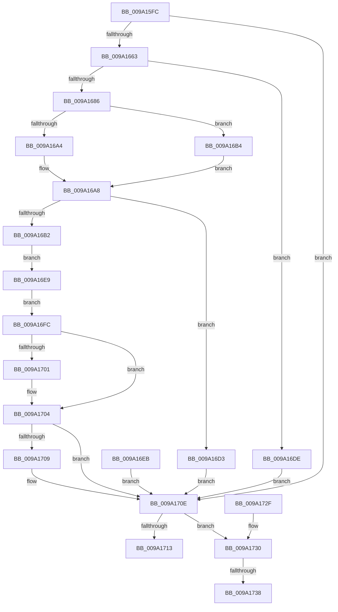

# WbMakeUserDataPagesKernelWritable

- RVA: `0x009A15FC`–`0x009A1746` (길이 `330` bytes)
- VA: `0x00000001409A15FC`
- 실행 섹션: `PAGE`
- PDB 이름 있음: `예`; PDB Function 태그: `예`
- unwind 정보 RVA: `0x0009B538`
- 디코드: `101`개 명령, `330/330` bytes 표시
- 미해석 바이트: `0` (있으면 어셈블리에 `.byte`로 보존)

> 이 문서는 커널 이미지의 기계어와 PDB 기호를 분석해 생성했습니다. 4번과 5번은 함수 원형과 자료형을 바이너리 사용 방식에서 추정한 C 해석이며 원본 소스 복구 결과는 아닙니다.

## 1. Dependencies

- 직접 호출 지점: **5**; 고유 호출 대상: **5**
- 직접 호출자로 확인된 함수: **3**
- RIP 상대 이미지 참조: **0**

### Outgoing calls
- `0x009A1650` → [ZwProtectVirtualMemory](../../text/6A/ZwProtectVirtualMemory_function_006ADAD0.md) (function, `0x006ADAD0`)
- `0x009A1674` → [IoAllocateMdl](../../text/29/IoAllocateMdl_function_0029EBF0.md) (function, `0x0029EBF0`)
- `0x009A1695` → [MmProbeAndLockPages](../../text/23/MmProbeAndLockPages_function_0023B990.md) (function, `0x0023B990`)
- `0x009A16CC` → [MmMapLockedPagesSpecifyCache](../../text/31/MmMapLockedPagesSpecifyCache_function_00318800.md) (function, `0x00318800`)
- `0x009A173B` → [MmUnlockPages](../../text/29/MmUnlockPages_function_0029EEE0.md) (function, `0x0029EEE0`)

### Direct callers
- [sub_009A0EC4](Unknown_function_009A0EC4.md) at `0x009A1137`
- [sub_009A11E0](Unknown_function_009A11E0.md) at `0x009A1273`
- [sub_009A14C8](Unknown_function_009A14C8.md) at `0x009A14E7`

### Static image references
- 디코드된 RIP-relative 메모리 참조가 없습니다.

## 2. Other-region calls and transfers

- 다른 실행 섹션으로 향하는 call: **5**
  - `0x009A1650` → [ZwProtectVirtualMemory](../../text/6A/ZwProtectVirtualMemory_function_006ADAD0.md) (`PAGE` → `.text`)
  - `0x009A1674` → [IoAllocateMdl](../../text/29/IoAllocateMdl_function_0029EBF0.md) (`PAGE` → `.text`)
  - `0x009A1695` → [MmProbeAndLockPages](../../text/23/MmProbeAndLockPages_function_0023B990.md) (`PAGE` → `.text`)
  - `0x009A16CC` → [MmMapLockedPagesSpecifyCache](../../text/31/MmMapLockedPagesSpecifyCache_function_00318800.md) (`PAGE` → `.text`)
  - `0x009A173B` → [MmUnlockPages](../../text/29/MmUnlockPages_function_0029EEE0.md) (`PAGE` → `.text`)
- call이 아닌 외부 분기/꼬리 이동: **2**
  - `0x009A1732` → [sub_00B2D1A6](../B2/Unknown_function_00B2D1A6.md) (`tail-transfer`)
  - `0x009A1741` → [sub_00B2D1A6](../B2/Unknown_function_00B2D1A6.md) (`tail-transfer`)

## 3. Assembly (complete function range)

```asm
009A15FC  4C 8B DC                        mov r11, rsp
009A15FF  49 89 5B 18                     mov qword ptr [r11 + 0x18], rbx
009A1603  49 89 73 20                     mov qword ptr [r11 + 0x20], rsi
009A1607  57                              push rdi
009A1608  41 54                           push r12
009A160A  41 55                           push r13
009A160C  41 56                           push r14
009A160E  41 57                           push r15
009A1610  48 83 EC 60                     sub rsp, 0x60
009A1614  4D 8B F9                        mov r15, r9
009A1617  4D 8B F0                        mov r14, r8
009A161A  44 8B E2                        mov r12d, edx
009A161D  4C 8B E9                        mov r13, rcx
009A1620  33 DB                           xor ebx, ebx
009A1622  49 89 5B B8                     mov qword ptr [r11 - 0x48], rbx
009A1626  33 F6                           xor esi, esi
009A1628  89 74 24 38                     mov dword ptr [rsp + 0x38], esi
009A162C  41 21 5B 10                     and dword ptr [r11 + 0x10], ebx
009A1630  49 89 4B C0                     mov qword ptr [r11 - 0x40], rcx
009A1634  4D 89 63 08                     mov qword ptr [r11 + 8], r12
009A1638  49 8D 43 10                     lea rax, [r11 + 0x10]
009A163C  49 89 43 98                     mov qword ptr [r11 - 0x68], rax
009A1640  44 8D 4B 04                     lea r9d, [rbx + 4]
009A1644  4D 8D 43 08                     lea r8, [r11 + 8]
009A1648  49 8D 53 C0                     lea rdx, [r11 - 0x40]
009A164C  48 83 C9 FF                     or rcx, 0xffffffffffffffff
009A1650  E8 7B C4 D0 FF                  call 0x1406adad0
009A1655  8B F8                           mov edi, eax
009A1657  89 44 24 34                     mov dword ptr [rsp + 0x34], eax
009A165B  85 C0                           test eax, eax
009A165D  0F 88 AB 00 00 00               js 0x1409a170e
009A1663  48 21 74 24 20                  and qword ptr [rsp + 0x20], rsi
009A1668  45 33 C9                        xor r9d, r9d
009A166B  45 33 C0                        xor r8d, r8d
009A166E  41 8B D4                        mov edx, r12d
009A1671  49 8B CD                        mov rcx, r13
009A1674  E8 77 D5 8F FF                  call 0x14029ebf0
009A1679  48 8B D8                        mov rbx, rax
009A167C  48 89 44 24 40                  mov qword ptr [rsp + 0x40], rax
009A1681  48 85 C0                        test rax, rax
009A1684  74 58                           je 0x1409a16de
009A1686  BE 01 00 00 00                  mov esi, 1
009A168B  44 8D 46 01                     lea r8d, [rsi + 1]
009A168F  40 8A D6                        mov dl, sil
009A1692  48 8B C8                        mov rcx, rax
009A1695  E8 F6 A2 89 FF                  call 0x14023b990
009A169A  89 74 24 38                     mov dword ptr [rsp + 0x38], esi
009A169E  F6 43 0A 05                     test byte ptr [rbx + 0xa], 5
009A16A2  74 10                           je 0x1409a16b4
009A16A4  48 8B 43 18                     mov rax, qword ptr [rbx + 0x18]
009A16A8  48 89 44 24 50                  mov qword ptr [rsp + 0x50], rax
009A16AD  48 85 C0                        test rax, rax
009A16B0  74 21                           je 0x1409a16d3
009A16B2  EB 35                           jmp 0x1409a16e9
009A16B4  C7 44 24 28 20 00 00 40         mov dword ptr [rsp + 0x28], 0x40000020
009A16BC  83 64 24 20 00                  and dword ptr [rsp + 0x20], 0
009A16C1  45 33 C9                        xor r9d, r9d
009A16C4  44 8B C6                        mov r8d, esi
009A16C7  33 D2                           xor edx, edx
009A16C9  48 8B CB                        mov rcx, rbx
009A16CC  E8 2F 71 97 FF                  call 0x140318800
009A16D1  EB D5                           jmp 0x1409a16a8
009A16D3  BF 17 00 00 C0                  mov edi, 0xc0000017
009A16D8  89 7C 24 34                     mov dword ptr [rsp + 0x34], edi
009A16DC  EB 30                           jmp 0x1409a170e
009A16DE  BF 17 00 00 C0                  mov edi, 0xc0000017
009A16E3  89 7C 24 34                     mov dword ptr [rsp + 0x34], edi
009A16E7  EB 25                           jmp 0x1409a170e
009A16E9  EB 11                           jmp 0x1409a16fc
009A16EB  8B F8                           mov edi, eax
009A16ED  89 44 24 34                     mov dword ptr [rsp + 0x34], eax
009A16F1  48 8B 5C 24 40                  mov rbx, qword ptr [rsp + 0x40]
009A16F6  8B 74 24 38                     mov esi, dword ptr [rsp + 0x38]
009A16FA  EB 12                           jmp 0x1409a170e
009A16FC  4D 85 FF                        test r15, r15
009A16FF  74 03                           je 0x1409a1704
009A1701  49 89 07                        mov qword ptr [r15], rax
009A1704  4D 85 F6                        test r14, r14
009A1707  74 05                           je 0x1409a170e
009A1709  49 89 1E                        mov qword ptr [r14], rbx
009A170C  33 DB                           xor ebx, ebx
009A170E  48 85 DB                        test rbx, rbx
009A1711  75 1D                           jne 0x1409a1730
009A1713  8B C7                           mov eax, edi
009A1715  4C 8D 5C 24 60                  lea r11, [rsp + 0x60]
009A171A  49 8B 5B 40                     mov rbx, qword ptr [r11 + 0x40]
009A171E  49 8B 73 48                     mov rsi, qword ptr [r11 + 0x48]
009A1722  49 8B E3                        mov rsp, r11
009A1725  41 5F                           pop r15
009A1727  41 5E                           pop r14
009A1729  41 5D                           pop r13
009A172B  41 5C                           pop r12
009A172D  5F                              pop rdi
009A172E  C3                              ret
009A172F  CC                              int3
009A1730  85 F6                           test esi, esi
009A1732  0F 84 6E BA 18 00               je 0x140b2d1a6
009A1738  48 8B CB                        mov rcx, rbx
009A173B  E8 A0 D7 8F FF                  call 0x14029eee0
009A1740  90                              nop
009A1741  E9 60 BA 18 00                  jmp 0x140b2d1a6
```

## 4. C-style interpretation (structured pseudocode)

```c
__int64 __fastcall WbMakeUserDataPagesKernelWritable(__int64 a1, int a2, __int64 a3, __int64 a4)
{
    __int64 result;
    __int64 v_rbx;
    __int64 v_rsi;
    __int64 v_rsp;
    unsigned __int64 v_stack_m28;
    unsigned __int64 v_stack_m38;
    unsigned __int64 v_stack_m48;
    unsigned int v_stack_m50;
    unsigned int v_stack_m54;
    unsigned int v_stack_m60;
    unsigned __int64 v_stack_m68;

    *(unsigned __int64 *)(v_rsp + 24) = v_rbx;
    *(unsigned __int64 *)(v_rsp + 32) = v_rsi;
    v_rsp = (v_rsp) - (96);
    v_rbx = 0;
    *(unsigned __int64 *)(v_rsp - 72) = 0;
    v_rsi = 0;
    v_stack_m50 = 0;
    *(unsigned __int64 *)(v_rsp - 64) = a1;
    *(unsigned __int64 *)(v_rsp + 8) = (unsigned int)(a2);
    *(unsigned __int64 *)(v_rsp - 104) = v_rsp + 16;
    a1 = (a1) | (-1);
    result = ZwProtectVirtualMemory(a1, v_rsp - 64, v_rsp + 8, v_rbx + 4);
    v_stack_m54 = (unsigned int)(result);
    if (sign_flag) goto loc_009A170E;
    a4 = 0;
    a3 = 0;
    result = IoAllocateMdl(a1, (unsigned int)((unsigned int)((unsigned int)(a2))), a3, a4);
    v_stack_m48 = result;
    if (result == 0) goto loc_009A16DE;
    result = MmProbeAndLockPages(result, 1, 1 + 1, a4);
    v_stack_m50 = 1;
    if (((*(unsigned __int8 *)(result + 10)) & (5)) == 0) goto loc_009A16B4;
loc_009A16A8:
    v_stack_m38 = *(unsigned __int64 *)(result + 24);
    if (*(unsigned __int64 *)(result + 24) == 0) goto loc_009A16D3;
    goto loc_009A16E9;
loc_009A16B4:
    v_stack_m60 = 0x40000020ULL;
    a4 = 0;
    a2 = 0;
    result = MmMapLockedPagesSpecifyCache(result, a2, 1, a4);
    goto loc_009A16A8;
loc_009A16D3:
    v_stack_m54 = (unsigned int)((unsigned int)(0xC0000017ULL));
    goto loc_009A170E;
loc_009A16DE:
    v_stack_m54 = (unsigned int)((unsigned int)(0xC0000017ULL));
    goto loc_009A170E;
loc_009A16E9:
    goto loc_009A16FC;
loc_009A16FC:
    if (0 != 0) {
        *(unsigned __int64 *)(a4) = result;
    }
    v_rbx = result;
    if (0 != 0) {
        *(unsigned __int64 *)(a3) = result;
        v_rbx = 0;
    }
    if (0 != 0) goto loc_009A1730;
    return (unsigned int)((unsigned int)((unsigned int)(0xC0000017ULL)));
loc_009A1730:
    result = MmUnlockPages(*(unsigned __int64 *)(v_stack_m28 + 64), a2, 1, a4);
}
```

## 5. (Beta) C Style

```c
int64_t WbMakeUserDataPagesKernelWritable(int64_t Arg1, int32_t Arg2, int64_t Arg3, int64_t Arg4)
{
    int64_t result;
    int64_t local_rbx;
    int64_t local_rsi;
    int64_t local_rsp;
    uint64_t v_stack_m28;
    uint64_t v_stack_m38;
    uint64_t v_stack_m48;
    uint32_t v_stack_m50;
    uint32_t v_stack_m54;
    uint32_t v_stack_m60;
    uint64_t v_stack_m68;

    *(uint64_t *)(local_rsp + 0x18) = local_rbx;
    *(uint64_t *)(local_rsp + 0x20) = local_rsi;
    local_rsp = (local_rsp) - (96);
    local_rbx = 0;
    *(uint64_t *)(local_rsp - 0x48) = 0;
    local_rsi = 0;
    v_stack_m50 = 0;
    *(uint64_t *)(local_rsp - 0x40) = Arg1;
    *(uint64_t *)(local_rsp + 0x8) = (uint32_t)(Arg2);
    *(uint64_t *)(local_rsp - 0x68) = local_rsp + 16;
    Arg1 = (Arg1) | (-1);
    result = ZwProtectVirtualMemory(Arg1, local_rsp - 64, local_rsp + 8, local_rbx + 4);
    v_stack_m54 = (uint32_t)(result);
    if (sign_flag) goto loc_009A170E;
    Arg4 = 0;
    Arg3 = 0;
    result = IoAllocateMdl(Arg1, (uint32_t)((uint32_t)((uint32_t)(Arg2))), Arg3, Arg4);
    v_stack_m48 = result;
    if (result == 0) goto loc_009A16DE;
    result = MmProbeAndLockPages(result, 1, 1 + 1, Arg4);
    v_stack_m50 = 1;
    if (((*(uint8_t *)(result + 0xA)) & (5)) == 0) goto loc_009A16B4;
loc_009A16A8:
    v_stack_m38 = *(uint64_t *)(result + 0x18);
    if (*(uint64_t *)(result + 0x18) == 0) goto loc_009A16D3;
    goto loc_009A16E9;
loc_009A16B4:
    v_stack_m60 = 0x40000020ULL;
    Arg4 = 0;
    Arg2 = 0;
    result = MmMapLockedPagesSpecifyCache(result, Arg2, 1, Arg4);
    goto loc_009A16A8;
loc_009A16D3:
    v_stack_m54 = (uint32_t)((uint32_t)(0xC0000017ULL));
    goto loc_009A170E;
loc_009A16DE:
    v_stack_m54 = (uint32_t)((uint32_t)(0xC0000017ULL));
    goto loc_009A170E;
loc_009A16E9:
    goto loc_009A16FC;
loc_009A16FC:
    if (0 != 0) {
        *(uint64_t *)(Arg4) = result;
    }
    local_rbx = result;
    if (0 != 0) {
        *(uint64_t *)(Arg3) = result;
        local_rbx = 0;
    }
    if (0 != 0) goto loc_009A1730;
    return (uint32_t)((uint32_t)((uint32_t)(0xC0000017ULL)));
loc_009A1730:
    result = MmUnlockPages(*(uint64_t *)(v_stack_m28 + 0x40), Arg2, 1, Arg4);
}
```

## 6. Execution-region graph

[열기: 2D/3D 그래프와 함수 탐색 컨트롤 패널](../../../control-panel.html?section=page&rva=0x009A15FC&view=graph)

- 2D 그래프는 위에서 아래로 흐르고, 3D 그래프는 빈 공간을 드래그해 회전합니다. Shift+드래그는 이동, 휠은 확대·축소, 함수 노드 선택은 대상 보고서 이동입니다.

### Static fallback


