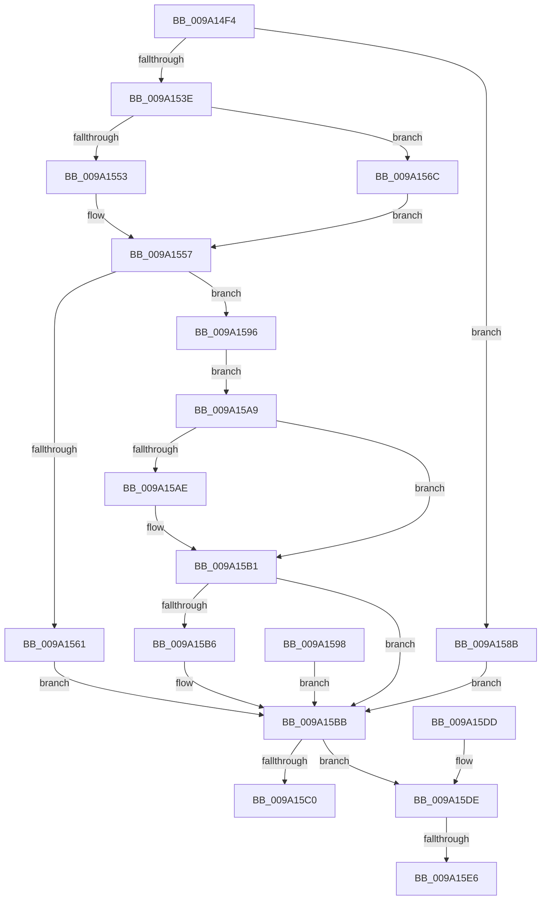

# WbMakeUserExecutablePagesKernelWritable

- RVA: `0x009A14F4`–`0x009A15F4` (길이 `256` bytes)
- VA: `0x00000001409A14F4`
- 실행 섹션: `PAGE`
- PDB 이름 있음: `예`; PDB Function 태그: `예`
- unwind 정보 RVA: `0x0009B4E8`
- 디코드: `77`개 명령, `256/256` bytes 표시
- 미해석 바이트: `0` (있으면 어셈블리에 `.byte`로 보존)

> 이 문서는 커널 이미지의 기계어와 PDB 기호를 분석해 생성했습니다. 4번과 5번은 함수 원형과 자료형을 바이너리 사용 방식에서 추정한 C 해석이며 원본 소스 복구 결과는 아닙니다.

## 1. Dependencies

- 직접 호출 지점: **4**; 고유 호출 대상: **4**
- 직접 호출자로 확인된 함수: **4**
- RIP 상대 이미지 참조: **0**

### Outgoing calls
- `0x009A152C` → [IoAllocateMdl](../../text/29/IoAllocateMdl_function_0029EBF0.md) (function, `0x0029EBF0`)
- `0x009A1541` → [MmProbeAndLockPagesPrivate](../../text/48/MmProbeAndLockPagesPrivate_function_0048ED68.md) (function, `0x0048ED68`)
- `0x009A1584` → [MmMapLockedPagesSpecifyCache](../../text/31/MmMapLockedPagesSpecifyCache_function_00318800.md) (function, `0x00318800`)
- `0x009A15E9` → [MmUnlockPages](../../text/29/MmUnlockPages_function_0029EEE0.md) (function, `0x0029EEE0`)

### Direct callers
- [sub_009A0C94](Unknown_function_009A0C94.md) at `0x009A0DCC`
- [sub_009A0EC4](Unknown_function_009A0EC4.md) at `0x009A0F5F`
- [sub_009A11E0](Unknown_function_009A11E0.md) at `0x009A1266`
- [sub_009A14C8](Unknown_function_009A14C8.md) at `0x009A14DC`

### Static image references
- 디코드된 RIP-relative 메모리 참조가 없습니다.

## 2. Other-region calls and transfers

- 다른 실행 섹션으로 향하는 call: **4**
  - `0x009A152C` → [IoAllocateMdl](../../text/29/IoAllocateMdl_function_0029EBF0.md) (`PAGE` → `.text`)
  - `0x009A1541` → [MmProbeAndLockPagesPrivate](../../text/48/MmProbeAndLockPagesPrivate_function_0048ED68.md) (`PAGE` → `.text`)
  - `0x009A1584` → [MmMapLockedPagesSpecifyCache](../../text/31/MmMapLockedPagesSpecifyCache_function_00318800.md) (`PAGE` → `.text`)
  - `0x009A15E9` → [MmUnlockPages](../../text/29/MmUnlockPages_function_0029EEE0.md) (`PAGE` → `.text`)
- call이 아닌 외부 분기/꼬리 이동: **2**
  - `0x009A15E0` → [sub_00B2D198](../B2/Unknown_function_00B2D198.md) (`tail-transfer`)
  - `0x009A15EF` → [sub_00B2D198](../B2/Unknown_function_00B2D198.md) (`tail-transfer`)

## 3. Assembly (complete function range)

```asm
009A14F4  48 8B C4                        mov rax, rsp
009A14F7  48 89 58 08                     mov qword ptr [rax + 8], rbx
009A14FB  48 89 70 10                     mov qword ptr [rax + 0x10], rsi
009A14FF  48 89 78 18                     mov qword ptr [rax + 0x18], rdi
009A1503  4C 89 70 20                     mov qword ptr [rax + 0x20], r14
009A1507  41 57                           push r15
009A1509  48 83 EC 60                     sub rsp, 0x60
009A150D  4D 8B F9                        mov r15, r9
009A1510  4D 8B F0                        mov r14, r8
009A1513  48 83 60 D8 00                  and qword ptr [rax - 0x28], 0
009A1518  33 F6                           xor esi, esi
009A151A  89 70 D0                        mov dword ptr [rax - 0x30], esi
009A151D  33 FF                           xor edi, edi
009A151F  89 78 CC                        mov dword ptr [rax - 0x34], edi
009A1522  48 21 78 B8                     and qword ptr [rax - 0x48], rdi
009A1526  45 33 C9                        xor r9d, r9d
009A1529  45 33 C0                        xor r8d, r8d
009A152C  E8 BF D6 8F FF                  call 0x14029ebf0
009A1531  48 8B D8                        mov rbx, rax
009A1534  48 89 44 24 40                  mov qword ptr [rsp + 0x40], rax
009A1539  48 85 C0                        test rax, rax
009A153C  74 4D                           je 0x1409a158b
009A153E  48 8B C8                        mov rcx, rax
009A1541  E8 22 D8 AE FF                  call 0x14048ed68
009A1546  8D 77 01                        lea esi, [rdi + 1]
009A1549  89 74 24 38                     mov dword ptr [rsp + 0x38], esi
009A154D  F6 43 0A 05                     test byte ptr [rbx + 0xa], 5
009A1551  74 19                           je 0x1409a156c
009A1553  48 8B 43 18                     mov rax, qword ptr [rbx + 0x18]
009A1557  48 89 44 24 48                  mov qword ptr [rsp + 0x48], rax
009A155C  48 85 C0                        test rax, rax
009A155F  75 35                           jne 0x1409a1596
009A1561  BF 17 00 00 C0                  mov edi, 0xc0000017
009A1566  89 7C 24 34                     mov dword ptr [rsp + 0x34], edi
009A156A  EB 4F                           jmp 0x1409a15bb
009A156C  C7 44 24 28 20 00 00 40         mov dword ptr [rsp + 0x28], 0x40000020
009A1574  83 64 24 20 00                  and dword ptr [rsp + 0x20], 0
009A1579  45 33 C9                        xor r9d, r9d
009A157C  44 8B C6                        mov r8d, esi
009A157F  33 D2                           xor edx, edx
009A1581  48 8B CB                        mov rcx, rbx
009A1584  E8 77 72 97 FF                  call 0x140318800
009A1589  EB CC                           jmp 0x1409a1557
009A158B  BF 17 00 00 C0                  mov edi, 0xc0000017
009A1590  89 7C 24 34                     mov dword ptr [rsp + 0x34], edi
009A1594  EB 25                           jmp 0x1409a15bb
009A1596  EB 11                           jmp 0x1409a15a9
009A1598  8B F8                           mov edi, eax
009A159A  89 44 24 34                     mov dword ptr [rsp + 0x34], eax
009A159E  48 8B 5C 24 40                  mov rbx, qword ptr [rsp + 0x40]
009A15A3  8B 74 24 38                     mov esi, dword ptr [rsp + 0x38]
009A15A7  EB 12                           jmp 0x1409a15bb
009A15A9  4D 85 FF                        test r15, r15
009A15AC  74 03                           je 0x1409a15b1
009A15AE  49 89 07                        mov qword ptr [r15], rax
009A15B1  4D 85 F6                        test r14, r14
009A15B4  74 05                           je 0x1409a15bb
009A15B6  49 89 1E                        mov qword ptr [r14], rbx
009A15B9  33 DB                           xor ebx, ebx
009A15BB  48 85 DB                        test rbx, rbx
009A15BE  75 1E                           jne 0x1409a15de
009A15C0  8B C7                           mov eax, edi
009A15C2  4C 8D 5C 24 60                  lea r11, [rsp + 0x60]
009A15C7  49 8B 5B 10                     mov rbx, qword ptr [r11 + 0x10]
009A15CB  49 8B 73 18                     mov rsi, qword ptr [r11 + 0x18]
009A15CF  49 8B 7B 20                     mov rdi, qword ptr [r11 + 0x20]
009A15D3  4D 8B 73 28                     mov r14, qword ptr [r11 + 0x28]
009A15D7  49 8B E3                        mov rsp, r11
009A15DA  41 5F                           pop r15
009A15DC  C3                              ret
009A15DD  CC                              int3
009A15DE  85 F6                           test esi, esi
009A15E0  0F 84 B2 BB 18 00               je 0x140b2d198
009A15E6  48 8B CB                        mov rcx, rbx
009A15E9  E8 F2 D8 8F FF                  call 0x14029eee0
009A15EE  90                              nop
009A15EF  E9 A4 BB 18 00                  jmp 0x140b2d198
```

## 4. C-style interpretation (structured pseudocode)

```c
__int64 __fastcall WbMakeUserExecutablePagesKernelWritable(__int64 a1, int a2, __int64 a3, __int64 a4)
{
    __int64 result;
    __int64 v_rbx;
    __int64 v_rdi;
    __int64 v_rsi;
    __int64 v_rsp;
    unsigned __int64 v_stack_m20;
    unsigned __int64 v_stack_m28;
    unsigned int v_stack_m30;
    unsigned int v_stack_m34;
    unsigned int v_stack_m40;
    unsigned int v_stack_m48;
    unsigned __int64 v_stack_m8;

    *(unsigned __int64 *)(v_rsp + 8) = v_rbx;
    *(unsigned __int64 *)(v_rsp + 16) = v_rsi;
    *(unsigned __int64 *)(v_rsp + 24) = v_rdi;
    *(unsigned __int64 *)(v_rsp + 32) = v_r14;
    v_rsp = (v_rsp) - (96);
    v_rsi = 0;
    *(unsigned int *)(v_rsp - 48) = 0;
    v_rdi = 0;
    *(unsigned int *)(v_rsp - 52) = 0;
    a4 = 0;
    a3 = 0;
    result = IoAllocateMdl(a1, a2, a3, a4);
    v_stack_m28 = result;
    if (result == 0) goto loc_009A158B;
    result = MmProbeAndLockPagesPrivate(result, a2, a3, a4);
    v_stack_m30 = (unsigned int)(v_rdi + 1);
    if (((*(unsigned __int8 *)(result + 10)) & (5)) == 0) goto loc_009A156C;
loc_009A1557:
    v_stack_m20 = *(unsigned __int64 *)(result + 24);
    if (*(unsigned __int64 *)(result + 24) != 0) goto loc_009A1596;
    v_stack_m34 = (unsigned int)((unsigned int)(0xC0000017ULL));
    goto loc_009A15BB;
loc_009A156C:
    v_stack_m40 = 0x40000020ULL;
    a4 = 0;
    a2 = 0;
    result = MmMapLockedPagesSpecifyCache(result, a2, (unsigned int)((unsigned int)(v_rdi + 1)), a4);
    goto loc_009A1557;
loc_009A158B:
    v_stack_m34 = (unsigned int)((unsigned int)(0xC0000017ULL));
    goto loc_009A15BB;
loc_009A1596:
    goto loc_009A15A9;
loc_009A15A9:
    if (0 != 0) {
        *(unsigned __int64 *)(a4) = result;
    }
    v_rbx = result;
    if (0 != 0) {
        *(unsigned __int64 *)(a3) = result;
        v_rbx = 0;
    }
    if (0 != 0) goto loc_009A15DE;
    return (unsigned int)((unsigned int)((unsigned int)(0xC0000017ULL)));
loc_009A15DE:
    result = MmUnlockPages(*(unsigned __int64 *)(v_stack_m8 + 16), a2, (unsigned int)((unsigned int)(v_rdi + 1)), a4);
}
```

## 5. (Beta) C Style

```c
int64_t WbMakeUserExecutablePagesKernelWritable(int64_t Arg1, int32_t Arg2, int64_t Arg3, int64_t Arg4)
{
    int64_t result;
    int64_t local_rbx;
    int64_t local_rdi;
    int64_t local_rsi;
    int64_t local_rsp;
    uint64_t v_stack_m20;
    uint64_t v_stack_m28;
    uint32_t v_stack_m30;
    uint32_t v_stack_m34;
    uint32_t v_stack_m40;
    uint32_t v_stack_m48;
    uint64_t v_stack_m8;

    *(uint64_t *)(local_rsp + 0x8) = local_rbx;
    *(uint64_t *)(local_rsp + 0x10) = local_rsi;
    *(uint64_t *)(local_rsp + 0x18) = local_rdi;
    *(uint64_t *)(local_rsp + 0x20) = local_r14;
    local_rsp = (local_rsp) - (96);
    local_rsi = 0;
    *(uint32_t *)(local_rsp - 0x30) = 0;
    local_rdi = 0;
    *(uint32_t *)(local_rsp - 0x34) = 0;
    Arg4 = 0;
    Arg3 = 0;
    result = IoAllocateMdl(Arg1, Arg2, Arg3, Arg4);
    v_stack_m28 = result;
    if (result == 0) goto loc_009A158B;
    result = MmProbeAndLockPagesPrivate(result, Arg2, Arg3, Arg4);
    v_stack_m30 = (uint32_t)(local_rdi + 1);
    if (((*(uint8_t *)(result + 0xA)) & (5)) == 0) goto loc_009A156C;
loc_009A1557:
    v_stack_m20 = *(uint64_t *)(result + 0x18);
    if (*(uint64_t *)(result + 0x18) != 0) goto loc_009A1596;
    v_stack_m34 = (uint32_t)((uint32_t)(0xC0000017ULL));
    goto loc_009A15BB;
loc_009A156C:
    v_stack_m40 = 0x40000020ULL;
    Arg4 = 0;
    Arg2 = 0;
    result = MmMapLockedPagesSpecifyCache(result, Arg2, (uint32_t)((uint32_t)(local_rdi + 1)), Arg4);
    goto loc_009A1557;
loc_009A158B:
    v_stack_m34 = (uint32_t)((uint32_t)(0xC0000017ULL));
    goto loc_009A15BB;
loc_009A1596:
    goto loc_009A15A9;
loc_009A15A9:
    if (0 != 0) {
        *(uint64_t *)(Arg4) = result;
    }
    local_rbx = result;
    if (0 != 0) {
        *(uint64_t *)(Arg3) = result;
        local_rbx = 0;
    }
    if (0 != 0) goto loc_009A15DE;
    return (uint32_t)((uint32_t)((uint32_t)(0xC0000017ULL)));
loc_009A15DE:
    result = MmUnlockPages(*(uint64_t *)(v_stack_m8 + 0x10), Arg2, (uint32_t)((uint32_t)(local_rdi + 1)), Arg4);
}
```

## 6. Execution-region graph

[열기: 2D/3D 그래프와 함수 탐색 컨트롤 패널](../../../control-panel.html?section=page&rva=0x009A14F4&view=graph)

- 2D 그래프는 위에서 아래로 흐르고, 3D 그래프는 빈 공간을 드래그해 회전합니다. Shift+드래그는 이동, 휠은 확대·축소, 함수 노드 선택은 대상 보고서 이동입니다.

### Static fallback


