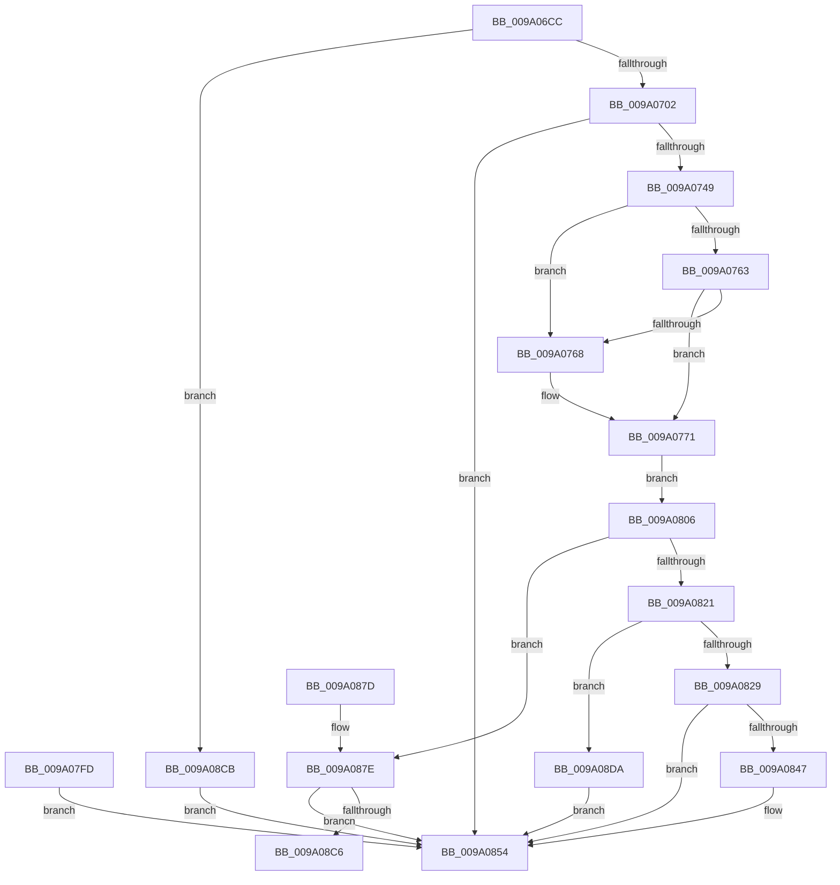

# WbValidateEncryptionSegmentArguments

- RVA: `0x009A06CC`–`0x009A08E4` (길이 `536` bytes)
- VA: `0x00000001409A06CC`
- 실행 섹션: `PAGE`
- PDB 이름 있음: `예`; PDB Function 태그: `예`
- unwind 정보 RVA: `0x0009B3AC`
- 디코드: `146`개 명령, `536/536` bytes 표시
- 미해석 바이트: `0` (있으면 어셈블리에 `.byte`로 보존)

> 이 문서는 커널 이미지의 기계어와 PDB 기호를 분석해 생성했습니다. 4번과 5번은 함수 원형과 자료형을 바이너리 사용 방식에서 추정한 C 해석이며 원본 소스 복구 결과는 아닙니다.

## 1. Dependencies

- 직접 호출 지점: **6**; 고유 호출 대상: **2**
- 직접 호출자로 확인된 함수: **1**
- RIP 상대 이미지 참조: **0**

### Outgoing calls
- `0x009A0710` → [ExAllocatePool2](../../poolcode/B8/ExAllocatePool2_function_00B820F0.md) (function, `0x00B820F0`)
- `0x009A072B` → [PdcCloseEvent](../8D/PdcCloseEvent_function_008D2404.md) (function, `0x008D2404`)
- `0x009A0857` → [PdcCloseEvent](../8D/PdcCloseEvent_function_008D2404.md) (function, `0x008D2404`)
- `0x009A0881` → [PdcCloseEvent](../8D/PdcCloseEvent_function_008D2404.md) (function, `0x008D2404`)
- `0x009A0896` → [ExAllocatePool2](../../poolcode/B8/ExAllocatePool2_function_00B820F0.md) (function, `0x00B820F0`)
- `0x009A08AC` → [PdcCloseEvent](../8D/PdcCloseEvent_function_008D2404.md) (function, `0x008D2404`)

### Direct callers
- [sub_009A051C](Unknown_function_009A051C.md) at `0x009A056E`

### Static image references
- 디코드된 RIP-relative 메모리 참조가 없습니다.

## 2. Other-region calls and transfers

- 다른 실행 섹션으로 향하는 call: **2**
  - `0x009A0710` → [ExAllocatePool2](../../poolcode/B8/ExAllocatePool2_function_00B820F0.md) (`PAGE` → `POOLCODE`)
  - `0x009A0896` → [ExAllocatePool2](../../poolcode/B8/ExAllocatePool2_function_00B820F0.md) (`PAGE` → `POOLCODE`)
- call이 아닌 외부 분기/꼬리 이동: **1**
  - `0x009A08C6` → [sub_00B2D0DC](../B2/Unknown_function_00B2D0DC.md) (`tail-transfer`)

## 3. Assembly (complete function range)

```asm
009A06CC  48 8B C4                        mov rax, rsp
009A06CF  48 89 58 08                     mov qword ptr [rax + 8], rbx
009A06D3  48 89 70 10                     mov qword ptr [rax + 0x10], rsi
009A06D7  48 89 78 18                     mov qword ptr [rax + 0x18], rdi
009A06DB  4C 89 60 20                     mov qword ptr [rax + 0x20], r12
009A06DF  41 55                           push r13
009A06E1  41 56                           push r14
009A06E3  41 57                           push r15
009A06E5  48 83 EC 50                     sub rsp, 0x50
009A06E9  4D 8B F1                        mov r14, r9
009A06EC  4D 8B E0                        mov r12, r8
009A06EF  4C 8B F9                        mov r15, rcx
009A06F2  0F 57 C0                        xorps xmm0, xmm0
009A06F5  0F 11 40 D0                     movups xmmword ptr [rax - 0x30], xmm0
009A06F9  83 FA 10                        cmp edx, 0x10
009A06FC  0F 82 C9 01 00 00               jb 0x1409a08cb
009A0702  BA F4 00 00 00                  mov edx, 0xf4
009A0707  8D 4A 0C                        lea ecx, [rdx + 0xc]
009A070A  41 B8 57 41 52 42               mov r8d, 0x42524157
009A0710  E8 DB 19 1E 00                  call 0x140b820f0
009A0715  48 8B D8                        mov rbx, rax
009A0718  48 8B 7C 24 40                  mov rdi, qword ptr [rsp + 0x40]
009A071D  48 85 C0                        test rax, rax
009A0720  48 0F 45 F8                     cmovne rdi, rax
009A0724  48 89 7C 24 40                  mov qword ptr [rsp + 0x40], rdi
009A0729  33 C9                           xor ecx, ecx
009A072B  E8 D4 1C F3 FF                  call 0x1408d2404
009A0730  48 8B C3                        mov rax, rbx
009A0733  48 F7 D8                        neg rax
009A0736  1B F6                           sbb esi, esi
009A0738  F7 D6                           not esi
009A073A  81 E6 17 00 00 C0               and esi, 0xc0000017
009A0740  48 85 DB                        test rbx, rbx
009A0743  0F 84 0B 01 00 00               je 0x1409a0854
009A0749  49 8B 47 08                     mov rax, qword ptr [r15 + 8]
009A074D  48 8D 88 F4 00 00 00            lea rcx, [rax + 0xf4]
009A0754  49 BD 00 00 FF FF FF 7F 00 00   movabs r13, 0x7fffffff0000
009A075E  49 3B CD                        cmp rcx, r13
009A0761  77 05                           ja 0x1409a0768
009A0763  48 3B C8                        cmp rcx, rax
009A0766  73 09                           jae 0x1409a0771
009A0768  41 8A 45 00                     mov al, byte ptr [r13]
009A076C  48 8B 7C 24 40                  mov rdi, qword ptr [rsp + 0x40]
009A0771  49 8B 47 08                     mov rax, qword ptr [r15 + 8]
009A0775  0F 10 00                        movups xmm0, xmmword ptr [rax]
009A0778  0F 11 07                        movups xmmword ptr [rdi], xmm0
009A077B  0F 10 48 10                     movups xmm1, xmmword ptr [rax + 0x10]
009A077F  0F 11 4F 10                     movups xmmword ptr [rdi + 0x10], xmm1
009A0783  0F 10 40 20                     movups xmm0, xmmword ptr [rax + 0x20]
009A0787  0F 11 47 20                     movups xmmword ptr [rdi + 0x20], xmm0
009A078B  0F 10 48 30                     movups xmm1, xmmword ptr [rax + 0x30]
009A078F  0F 11 4F 30                     movups xmmword ptr [rdi + 0x30], xmm1
009A0793  0F 10 40 40                     movups xmm0, xmmword ptr [rax + 0x40]
009A0797  0F 11 47 40                     movups xmmword ptr [rdi + 0x40], xmm0
009A079B  0F 10 48 50                     movups xmm1, xmmword ptr [rax + 0x50]
009A079F  0F 11 4F 50                     movups xmmword ptr [rdi + 0x50], xmm1
009A07A3  0F 10 40 60                     movups xmm0, xmmword ptr [rax + 0x60]
009A07A7  0F 11 47 60                     movups xmmword ptr [rdi + 0x60], xmm0
009A07AB  BA 80 00 00 00                  mov edx, 0x80
009A07B0  48 8D 0C 3A                     lea rcx, [rdx + rdi]
009A07B4  0F 10 40 70                     movups xmm0, xmmword ptr [rax + 0x70]
009A07B8  0F 11 41 F0                     movups xmmword ptr [rcx - 0x10], xmm0
009A07BC  48 03 C2                        add rax, rdx
009A07BF  0F 10 08                        movups xmm1, xmmword ptr [rax]
009A07C2  0F 11 09                        movups xmmword ptr [rcx], xmm1
009A07C5  0F 10 40 10                     movups xmm0, xmmword ptr [rax + 0x10]
009A07C9  0F 11 41 10                     movups xmmword ptr [rcx + 0x10], xmm0
009A07CD  0F 10 48 20                     movups xmm1, xmmword ptr [rax + 0x20]
009A07D1  0F 11 49 20                     movups xmmword ptr [rcx + 0x20], xmm1
009A07D5  0F 10 40 30                     movups xmm0, xmmword ptr [rax + 0x30]
009A07D9  0F 11 41 30                     movups xmmword ptr [rcx + 0x30], xmm0
009A07DD  0F 10 48 40                     movups xmm1, xmmword ptr [rax + 0x40]
009A07E1  0F 11 49 40                     movups xmmword ptr [rcx + 0x40], xmm1
009A07E5  0F 10 40 50                     movups xmm0, xmmword ptr [rax + 0x50]
009A07E9  0F 11 41 50                     movups xmmword ptr [rcx + 0x50], xmm0
009A07ED  0F 10 48 60                     movups xmm1, xmmword ptr [rax + 0x60]
009A07F1  0F 11 49 60                     movups xmmword ptr [rcx + 0x60], xmm1
009A07F5  8B 40 70                        mov eax, dword ptr [rax + 0x70]
009A07F8  89 41 70                        mov dword ptr [rcx + 0x70], eax
009A07FB  EB 09                           jmp 0x1409a0806
009A07FD  8B F0                           mov esi, eax
009A07FF  48 8B 7C 24 40                  mov rdi, qword ptr [rsp + 0x40]
009A0804  EB 4E                           jmp 0x1409a0854
009A0806  8B 47 24                        mov eax, dword ptr [rdi + 0x24]
009A0809  8B D0                           mov edx, eax
009A080B  83 E2 0F                        and edx, 0xf
009A080E  89 54 24 38                     mov dword ptr [rsp + 0x38], edx
009A0812  C1 E8 04                        shr eax, 4
009A0815  83 E0 0F                        and eax, 0xf
009A0818  89 44 24 3C                     mov dword ptr [rsp + 0x3c], eax
009A081C  83 FA 01                        cmp edx, 1
009A081F  74 5D                           je 0x1409a087e
009A0821  85 D2                           test edx, edx
009A0823  0F 85 B1 00 00 00               jne 0x1409a08da
009A0829  8B 47 40                        mov eax, dword ptr [rdi + 0x40]
009A082C  41 89 46 08                     mov dword ptr [r14 + 8], eax
009A0830  8B 47 28                        mov eax, dword ptr [rdi + 0x28]
009A0833  25 FF FF FF 0F                  and eax, 0xfffffff
009A0838  49 8B 4F 08                     mov rcx, qword ptr [r15 + 8]
009A083C  48 2B C8                        sub rcx, rax
009A083F  49 89 0E                        mov qword ptr [r14], rcx
009A0842  4D 85 E4                        test r12, r12
009A0845  74 0D                           je 0x1409a0854
009A0847  0F 10 44 24 38                  movups xmm0, xmmword ptr [rsp + 0x38]
009A084C  F3 41 0F 7F 04 24               movdqu xmmword ptr [r12], xmm0
009A0852  33 FF                           xor edi, edi
009A0854  48 8B CF                        mov rcx, rdi
009A0857  E8 A8 1B F3 FF                  call 0x1408d2404
009A085C  8B C6                           mov eax, esi
009A085E  4C 8D 5C 24 50                  lea r11, [rsp + 0x50]
009A0863  49 8B 5B 20                     mov rbx, qword ptr [r11 + 0x20]
009A0867  49 8B 73 28                     mov rsi, qword ptr [r11 + 0x28]
009A086B  49 8B 7B 30                     mov rdi, qword ptr [r11 + 0x30]
009A086F  4D 8B 63 38                     mov r12, qword ptr [r11 + 0x38]
009A0873  49 8B E3                        mov rsp, r11
009A0876  41 5F                           pop r15
009A0878  41 5E                           pop r14
009A087A  41 5D                           pop r13
009A087C  C3                              ret
009A087D  CC                              int3
009A087E  48 8B CF                        mov rcx, rdi
009A0881  E8 7E 1B F3 FF                  call 0x1408d2404
009A0886  33 FF                           xor edi, edi
009A0888  BA F8 00 00 00                  mov edx, 0xf8
009A088D  8D 4A 08                        lea ecx, [rdx + 8]
009A0890  41 B8 57 41 52 42               mov r8d, 0x42524157
009A0896  E8 55 18 1E 00                  call 0x140b820f0
009A089B  48 8B D8                        mov rbx, rax
009A089E  48 85 C0                        test rax, rax
009A08A1  48 0F 45 F8                     cmovne rdi, rax
009A08A5  48 89 7C 24 40                  mov qword ptr [rsp + 0x40], rdi
009A08AA  33 C9                           xor ecx, ecx
009A08AC  E8 53 1B F3 FF                  call 0x1408d2404
009A08B1  48 8B C3                        mov rax, rbx
009A08B4  48 F7 D8                        neg rax
009A08B7  1B F6                           sbb esi, esi
009A08B9  F7 D6                           not esi
009A08BB  81 E6 17 00 00 C0               and esi, 0xc0000017
009A08C1  48 85 DB                        test rbx, rbx
009A08C4  74 8E                           je 0x1409a0854
009A08C6  E9 11 C8 18 00                  jmp 0x140b2d0dc
009A08CB  BE 0D 00 00 C0                  mov esi, 0xc000000d
009A08D0  48 8B 7C 24 40                  mov rdi, qword ptr [rsp + 0x40]
009A08D5  E9 7A FF FF FF                  jmp 0x1409a0854
009A08DA  BE 0D 00 00 C0                  mov esi, 0xc000000d
009A08DF  E9 70 FF FF FF                  jmp 0x1409a0854
```

## 4. C-style interpretation (structured pseudocode)

```c
__int64 __fastcall WbValidateEncryptionSegmentArguments(__int64 a1, int a2, __int64 a3, __int64 a4)
{
    __int64 result;
    __int64 v_rdi;
    __int64 v_rsi;
    __int64 v_rsp;
    unsigned __int64 v_stack_m10;
    unsigned __int64 v_stack_m18;
    unsigned __int64 v_stack_m28;
    unsigned int v_stack_m2C;
    unsigned int v_stack_m30;

    *(unsigned __int64 *)(v_rsp + 8) = v_rbx;
    *(unsigned __int64 *)(v_rsp + 16) = v_rsi;
    *(unsigned __int64 *)(v_rsp + 24) = v_rdi;
    *(unsigned __int64 *)(v_rsp + 32) = v_r12;
    v_rsp = (v_rsp) - (80);
    *(unsigned __int64 *)(v_rsp - 48) = v_xmm0;
    if (a2 < 16) goto loc_009A08CB;
    result = ExAllocatePool2(244 + 12, 244, (unsigned int)(0x42524157ULL), a4);
    v_rdi = v_stack_m28;
    if (result != 0) { v_rdi = result; }
    v_stack_m28 = v_rdi;
    a1 = 0;
    result = PdcCloseEvent(a1, 244, (unsigned int)(0x42524157ULL), a4);
    result = -(result);
    v_rsi = (unsigned int)(~(v_rsi));
    v_rsi = (unsigned int)((v_rsi) & (0xC0000017ULL));
    if (result == 0) goto loc_009A0854;
    if ((*(unsigned __int64 *)(a1 + 8) + 244) > v_r13) goto loc_009A0768;
    result = *(unsigned __int64 *)(a1 + 8);
    if ((*(unsigned __int64 *)(a1 + 8) + 244) < (*(unsigned __int64 *)(a1 + 8))) {
        result = *(unsigned __int8 *)(v_r13);
        v_rdi = v_stack_m28;
    }
    *(unsigned __int64 *)(v_rdi) = v_xmm0;
    *(unsigned __int64 *)(v_rdi + 16) = v_xmm1;
    *(unsigned __int64 *)(v_rdi + 32) = v_xmm0;
    *(unsigned __int64 *)(v_rdi + 48) = v_xmm1;
    *(unsigned __int64 *)(v_rdi + 64) = v_xmm0;
    *(unsigned __int64 *)(v_rdi + 80) = v_xmm1;
    *(unsigned __int64 *)(v_rdi + 96) = v_xmm0;
    *(unsigned __int64 *)(128 + v_rdi * 1 - 16) = v_xmm0;
    result = (*(unsigned __int64 *)(a1 + 8)) + (128);
    *(unsigned __int64 *)(128 + v_rdi * 1) = v_xmm1;
    *(unsigned __int64 *)(128 + v_rdi * 1 + 16) = v_xmm0;
    *(unsigned __int64 *)(128 + v_rdi * 1 + 32) = v_xmm1;
    *(unsigned __int64 *)(128 + v_rdi * 1 + 48) = v_xmm0;
    *(unsigned __int64 *)(128 + v_rdi * 1 + 64) = v_xmm1;
    *(unsigned __int64 *)(128 + v_rdi * 1 + 80) = v_xmm0;
    *(unsigned __int64 *)(128 + v_rdi * 1 + 96) = v_xmm1;
    *(unsigned int *)(128 + v_rdi * 1 + 112) = (unsigned int)((unsigned int)(*(unsigned int *)(result + 112)));
    goto loc_009A0806;
loc_009A0806:
    a2 = (unsigned int)(((unsigned int)((unsigned int)((unsigned int)(*(unsigned int *)(v_rdi + 36))))) & (15));
    v_stack_m30 = a2;
    result = (unsigned int)(((unsigned int)(*(unsigned int *)(v_rdi + 36))) >> (4));
    result = (unsigned int)((result) & (15));
    v_stack_m2C = (unsigned int)(result);
    if (a2 == 1) goto loc_009A087E;
    if (a2 != 0) goto loc_009A08DA;
    *(unsigned int *)(a4 + 8) = (unsigned int)((unsigned int)(*(unsigned int *)(v_rdi + 64)));
    result = (unsigned int)(((unsigned int)(*(unsigned int *)(v_rdi + 40))) & (0xFFFFFFFULL));
    a1 = (*(unsigned __int64 *)(a1 + 8)) - (result);
    *(unsigned __int64 *)(a4) = a1;
    if (a3 != 0) {
        *(unsigned __int64 *)(a3) = v_xmm0;
        v_rdi = 0;
    }
    result = PdcCloseEvent(0, a2, (unsigned int)(0x42524157ULL), a4);
    return (unsigned int)((unsigned int)(v_rsi));
loc_009A087E:
    result = PdcCloseEvent(*(unsigned __int64 *)(v_stack_m18 + 48), a2, (unsigned int)(0x42524157ULL), a4);
    v_rdi = 0;
    result = ExAllocatePool2(248 + 8, 248, (unsigned int)(0x42524157ULL), a4);
    if (result != 0) { v_rdi = result; }
    v_stack_m10 = v_rdi;
    a1 = 0;
    result = PdcCloseEvent(a1, 248, (unsigned int)(0x42524157ULL), a4);
    result = -(result);
    v_rsi = (unsigned int)(~(*(unsigned __int64 *)(v_stack_m18 + 40)));
    v_rsi = (unsigned int)((v_rsi) & (0xC0000017ULL));
    if (result == 0) goto loc_009A0854;
loc_009A08CB:
    goto loc_009A0854;
loc_009A08DA:
    goto loc_009A0854;
}
```

## 5. (Beta) C Style

```c
int64_t WbValidateEncryptionSegmentArguments(void *Arg1, int32_t Arg2, int64_t Arg3, void *Arg4)
{
    uint8_t *arg1 = (uint8_t *)Arg1;
    uint8_t *arg4 = (uint8_t *)Arg4;

    int64_t result;
    int64_t local_rdi;
    int64_t local_rsi;
    int64_t local_rsp;
    uint64_t v_stack_m10;
    uint64_t v_stack_m18;
    uint64_t v_stack_m28;
    uint32_t v_stack_m2C;
    uint32_t v_stack_m30;

    *(uint64_t *)(local_rsp + 0x8) = local_rbx;
    *(uint64_t *)(local_rsp + 0x10) = local_rsi;
    *(uint64_t *)(local_rsp + 0x18) = local_rdi;
    *(uint64_t *)(local_rsp + 0x20) = local_r12;
    local_rsp = (local_rsp) - (80);
    *(uint64_t *)(local_rsp - 0x30) = v_xmm0;
    if (Arg2 < 16) goto loc_009A08CB;
    result = ExAllocatePool2(244 + 12, 244, (uint32_t)(0x42524157ULL), Arg4);
    local_rdi = v_stack_m28;
    if (result != 0) { local_rdi = result; }
    v_stack_m28 = local_rdi;
    Arg1 = 0;
    result = PdcCloseEvent(Arg1, 244, (uint32_t)(0x42524157ULL), Arg4);
    result = -(result);
    local_rsi = (uint32_t)(~(local_rsi));
    local_rsi = (uint32_t)((local_rsi) & (0xC0000017ULL));
    if (result == 0) goto loc_009A0854;
    if ((*(uint64_t *)(arg1 + 0x8) + 244) > local_r13) goto loc_009A0768;
    result = *(uint64_t *)(arg1 + 0x8);
    if ((*(uint64_t *)(arg1 + 0x8) + 244) < (*(uint64_t *)(arg1 + 0x8))) {
        result = *(uint8_t *)(local_r13);
        local_rdi = v_stack_m28;
    }
    *(uint64_t *)(local_rdi) = v_xmm0;
    *(uint64_t *)(local_rdi + 0x10) = v_xmm1;
    *(uint64_t *)(local_rdi + 0x20) = v_xmm0;
    *(uint64_t *)(local_rdi + 0x30) = v_xmm1;
    *(uint64_t *)(local_rdi + 0x40) = v_xmm0;
    *(uint64_t *)(local_rdi + 0x50) = v_xmm1;
    *(uint64_t *)(local_rdi + 0x60) = v_xmm0;
    *(uint64_t *)(128 + local_rdi * 1 - 0x10) = v_xmm0;
    result = (*(uint64_t *)(arg1 + 0x8)) + (128);
    *(uint64_t *)(128 + local_rdi * 1) = v_xmm1;
    *(uint64_t *)(128 + local_rdi * 1 + 0x10) = v_xmm0;
    *(uint64_t *)(128 + local_rdi * 1 + 0x20) = v_xmm1;
    *(uint64_t *)(128 + local_rdi * 1 + 0x30) = v_xmm0;
    *(uint64_t *)(128 + local_rdi * 1 + 0x40) = v_xmm1;
    *(uint64_t *)(128 + local_rdi * 1 + 0x50) = v_xmm0;
    *(uint64_t *)(128 + local_rdi * 1 + 0x60) = v_xmm1;
    *(uint32_t *)(128 + local_rdi * 1 + 0x70) = (uint32_t)((uint32_t)(*(uint32_t *)(result + 0x70)));
    goto loc_009A0806;
loc_009A0806:
    Arg2 = (uint32_t)(((uint32_t)((uint32_t)((uint32_t)(*(uint32_t *)(local_rdi + 0x24))))) & (15));
    v_stack_m30 = Arg2;
    result = (uint32_t)(((uint32_t)(*(uint32_t *)(local_rdi + 0x24))) >> (4));
    result = (uint32_t)((result) & (15));
    v_stack_m2C = (uint32_t)(result);
    if (Arg2 == 1) goto loc_009A087E;
    if (Arg2 != 0) goto loc_009A08DA;
    *(uint32_t *)(arg4 + 0x8) = (uint32_t)((uint32_t)(*(uint32_t *)(local_rdi + 0x40)));
    result = (uint32_t)(((uint32_t)(*(uint32_t *)(local_rdi + 0x28))) & (0xFFFFFFFULL));
    Arg1 = (*(uint64_t *)(arg1 + 0x8)) - (result);
    *(void **)(arg4) = Arg1;
    if (Arg3 != 0) {
        *(uint64_t *)(Arg3) = v_xmm0;
        local_rdi = 0;
    }
    result = PdcCloseEvent(0, Arg2, (uint32_t)(0x42524157ULL), Arg4);
    return (uint32_t)((uint32_t)(local_rsi));
loc_009A087E:
    result = PdcCloseEvent(*(uint64_t *)(v_stack_m18 + 0x30), Arg2, (uint32_t)(0x42524157ULL), Arg4);
    local_rdi = 0;
    result = ExAllocatePool2(248 + 8, 248, (uint32_t)(0x42524157ULL), Arg4);
    if (result != 0) { local_rdi = result; }
    v_stack_m10 = local_rdi;
    Arg1 = 0;
    result = PdcCloseEvent(Arg1, 248, (uint32_t)(0x42524157ULL), Arg4);
    result = -(result);
    local_rsi = (uint32_t)(~(*(uint64_t *)(v_stack_m18 + 0x28)));
    local_rsi = (uint32_t)((local_rsi) & (0xC0000017ULL));
    if (result == 0) goto loc_009A0854;
loc_009A08CB:
    goto loc_009A0854;
loc_009A08DA:
    goto loc_009A0854;
}
```

### 관측된 메모리 오프셋

구조체 형식이 확인되지 않은 접근은 인자 기준의 오프셋으로만 기록했습니다.

| 기준 인자 | 오프셋 표현 | 폭 (bit) | 접근 |
|---|---:|---:|---|
| `Arg1` | `+ 0x8` | `64` | `R` |
| `Arg4` | `+ 0x0` | `64` | `W` |
| `Arg4` | `+ 0x8` | `32` | `W` |

## 6. Execution-region graph

[열기: 2D/3D 그래프와 함수 탐색 컨트롤 패널](../../../control-panel.html?section=page&rva=0x009A06CC&view=graph)

- 2D 그래프는 위에서 아래로 흐르고, 3D 그래프는 빈 공간을 드래그해 회전합니다. Shift+드래그는 이동, 휠은 확대·축소, 함수 노드 선택은 대상 보고서 이동입니다.

### Static fallback


