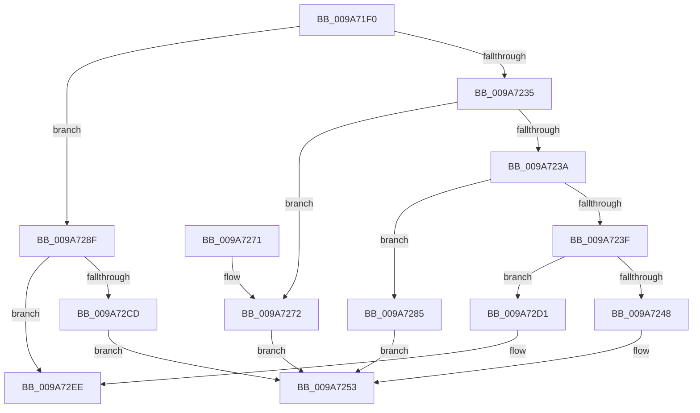

# WmipSecurityMethod

- RVA: `0x009A71F0`–`0x009A72FC` (길이 `268` bytes)
- VA: `0x00000001409A71F0`
- 실행 섹션: `PAGE`
- PDB 이름 있음: `예`; PDB Function 태그: `예`
- unwind 정보 RVA: `0x0009CA8C`
- 디코드: `74`개 명령, `268/268` bytes 표시
- 미해석 바이트: `0` (있으면 어셈블리에 `.byte`로 보존)

> 이 문서는 커널 이미지의 기계어와 PDB 기호를 분석해 생성했습니다. 4번과 5번은 함수 원형과 자료형을 바이너리 사용 방식에서 추정한 C 해석이며 원본 소스 복구 결과는 아닙니다.

## 1. Dependencies

- 직접 호출 지점: **6**; 고유 호출 대상: **6**
- 직접 호출자로 확인된 함수: **1**
- RIP 상대 이미지 참조: **1**

### Outgoing calls
- `0x009A724E` → [ObAssignObjectSecurityDescriptor](ObAssignObjectSecurityDescriptor_function_009A7310.md) (function, `0x009A7310`)
- `0x009A725E` → [_security_check_cookie](../../text/6A/_security_check_cookie_function_006AC640.md) (function, `0x006AC640`)
- `0x009A727E` → [ObQuerySecurityDescriptorInfo](../87/ObQuerySecurityDescriptorInfo_function_00873624.md) (function, `0x00873624`)
- `0x009A7288` → [ObDeassignSecurity](../86/ObDeassignSecurity_function_008653F0.md) (function, `0x008653F0`)
- `0x009A72C2` → [ObSetSecurityDescriptorInfo](../8B/ObSetSecurityDescriptorInfo_function_008BAE20.md) (function, `0x008BAE20`)
- `0x009A72E8` → [KeBugCheckEx](../../text/4F/KeBugCheckEx_function_004FD660.md) (function, `0x004FD660`)

### Direct callers
- [ObpRemoveObjectRoutine](../86/ObpRemoveObjectRoutine_function_00864A60.md) at `0x00864BB0`

### Static image references
- `0x009A71FE` → RVA `0x00E0A740` (`.data`; read)

## 2. Other-region calls and transfers

- 다른 실행 섹션으로 향하는 call: **2**
  - `0x009A725E` → [_security_check_cookie](../../text/6A/_security_check_cookie_function_006AC640.md) (`PAGE` → `.text`)
  - `0x009A72E8` → [KeBugCheckEx](../../text/4F/KeBugCheckEx_function_004FD660.md) (`PAGE` → `.text`)
- call이 아닌 외부 분기/꼬리 이동: **1**
  - `0x009A72F7` → [sub_00B2D638](../B2/Unknown_function_00B2D638.md) (`tail-transfer`)

## 3. Assembly (complete function range)

```asm
009A71F0  40 53                           push rbx
009A71F2  55                              push rbp
009A71F3  56                              push rsi
009A71F4  57                              push rdi
009A71F5  41 56                           push r14
009A71F7  48 81 EC F0 00 00 00            sub rsp, 0xf0
009A71FE  48 8B 05 3B 35 46 00            mov rax, qword ptr [rip + 0x46353b]
009A7205  48 33 C4                        xor rax, rsp
009A7208  48 89 84 24 E0 00 00 00         mov qword ptr [rsp + 0xe0], rax
009A7210  4D 8B D1                        mov r10, r9
009A7213  4C 8B 8C 24 48 01 00 00         mov r9, qword ptr [rsp + 0x148]
009A721B  4D 8B D8                        mov r11, r8
009A721E  4C 8B 84 24 58 01 00 00         mov r8, qword ptr [rsp + 0x158]
009A7226  48 8B E9                        mov rbp, rcx
009A7229  48 8B 8C 24 40 01 00 00         mov rcx, qword ptr [rsp + 0x140]
009A7231  85 D2                           test edx, edx
009A7233  74 5A                           je 0x1409a728f
009A7235  83 EA 01                        sub edx, 1
009A7238  74 38                           je 0x1409a7272
009A723A  83 EA 01                        sub edx, 1
009A723D  74 46                           je 0x1409a7285
009A723F  83 FA 01                        cmp edx, 1
009A7242  0F 85 89 00 00 00               jne 0x1409a72d1
009A7248  49 8B D2                        mov rdx, r10
009A724B  48 8B CD                        mov rcx, rbp
009A724E  E8 BD 00 00 00                  call 0x1409a7310
009A7253  48 8B 8C 24 E0 00 00 00         mov rcx, qword ptr [rsp + 0xe0]
009A725B  48 33 CC                        xor rcx, rsp
009A725E  E8 DD 53 D0 FF                  call 0x1406ac640
009A7263  48 81 C4 F0 00 00 00            add rsp, 0xf0
009A726A  41 5E                           pop r14
009A726C  5F                              pop rdi
009A726D  5E                              pop rsi
009A726E  5D                              pop rbp
009A726F  5B                              pop rbx
009A7270  C3                              ret
009A7271  CC                              int3
009A7272  4C 8B C9                        mov r9, rcx
009A7275  4D 8B C2                        mov r8, r10
009A7278  48 8B CD                        mov rcx, rbp
009A727B  49 8B D3                        mov rdx, r11
009A727E  E8 A1 C3 EC FF                  call 0x140873624
009A7283  EB CE                           jmp 0x1409a7253
009A7285  49 8B C9                        mov rcx, r9
009A7288  E8 63 E1 EB FF                  call 0x1408653f0
009A728D  EB C4                           jmp 0x1409a7253
009A728F  8B 84 24 50 01 00 00            mov eax, dword ptr [rsp + 0x150]
009A7296  B9 00 01 00 00                  mov ecx, 0x100
009A729B  4C 89 44 24 28                  mov qword ptr [rsp + 0x28], r8
009A72A0  3D 00 02 00 00                  cmp eax, 0x200
009A72A5  0F 57 C0                        xorps xmm0, xmm0
009A72A8  89 44 24 20                     mov dword ptr [rsp + 0x20], eax
009A72AC  BF 40 00 00 00                  mov edi, 0x40
009A72B1  4D 8B C2                        mov r8, r10
009A72B4  0F 45 F9                        cmovne edi, ecx
009A72B7  49 8B D3                        mov rdx, r11
009A72BA  48 8B CD                        mov rcx, rbp
009A72BD  0F 11 44 24 78                  movups xmmword ptr [rsp + 0x78], xmm0
009A72C2  E8 59 3B F1 FF                  call 0x1408bae20
009A72C7  8B D8                           mov ebx, eax
009A72C9  85 C0                           test eax, eax
009A72CB  79 21                           jns 0x1409a72ee
009A72CD  8B C3                           mov eax, ebx
009A72CF  EB 82                           jmp 0x1409a7253
009A72D1  48 83 64 24 20 00               and qword ptr [rsp + 0x20], 0
009A72D7  45 33 C9                        xor r9d, r9d
009A72DA  49 C7 C0 0D 00 00 C0            mov r8, 0xffffffffc000000d
009A72E1  41 8D 51 01                     lea edx, [r9 + 1]
009A72E5  8D 4A 28                        lea ecx, [rdx + 0x28]
009A72E8  E8 73 63 B5 FF                  call 0x1404fd660
009A72ED  CC                              int3
009A72EE  B8 00 04 00 00                  mov eax, 0x400
009A72F3  89 44 24 70                     mov dword ptr [rsp + 0x70], eax
009A72F7  E9 3C 63 18 00                  jmp 0x140b2d638
```

## 4. C-style interpretation (structured pseudocode)

```c
__int64 __fastcall WmipSecurityMethod(__int64 a1, int a2, __int64 a3, __int64 a4, __int64 a5, __int64 a6, unsigned int a7, __int64 a8)
{
    __int64 result;
    __int64 v_rdi;
    __int64 v_rsp;
    unsigned __int64 v_stack_m38;
    unsigned int v_stack_p20;
    unsigned __int64 v_stack_p28;
    unsigned int v_stack_p70;
    unsigned __int64 v_stack_p78;

    v_rsp = (v_rsp) - (240);
    result = (*(unsigned __int64 *)(v_rip + 4601147)) ^ (v_rsp);
    v_stack_m38 = result;
    if (a2 == 0) goto loc_009A728F;
    a2 = (unsigned int)((a2) - (1));
    if (condition_is_equal) goto loc_009A7272;
    a2 = (unsigned int)((a2) - (1));
    if (condition_is_equal) goto loc_009A7285;
    if (a2 != 1) goto loc_009A72D1;
    result = ObAssignObjectSecurityDescriptor(a1, a4, a8, a6);
loc_009A7253:
    a1 = (v_stack_m38) ^ (v_rsp);
    result = _security_check_cookie(a1, a4, a8, a6);
    v_rsp = (v_rsp) + (240);
    return result;
loc_009A7272:
    result = ObQuerySecurityDescriptorInfo(a1, a3, a4, a1);
    goto loc_009A7253;
loc_009A7285:
    result = ObDeassignSecurity(a1, a3, a4, a1);
    goto loc_009A7253;
loc_009A728F:
    v_stack_p28 = a4;
    v_stack_p20 = (unsigned int)((unsigned int)(a7));
    v_rdi = 64;
    if (((unsigned int)((unsigned int)(a7))) != 512) { v_rdi = 256; }
    v_stack_p78 = v_xmm0;
    result = ObSetSecurityDescriptorInfo(a1, a3, a4, a1);
    if (!sign_flag) goto loc_009A72EE;
    goto loc_009A7253;
loc_009A72D1:
    a4 = 0;
    result = KeBugCheckEx(a4 + 1 + 40, a4 + 1, 0xFFFFFFFFC000000DULL, a4);
loc_009A72EE:
    v_stack_p70 = (unsigned int)((unsigned int)(0x400ULL));
}
```

## 5. (Beta) C Style

```c
int64_t WmipSecurityMethod(int64_t Arg1, int32_t Arg2, int64_t Arg3, int64_t Arg4, int64_t Arg5, int64_t Arg6, uint32_t Arg7, int64_t Arg8)
{
    int64_t result;
    int64_t local_rdi;
    int64_t local_rsp;
    uint64_t v_stack_m38;
    uint32_t v_stack_p20;
    uint64_t v_stack_p28;
    uint32_t v_stack_p70;
    uint64_t v_stack_p78;

    local_rsp = (local_rsp) - (240);
    result = (*(uint64_t *)(v_rip + 0x46353B)) ^ (local_rsp);
    v_stack_m38 = result;
    if (Arg2 == 0) goto loc_009A728F;
    Arg2 = (uint32_t)((Arg2) - (1));
    if (condition_is_equal) goto loc_009A7272;
    Arg2 = (uint32_t)((Arg2) - (1));
    if (condition_is_equal) goto loc_009A7285;
    if (Arg2 != 1) goto loc_009A72D1;
    result = ObAssignObjectSecurityDescriptor(Arg1, Arg4, Arg8, Arg6);
loc_009A7253:
    Arg1 = (v_stack_m38) ^ (local_rsp);
    result = _security_check_cookie(Arg1, Arg4, Arg8, Arg6);
    local_rsp = (local_rsp) + (240);
    return result;
loc_009A7272:
    result = ObQuerySecurityDescriptorInfo(Arg1, Arg3, Arg4, Arg1);
    goto loc_009A7253;
loc_009A7285:
    result = ObDeassignSecurity(Arg1, Arg3, Arg4, Arg1);
    goto loc_009A7253;
loc_009A728F:
    v_stack_p28 = Arg4;
    v_stack_p20 = (uint32_t)((uint32_t)(Arg7));
    local_rdi = 64;
    if (((uint32_t)((uint32_t)(Arg7))) != 512) { local_rdi = 256; }
    v_stack_p78 = v_xmm0;
    result = ObSetSecurityDescriptorInfo(Arg1, Arg3, Arg4, Arg1);
    if (!sign_flag) goto loc_009A72EE;
    goto loc_009A7253;
loc_009A72D1:
    Arg4 = 0;
    result = KeBugCheckEx(Arg4 + 1 + 40, Arg4 + 1, 0xFFFFFFFFC000000DULL, Arg4);
loc_009A72EE:
    v_stack_p70 = (uint32_t)((uint32_t)(0x400ULL));
}
```

## 6. Execution-region graph

[열기: 2D/3D 그래프와 함수 탐색 컨트롤 패널](../../../control-panel.html?section=page&rva=0x009A71F0&view=graph)

- 2D 그래프는 위에서 아래로 흐르고, 3D 그래프는 빈 공간을 드래그해 회전합니다. Shift+드래그는 이동, 휠은 확대·축소, 함수 노드 선택은 대상 보고서 이동입니다.

### Static fallback


