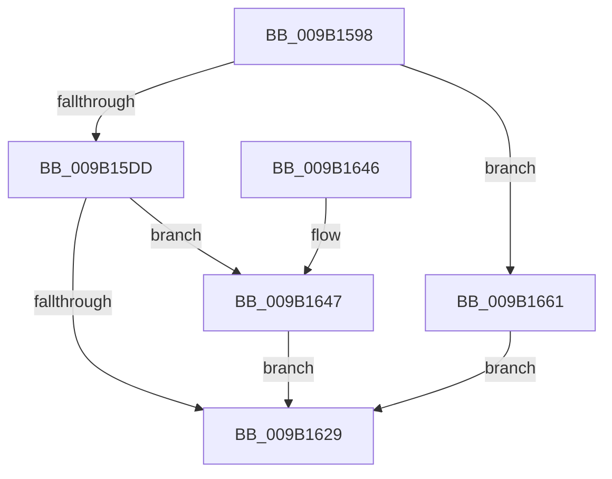

# CmLogTmRmAction

- RVA: `0x009B1598`–`0x009B1665` (길이 `205` bytes)
- VA: `0x00000001409B1598`
- 실행 섹션: `PAGE`
- PDB 이름 있음: `예`; PDB Function 태그: `아니요`
- unwind 정보 RVA: `0x0009E29C`
- 디코드: `50`개 명령, `205/205` bytes 표시
- 미해석 바이트: `0` (있으면 어셈블리에 `.byte`로 보존)

> 이 문서는 커널 이미지의 기계어와 PDB 기호를 분석해 생성했습니다. 4번과 5번은 함수 원형과 자료형을 바이너리 사용 방식에서 추정한 C 해석이며 원본 소스 복구 결과는 아닙니다.

## 1. Dependencies

- 직접 호출 지점: **4**; 고유 호출 대상: **4**
- 직접 호출자로 확인된 함수: **1**
- RIP 상대 이미지 참조: **2**

### Outgoing calls
- `0x009B15FE` → [HvBufferCheckSum](../84/HvBufferCheckSum_function_00842A04.md) (function, `0x00842A04`)
- `0x009B1620` → [CmpTransWriteLog](../84/CmpTransWriteLog_function_00842A7C.md) (function, `0x00842A7C`)
- `0x009B1630` → [_security_check_cookie](../../text/6A/_security_check_cookie_function_006AC640.md) (function, `0x006AC640`)
- `0x009B1653` → `ext-ms-win-fs-clfs-l1-1-0.dll!ClfsFlushToLsn` (import, 간접 대상; import `ext-ms-win-fs-clfs-l1-1-0.dll!ClfsFlushToLsn`)

### Direct callers
- [CmKtmNotification](CmKtmNotification_function_009B1950.md) at `0x009B1ADC`

### Static image references
- `0x009B15A8` → RVA `0x00E0A740` (`.data`; read)
- `0x009B1653` → RVA `0x00151208` (`ext-ms-win-fs-clfs-l1-1-0.dll!ClfsFlushToLsn (IAT)`; read)

## 2. Other-region calls and transfers

- 다른 실행 섹션으로 향하는 call: **1**
  - `0x009B1630` → [_security_check_cookie](../../text/6A/_security_check_cookie_function_006AC640.md) (`PAGE` → `.text`)
- 별도 외부 분기/꼬리 이동을 확인하지 못했습니다.

## 3. Assembly (complete function range)

```asm
009B1598  48 89 5C 24 20                  mov qword ptr [rsp + 0x20], rbx
009B159D  55                              push rbp
009B159E  48 8B EC                        mov rbp, rsp
009B15A1  48 81 EC 80 00 00 00            sub rsp, 0x80
009B15A8  48 8B 05 91 91 45 00            mov rax, qword ptr [rip + 0x459191]
009B15AF  48 33 C4                        xor rax, rsp
009B15B2  48 89 45 F0                     mov qword ptr [rbp - 0x10], rax
009B15B6  48 83 65 B0 00                  and qword ptr [rbp - 0x50], 0
009B15BB  0F 57 C0                        xorps xmm0, xmm0
009B15BE  48 83 65 B8 00                  and qword ptr [rbp - 0x48], 0
009B15C3  48 8B D9                        mov rbx, rcx
009B15C6  48 83 79 60 00                  cmp qword ptr [rcx + 0x60], 0
009B15CB  0F 11 45 C0                     movups xmmword ptr [rbp - 0x40], xmm0
009B15CF  0F 11 45 D0                     movups xmmword ptr [rbp - 0x30], xmm0
009B15D3  0F 11 45 E0                     movups xmmword ptr [rbp - 0x20], xmm0
009B15D7  0F 84 84 00 00 00               je 0x1409b1661
009B15DD  0F 10 42 58                     movups xmm0, xmmword ptr [rdx + 0x58]
009B15E1  83 65 CC 00                     and dword ptr [rbp - 0x34], 0
009B15E5  48 8D 4D C0                     lea rcx, [rbp - 0x40]
009B15E9  BA 30 00 00 00                  mov edx, 0x30
009B15EE  C7 45 C4 30 00 00 00            mov dword ptr [rbp - 0x3c], 0x30
009B15F5  F3 0F 7F 45 D0                  movdqu xmmword ptr [rbp - 0x30], xmm0
009B15FA  44 89 45 C8                     mov dword ptr [rbp - 0x38], r8d
009B15FE  E8 01 14 E9 FF                  call 0x140842a04
009B1603  41 B9 02 00 00 00               mov r9d, 2
009B1609  89 45 C0                        mov dword ptr [rbp - 0x40], eax
009B160C  48 8D 45 B0                     lea rax, [rbp - 0x50]
009B1610  48 8B CB                        mov rcx, rbx
009B1613  48 8D 55 C0                     lea rdx, [rbp - 0x40]
009B1617  48 89 44 24 20                  mov qword ptr [rsp + 0x20], rax
009B161C  45 8D 41 2E                     lea r8d, [r9 + 0x2e]
009B1620  E8 57 14 E9 FF                  call 0x140842a7c
009B1625  85 C0                           test eax, eax
009B1627  79 1E                           jns 0x1409b1647
009B1629  48 8B 4D F0                     mov rcx, qword ptr [rbp - 0x10]
009B162D  48 33 CC                        xor rcx, rsp
009B1630  E8 0B B0 CF FF                  call 0x1406ac640
009B1635  48 8B 9C 24 A8 00 00 00         mov rbx, qword ptr [rsp + 0xa8]
009B163D  48 81 C4 80 00 00 00            add rsp, 0x80
009B1644  5D                              pop rbp
009B1645  C3                              ret
009B1646  CC                              int3
009B1647  48 8B 4B 60                     mov rcx, qword ptr [rbx + 0x60]
009B164B  4C 8D 45 B8                     lea r8, [rbp - 0x48]
009B164F  48 8D 55 B0                     lea rdx, [rbp - 0x50]
009B1653  48 FF 15 AE FB 79 FF            call qword ptr [rip - 0x860452]
009B165A  0F 1F 44 00 00                  nop dword ptr [rax + rax]
009B165F  EB C8                           jmp 0x1409b1629
009B1661  33 C0                           xor eax, eax
009B1663  EB C4                           jmp 0x1409b1629
```

## 4. C-style interpretation (structured pseudocode)

```c
__int64 __fastcall CmLogTmRmAction(__int64 a1, __int64 a2, int a3)
{
    __int64 result;
    __int64 v_rsp;
    unsigned __int64 v_stack_m18;
    unsigned __int64 v_stack_m28;
    unsigned __int64 v_stack_m38;
    unsigned int v_stack_m3C;
    unsigned int v_stack_m40;
    unsigned int v_stack_m44;
    unsigned __int64 v_stack_m48;
    unsigned __int64 v_stack_m50;
    unsigned __int64 v_stack_m58;
    unsigned __int64 v_stack_m68;
    unsigned __int64 v_stack_p20;

    v_stack_p20 = v_rbx;
    v_rsp = (v_rsp) - (128);
    result = (*(unsigned __int64 *)(v_rip + 4559249)) ^ (v_rsp);
    v_stack_m18 = result;
    v_stack_m48 = v_xmm0;
    v_stack_m38 = v_xmm0;
    v_stack_m28 = v_xmm0;
    if ((*(unsigned __int64 *)(a1 + 96)) == 0) goto loc_009B1661;
    v_stack_m44 = 48;
    v_stack_m38 = v_xmm0;
    v_stack_m40 = a3;
    result = HvBufferCheckSum(v_stack_m48, 48, a3, a4);
    v_stack_m48 = (unsigned int)(result);
    v_stack_m68 = v_stack_m58;
    result = CmpTransWriteLog(a1, v_stack_m48, 2 + 46, 2);
    if (!sign_flag) goto loc_009B1647;
loc_009B1629:
    a1 = (v_stack_m18) ^ (v_rsp);
    result = _security_check_cookie(a1, v_stack_m48, 2 + 46, 2);
    v_rsp = (v_rsp) + (128);
    return result;
loc_009B1647:
    result = ext_ms_win_fs_clfs_l1_1_0_dll_ClfsFlushToLsn(*(unsigned __int64 *)(v_stack_p20 + 96), v_stack_m58, v_stack_m50, 2);
    goto loc_009B1629;
loc_009B1661:
    result = 0;
    goto loc_009B1629;
}
```

## 5. (Beta) C Style

```c
int64_t CmLogTmRmAction(void *Arg1, void *Arg2, int32_t Arg3)
{
    uint8_t *arg1 = (uint8_t *)Arg1;
    uint8_t *arg2 = (uint8_t *)Arg2;

    int64_t result;
    int64_t local_rsp;
    uint64_t v_stack_m18;
    uint64_t v_stack_m28;
    uint64_t v_stack_m38;
    uint32_t v_stack_m3C;
    uint32_t v_stack_m40;
    uint32_t v_stack_m44;
    uint64_t v_stack_m48;
    uint64_t v_stack_m50;
    uint64_t v_stack_m58;
    uint64_t v_stack_m68;
    uint64_t v_stack_p20;

    v_stack_p20 = local_rbx;
    local_rsp = (local_rsp) - (128);
    result = (*(uint64_t *)(v_rip + 0x459191)) ^ (local_rsp);
    v_stack_m18 = result;
    v_stack_m48 = v_xmm0;
    v_stack_m38 = v_xmm0;
    v_stack_m28 = v_xmm0;
    if ((*(uint64_t *)(arg1 + 0x60)) == 0) goto loc_009B1661;
    v_stack_m44 = 48;
    v_stack_m38 = v_xmm0;
    v_stack_m40 = Arg3;
    result = HvBufferCheckSum(v_stack_m48, 48, Arg3, a4);
    v_stack_m48 = (uint32_t)(result);
    v_stack_m68 = v_stack_m58;
    result = CmpTransWriteLog(Arg1, v_stack_m48, 2 + 46, 2);
    if (!sign_flag) goto loc_009B1647;
loc_009B1629:
    Arg1 = (v_stack_m18) ^ (local_rsp);
    result = _security_check_cookie(Arg1, v_stack_m48, 2 + 46, 2);
    local_rsp = (local_rsp) + (128);
    return result;
loc_009B1647:
    result = kernel_indirect_call(*(uint64_t *)(v_stack_p20 + 0x60), v_stack_m58, v_stack_m50, 2);
    goto loc_009B1629;
loc_009B1661:
    result = 0;
    goto loc_009B1629;
}
```

### 관측된 메모리 오프셋

구조체 형식이 확인되지 않은 접근은 인자 기준의 오프셋으로만 기록했습니다.

| 기준 인자 | 오프셋 표현 | 폭 (bit) | 접근 |
|---|---:|---:|---|
| `Arg1` | `+ 0x60` | `64` | `R` |
| `Arg2` | `+ 0x58` | `128` | `R` |

## 6. Execution-region graph

[열기: 2D/3D 그래프와 함수 탐색 컨트롤 패널](../../../control-panel.html?section=page&rva=0x009B1598&view=graph)

- 2D 그래프는 위에서 아래로 흐르고, 3D 그래프는 빈 공간을 드래그해 회전합니다. Shift+드래그는 이동, 휠은 확대·축소, 함수 노드 선택은 대상 보고서 이동입니다.

### Static fallback


