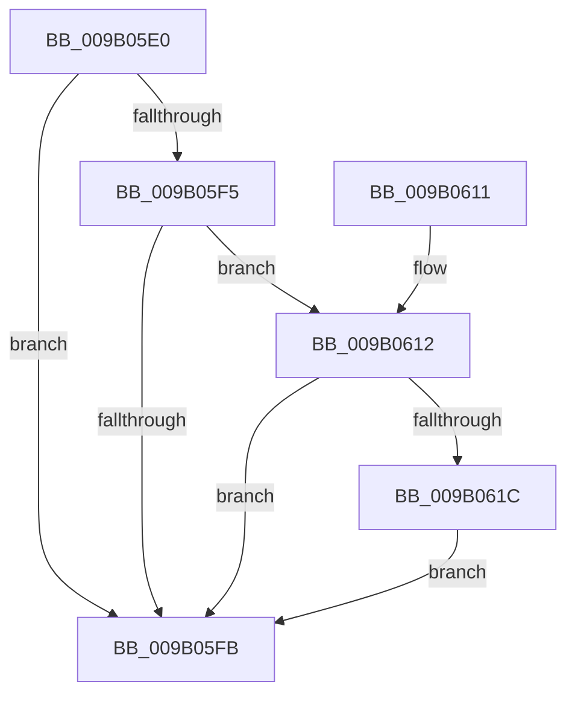

# CmShutdownCmRM

- RVA: `0x009B05E0`–`0x009B0623` (길이 `67` bytes)
- VA: `0x00000001409B05E0`
- 실행 섹션: `PAGE`
- PDB 이름 있음: `예`; PDB Function 태그: `아니요`
- unwind 정보 RVA: `0x00070544`
- 디코드: `22`개 명령, `67/67` bytes 표시
- 미해석 바이트: `0` (있으면 어셈블리에 `.byte`로 보존)

> 이 문서는 커널 이미지의 기계어와 PDB 기호를 분석해 생성했습니다. 4번과 5번은 함수 원형과 자료형을 바이너리 사용 방식에서 추정한 C 해석이며 원본 소스 복구 결과는 아닙니다.

## 1. Dependencies

- 직접 호출 지점: **2**; 고유 호출 대상: **2**
- 직접 호출자로 확인된 함수: **3**
- RIP 상대 이미지 참조: **0**

### Outgoing calls
- `0x009B0601` → [CmpRunDownCmRM](CmpRunDownCmRM_function_009B062C.md) (function, `0x009B062C`)
- `0x009B061C` → [CmpStopRMLog](../84/CmpStopRMLog_function_008427AC.md) (function, `0x008427AC`)

### Direct callers
- [CmpTryToRundownHive](../../text/2A/CmpTryToRundownHive_function_002A4A60.md) at `0x002A4BC4`
- [CmShutdownSystem1](../../text/66/CmShutdownSystem1_function_0066A5B0.md) at `0x0066A6EF`
- [CmpPerformUnloadKey](../9A/CmpPerformUnloadKey_function_009AFA28.md) at `0x009AFEDE`

### Static image references
- 디코드된 RIP-relative 메모리 참조가 없습니다.

## 2. Other-region calls and transfers

- 다른 실행 섹션으로 향하는 call: **0**
- 별도 외부 분기/꼬리 이동을 확인하지 못했습니다.

## 3. Assembly (complete function range)

```asm
009B05E0  48 89 5C 24 08                  mov qword ptr [rsp + 8], rbx
009B05E5  57                              push rdi
009B05E6  48 83 EC 20                     sub rsp, 0x20
009B05EA  40 8A FA                        mov dil, dl
009B05ED  48 8B D9                        mov rbx, rcx
009B05F0  48 85 C9                        test rcx, rcx
009B05F3  74 06                           je 0x1409b05fb
009B05F5  83 79 40 00                     cmp dword ptr [rcx + 0x40], 0
009B05F9  75 17                           jne 0x1409b0612
009B05FB  40 8A D7                        mov dl, dil
009B05FE  48 8B CB                        mov rcx, rbx
009B0601  E8 26 00 00 00                  call 0x1409b062c
009B0606  48 8B 5C 24 30                  mov rbx, qword ptr [rsp + 0x30]
009B060B  48 83 C4 20                     add rsp, 0x20
009B060F  5F                              pop rdi
009B0610  C3                              ret
009B0611  CC                              int3
009B0612  F0 FF 49 40                     lock dec dword ptr [rcx + 0x40]
009B0616  83 79 40 00                     cmp dword ptr [rcx + 0x40], 0
009B061A  75 DF                           jne 0x1409b05fb
009B061C  E8 8B 21 E9 FF                  call 0x1408427ac
009B0621  EB D8                           jmp 0x1409b05fb
```

## 4. C-style interpretation (structured pseudocode)

```c
__int64 __fastcall CmShutdownCmRM(__int64 a1, unsigned __int8 a2)
{
    __int64 result;
    __int64 v_rsp;
    unsigned __int64 v_stack_p8;

    v_stack_p8 = v_rbx;
    v_rsp = (v_rsp) - (32);
    if (a1 == 0) goto loc_009B05FB;
    if ((*(unsigned int *)(a1 + 64)) != 0) goto loc_009B0612;
loc_009B05FB:
    result = CmpRunDownCmRM(a1, a2, a3, a4);
    v_rsp = (v_rsp) + (32);
    return result;
loc_009B0612:
    if ((*(unsigned int *)(a1 + 64)) != 0) goto loc_009B05FB;
    result = CmpStopRMLog(a1, a2, a3, a4);
    goto loc_009B05FB;
}
```

## 5. (Beta) C Style

```c
int64_t CmShutdownCmRM(int64_t Arg1, uint8_t Arg2)
{
    int64_t result;
    int64_t local_rsp;
    uint64_t v_stack_p8;

    v_stack_p8 = local_rbx;
    local_rsp = (local_rsp) - (32);
    if (Arg1 == 0) goto loc_009B05FB;
    if ((*(uint32_t *)(Arg1 + 0x40)) != 0) goto loc_009B0612;
loc_009B05FB:
    result = CmpRunDownCmRM(Arg1, Arg2, a3, a4);
    local_rsp = (local_rsp) + (32);
    return result;
loc_009B0612:
    if ((*(uint32_t *)(Arg1 + 0x40)) != 0) goto loc_009B05FB;
    result = CmpStopRMLog(Arg1, Arg2, a3, a4);
    goto loc_009B05FB;
}
```

## 6. Execution-region graph

[열기: 2D/3D 그래프와 함수 탐색 컨트롤 패널](../../../control-panel.html?section=page&rva=0x009B05E0&view=graph)

- 2D 그래프는 위에서 아래로 흐르고, 3D 그래프는 빈 공간을 드래그해 회전합니다. Shift+드래그는 이동, 휠은 확대·축소, 함수 노드 선택은 대상 보고서 이동입니다.

### Static fallback


