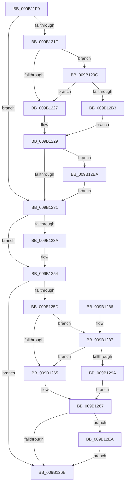

# CmpAbortLightWeightTransaction

- RVA: `0x009B11F0`–`0x009B1339` (길이 `329` bytes)
- VA: `0x00000001409B11F0`
- 실행 섹션: `PAGE`
- PDB 이름 있음: `예`; PDB Function 태그: `아니요`
- unwind 정보 RVA: `0x0009E264`
- 디코드: `75`개 명령, `329/329` bytes 표시
- 미해석 바이트: `0` (있으면 어셈블리에 `.byte`로 보존)

> 이 문서는 커널 이미지의 기계어와 PDB 기호를 분석해 생성했습니다. 4번과 5번은 함수 원형과 자료형을 바이너리 사용 방식에서 추정한 C 해석이며 원본 소스 복구 결과는 아닙니다.

## 1. Dependencies

- 직접 호출 지점: **5**; 고유 호출 대상: **4**
- 직접 호출자로 확인된 함수: **2**
- RIP 상대 이미지 참조: **6**

### Outgoing calls
- `0x009B1242` → [CmpTransMgrRollback](CmpTransMgrRollback_function_009B1400.md) (function, `0x009B1400`)
- `0x009B124F` → [CmpCleanupLightWeightTransaction](CmpCleanupLightWeightTransaction_function_009B1340.md) (function, `0x009B1340`)
- `0x009B1273` → [_security_check_cookie](../../text/6A/_security_check_cookie_function_006AC640.md) (function, `0x006AC640`)
- `0x009B12E0` → [tlgWriteTransfer_EtwWriteTransfer](../../text/42/tlgWriteTransfer_EtwWriteTransfer_function_004260E0.md) (function, `0x004260E0`)
- `0x009B132F` → [tlgWriteTransfer_EtwWriteTransfer](../../text/42/tlgWriteTransfer_EtwWriteTransfer_function_004260E0.md) (function, `0x004260E0`)

### Direct callers
- [CmpCommitLightWeightTransaction](CmpCommitLightWeightTransaction_function_009B0868.md) at `0x009B09F0`
- [CmpRollbackLightWeightTransaction](CmpRollbackLightWeightTransaction_function_009B1158.md) at `0x009B119B`

### Static image references
- `0x009B11FA` → RVA `0x00E0A740` (`.data`; read)
- `0x009B1211` → RVA `0x00E09F58` (`.data`; read)
- `0x009B121F` → RVA `0x00E09F68` (`.data`; reference)
- `0x009B1287` → RVA `0x00E09F70` (`.data`; read)
- `0x009B12C7` → RVA `0x00056C26` (`.rdata`; read)
- `0x009B12EE` → RVA `0x00056BF0` (`.rdata`; read)

## 2. Other-region calls and transfers

- 다른 실행 섹션으로 향하는 call: **3**
  - `0x009B1273` → [_security_check_cookie](../../text/6A/_security_check_cookie_function_006AC640.md) (`PAGE` → `.text`)
  - `0x009B12E0` → [tlgWriteTransfer_EtwWriteTransfer](../../text/42/tlgWriteTransfer_EtwWriteTransfer_function_004260E0.md) (`PAGE` → `.text`)
  - `0x009B132F` → [tlgWriteTransfer_EtwWriteTransfer](../../text/42/tlgWriteTransfer_EtwWriteTransfer_function_004260E0.md) (`PAGE` → `.text`)
- 별도 외부 분기/꼬리 이동을 확인하지 못했습니다.

## 3. Assembly (complete function range)

```asm
009B11F0  48 89 5C 24 10                  mov qword ptr [rsp + 0x10], rbx
009B11F5  57                              push rdi
009B11F6  48 83 EC 70                     sub rsp, 0x70
009B11FA  48 8B 05 3F 95 45 00            mov rax, qword ptr [rip + 0x45953f]
009B1201  48 33 C4                        xor rax, rsp
009B1204  48 89 44 24 68                  mov qword ptr [rsp + 0x68], rax
009B1209  83 64 24 30 00                  and dword ptr [rsp + 0x30], 0
009B120E  48 8B F9                        mov rdi, rcx
009B1211  83 3D 40 8D 45 00 05            cmp dword ptr [rip + 0x458d40], 5
009B1218  BB 01 00 00 00                  mov ebx, 1
009B121D  76 12                           jbe 0x1409b1231
009B121F  84 1D 43 8D 45 00               test byte ptr [rip + 0x458d43], bl
009B1225  75 75                           jne 0x1409b129c
009B1227  32 C0                           xor al, al
009B1229  84 C0                           test al, al
009B122B  0F 85 89 00 00 00               jne 0x1409b12ba
009B1231  48 8B 7F 10                     mov rdi, qword ptr [rdi + 0x10]
009B1235  48 85 FF                        test rdi, rdi
009B1238  74 1A                           je 0x1409b1254
009B123A  48 8D 54 24 30                  lea rdx, [rsp + 0x30]
009B123F  48 8B CF                        mov rcx, rdi
009B1242  E8 B9 01 00 00                  call 0x1409b1400
009B1247  BA 08 00 00 00                  mov edx, 8
009B124C  48 8B CF                        mov rcx, rdi
009B124F  E8 EC 00 00 00                  call 0x1409b1340
009B1254  83 3D FD 8C 45 00 05            cmp dword ptr [rip + 0x458cfd], 5
009B125B  76 0E                           jbe 0x1409b126b
009B125D  84 1D 05 8D 45 00               test byte ptr [rip + 0x458d05], bl
009B1263  75 22                           jne 0x1409b1287
009B1265  32 DB                           xor bl, bl
009B1267  84 DB                           test bl, bl
009B1269  75 7F                           jne 0x1409b12ea
009B126B  48 8B 4C 24 68                  mov rcx, qword ptr [rsp + 0x68]
009B1270  48 33 CC                        xor rcx, rsp
009B1273  E8 C8 B3 CF FF                  call 0x1406ac640
009B1278  48 8B 9C 24 88 00 00 00         mov rbx, qword ptr [rsp + 0x88]
009B1280  48 83 C4 70                     add rsp, 0x70
009B1284  5F                              pop rdi
009B1285  C3                              ret
009B1286  CC                              int3
009B1287  48 8B 05 E2 8C 45 00            mov rax, qword ptr [rip + 0x458ce2]
009B128E  48 23 C3                        and rax, rbx
009B1291  48 3B 05 D8 8C 45 00            cmp rax, qword ptr [rip + 0x458cd8]
009B1298  75 CB                           jne 0x1409b1265
009B129A  EB CB                           jmp 0x1409b1267
009B129C  48 8B 05 CD 8C 45 00            mov rax, qword ptr [rip + 0x458ccd]
009B12A3  48 23 C3                        and rax, rbx
009B12A6  48 3B 05 C3 8C 45 00            cmp rax, qword ptr [rip + 0x458cc3]
009B12AD  0F 85 74 FF FF FF               jne 0x1409b1227
009B12B3  8A C3                           mov al, bl
009B12B5  E9 6F FF FF FF                  jmp 0x1409b1229
009B12BA  48 8D 44 24 38                  lea rax, [rsp + 0x38]
009B12BF  45 33 C9                        xor r9d, r9d
009B12C2  48 89 44 24 28                  mov qword ptr [rsp + 0x28], rax
009B12C7  48 8D 15 58 59 6A FF            lea rdx, [rip - 0x95a6a8]
009B12CE  45 33 C0                        xor r8d, r8d
009B12D1  C7 44 24 20 02 00 00 00         mov dword ptr [rsp + 0x20], 2
009B12D9  48 8D 0D 78 8C 45 00            lea rcx, [rip + 0x458c78]
009B12E0  E8 FB 4D A7 FF                  call 0x1404260e0
009B12E5  E9 47 FF FF FF                  jmp 0x1409b1231
009B12EA  8B 44 24 30                     mov eax, dword ptr [rsp + 0x30]
009B12EE  48 8D 15 FB 58 6A FF            lea rdx, [rip - 0x95a705]
009B12F5  83 64 24 64 00                  and dword ptr [rsp + 0x64], 0
009B12FA  48 8D 0D 57 8C 45 00            lea rcx, [rip + 0x458c57]
009B1301  89 44 24 30                     mov dword ptr [rsp + 0x30], eax
009B1305  45 33 C9                        xor r9d, r9d
009B1308  48 8D 44 24 30                  lea rax, [rsp + 0x30]
009B130D  C7 44 24 60 04 00 00 00         mov dword ptr [rsp + 0x60], 4
009B1315  48 89 44 24 58                  mov qword ptr [rsp + 0x58], rax
009B131A  45 33 C0                        xor r8d, r8d
009B131D  48 8D 44 24 38                  lea rax, [rsp + 0x38]
009B1322  48 89 44 24 28                  mov qword ptr [rsp + 0x28], rax
009B1327  C7 44 24 20 03 00 00 00         mov dword ptr [rsp + 0x20], 3
009B132F  E8 AC 4D A7 FF                  call 0x1404260e0
009B1334  E9 32 FF FF FF                  jmp 0x1409b126b
```

## 4. C-style interpretation (structured pseudocode)

```c
__int64 __fastcall CmpAbortLightWeightTransaction(__int64 a1, __int64 a2, int a3, int a4)
{
    __int64 result;
    __int64 v_rbx;
    __int64 v_rsp;
    unsigned __int64 v_stack_m10;
    unsigned int v_stack_m48;
    unsigned __int64 v_stack_p10;
    unsigned int v_stack_p20;
    unsigned __int64 v_stack_p28;
    unsigned int v_stack_p30;
    unsigned __int64 v_stack_p38;
    unsigned __int64 v_stack_p58;
    unsigned int v_stack_p60;
    unsigned int v_stack_p64;

    v_stack_p10 = v_rbx;
    v_rsp = (v_rsp) - (112);
    result = (*(unsigned __int64 *)(v_rip + 4560191)) ^ (v_rsp);
    v_stack_m10 = result;
    if ((*(unsigned int *)(v_rip + 4558144)) <= 5) goto loc_009B1231;
    if (((*(unsigned __int8 *)(v_rip + 4558147)) & (1)) != 0) goto loc_009B129C;
loc_009B1227:
    result = 0;
loc_009B1229:
    if (0 != 0) goto loc_009B12BA;
loc_009B1231:
    if (*(unsigned __int64 *)(a1 + 16) != 0) {
        a2 = v_stack_m48;
        a1 = *(unsigned __int64 *)(a1 + 16);
        result = CmpTransMgrRollback(a1, a2, a3, a4);
        a2 = 8;
        a1 = *(unsigned __int64 *)(a1 + 16);
        result = CmpCleanupLightWeightTransaction(a1, a2, a3, a4);
    }
    if ((*(unsigned int *)(v_rip + 4558077)) <= 5) goto loc_009B126B;
    if (((*(unsigned __int8 *)(v_rip + 4558085)) & (1)) != 0) goto loc_009B1287;
loc_009B1265:
    v_rbx = 0;
loc_009B1267:
    if (0 != 0) goto loc_009B12EA;
loc_009B126B:
    a1 = (v_stack_m10) ^ (v_rsp);
    result = _security_check_cookie(a1, a2, a3, a4);
    v_rsp = (v_rsp) + (112);
    return result;
loc_009B1287:
    result = (*(unsigned __int64 *)(v_rip + 4558050)) & (v_stack_p10);
    if (result != (*(unsigned __int64 *)(v_rip + 4558040))) goto loc_009B1265;
    goto loc_009B1267;
loc_009B129C:
    result = (*(unsigned __int64 *)(v_rip + 4558029)) & (v_stack_p10);
    if (result != (*(unsigned __int64 *)(v_rip + 4558019))) goto loc_009B1227;
    goto loc_009B1229;
loc_009B12BA:
    a4 = 0;
    v_stack_p28 = v_stack_p38;
    a3 = 0;
    v_stack_p20 = 2;
    result = tlgWriteTransfer_EtwWriteTransfer(v_rip + 4557944, v_rip - 9807528, a3, a4);
    goto loc_009B1231;
loc_009B12EA:
    v_stack_p30 = (unsigned int)((unsigned int)(v_stack_p30));
    a4 = 0;
    v_stack_p60 = 4;
    v_stack_p58 = v_stack_p30;
    a3 = 0;
    v_stack_p28 = v_stack_p38;
    v_stack_p20 = 3;
    result = tlgWriteTransfer_EtwWriteTransfer(v_rip + 4557911, v_rip - 9807621, a3, a4);
    goto loc_009B126B;
}
```

## 5. (Beta) C Style

```c
int64_t CmpAbortLightWeightTransaction(void *Arg1, int64_t Arg2, int32_t Arg3, int32_t Arg4)
{
    uint8_t *arg1 = (uint8_t *)Arg1;

    int64_t result;
    int64_t local_rbx;
    int64_t local_rsp;
    uint64_t v_stack_m10;
    uint32_t v_stack_m48;
    uint64_t v_stack_p10;
    uint32_t v_stack_p20;
    uint64_t v_stack_p28;
    uint32_t v_stack_p30;
    uint64_t v_stack_p38;
    uint64_t v_stack_p58;
    uint32_t v_stack_p60;
    uint32_t v_stack_p64;

    v_stack_p10 = local_rbx;
    local_rsp = (local_rsp) - (112);
    result = (*(uint64_t *)(v_rip + 0x45953F)) ^ (local_rsp);
    v_stack_m10 = result;
    if ((*(uint32_t *)(v_rip + 0x458D40)) <= 5) goto loc_009B1231;
    if (((*(uint8_t *)(v_rip + 0x458D43)) & (1)) != 0) goto loc_009B129C;
loc_009B1227:
    result = 0;
loc_009B1229:
    if (0 != 0) goto loc_009B12BA;
loc_009B1231:
    if (*(uint64_t *)(arg1 + 0x10) != 0) {
        Arg2 = v_stack_m48;
        Arg1 = *(uint64_t *)(arg1 + 0x10);
        result = CmpTransMgrRollback(Arg1, Arg2, Arg3, Arg4);
        Arg2 = 8;
        Arg1 = *(uint64_t *)(arg1 + 0x10);
        result = CmpCleanupLightWeightTransaction(Arg1, Arg2, Arg3, Arg4);
    }
    if ((*(uint32_t *)(v_rip + 0x458CFD)) <= 5) goto loc_009B126B;
    if (((*(uint8_t *)(v_rip + 0x458D05)) & (1)) != 0) goto loc_009B1287;
loc_009B1265:
    local_rbx = 0;
loc_009B1267:
    if (0 != 0) goto loc_009B12EA;
loc_009B126B:
    Arg1 = (v_stack_m10) ^ (local_rsp);
    result = _security_check_cookie(Arg1, Arg2, Arg3, Arg4);
    local_rsp = (local_rsp) + (112);
    return result;
loc_009B1287:
    result = (*(uint64_t *)(v_rip + 0x458CE2)) & (v_stack_p10);
    if (result != (*(uint64_t *)(v_rip + 0x458CD8))) goto loc_009B1265;
    goto loc_009B1267;
loc_009B129C:
    result = (*(uint64_t *)(v_rip + 0x458CCD)) & (v_stack_p10);
    if (result != (*(uint64_t *)(v_rip + 0x458CC3))) goto loc_009B1227;
    goto loc_009B1229;
loc_009B12BA:
    Arg4 = 0;
    v_stack_p28 = v_stack_p38;
    Arg3 = 0;
    v_stack_p20 = 2;
    result = tlgWriteTransfer_EtwWriteTransfer(v_rip + 4557944, v_rip - 9807528, Arg3, Arg4);
    goto loc_009B1231;
loc_009B12EA:
    v_stack_p30 = (uint32_t)((uint32_t)(v_stack_p30));
    Arg4 = 0;
    v_stack_p60 = 4;
    v_stack_p58 = v_stack_p30;
    Arg3 = 0;
    v_stack_p28 = v_stack_p38;
    v_stack_p20 = 3;
    result = tlgWriteTransfer_EtwWriteTransfer(v_rip + 4557911, v_rip - 9807621, Arg3, Arg4);
    goto loc_009B126B;
}
```

### 관측된 메모리 오프셋

구조체 형식이 확인되지 않은 접근은 인자 기준의 오프셋으로만 기록했습니다.

| 기준 인자 | 오프셋 표현 | 폭 (bit) | 접근 |
|---|---:|---:|---|
| `Arg1` | `+ 0x10` | `64` | `R` |

## 6. Execution-region graph

[열기: 2D/3D 그래프와 함수 탐색 컨트롤 패널](../../../control-panel.html?section=page&rva=0x009B11F0&view=graph)

- 2D 그래프는 위에서 아래로 흐르고, 3D 그래프는 빈 공간을 드래그해 회전합니다. Shift+드래그는 이동, 휠은 확대·축소, 함수 노드 선택은 대상 보고서 이동입니다.

### Static fallback


