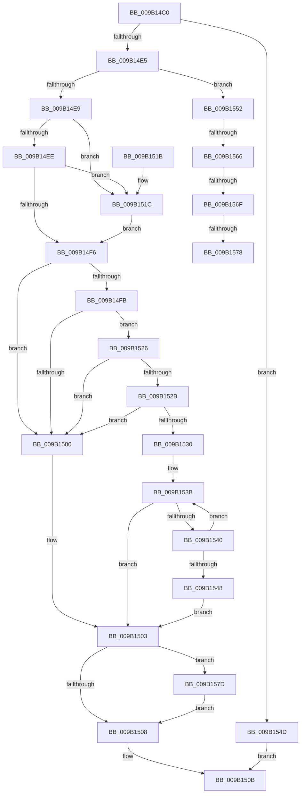

# CmpAdjustRequestedFileSize

- RVA: `0x009B14C0`–`0x009B1591` (길이 `209` bytes)
- VA: `0x00000001409B14C0`
- 실행 섹션: `PAGE`
- PDB 이름 있음: `예`; PDB Function 태그: `예`
- unwind 정보 RVA: `0x00094C88`
- 디코드: `67`개 명령, `209/209` bytes 표시
- 미해석 바이트: `0` (있으면 어셈블리에 `.byte`로 보존)

> 이 문서는 커널 이미지의 기계어와 PDB 기호를 분석해 생성했습니다. 4번과 5번은 함수 원형과 자료형을 바이너리 사용 방식에서 추정한 C 해석이며 원본 소스 복구 결과는 아닙니다.

## 1. Dependencies

- 직접 호출 지점: **1**; 고유 호출 대상: **1**
- 직접 호출자로 확인된 함수: **1**
- RIP 상대 이미지 참조: **0**

### Outgoing calls
- `0x009B151C` → [HvGetEffectiveLogSizeCapForHive](HvGetEffectiveLogSizeCapForHive_function_009B6408.md) (function, `0x009B6408`)

### Direct callers
- [CmpDoFileSetSizeEx](CmpDoFileSetSizeEx_function_009B2A4C.md) at `0x009B2AE6`

### Static image references
- 디코드된 RIP-relative 메모리 참조가 없습니다.

## 2. Other-region calls and transfers

- 다른 실행 섹션으로 향하는 call: **0**
- call이 아닌 외부 분기/꼬리 이동: **4**
  - `0x009B1560` → [sub_00B2DB7C](../B2/Unknown_function_00B2DB7C.md) (`tail-transfer`)
  - `0x009B1569` → [sub_00B2DB7C + 0x3](../B2/Unknown_function_00B2DB7C.md) (`tail-transfer`)
  - `0x009B1572` → [sub_00B2DB7C](../B2/Unknown_function_00B2DB7C.md) (`tail-transfer`)
  - `0x009B1578` → [sub_00B2DB7C + 0x3](../B2/Unknown_function_00B2DB7C.md) (`tail-transfer`)

## 3. Assembly (complete function range)

```asm
009B14C0  48 89 5C 24 08                  mov qword ptr [rsp + 8], rbx
009B14C5  48 89 74 24 10                  mov qword ptr [rsp + 0x10], rsi
009B14CA  57                              push rdi
009B14CB  48 83 EC 20                     sub rsp, 0x20
009B14CF  4D 8B D0                        mov r10, r8
009B14D2  45 33 DB                        xor r11d, r11d
009B14D5  45 33 C0                        xor r8d, r8d
009B14D8  40 32 F6                        xor sil, sil
009B14DB  49 8B D9                        mov rbx, r9
009B14DE  8B FA                           mov edi, edx
009B14E0  4D 3B D1                        cmp r10, r9
009B14E3  74 68                           je 0x1409b154d
009B14E5  85 D2                           test edx, edx
009B14E7  74 69                           je 0x1409b1552
009B14E9  83 FA 01                        cmp edx, 1
009B14EC  74 2E                           je 0x1409b151c
009B14EE  8D 42 FC                        lea eax, [rdx - 4]
009B14F1  83 F8 01                        cmp eax, 1
009B14F4  76 26                           jbe 0x1409b151c
009B14F6  4D 85 D2                        test r10, r10
009B14F9  74 05                           je 0x1409b1500
009B14FB  49 3B D8                        cmp rbx, r8
009B14FE  76 26                           jbe 0x1409b1526
009B1500  4C 8B D3                        mov r10, rbx
009B1503  45 85 DB                        test r11d, r11d
009B1506  75 75                           jne 0x1409b157d
009B1508  49 8B C2                        mov rax, r10
009B150B  48 8B 5C 24 30                  mov rbx, qword ptr [rsp + 0x30]
009B1510  48 8B 74 24 38                  mov rsi, qword ptr [rsp + 0x38]
009B1515  48 83 C4 20                     add rsp, 0x20
009B1519  5F                              pop rdi
009B151A  C3                              ret
009B151B  CC                              int3
009B151C  E8 E7 4E 00 00                  call 0x1409b6408
009B1521  44 8B C0                        mov r8d, eax
009B1524  EB D0                           jmp 0x1409b14f6
009B1526  4C 3B D3                        cmp r10, rbx
009B1529  73 D5                           jae 0x1409b1500
009B152B  40 84 F6                        test sil, sil
009B152E  75 D0                           jne 0x1409b1500
009B1530  85 FF                           test edi, edi
009B1532  B8 00 10 00 00                  mov eax, 0x1000
009B1537  44 0F 44 D8                     cmove r11d, eax
009B153B  4C 3B D3                        cmp r10, rbx
009B153E  73 C3                           jae 0x1409b1503
009B1540  4D 03 D2                        add r10, r10
009B1543  4D 3B D0                        cmp r10, r8
009B1546  76 F3                           jbe 0x1409b153b
009B1548  4D 8B D0                        mov r10, r8
009B154B  EB B6                           jmp 0x1409b1503
009B154D  48 8B C3                        mov rax, rbx
009B1550  EB B9                           jmp 0x1409b150b
009B1552  8B 81 10 10 00 00               mov eax, dword ptr [rcx + 0x1010]
009B1558  41 B8 00 00 04 00               mov r8d, 0x40000
009B155E  84 C0                           test al, al
009B1560  0F 88 16 C6 17 00               js 0x140b2db7c
009B1566  4D 85 D2                        test r10, r10
009B1569  0F 85 10 C6 17 00               jne 0x140b2db7f
009B156F  49 3B D8                        cmp rbx, r8
009B1572  0F 86 04 C6 17 00               jbe 0x140b2db7c
009B1578  E9 02 C6 17 00                  jmp 0x140b2db7f
009B157D  41 FF CA                        dec r10d
009B1580  45 03 D3                        add r10d, r11d
009B1583  41 F7 DB                        neg r11d
009B1586  41 8B CB                        mov ecx, r11d
009B1589  4C 23 D1                        and r10, rcx
009B158C  E9 77 FF FF FF                  jmp 0x1409b1508
```

## 4. C-style interpretation (structured pseudocode)

```c
__int64 __fastcall CmpAdjustRequestedFileSize(__int64 a1, __int64 a2, __int64 a3, __int64 a4)
{
    __int64 result;
    __int64 v_r10;
    __int64 v_r11;
    __int64 v_rsi;
    __int64 v_rsp;
    unsigned __int64 v_stack_p10;
    unsigned __int64 v_stack_p8;

    v_stack_p8 = v_rbx;
    v_stack_p10 = v_rsi;
    v_rsp = (v_rsp) - (32);
    v_r11 = 0;
    a3 = 0;
    v_rsi = 0;
    if (0 == a4) goto loc_009B154D;
    if ((unsigned int)(a2) == 0) goto loc_009B1552;
    if (((unsigned int)(a2)) == 1) goto loc_009B151C;
    if (((unsigned int)(a2 - 4)) <= 1) goto loc_009B151C;
loc_009B14F6:
    if (0 == 0) goto loc_009B1500;
    if (a4 <= 0) goto loc_009B1526;
loc_009B1500:
loc_009B1503:
    if (0 != 0) goto loc_009B157D;
loc_009B1508:
loc_009B150B:
    v_rsp = (v_rsp) + (32);
    return a4;
loc_009B151C:
    result = HvGetEffectiveLogSizeCapForHive(a1, a2, a3, a4);
    goto loc_009B14F6;
loc_009B1526:
    if (a4 >= v_stack_p8) goto loc_009B1500;
    if ((unsigned __int8)(v_stack_p10) != 0) goto loc_009B1500;
    if ((unsigned int)((unsigned int)((unsigned int)(a2))) == 0) { v_r11 = (unsigned int)((unsigned int)(0x1000ULL)); }
loc_009B153B:
    if (a4 >= v_stack_p8) goto loc_009B1503;
    v_r10 = (a4) + (a4);
    if (v_r10 <= ((unsigned int)((unsigned int)(result)))) goto loc_009B153B;
    goto loc_009B1503;
loc_009B154D:
    goto loc_009B150B;
loc_009B1552:
loc_009B157D:
    v_r10 = (unsigned int)(((unsigned int)((unsigned int)(result))) - 1);
    v_r10 = (unsigned int)((v_r10) + ((unsigned int)(v_r11)));
    v_r11 = (unsigned int)(-(v_r11));
    v_r10 = (v_r10) & ((unsigned int)((unsigned int)(v_r11)));
    goto loc_009B1508;
}
```

## 5. (Beta) C Style

```c
int64_t CmpAdjustRequestedFileSize(void *Arg1, int64_t Arg2, int64_t Arg3, int64_t Arg4)
{
    uint8_t *arg1 = (uint8_t *)Arg1;

    int64_t result;
    int64_t local_r10;
    int64_t local_r11;
    int64_t local_rsi;
    int64_t local_rsp;
    uint64_t v_stack_p10;
    uint64_t v_stack_p8;

    v_stack_p8 = local_rbx;
    v_stack_p10 = local_rsi;
    local_rsp = (local_rsp) - (32);
    local_r11 = 0;
    Arg3 = 0;
    local_rsi = 0;
    if (0 == Arg4) goto loc_009B154D;
    if ((uint32_t)(Arg2) == 0) goto loc_009B1552;
    if (((uint32_t)(Arg2)) == 1) goto loc_009B151C;
    if (((uint32_t)(Arg2 - 4)) <= 1) goto loc_009B151C;
loc_009B14F6:
    if (0 == 0) goto loc_009B1500;
    if (Arg4 <= 0) goto loc_009B1526;
loc_009B1500:
loc_009B1503:
    if (0 != 0) goto loc_009B157D;
loc_009B1508:
loc_009B150B:
    local_rsp = (local_rsp) + (32);
    return Arg4;
loc_009B151C:
    result = HvGetEffectiveLogSizeCapForHive(Arg1, Arg2, Arg3, Arg4);
    goto loc_009B14F6;
loc_009B1526:
    if (Arg4 >= v_stack_p8) goto loc_009B1500;
    if ((uint8_t)(v_stack_p10) != 0) goto loc_009B1500;
    if ((uint32_t)((uint32_t)((uint32_t)(Arg2))) == 0) { local_r11 = (uint32_t)((uint32_t)(0x1000ULL)); }
loc_009B153B:
    if (Arg4 >= v_stack_p8) goto loc_009B1503;
    local_r10 = (Arg4) + (Arg4);
    if (local_r10 <= ((uint32_t)((uint32_t)(result)))) goto loc_009B153B;
    goto loc_009B1503;
loc_009B154D:
    goto loc_009B150B;
loc_009B1552:
loc_009B157D:
    local_r10 = (uint32_t)(((uint32_t)((uint32_t)(result))) - 1);
    local_r10 = (uint32_t)((local_r10) + ((uint32_t)(local_r11)));
    local_r11 = (uint32_t)(-(local_r11));
    local_r10 = (local_r10) & ((uint32_t)((uint32_t)(local_r11)));
    goto loc_009B1508;
}
```

### 관측된 메모리 오프셋

구조체 형식이 확인되지 않은 접근은 인자 기준의 오프셋으로만 기록했습니다.

| 기준 인자 | 오프셋 표현 | 폭 (bit) | 접근 |
|---|---:|---:|---|
| `Arg1` | `+ 0x1010` | `32` | `R` |

## 6. Execution-region graph

[열기: 2D/3D 그래프와 함수 탐색 컨트롤 패널](../../../control-panel.html?section=page&rva=0x009B14C0&view=graph)

- 2D 그래프는 위에서 아래로 흐르고, 3D 그래프는 빈 공간을 드래그해 회전합니다. Shift+드래그는 이동, 휠은 확대·축소, 함수 노드 선택은 대상 보고서 이동입니다.

### Static fallback


