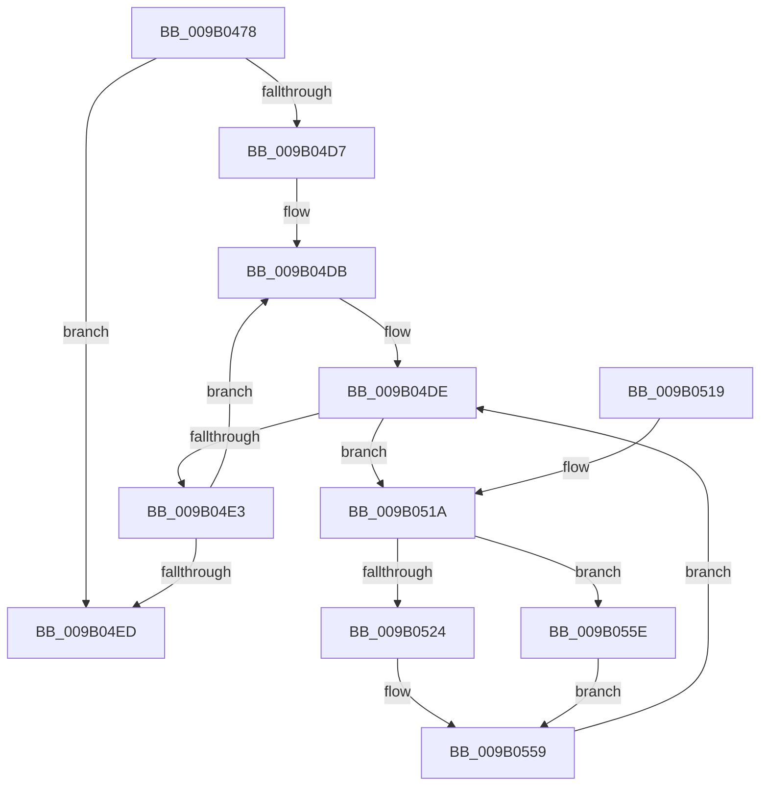

# CmpCleanUpKCBCacheTable

- RVA: `0x009B0478`–`0x009B0564` (길이 `236` bytes)
- VA: `0x00000001409B0478`
- 실행 섹션: `PAGE`
- PDB 이름 있음: `예`; PDB Function 태그: `아니요`
- unwind 정보 RVA: `0x0009E170`
- 디코드: `65`개 명령, `236/236` bytes 표시
- 미해석 바이트: `0` (있으면 어셈블리에 `.byte`로 보존)

> 이 문서는 커널 이미지의 기계어와 PDB 기호를 분석해 생성했습니다. 4번과 5번은 함수 원형과 자료형을 바이너리 사용 방식에서 추정한 C 해석이며 원본 소스 복구 결과는 아닙니다.

## 1. Dependencies

- 직접 호출 지점: **8**; 고유 호출 대상: **8**
- 직접 호출자로 확인된 함수: **5**
- RIP 상대 이미지 참조: **1**

### Outgoing calls
- `0x009B04C2` → [CmpAttachToRegistryProcess](../../pagecmrc/BC/CmpAttachToRegistryProcess_function_00BC98E0.md) (function, `0x00BC98E0`)
- `0x009B04CC` → [CmpInitializeDelayDerefContext](../../text/42/CmpInitializeDelayDerefContext_function_0042A7F0.md) (function, `0x0042A7F0`)
- `0x009B04F2` → [CmpDetachFromRegistryProcess](../../pagecmrc/BC/CmpDetachFromRegistryProcess_function_00BC9920.md) (function, `0x00BC9920`)
- `0x009B04FF` → [_security_check_cookie](../../text/6A/_security_check_cookie_function_006AC640.md) (function, `0x006AC640`)
- `0x009B0527` → [CmpRemoveFromDelayedClose](../86/CmpRemoveFromDelayedClose_function_00862350.md) (function, `0x00862350`)
- `0x009B0534` → [CmpCleanUpKcbCacheWithLock](../86/CmpCleanUpKcbCacheWithLock_function_00861F20.md) (function, `0x00861F20`)
- `0x009B053C` → [CmpDecommisssionKcb](../86/CmpDecommisssionKcb_function_00862750.md) (function, `0x00862750`)
- `0x009B0548` → [CmpDrainDelayDerefContext](../../text/41/CmpDrainDelayDerefContext_function_0041B9A0.md) (function, `0x0041B9A0`)

### Direct callers
- [CmpRefreshHive](../7D/CmpRefreshHive_function_007DEAD0.md) at `0x007DEEB0`
- [CmpCleanUpHigherLayerKcbCachesPostCallback](../7F/CmpCleanUpHigherLayerKcbCachesPostCallback_function_007F1450.md) at `0x007F145D`
- [CmpPrepareForSubtreeInvalidation](CmpPrepareForSubtreeInvalidation_function_009B01B0.md) at `0x009B01E2`
- [CmpDoesKeyHaveOpenSubkeys](CmpDoesKeyHaveOpenSubkeys_function_009B0274.md) at `0x009B029A`
- [CmpEnumerateAllOpenSubKeys](CmpEnumerateAllOpenSubKeys_function_009B031C.md) at `0x009B034C`

### Static image references
- `0x009B048A` → RVA `0x00E0A740` (`.data`; read)

## 2. Other-region calls and transfers

- 다른 실행 섹션으로 향하는 call: **5**
  - `0x009B04C2` → [CmpAttachToRegistryProcess](../../pagecmrc/BC/CmpAttachToRegistryProcess_function_00BC98E0.md) (`PAGE` → `PAGECMRC`)
  - `0x009B04CC` → [CmpInitializeDelayDerefContext](../../text/42/CmpInitializeDelayDerefContext_function_0042A7F0.md) (`PAGE` → `.text`)
  - `0x009B04F2` → [CmpDetachFromRegistryProcess](../../pagecmrc/BC/CmpDetachFromRegistryProcess_function_00BC9920.md) (`PAGE` → `PAGECMRC`)
  - `0x009B04FF` → [_security_check_cookie](../../text/6A/_security_check_cookie_function_006AC640.md) (`PAGE` → `.text`)
  - `0x009B0548` → [CmpDrainDelayDerefContext](../../text/41/CmpDrainDelayDerefContext_function_0041B9A0.md) (`PAGE` → `.text`)
- 별도 외부 분기/꼬리 이동을 확인하지 못했습니다.

## 3. Assembly (complete function range)

```asm
009B0478  48 89 5C 24 10                  mov qword ptr [rsp + 0x10], rbx
009B047D  48 89 6C 24 18                  mov qword ptr [rsp + 0x18], rbp
009B0482  56                              push rsi
009B0483  57                              push rdi
009B0484  41 56                           push r14
009B0486  48 83 EC 70                     sub rsp, 0x70
009B048A  48 8B 05 AF A2 45 00            mov rax, qword ptr [rip + 0x45a2af]
009B0491  48 33 C4                        xor rax, rsp
009B0494  48 89 44 24 60                  mov qword ptr [rsp + 0x60], rax
009B0499  8B A9 78 06 00 00               mov ebp, dword ptr [rcx + 0x678]
009B049F  0F 57 C0                        xorps xmm0, xmm0
009B04A2  4C 8B B1 70 06 00 00            mov r14, qword ptr [rcx + 0x670]
009B04A9  48 8D 4C 24 30                  lea rcx, [rsp + 0x30]
009B04AE  0F 11 44 24 30                  movups xmmword ptr [rsp + 0x30], xmm0
009B04B3  0F 11 44 24 40                  movups xmmword ptr [rsp + 0x40], xmm0
009B04B8  0F 11 44 24 50                  movups xmmword ptr [rsp + 0x50], xmm0
009B04BD  0F 11 44 24 20                  movups xmmword ptr [rsp + 0x20], xmm0
009B04C2  E8 19 94 21 00                  call 0x140bc98e0
009B04C7  48 8D 4C 24 20                  lea rcx, [rsp + 0x20]
009B04CC  E8 1F A3 A7 FF                  call 0x14042a7f0
009B04D1  33 FF                           xor edi, edi
009B04D3  85 ED                           test ebp, ebp
009B04D5  74 16                           je 0x1409b04ed
009B04D7  49 8D 76 10                     lea rsi, [r14 + 0x10]
009B04DB  48 8B 06                        mov rax, qword ptr [rsi]
009B04DE  48 85 C0                        test rax, rax
009B04E1  75 37                           jne 0x1409b051a
009B04E3  FF C7                           inc edi
009B04E5  48 83 C6 18                     add rsi, 0x18
009B04E9  3B FD                           cmp edi, ebp
009B04EB  72 EE                           jb 0x1409b04db
009B04ED  48 8D 4C 24 30                  lea rcx, [rsp + 0x30]
009B04F2  E8 29 94 21 00                  call 0x140bc9920
009B04F7  48 8B 4C 24 60                  mov rcx, qword ptr [rsp + 0x60]
009B04FC  48 33 CC                        xor rcx, rsp
009B04FF  E8 3C C1 CF FF                  call 0x1406ac640
009B0504  4C 8D 5C 24 70                  lea r11, [rsp + 0x70]
009B0509  49 8B 5B 28                     mov rbx, qword ptr [r11 + 0x28]
009B050D  49 8B 6B 30                     mov rbp, qword ptr [r11 + 0x30]
009B0511  49 8B E3                        mov rsp, r11
009B0514  41 5E                           pop r14
009B0516  5F                              pop rdi
009B0517  5E                              pop rsi
009B0518  C3                              ret
009B0519  CC                              int3
009B051A  48 8D 58 F0                     lea rbx, [rax - 0x10]
009B051E  48 83 3B 00                     cmp qword ptr [rbx], 0
009B0522  75 3A                           jne 0x1409b055e
009B0524  48 8B CB                        mov rcx, rbx
009B0527  E8 24 1E EB FF                  call 0x140862350
009B052C  48 8D 54 24 20                  lea rdx, [rsp + 0x20]
009B0531  48 8B CB                        mov rcx, rbx
009B0534  E8 E7 19 EB FF                  call 0x140861f20
009B0539  48 8B CB                        mov rcx, rbx
009B053C  E8 0F 22 EB FF                  call 0x140862750
009B0541  B2 01                           mov dl, 1
009B0543  48 8D 4C 24 20                  lea rcx, [rsp + 0x20]
009B0548  E8 53 B4 A6 FF                  call 0x14041b9a0
009B054D  48 8D 47 01                     lea rax, [rdi + 1]
009B0551  48 8D 04 47                     lea rax, [rdi + rax*2]
009B0555  49 8D 04 C6                     lea rax, [r14 + rax*8]
009B0559  48 8B 00                        mov rax, qword ptr [rax]
009B055C  EB 80                           jmp 0x1409b04de
009B055E  48 8D 43 18                     lea rax, [rbx + 0x18]
009B0562  EB F5                           jmp 0x1409b0559
```

## 4. C-style interpretation (structured pseudocode)

```c
__int64 __fastcall CmpCleanUpKCBCacheTable(__int64 a1)
{
    __int64 result;
    __int64 v_rdi;
    __int64 v_rsi;
    __int64 v_rsp;
    unsigned __int64 v_stack_m18;
    unsigned __int64 v_stack_m28;
    unsigned __int64 v_stack_m38;
    unsigned __int64 v_stack_m48;
    unsigned __int64 v_stack_m50;
    unsigned __int64 v_stack_m58;
    unsigned __int64 v_stack_m68;
    unsigned __int64 v_stack_p10;
    unsigned __int64 v_stack_p18;

    v_stack_p10 = v_rbx;
    v_stack_p18 = v_rbp;
    v_rsp = (v_rsp) - (112);
    result = (*(unsigned __int64 *)(v_rip + 4563631)) ^ (v_rsp);
    v_stack_m28 = result;
    v_stack_m58 = v_xmm0;
    v_stack_m48 = v_xmm0;
    v_stack_m38 = v_xmm0;
    v_stack_m68 = v_xmm0;
    result = CmpAttachToRegistryProcess(v_stack_m58, a2, a3, a4);
    result = CmpInitializeDelayDerefContext(v_stack_m68, a2, a3, a4);
    v_rdi = 0;
    if ((unsigned int)((unsigned int)(*(unsigned int *)(a1 + 1656))) == 0) goto loc_009B04ED;
loc_009B04DB:
loc_009B04DE:
    if (*(unsigned __int64 *)(*(unsigned __int64 *)(a1 + 1648) + 16) != 0) goto loc_009B051A;
    v_rdi = (unsigned int)((v_rdi) + 1);
    v_rsi = (*(unsigned __int64 *)(a1 + 1648) + 16) + (24);
    if (((unsigned int)(v_rdi)) < ((unsigned int)((unsigned int)(*(unsigned int *)(a1 + 1656))))) goto loc_009B04DB;
loc_009B04ED:
    result = CmpDetachFromRegistryProcess(v_stack_m58, a2, a3, a4);
    a1 = (v_stack_m28) ^ (v_rsp);
    result = _security_check_cookie(a1, a2, a3, a4);
    return result;
loc_009B051A:
    if ((*(unsigned __int64 *)(result - 16)) != 0) goto loc_009B055E;
    result = CmpRemoveFromDelayedClose(result - 16, a2, a3, a4);
    result = CmpCleanUpKcbCacheWithLock(result - 16, v_stack_m50, a3, a4);
    result = CmpDecommisssionKcb(result - 16, v_stack_m50, a3, a4);
    result = CmpDrainDelayDerefContext(v_stack_m50, 1, a3, a4);
loc_009B0559:
    goto loc_009B04DE;
loc_009B055E:
    goto loc_009B0559;
}
```

## 5. (Beta) C Style

```c
int64_t CmpCleanUpKCBCacheTable(void *Arg1)
{
    uint8_t *arg1 = (uint8_t *)Arg1;

    int64_t result;
    int64_t local_rdi;
    int64_t local_rsi;
    int64_t local_rsp;
    uint64_t v_stack_m18;
    uint64_t v_stack_m28;
    uint64_t v_stack_m38;
    uint64_t v_stack_m48;
    uint64_t v_stack_m50;
    uint64_t v_stack_m58;
    uint64_t v_stack_m68;
    uint64_t v_stack_p10;
    uint64_t v_stack_p18;

    v_stack_p10 = local_rbx;
    v_stack_p18 = local_rbp;
    local_rsp = (local_rsp) - (112);
    result = (*(uint64_t *)(v_rip + 0x45A2AF)) ^ (local_rsp);
    v_stack_m28 = result;
    v_stack_m58 = v_xmm0;
    v_stack_m48 = v_xmm0;
    v_stack_m38 = v_xmm0;
    v_stack_m68 = v_xmm0;
    result = CmpAttachToRegistryProcess(v_stack_m58, a2, a3, a4);
    result = CmpInitializeDelayDerefContext(v_stack_m68, a2, a3, a4);
    local_rdi = 0;
    if ((uint32_t)((uint32_t)(*(uint32_t *)(arg1 + 0x678))) == 0) goto loc_009B04ED;
loc_009B04DB:
loc_009B04DE:
    if (*(uint64_t *)(*(uint64_t *)(arg1 + 0x670) + 0x10) != 0) goto loc_009B051A;
    local_rdi = (uint32_t)((local_rdi) + 1);
    local_rsi = (*(uint64_t *)(arg1 + 0x670) + 16) + (24);
    if (((uint32_t)(local_rdi)) < ((uint32_t)((uint32_t)(*(uint32_t *)(arg1 + 0x678))))) goto loc_009B04DB;
loc_009B04ED:
    result = CmpDetachFromRegistryProcess(v_stack_m58, a2, a3, a4);
    Arg1 = (v_stack_m28) ^ (local_rsp);
    result = _security_check_cookie(Arg1, a2, a3, a4);
    return result;
loc_009B051A:
    if ((*(uint64_t *)(result - 0x10)) != 0) goto loc_009B055E;
    result = CmpRemoveFromDelayedClose(result - 16, a2, a3, a4);
    result = CmpCleanUpKcbCacheWithLock(result - 16, v_stack_m50, a3, a4);
    result = CmpDecommisssionKcb(result - 16, v_stack_m50, a3, a4);
    result = CmpDrainDelayDerefContext(v_stack_m50, 1, a3, a4);
loc_009B0559:
    goto loc_009B04DE;
loc_009B055E:
    goto loc_009B0559;
}
```

### 관측된 메모리 오프셋

구조체 형식이 확인되지 않은 접근은 인자 기준의 오프셋으로만 기록했습니다.

| 기준 인자 | 오프셋 표현 | 폭 (bit) | 접근 |
|---|---:|---:|---|
| `Arg1` | `+ 0x670` | `64` | `R` |
| `Arg1` | `+ 0x678` | `32` | `R` |

## 6. Execution-region graph

[열기: 2D/3D 그래프와 함수 탐색 컨트롤 패널](../../../control-panel.html?section=page&rva=0x009B0478&view=graph)

- 2D 그래프는 위에서 아래로 흐르고, 3D 그래프는 빈 공간을 드래그해 회전합니다. Shift+드래그는 이동, 휠은 확대·축소, 함수 노드 선택은 대상 보고서 이동입니다.

### Static fallback


