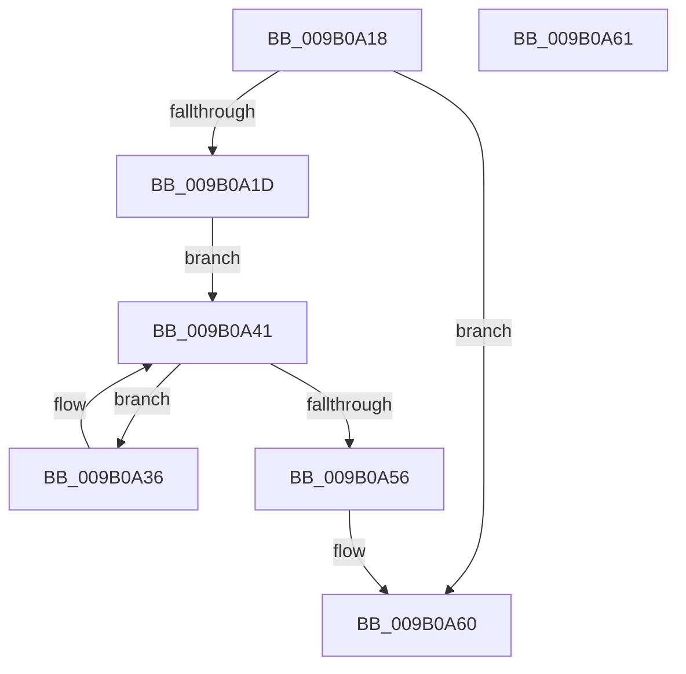

# CmpCleanupLightWeightPrepare

- RVA: `0x009B0A18`–`0x009B0A62` (길이 `74` bytes)
- VA: `0x00000001409B0A18`
- 실행 섹션: `PAGE`
- PDB 이름 있음: `예`; PDB Function 태그: `아니요`
- unwind 정보 RVA: `0x00068580`
- 디코드: `23`개 명령, `74/74` bytes 표시
- 미해석 바이트: `0` (있으면 어셈블리에 `.byte`로 보존)

> 이 문서는 커널 이미지의 기계어와 PDB 기호를 분석해 생성했습니다. 4번과 5번은 함수 원형과 자료형을 바이너리 사용 방식에서 추정한 C 해석이며 원본 소스 복구 결과는 아닙니다.

## 1. Dependencies

- 직접 호출 지점: **2**; 고유 호출 대상: **2**
- 직접 호출자로 확인된 함수: **1**
- RIP 상대 이미지 참조: **0**

### Outgoing calls
- `0x009B0A3C` → [CmpCleanupLightWeightUoWData](CmpCleanupLightWeightUoWData_function_009B0A68.md) (function, `0x009B0A68`)
- `0x009B0A4C` → [CmListGetNextElement](../../pagecmrc/BC/CmListGetNextElement_function_00BC9940.md) (function, `0x00BC9940`)

### Direct callers
- [CmpPrepareLightWeightTransaction](CmpPrepareLightWeightTransaction_function_009B0D24.md) at `0x009B0DF6`

### Static image references
- 디코드된 RIP-relative 메모리 참조가 없습니다.

## 2. Other-region calls and transfers

- 다른 실행 섹션으로 향하는 call: **1**
  - `0x009B0A4C` → [CmListGetNextElement](../../pagecmrc/BC/CmListGetNextElement_function_00BC9940.md) (`PAGE` → `PAGECMRC`)
- 별도 외부 분기/꼬리 이동을 확인하지 못했습니다.

## 3. Assembly (complete function range)

```asm
009B0A18  48 85 C9                        test rcx, rcx
009B0A1B  74 43                           je 0x1409b0a60
009B0A1D  48 89 5C 24 10                  mov qword ptr [rsp + 0x10], rbx
009B0A22  57                              push rdi
009B0A23  48 83 EC 20                     sub rsp, 0x20
009B0A27  48 83 64 24 30 00               and qword ptr [rsp + 0x30], 0
009B0A2D  48 8D 59 10                     lea rbx, [rcx + 0x10]
009B0A31  49 8B F8                        mov rdi, r8
009B0A34  EB 0B                           jmp 0x1409b0a41
009B0A36  4C 8B C7                        mov r8, rdi
009B0A39  48 8B C8                        mov rcx, rax
009B0A3C  E8 27 00 00 00                  call 0x1409b0a68
009B0A41  45 33 C0                        xor r8d, r8d
009B0A44  48 8D 54 24 30                  lea rdx, [rsp + 0x30]
009B0A49  48 8B CB                        mov rcx, rbx
009B0A4C  E8 EF 8E 21 00                  call 0x140bc9940
009B0A51  48 85 C0                        test rax, rax
009B0A54  75 E0                           jne 0x1409b0a36
009B0A56  48 8B 5C 24 38                  mov rbx, qword ptr [rsp + 0x38]
009B0A5B  48 83 C4 20                     add rsp, 0x20
009B0A5F  5F                              pop rdi
009B0A60  C3                              ret
009B0A61  CC                              int3
```

## 4. C-style interpretation (structured pseudocode)

```c
__int64 __fastcall CmpCleanupLightWeightPrepare(__int64 a1, __int64 a2, __int64 a3)
{
    __int64 result;
    __int64 v_rsp;
    unsigned __int64 v_stack_p10;
    unsigned __int64 v_stack_p8;

    if (a1 == 0) goto loc_009B0A60;
    v_stack_p10 = v_rbx;
    v_rsp = (v_rsp) - (32);
    goto loc_009B0A41;
loc_009B0A36:
    result = CmpCleanupLightWeightUoWData(result, a2, a3, a4);
loc_009B0A41:
    a3 = 0;
    result = CmListGetNextElement(a1 + 16, v_stack_p8, a3, a4);
    if (result != 0) goto loc_009B0A36;
    v_rsp = (v_rsp) + (32);
loc_009B0A60:
    return result;
}
```

## 5. (Beta) C Style

```c
int64_t CmpCleanupLightWeightPrepare(int64_t Arg1, int64_t Arg2, int64_t Arg3)
{
    int64_t result;
    int64_t local_rsp;
    uint64_t v_stack_p10;
    uint64_t v_stack_p8;

    if (Arg1 == 0) goto loc_009B0A60;
    v_stack_p10 = local_rbx;
    local_rsp = (local_rsp) - (32);
    goto loc_009B0A41;
loc_009B0A36:
    result = CmpCleanupLightWeightUoWData(result, Arg2, Arg3, a4);
loc_009B0A41:
    Arg3 = 0;
    result = CmListGetNextElement(Arg1 + 16, v_stack_p8, Arg3, a4);
    if (result != 0) goto loc_009B0A36;
    local_rsp = (local_rsp) + (32);
loc_009B0A60:
    return result;
}
```

## 6. Execution-region graph

[열기: 2D/3D 그래프와 함수 탐색 컨트롤 패널](../../../control-panel.html?section=page&rva=0x009B0A18&view=graph)

- 2D 그래프는 위에서 아래로 흐르고, 3D 그래프는 빈 공간을 드래그해 회전합니다. Shift+드래그는 이동, 휠은 확대·축소, 함수 노드 선택은 대상 보고서 이동입니다.

### Static fallback


