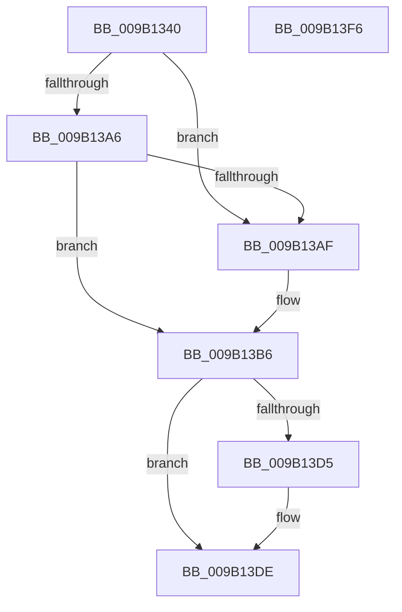

# CmpCleanupLightWeightTransaction

- RVA: `0x009B1340`–`0x009B13F7` (길이 `183` bytes)
- VA: `0x00000001409B1340`
- 실행 섹션: `PAGE`
- PDB 이름 있음: `예`; PDB Function 태그: `아니요`
- unwind 정보 RVA: `0x0005DD4C`
- 디코드: `47`개 명령, `183/183` bytes 표시
- 미해석 바이트: `0` (있으면 어셈블리에 `.byte`로 보존)

> 이 문서는 커널 이미지의 기계어와 PDB 기호를 분석해 생성했습니다. 4번과 5번은 함수 원형과 자료형을 바이너리 사용 방식에서 추정한 C 해석이며 원본 소스 복구 결과는 아닙니다.

## 1. Dependencies

- 직접 호출 지점: **10**; 고유 호출 대상: **10**
- 직접 호출자로 확인된 함수: **2**
- RIP 상대 이미지 참조: **2**

### Outgoing calls
- `0x009B1375` → [CmpAttachToRegistryProcess](../../pagecmrc/BC/CmpAttachToRegistryProcess_function_00BC98E0.md) (function, `0x00BC98E0`)
- `0x009B137A` → [CmpLockRegistryExclusive](../84/CmpLockRegistryExclusive_function_0084F9B4.md) (function, `0x0084F9B4`)
- `0x009B1384` → [CmpTransMgrFreeVolatileData](../87/CmpTransMgrFreeVolatileData_function_00874BDC.md) (function, `0x00874BDC`)
- `0x009B1389` → [CmpUnlockRegistry](../../pagecmrc/BC/CmpUnlockRegistry_function_00BC9A84.md) (function, `0x00BC9A84`)
- `0x009B1393` → [CmpDetachFromRegistryProcess](../../pagecmrc/BC/CmpDetachFromRegistryProcess_function_00BC9920.md) (function, `0x00BC9920`)
- `0x009B1398` → [LOCK_TRANSACTION_LIST](../87/LOCK_TRANSACTION_LIST_function_00874AD4.md) (function, `0x00874AD4`)
- `0x009B13C4` → [ExReleaseFastMutexUnsafe](../../text/25/ExReleaseFastMutexUnsafe_function_002503A0.md) (function, `0x002503A0`)
- `0x009B13C9` → [KeLeaveCriticalRegion](../../text/25/KeLeaveCriticalRegion_function_0025D8B0.md) (function, `0x0025D8B0`)
- `0x009B13D9` → [CmpTransDereferenceTransaction](../87/CmpTransDereferenceTransaction_function_00873608.md) (function, `0x00873608`)
- `0x009B13E6` → [_security_check_cookie](../../text/6A/_security_check_cookie_function_006AC640.md) (function, `0x006AC640`)

### Direct callers
- [CmpCommitLightWeightTransaction](CmpCommitLightWeightTransaction_function_009B0868.md) at `0x009B0939`
- [CmpAbortLightWeightTransaction](CmpAbortLightWeightTransaction_function_009B11F0.md) at `0x009B124F`

### Static image references
- `0x009B134A` → RVA `0x00E0A740` (`.data`; read)
- `0x009B13BD` → RVA `0x00EF5820` (`.data`; read)

## 2. Other-region calls and transfers

- 다른 실행 섹션으로 향하는 call: **6**
  - `0x009B1375` → [CmpAttachToRegistryProcess](../../pagecmrc/BC/CmpAttachToRegistryProcess_function_00BC98E0.md) (`PAGE` → `PAGECMRC`)
  - `0x009B1389` → [CmpUnlockRegistry](../../pagecmrc/BC/CmpUnlockRegistry_function_00BC9A84.md) (`PAGE` → `PAGECMRC`)
  - `0x009B1393` → [CmpDetachFromRegistryProcess](../../pagecmrc/BC/CmpDetachFromRegistryProcess_function_00BC9920.md) (`PAGE` → `PAGECMRC`)
  - `0x009B13C4` → [ExReleaseFastMutexUnsafe](../../text/25/ExReleaseFastMutexUnsafe_function_002503A0.md) (`PAGE` → `.text`)
  - `0x009B13C9` → [KeLeaveCriticalRegion](../../text/25/KeLeaveCriticalRegion_function_0025D8B0.md) (`PAGE` → `.text`)
  - `0x009B13E6` → [_security_check_cookie](../../text/6A/_security_check_cookie_function_006AC640.md) (`PAGE` → `.text`)
- 별도 외부 분기/꼬리 이동을 확인하지 못했습니다.

## 3. Assembly (complete function range)

```asm
009B1340  48 89 5C 24 10                  mov qword ptr [rsp + 0x10], rbx
009B1345  57                              push rdi
009B1346  48 83 EC 60                     sub rsp, 0x60
009B134A  48 8B 05 EF 93 45 00            mov rax, qword ptr [rip + 0x4593ef]
009B1351  48 33 C4                        xor rax, rsp
009B1354  48 89 44 24 50                  mov qword ptr [rsp + 0x50], rax
009B1359  0F 57 C0                        xorps xmm0, xmm0
009B135C  48 8B F9                        mov rdi, rcx
009B135F  48 8D 4C 24 20                  lea rcx, [rsp + 0x20]
009B1364  8B DA                           mov ebx, edx
009B1366  0F 11 44 24 20                  movups xmmword ptr [rsp + 0x20], xmm0
009B136B  0F 11 44 24 30                  movups xmmword ptr [rsp + 0x30], xmm0
009B1370  0F 11 44 24 40                  movups xmmword ptr [rsp + 0x40], xmm0
009B1375  E8 66 85 21 00                  call 0x140bc98e0
009B137A  E8 35 E6 E9 FF                  call 0x14084f9b4
009B137F  8B D3                           mov edx, ebx
009B1381  48 8B CF                        mov rcx, rdi
009B1384  E8 53 38 EC FF                  call 0x140874bdc
009B1389  E8 F6 86 21 00                  call 0x140bc9a84
009B138E  48 8D 4C 24 20                  lea rcx, [rsp + 0x20]
009B1393  E8 88 85 21 00                  call 0x140bc9920
009B1398  E8 37 37 EC FF                  call 0x140874ad4
009B139D  48 8B 0F                        mov rcx, qword ptr [rdi]
009B13A0  48 39 79 08                     cmp qword ptr [rcx + 8], rdi
009B13A4  75 09                           jne 0x1409b13af
009B13A6  48 8B 47 08                     mov rax, qword ptr [rdi + 8]
009B13AA  48 39 38                        cmp qword ptr [rax], rdi
009B13AD  74 07                           je 0x1409b13b6
009B13AF  B9 03 00 00 00                  mov ecx, 3
009B13B4  CD 29                           int 0x29
009B13B6  48 89 08                        mov qword ptr [rax], rcx
009B13B9  48 89 41 08                     mov qword ptr [rcx + 8], rax
009B13BD  48 8D 0D 5C 44 54 00            lea rcx, [rip + 0x54445c]
009B13C4  E8 D7 EF 89 FF                  call 0x1402503a0
009B13C9  E8 E2 C4 8A FF                  call 0x14025d8b0
009B13CE  48 83 7F 38 00                  cmp qword ptr [rdi + 0x38], 0
009B13D3  74 09                           je 0x1409b13de
009B13D5  48 8B 4F 38                     mov rcx, qword ptr [rdi + 0x38]
009B13D9  E8 2A 22 EC FF                  call 0x140873608
009B13DE  48 8B 4C 24 50                  mov rcx, qword ptr [rsp + 0x50]
009B13E3  48 33 CC                        xor rcx, rsp
009B13E6  E8 55 B2 CF FF                  call 0x1406ac640
009B13EB  48 8B 5C 24 78                  mov rbx, qword ptr [rsp + 0x78]
009B13F0  48 83 C4 60                     add rsp, 0x60
009B13F4  5F                              pop rdi
009B13F5  C3                              ret
009B13F6  CC                              int3
```

## 4. C-style interpretation (structured pseudocode)

```c
__int64 __fastcall CmpCleanupLightWeightTransaction(__int64 a1, int a2)
{
    __int64 result;
    __int64 v_rsp;
    unsigned __int64 v_stack_m18;
    unsigned __int64 v_stack_m28;
    unsigned __int64 v_stack_m38;
    unsigned __int64 v_stack_m48;
    unsigned __int64 v_stack_p10;

    v_stack_p10 = v_rbx;
    v_rsp = (v_rsp) - (96);
    result = (*(unsigned __int64 *)(v_rip + 4559855)) ^ (v_rsp);
    v_stack_m18 = result;
    v_stack_m48 = v_xmm0;
    v_stack_m38 = v_xmm0;
    v_stack_m28 = v_xmm0;
    result = CmpAttachToRegistryProcess(v_stack_m48, a2, a3, a4);
    result = CmpLockRegistryExclusive(v_stack_m48, a2, a3, a4);
    result = CmpTransMgrFreeVolatileData(a1, (unsigned int)((unsigned int)((unsigned int)(a2))), a3, a4);
    result = CmpUnlockRegistry(a1, (unsigned int)((unsigned int)((unsigned int)(a2))), a3, a4);
    result = CmpDetachFromRegistryProcess(v_stack_m48, (unsigned int)((unsigned int)((unsigned int)(a2))), a3, a4);
    result = LOCK_TRANSACTION_LIST(v_stack_m48, (unsigned int)((unsigned int)((unsigned int)(a2))), a3, a4);
    if ((*(unsigned __int64 *)(*(unsigned __int64 *)(a1) + 8)) != a1) goto loc_009B13AF;
    if ((*(unsigned __int64 *)(*(unsigned __int64 *)(a1 + 8))) != a1) {
        a1 = 3;
    }
    *(unsigned __int64 *)(*(unsigned __int64 *)(a1 + 8)) = a1;
    *(unsigned __int64 *)(a1 + 8) = *(unsigned __int64 *)(a1 + 8);
    result = ExReleaseFastMutexUnsafe(v_rip + 5522524, (unsigned int)((unsigned int)((unsigned int)(a2))), a3, a4);
    result = KeLeaveCriticalRegion(v_rip + 5522524, (unsigned int)((unsigned int)((unsigned int)(a2))), a3, a4);
    if ((*(unsigned __int64 *)(a1 + 56)) != 0) {
        a1 = *(unsigned __int64 *)(a1 + 56);
        result = CmpTransDereferenceTransaction(a1, (unsigned int)((unsigned int)((unsigned int)(a2))), a3, a4);
    }
    a1 = (v_stack_m18) ^ (v_rsp);
    result = _security_check_cookie(a1, (unsigned int)((unsigned int)((unsigned int)(a2))), a3, a4);
    v_rsp = (v_rsp) + (96);
    return result;
}
```

## 5. (Beta) C Style

```c
int64_t CmpCleanupLightWeightTransaction(void *Arg1, int32_t Arg2)
{
    uint8_t *arg1 = (uint8_t *)Arg1;

    int64_t result;
    int64_t local_rsp;
    uint64_t v_stack_m18;
    uint64_t v_stack_m28;
    uint64_t v_stack_m38;
    uint64_t v_stack_m48;
    uint64_t v_stack_p10;

    v_stack_p10 = local_rbx;
    local_rsp = (local_rsp) - (96);
    result = (*(uint64_t *)(v_rip + 0x4593EF)) ^ (local_rsp);
    v_stack_m18 = result;
    v_stack_m48 = v_xmm0;
    v_stack_m38 = v_xmm0;
    v_stack_m28 = v_xmm0;
    result = CmpAttachToRegistryProcess(v_stack_m48, Arg2, a3, a4);
    result = CmpLockRegistryExclusive(v_stack_m48, Arg2, a3, a4);
    result = CmpTransMgrFreeVolatileData(Arg1, (uint32_t)((uint32_t)((uint32_t)(Arg2))), a3, a4);
    result = CmpUnlockRegistry(Arg1, (uint32_t)((uint32_t)((uint32_t)(Arg2))), a3, a4);
    result = CmpDetachFromRegistryProcess(v_stack_m48, (uint32_t)((uint32_t)((uint32_t)(Arg2))), a3, a4);
    result = LOCK_TRANSACTION_LIST(v_stack_m48, (uint32_t)((uint32_t)((uint32_t)(Arg2))), a3, a4);
    if ((*(uint64_t *)(*(uint64_t *)(arg1) + 0x8)) != Arg1) goto loc_009B13AF;
    if ((*(uint64_t *)(*(uint64_t *)(arg1 + 0x8))) != Arg1) {
        Arg1 = 3;
    }
    *(void **)(*(uint64_t *)(arg1 + 0x8)) = Arg1;
    *(uint64_t *)(arg1 + 0x8) = *(uint64_t *)(arg1 + 0x8);
    result = ExReleaseFastMutexUnsafe(v_rip + 5522524, (uint32_t)((uint32_t)((uint32_t)(Arg2))), a3, a4);
    result = KeLeaveCriticalRegion(v_rip + 5522524, (uint32_t)((uint32_t)((uint32_t)(Arg2))), a3, a4);
    if ((*(uint64_t *)(arg1 + 0x38)) != 0) {
        Arg1 = *(uint64_t *)(arg1 + 0x38);
        result = CmpTransDereferenceTransaction(Arg1, (uint32_t)((uint32_t)((uint32_t)(Arg2))), a3, a4);
    }
    Arg1 = (v_stack_m18) ^ (local_rsp);
    result = _security_check_cookie(Arg1, (uint32_t)((uint32_t)((uint32_t)(Arg2))), a3, a4);
    local_rsp = (local_rsp) + (96);
    return result;
}
```

### 관측된 메모리 오프셋

구조체 형식이 확인되지 않은 접근은 인자 기준의 오프셋으로만 기록했습니다.

| 기준 인자 | 오프셋 표현 | 폭 (bit) | 접근 |
|---|---:|---:|---|
| `Arg1` | `+ 0x0` | `64` | `R` |
| `Arg1` | `+ 0x8` | `64` | `R` |
| `Arg1` | `+ 0x38` | `64` | `R` |

## 6. Execution-region graph

[열기: 2D/3D 그래프와 함수 탐색 컨트롤 패널](../../../control-panel.html?section=page&rva=0x009B1340&view=graph)

- 2D 그래프는 위에서 아래로 흐르고, 3D 그래프는 빈 공간을 드래그해 회전합니다. Shift+드래그는 이동, 휠은 확대·축소, 함수 노드 선택은 대상 보고서 이동입니다.

### Static fallback


