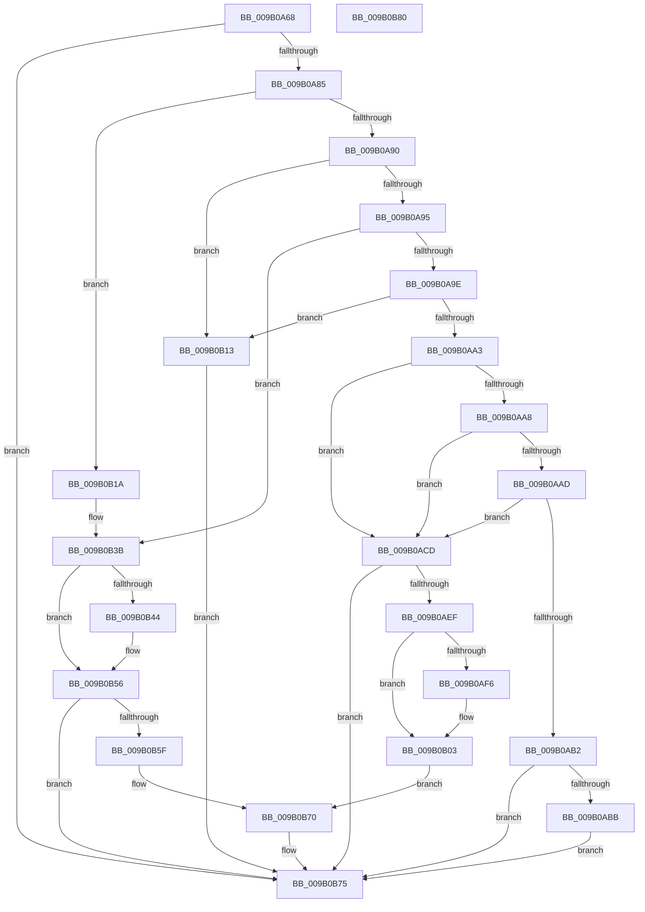

# CmpCleanupLightWeightUoWData

- RVA: `0x009B0A68`–`0x009B0B81` (길이 `281` bytes)
- VA: `0x00000001409B0A68`
- 실행 섹션: `PAGE`
- PDB 이름 있음: `예`; PDB Function 태그: `아니요`
- unwind 정보 RVA: `0x0005CAAC`
- 디코드: `78`개 명령, `281/281` bytes 표시
- 미해석 바이트: `0` (있으면 어셈블리에 `.byte`로 보존)

> 이 문서는 커널 이미지의 기계어와 PDB 기호를 분석해 생성했습니다. 4번과 5번은 함수 원형과 자료형을 바이너리 사용 방식에서 추정한 C 해석이며 원본 소스 복구 결과는 아닙니다.

## 1. Dependencies

- 직접 호출 지점: **8**; 고유 호출 대상: **8**
- 직접 호출자로 확인된 함수: **2**
- RIP 상대 이미지 참조: **0**

### Outgoing calls
- `0x009B0ABE` → [CmpLightWeightCleanupSetSecDescUoW](../94/CmpLightWeightCleanupSetSecDescUoW_function_0094B374.md) (function, `0x0094B374`)
- `0x009B0AD8` → [CmpLightWeightCleanupSetValueKeyUoW](../A3/CmpLightWeightCleanupSetValueKeyUoW_function_00A3A114.md) (function, `0x00A3A114`)
- `0x009B0AFE` → [CmpFreeValue](../84/CmpFreeValue_function_0084AF98.md) (function, `0x0084AF98`)
- `0x009B0B0C` → [CmpFreePoolWithTag](../../text/44/CmpFreePoolWithTag_function_004489E0.md) (function, `0x004489E0`)
- `0x009B0B28` → [CmpFreeKeyByCell](../84/CmpFreeKeyByCell_function_0084AD70.md) (function, `0x0084AD70`)
- `0x009B0B4C` → [CmpLightWeightCleanupModifyKeyDataUoW](../A5/CmpLightWeightCleanupModifyKeyDataUoW_function_00A54EE4.md) (function, `0x00A54EE4`)
- `0x009B0B62` → [CmpCleanupDiscardReplaceContext](../A5/CmpCleanupDiscardReplaceContext_function_00A54FF8.md) (function, `0x00A54FF8`)
- `0x009B0B6B` → [CmSiFreeMemory](../../text/47/CmSiFreeMemory_function_00475D80.md) (function, `0x00475D80`)

### Direct callers
- [CmpCommitLightWeightTransaction](CmpCommitLightWeightTransaction_function_009B0868.md) at `0x009B08FE`
- [CmpCommitLightWeightTransaction](CmpCommitLightWeightTransaction_function_009B0868.md) at `0x009B0970`
- [CmpCleanupLightWeightPrepare](CmpCleanupLightWeightPrepare_function_009B0A18.md) at `0x009B0A3C`

### Static image references
- 디코드된 RIP-relative 메모리 참조가 없습니다.

## 2. Other-region calls and transfers

- 다른 실행 섹션으로 향하는 call: **2**
  - `0x009B0B0C` → [CmpFreePoolWithTag](../../text/44/CmpFreePoolWithTag_function_004489E0.md) (`PAGE` → `.text`)
  - `0x009B0B6B` → [CmSiFreeMemory](../../text/47/CmSiFreeMemory_function_00475D80.md) (`PAGE` → `.text`)
- 별도 외부 분기/꼬리 이동을 확인하지 못했습니다.

## 3. Assembly (complete function range)

```asm
009B0A68  48 89 5C 24 08                  mov qword ptr [rsp + 8], rbx
009B0A6D  57                              push rdi
009B0A6E  48 83 EC 20                     sub rsp, 0x20
009B0A72  4C 8B 49 68                     mov r9, qword ptr [rcx + 0x68]
009B0A76  49 8B F8                        mov rdi, r8
009B0A79  48 8B D9                        mov rbx, rcx
009B0A7C  4D 85 C9                        test r9, r9
009B0A7F  0F 84 F0 00 00 00               je 0x1409b0b75
009B0A85  8B 51 44                        mov edx, dword ptr [rcx + 0x44]
009B0A88  85 D2                           test edx, edx
009B0A8A  0F 84 8A 00 00 00               je 0x1409b0b1a
009B0A90  83 EA 01                        sub edx, 1
009B0A93  74 7E                           je 0x1409b0b13
009B0A95  83 EA 01                        sub edx, 1
009B0A98  0F 84 9D 00 00 00               je 0x1409b0b3b
009B0A9E  83 EA 01                        sub edx, 1
009B0AA1  74 70                           je 0x1409b0b13
009B0AA3  83 EA 01                        sub edx, 1
009B0AA6  74 25                           je 0x1409b0acd
009B0AA8  83 EA 01                        sub edx, 1
009B0AAB  74 20                           je 0x1409b0acd
009B0AAD  83 EA 01                        sub edx, 1
009B0AB0  74 1B                           je 0x1409b0acd
009B0AB2  83 FA 03                        cmp edx, 3
009B0AB5  0F 85 BA 00 00 00               jne 0x1409b0b75
009B0ABB  49 8B C9                        mov rcx, r9
009B0ABE  E8 B1 A8 F9 FF                  call 0x14094b374
009B0AC3  48 83 63 68 00                  and qword ptr [rbx + 0x68], 0
009B0AC8  E9 A8 00 00 00                  jmp 0x1409b0b75
009B0ACD  48 8B 49 30                     mov rcx, qword ptr [rcx + 0x30]
009B0AD1  49 8B D1                        mov rdx, r9
009B0AD4  48 8B 49 20                     mov rcx, qword ptr [rcx + 0x20]
009B0AD8  E8 37 96 08 00                  call 0x140a3a114
009B0ADD  48 8B 53 70                     mov rdx, qword ptr [rbx + 0x70]
009B0AE1  48 83 63 68 00                  and qword ptr [rbx + 0x68], 0
009B0AE6  48 85 D2                        test rdx, rdx
009B0AE9  0F 84 86 00 00 00               je 0x1409b0b75
009B0AEF  8B 12                           mov edx, dword ptr [rdx]
009B0AF1  83 FA FF                        cmp edx, -1
009B0AF4  74 0D                           je 0x1409b0b03
009B0AF6  48 8B 4B 30                     mov rcx, qword ptr [rbx + 0x30]
009B0AFA  48 8B 49 20                     mov rcx, qword ptr [rcx + 0x20]
009B0AFE  E8 95 A4 E9 FF                  call 0x14084af98
009B0B03  48 8B 4B 70                     mov rcx, qword ptr [rbx + 0x70]
009B0B07  BA 43 4D 55 77                  mov edx, 0x77554d43
009B0B0C  E8 CF 7E A9 FF                  call 0x1404489e0
009B0B11  EB 5D                           jmp 0x1409b0b70
009B0B13  48 83 61 68 00                  and qword ptr [rcx + 0x68], 0
009B0B18  EB 5B                           jmp 0x1409b0b75
009B0B1A  48 8B 49 30                     mov rcx, qword ptr [rcx + 0x30]
009B0B1E  45 33 C0                        xor r8d, r8d
009B0B21  8B 51 28                        mov edx, dword ptr [rcx + 0x28]
009B0B24  48 8B 49 20                     mov rcx, qword ptr [rcx + 0x20]
009B0B28  E8 43 A2 E9 FF                  call 0x14084ad70
009B0B2D  8B 43 58                        mov eax, dword ptr [rbx + 0x58]
009B0B30  48 8B 4B 30                     mov rcx, qword ptr [rbx + 0x30]
009B0B34  89 41 28                        mov dword ptr [rcx + 0x28], eax
009B0B37  83 63 58 00                     and dword ptr [rbx + 0x58], 0
009B0B3B  48 8B 53 68                     mov rdx, qword ptr [rbx + 0x68]
009B0B3F  48 85 D2                        test rdx, rdx
009B0B42  74 12                           je 0x1409b0b56
009B0B44  48 8B 4B 30                     mov rcx, qword ptr [rbx + 0x30]
009B0B48  48 8B 49 20                     mov rcx, qword ptr [rcx + 0x20]
009B0B4C  E8 93 43 0A 00                  call 0x140a54ee4
009B0B51  48 83 63 68 00                  and qword ptr [rbx + 0x68], 0
009B0B56  48 8B 4B 70                     mov rcx, qword ptr [rbx + 0x70]
009B0B5A  48 85 C9                        test rcx, rcx
009B0B5D  74 16                           je 0x1409b0b75
009B0B5F  48 8B D7                        mov rdx, rdi
009B0B62  E8 91 44 0A 00                  call 0x140a54ff8
009B0B67  48 8B 4B 70                     mov rcx, qword ptr [rbx + 0x70]
009B0B6B  E8 10 52 AC FF                  call 0x140475d80
009B0B70  48 83 63 70 00                  and qword ptr [rbx + 0x70], 0
009B0B75  48 8B 5C 24 30                  mov rbx, qword ptr [rsp + 0x30]
009B0B7A  48 83 C4 20                     add rsp, 0x20
009B0B7E  5F                              pop rdi
009B0B7F  C3                              ret
009B0B80  CC                              int3
```

## 4. C-style interpretation (structured pseudocode)

```c
__int64 __fastcall CmpCleanupLightWeightUoWData(__int64 a1, __int64 a2, __int64 a3)
{
    __int64 result;
    __int64 v_rsp;
    unsigned __int64 v_stack_p8;

    v_stack_p8 = v_rbx;
    v_rsp = (v_rsp) - (32);
    if (*(unsigned __int64 *)(a1 + 104) == 0) goto loc_009B0B75;
    if ((unsigned int)((unsigned int)(*(unsigned int *)(a1 + 68))) == 0) goto loc_009B0B1A;
    a2 = (unsigned int)(((unsigned int)(*(unsigned int *)(a1 + 68))) - (1));
    if (condition_is_equal) goto loc_009B0B13;
    a2 = (unsigned int)((a2) - (1));
    if (condition_is_equal) goto loc_009B0B3B;
    a2 = (unsigned int)((a2) - (1));
    if (condition_is_equal) goto loc_009B0B13;
    a2 = (unsigned int)((a2) - (1));
    if (condition_is_equal) goto loc_009B0ACD;
    a2 = (unsigned int)((a2) - (1));
    if (condition_is_equal) goto loc_009B0ACD;
    a2 = (unsigned int)((a2) - (1));
    if (condition_is_equal) goto loc_009B0ACD;
    if (((unsigned int)(a2)) != 3) goto loc_009B0B75;
    result = CmpLightWeightCleanupSetSecDescUoW(*(unsigned __int64 *)(a1 + 104), a2, a3, *(unsigned __int64 *)(a1 + 104));
    goto loc_009B0B75;
loc_009B0ACD:
    result = CmpLightWeightCleanupSetValueKeyUoW(*(unsigned __int64 *)(*(unsigned __int64 *)(*(unsigned __int64 *)(a1 + 104) + 48) + 32), *(unsigned __int64 *)(a1 + 104), a3, *(unsigned __int64 *)(a1 + 104));
    if (*(unsigned __int64 *)(a1 + 112) == 0) goto loc_009B0B75;
    if (((unsigned int)((unsigned int)(*(unsigned int *)(*(unsigned __int64 *)(a1 + 112))))) != -1) {
        a1 = *(unsigned __int64 *)(a1 + 48);
        a1 = *(unsigned __int64 *)(a1 + 32);
        result = CmpFreeValue(a1, (unsigned int)(*(unsigned int *)(*(unsigned __int64 *)(a1 + 112))), a3, *(unsigned __int64 *)(a1 + 104));
    }
    result = CmpFreePoolWithTag(*(unsigned __int64 *)(a1 + 112), (unsigned int)(0x77554D43ULL), a3, *(unsigned __int64 *)(a1 + 104));
    goto loc_009B0B70;
loc_009B0B13:
    goto loc_009B0B75;
loc_009B0B1A:
    a3 = 0;
    result = CmpFreeKeyByCell(*(unsigned __int64 *)(*(unsigned __int64 *)(*(unsigned __int64 *)(a1 + 112) + 48) + 32), (unsigned int)(*(unsigned int *)(*(unsigned __int64 *)(*(unsigned __int64 *)(a1 + 112) + 48) + 40)), a3, *(unsigned __int64 *)(a1 + 104));
    *(unsigned int *)(*(unsigned __int64 *)(a1 + 48) + 40) = (unsigned int)((unsigned int)(*(unsigned int *)(a1 + 88)));
loc_009B0B3B:
    result = (unsigned int)(*(unsigned int *)(a1 + 88));
    if (*(unsigned __int64 *)(a1 + 104) != 0) {
        a1 = *(unsigned __int64 *)(a1 + 48);
        a1 = *(unsigned __int64 *)(a1 + 32);
        result = CmpLightWeightCleanupModifyKeyDataUoW(a1, *(unsigned __int64 *)(a1 + 104), a3, *(unsigned __int64 *)(a1 + 104));
    }
    if (*(unsigned __int64 *)(a1 + 112) == 0) goto loc_009B0B75;
    result = CmpCleanupDiscardReplaceContext(*(unsigned __int64 *)(a1 + 112), 0, a3, *(unsigned __int64 *)(a1 + 104));
    result = CmSiFreeMemory(*(unsigned __int64 *)(a1 + 112), 0, a3, *(unsigned __int64 *)(a1 + 104));
loc_009B0B70:
loc_009B0B75:
    v_rsp = (v_rsp) + (32);
    return result;
}
```

## 5. (Beta) C Style

```c
int64_t CmpCleanupLightWeightUoWData(void *Arg1, int64_t Arg2, int64_t Arg3)
{
    uint8_t *arg1 = (uint8_t *)Arg1;

    int64_t result;
    int64_t local_rsp;
    uint64_t v_stack_p8;

    v_stack_p8 = local_rbx;
    local_rsp = (local_rsp) - (32);
    if (*(uint64_t *)(arg1 + 0x68) == 0) goto loc_009B0B75;
    if ((uint32_t)((uint32_t)(*(uint32_t *)(arg1 + 0x44))) == 0) goto loc_009B0B1A;
    Arg2 = (uint32_t)(((uint32_t)(*(uint32_t *)(arg1 + 0x44))) - (1));
    if (condition_is_equal) goto loc_009B0B13;
    Arg2 = (uint32_t)((Arg2) - (1));
    if (condition_is_equal) goto loc_009B0B3B;
    Arg2 = (uint32_t)((Arg2) - (1));
    if (condition_is_equal) goto loc_009B0B13;
    Arg2 = (uint32_t)((Arg2) - (1));
    if (condition_is_equal) goto loc_009B0ACD;
    Arg2 = (uint32_t)((Arg2) - (1));
    if (condition_is_equal) goto loc_009B0ACD;
    Arg2 = (uint32_t)((Arg2) - (1));
    if (condition_is_equal) goto loc_009B0ACD;
    if (((uint32_t)(Arg2)) != 3) goto loc_009B0B75;
    result = CmpLightWeightCleanupSetSecDescUoW(*(uint64_t *)(arg1 + 0x68), Arg2, Arg3, *(uint64_t *)(arg1 + 0x68));
    goto loc_009B0B75;
loc_009B0ACD:
    result = CmpLightWeightCleanupSetValueKeyUoW(*(uint64_t *)(*(uint64_t *)(*(uint64_t *)(arg1 + 0x68) + 0x30) + 0x20), *(uint64_t *)(arg1 + 0x68), Arg3, *(uint64_t *)(arg1 + 0x68));
    if (*(uint64_t *)(arg1 + 0x70) == 0) goto loc_009B0B75;
    if (((uint32_t)((uint32_t)(*(uint32_t *)(*(uint64_t *)(arg1 + 0x70))))) != -1) {
        Arg1 = *(uint64_t *)(arg1 + 0x30);
        Arg1 = *(uint64_t *)(arg1 + 0x20);
        result = CmpFreeValue(Arg1, (uint32_t)(*(uint32_t *)(*(uint64_t *)(arg1 + 0x70))), Arg3, *(uint64_t *)(arg1 + 0x68));
    }
    result = CmpFreePoolWithTag(*(uint64_t *)(arg1 + 0x70), (uint32_t)(0x77554D43ULL), Arg3, *(uint64_t *)(arg1 + 0x68));
    goto loc_009B0B70;
loc_009B0B13:
    goto loc_009B0B75;
loc_009B0B1A:
    Arg3 = 0;
    result = CmpFreeKeyByCell(*(uint64_t *)(*(uint64_t *)(*(uint64_t *)(arg1 + 0x70) + 0x30) + 0x20), (uint32_t)(*(uint32_t *)(*(uint64_t *)(*(uint64_t *)(arg1 + 0x70) + 0x30) + 0x28)), Arg3, *(uint64_t *)(arg1 + 0x68));
    *(uint32_t *)(*(uint64_t *)(arg1 + 0x30) + 0x28) = (uint32_t)((uint32_t)(*(uint32_t *)(arg1 + 0x58)));
loc_009B0B3B:
    result = (uint32_t)(*(uint32_t *)(arg1 + 0x58));
    if (*(uint64_t *)(arg1 + 0x68) != 0) {
        Arg1 = *(uint64_t *)(arg1 + 0x30);
        Arg1 = *(uint64_t *)(arg1 + 0x20);
        result = CmpLightWeightCleanupModifyKeyDataUoW(Arg1, *(uint64_t *)(arg1 + 0x68), Arg3, *(uint64_t *)(arg1 + 0x68));
    }
    if (*(uint64_t *)(arg1 + 0x70) == 0) goto loc_009B0B75;
    result = CmpCleanupDiscardReplaceContext(*(uint64_t *)(arg1 + 0x70), 0, Arg3, *(uint64_t *)(arg1 + 0x68));
    result = CmSiFreeMemory(*(uint64_t *)(arg1 + 0x70), 0, Arg3, *(uint64_t *)(arg1 + 0x68));
loc_009B0B70:
loc_009B0B75:
    local_rsp = (local_rsp) + (32);
    return result;
}
```

### 관측된 메모리 오프셋

구조체 형식이 확인되지 않은 접근은 인자 기준의 오프셋으로만 기록했습니다.

| 기준 인자 | 오프셋 표현 | 폭 (bit) | 접근 |
|---|---:|---:|---|
| `Arg1` | `+ 0x30` | `64` | `R` |
| `Arg1` | `+ 0x44` | `32` | `R` |
| `Arg1` | `+ 0x58` | `32` | `R` |
| `Arg1` | `+ 0x58` | `32` | `R/W` |
| `Arg1` | `+ 0x68` | `64` | `R` |
| `Arg1` | `+ 0x68` | `64` | `R/W` |
| `Arg1` | `+ 0x70` | `64` | `R` |
| `Arg1` | `+ 0x70` | `64` | `R/W` |

## 6. Execution-region graph

[열기: 2D/3D 그래프와 함수 탐색 컨트롤 패널](../../../control-panel.html?section=page&rva=0x009B0A68&view=graph)

- 2D 그래프는 위에서 아래로 흐르고, 3D 그래프는 빈 공간을 드래그해 회전합니다. Shift+드래그는 이동, 휠은 확대·축소, 함수 노드 선택은 대상 보고서 이동입니다.

### Static fallback


