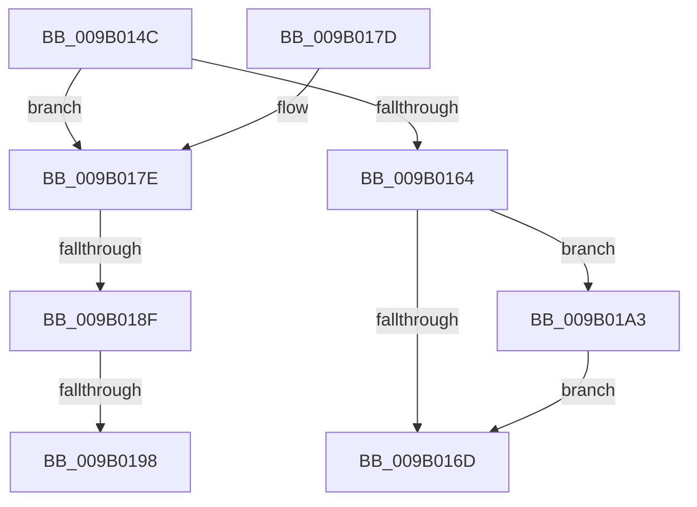

# CmpCleanupRollbackPacket

- RVA: `0x009B014C`–`0x009B01AA` (길이 `94` bytes)
- VA: `0x00000001409B014C`
- 실행 섹션: `PAGE`
- PDB 이름 있음: `예`; PDB Function 태그: `예`
- unwind 정보 RVA: `0x00084A08`
- 디코드: `28`개 명령, `94/94` bytes 표시
- 미해석 바이트: `0` (있으면 어셈블리에 `.byte`로 보존)

> 이 문서는 커널 이미지의 기계어와 PDB 기호를 분석해 생성했습니다. 4번과 5번은 함수 원형과 자료형을 바이너리 사용 방식에서 추정한 C 해석이며 원본 소스 복구 결과는 아닙니다.

## 1. Dependencies

- 직접 호출 지점: **2**; 고유 호출 대상: **2**
- 직접 호출자로 확인된 함수: **8**
- RIP 상대 이미지 참조: **0**

### Outgoing calls
- `0x009B0198` → [CmpTransDereferenceTransaction](../87/CmpTransDereferenceTransaction_function_00873608.md) (function, `0x00873608`)
- `0x009B01A3` → [CmSiFreeMemory](../../text/47/CmSiFreeMemory_function_00475D80.md) (function, `0x00475D80`)

### Direct callers
- [CmpTryToRundownHive](../../text/2A/CmpTryToRundownHive_function_002A4A60.md) at `0x002A4B2B`
- [CmpTryToRundownHive](../../text/2A/CmpTryToRundownHive_function_002A4A60.md) at `0x002A4BEE`
- [CmpSaveBootControlSet](../7D/CmpSaveBootControlSet_function_007DC744.md) at `0x007DCA81`
- [CmpSaveBootControlSet](../7D/CmpSaveBootControlSet_function_007DC744.md) at `0x007DCB66`
- [CmRestoreKey](../7D/CmRestoreKey_function_007DCF04.md) at `0x007DD3CC`
- [CmRestoreKey](../7D/CmRestoreKey_function_007DCF04.md) at `0x007DD4A0`
- [CmRestoreKey](../7D/CmRestoreKey_function_007DCF04.md) at `0x007DDB9D`
- [CmRenameKey](../7E/CmRenameKey_function_007E8F48.md) at `0x007E963B`
- [CmRenameKey](../7E/CmRenameKey_function_007E8F48.md) at `0x007E96A3`
- [CmRenameKey](../7E/CmRenameKey_function_007E8F48.md) at `0x007EA18E`
- [CmSetLastWriteTimeKey](../84/CmSetLastWriteTimeKey_function_00843368.md) at `0x0084351D`
- [CmSetLastWriteTimeKey](../84/CmSetLastWriteTimeKey_function_00843368.md) at `0x008436D0`
- [CmSetKeyFlags](../9A/CmSetKeyFlags_function_009AEEA4.md) at `0x009AEFB8`
- [CmpPerformUnloadKey](../9A/CmpPerformUnloadKey_function_009AFA28.md) at `0x009AFD3C`
- [CmpPerformUnloadKey](../9A/CmpPerformUnloadKey_function_009AFA28.md) at `0x009AFE76`
- [sub_00B2D804](../B2/Unknown_function_00B2D804.md) at `0x00B2D84C`

### Static image references
- 디코드된 RIP-relative 메모리 참조가 없습니다.

## 2. Other-region calls and transfers

- 다른 실행 섹션으로 향하는 call: **1**
  - `0x009B01A3` → [CmSiFreeMemory](../../text/47/CmSiFreeMemory_function_00475D80.md) (`PAGE` → `.text`)
- call이 아닌 외부 분기/꼬리 이동: **3**
  - `0x009B0189` → [sub_00B2DA56 + 0x5](../B2/Unknown_function_00B2DA56.md) (`tail-transfer`)
  - `0x009B0192` → [sub_00B2DA56](../B2/Unknown_function_00B2DA56.md) (`tail-transfer`)
  - `0x009B019E` → [sub_00B2DA56 + 0x5](../B2/Unknown_function_00B2DA56.md) (`tail-transfer`)

## 3. Assembly (complete function range)

```asm
009B014C  48 89 5C 24 08                  mov qword ptr [rsp + 8], rbx
009B0151  48 89 74 24 10                  mov qword ptr [rsp + 0x10], rsi
009B0156  57                              push rdi
009B0157  48 83 EC 20                     sub rsp, 0x20
009B015B  33 FF                           xor edi, edi
009B015D  48 8B F1                        mov rsi, rcx
009B0160  39 39                           cmp dword ptr [rcx], edi
009B0162  77 1A                           ja 0x1409b017e
009B0164  48 8B 4E 08                     mov rcx, qword ptr [rsi + 8]
009B0168  48 85 C9                        test rcx, rcx
009B016B  75 36                           jne 0x1409b01a3
009B016D  48 8B 5C 24 30                  mov rbx, qword ptr [rsp + 0x30]
009B0172  48 8B 74 24 38                  mov rsi, qword ptr [rsp + 0x38]
009B0177  48 83 C4 20                     add rsp, 0x20
009B017B  5F                              pop rdi
009B017C  C3                              ret
009B017D  CC                              int3
009B017E  48 8B 4E 08                     mov rcx, qword ptr [rsi + 8]
009B0182  48 8B 0C F9                     mov rcx, qword ptr [rcx + rdi*8]
009B0186  48 85 C9                        test rcx, rcx
009B0189  0F 84 CC D8 17 00               je 0x140b2da5b
009B018F  F6 C1 01                        test cl, 1
009B0192  0F 84 BE D8 17 00               je 0x140b2da56
009B0198  E8 6B 34 EC FF                  call 0x140873608
009B019D  90                              nop
009B019E  E9 B8 D8 17 00                  jmp 0x140b2da5b
009B01A3  E8 D8 5B AC FF                  call 0x140475d80
009B01A8  EB C3                           jmp 0x1409b016d
```

## 4. C-style interpretation (structured pseudocode)

```c
__int64 __fastcall CmpCleanupRollbackPacket(__int64 a1)
{
    __int64 result;
    __int64 v_rdi;
    __int64 v_rsp;
    unsigned __int64 v_stack_p10;
    unsigned __int64 v_stack_p8;

    v_stack_p8 = v_rbx;
    v_stack_p10 = v_rsi;
    v_rsp = (v_rsp) - (32);
    v_rdi = 0;
    if ((*(unsigned int *)(a1)) > 0) goto loc_009B017E;
    if (*(unsigned __int64 *)(a1 + 8) != 0) goto loc_009B01A3;
loc_009B016D:
    v_rsp = (v_rsp) + (32);
    return result;
loc_009B017E:
    result = CmpTransDereferenceTransaction(*(unsigned __int64 *)(*(unsigned __int64 *)(v_stack_p10 + 8) + v_rdi * 8), a2, a3, a4);
loc_009B01A3:
    result = CmSiFreeMemory(*(unsigned __int64 *)(*(unsigned __int64 *)(v_stack_p10 + 8) + v_rdi * 8), a2, a3, a4);
    goto loc_009B016D;
}
```

## 5. (Beta) C Style

```c
int64_t CmpCleanupRollbackPacket(void *Arg1)
{
    uint8_t *arg1 = (uint8_t *)Arg1;

    int64_t result;
    int64_t local_rdi;
    int64_t local_rsp;
    uint64_t v_stack_p10;
    uint64_t v_stack_p8;

    v_stack_p8 = local_rbx;
    v_stack_p10 = local_rsi;
    local_rsp = (local_rsp) - (32);
    local_rdi = 0;
    if ((*(uint32_t *)(arg1)) > 0) goto loc_009B017E;
    if (*(uint64_t *)(arg1 + 0x8) != 0) goto loc_009B01A3;
loc_009B016D:
    local_rsp = (local_rsp) + (32);
    return result;
loc_009B017E:
    result = CmpTransDereferenceTransaction(*(uint64_t *)(*(uint64_t *)(v_stack_p10 + 0x8) + local_rdi * 8), a2, a3, a4);
loc_009B01A3:
    result = CmSiFreeMemory(*(uint64_t *)(*(uint64_t *)(v_stack_p10 + 0x8) + local_rdi * 8), a2, a3, a4);
    goto loc_009B016D;
}
```

### 관측된 메모리 오프셋

구조체 형식이 확인되지 않은 접근은 인자 기준의 오프셋으로만 기록했습니다.

| 기준 인자 | 오프셋 표현 | 폭 (bit) | 접근 |
|---|---:|---:|---|
| `Arg1` | `+ 0x0` | `32` | `R` |
| `Arg1` | `+ 0x8` | `64` | `R` |

## 6. Execution-region graph

[열기: 2D/3D 그래프와 함수 탐색 컨트롤 패널](../../../control-panel.html?section=page&rva=0x009B014C&view=graph)

- 2D 그래프는 위에서 아래로 흐르고, 3D 그래프는 빈 공간을 드래그해 회전합니다. Shift+드래그는 이동, 휠은 확대·축소, 함수 노드 선택은 대상 보고서 이동입니다.

### Static fallback


