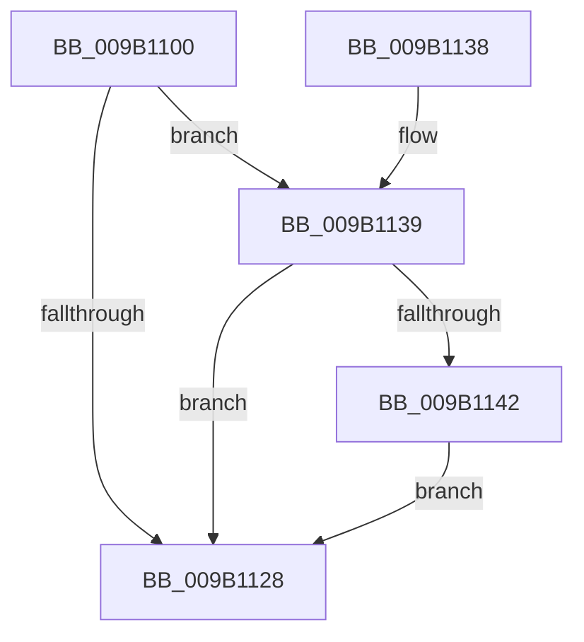

# CmpCloseLightWeightTransaction

- RVA: `0x009B1100`–`0x009B1151` (길이 `81` bytes)
- VA: `0x00000001409B1100`
- 실행 섹션: `PAGE`
- PDB 이름 있음: `예`; PDB Function 태그: `아니요`
- unwind 정보 RVA: `0x0009E238`
- 디코드: `24`개 명령, `81/81` bytes 표시
- 미해석 바이트: `0` (있으면 어셈블리에 `.byte`로 보존)

> 이 문서는 커널 이미지의 기계어와 PDB 기호를 분석해 생성했습니다. 4번과 5번은 함수 원형과 자료형을 바이너리 사용 방식에서 추정한 C 해석이며 원본 소스 복구 결과는 아닙니다.

## 1. Dependencies

- 직접 호출 지점: **5**; 고유 호출 대상: **5**
- 직접 호출자로 확인된 함수: **0**
- RIP 상대 이미지 참조: **0**

### Outgoing calls
- `0x009B111D` → [CmpInitializeThreadInfo](../../text/3F/CmpInitializeThreadInfo_function_003FBE70.md) (function, `0x003FBE70`)
- `0x009B112D` → [CmCleanupThreadInfo](../../text/41/CmCleanupThreadInfo_function_0041FD50.md) (function, `0x0041FD50`)
- `0x009B1139` → [CmpAcquireShutdownRundown](../../pagecmrc/BC/CmpAcquireShutdownRundown_function_00BC9400.md) (function, `0x00BC9400`)
- `0x009B1145` → [CmpRollbackLightWeightTransaction](CmpRollbackLightWeightTransaction_function_009B1158.md) (function, `0x009B1158`)
- `0x009B114A` → [CmpReleaseShutdownRundown](../../pagecmrc/BC/CmpReleaseShutdownRundown_function_00BC9880.md) (function, `0x00BC9880`)

### Direct callers
- 이 함수 시작 RVA로 연결되는 직접 call은 확인되지 않았습니다. 간접 호출은 완전히 역산할 수 없습니다.

### Static image references
- 디코드된 RIP-relative 메모리 참조가 없습니다.

## 2. Other-region calls and transfers

- 다른 실행 섹션으로 향하는 call: **4**
  - `0x009B111D` → [CmpInitializeThreadInfo](../../text/3F/CmpInitializeThreadInfo_function_003FBE70.md) (`PAGE` → `.text`)
  - `0x009B112D` → [CmCleanupThreadInfo](../../text/41/CmCleanupThreadInfo_function_0041FD50.md) (`PAGE` → `.text`)
  - `0x009B1139` → [CmpAcquireShutdownRundown](../../pagecmrc/BC/CmpAcquireShutdownRundown_function_00BC9400.md) (`PAGE` → `PAGECMRC`)
  - `0x009B114A` → [CmpReleaseShutdownRundown](../../pagecmrc/BC/CmpReleaseShutdownRundown_function_00BC9880.md) (`PAGE` → `PAGECMRC`)
- 별도 외부 분기/꼬리 이동을 확인하지 못했습니다.

## 3. Assembly (complete function range)

```asm
009B1100  40 53                           push rbx
009B1102  48 83 EC 40                     sub rsp, 0x40
009B1106  0F 57 C0                        xorps xmm0, xmm0
009B1109  48 8D 4C 24 20                  lea rcx, [rsp + 0x20]
009B110E  33 C0                           xor eax, eax
009B1110  48 8B DA                        mov rbx, rdx
009B1113  0F 11 44 24 20                  movups xmmword ptr [rsp + 0x20], xmm0
009B1118  48 89 44 24 30                  mov qword ptr [rsp + 0x30], rax
009B111D  E8 4E AD A4 FF                  call 0x1403fbe70
009B1122  49 83 F9 01                     cmp r9, 1
009B1126  74 11                           je 0x1409b1139
009B1128  48 8D 4C 24 20                  lea rcx, [rsp + 0x20]
009B112D  E8 1E EC A6 FF                  call 0x14041fd50
009B1132  48 83 C4 40                     add rsp, 0x40
009B1136  5B                              pop rbx
009B1137  C3                              ret
009B1138  CC                              int3
009B1139  E8 C2 82 21 00                  call 0x140bc9400
009B113E  84 C0                           test al, al
009B1140  74 E6                           je 0x1409b1128
009B1142  48 8B CB                        mov rcx, rbx
009B1145  E8 0E 00 00 00                  call 0x1409b1158
009B114A  E8 31 87 21 00                  call 0x140bc9880
009B114F  EB D7                           jmp 0x1409b1128
```

## 4. C-style interpretation (structured pseudocode)

```c
__int64 __fastcall CmpCloseLightWeightTransaction(__int64 a1, __int64 a2, __int64 a3, __int64 a4)
{
    __int64 result;
    __int64 v_rsp;
    unsigned __int64 v_stack_m18;
    unsigned __int64 v_stack_m28;

    v_rsp = (v_rsp) - (64);
    result = 0;
    v_stack_m28 = v_xmm0;
    v_stack_m18 = 0;
    result = CmpInitializeThreadInfo(v_stack_m28, a2, a3, a4);
    if (a4 == 1) goto loc_009B1139;
loc_009B1128:
    result = CmCleanupThreadInfo(v_stack_m28, a2, a3, a4);
    v_rsp = (v_rsp) + (64);
    return result;
loc_009B1139:
    result = CmpAcquireShutdownRundown(v_stack_m28, a2, a3, a4);
    if ((unsigned __int8)(result) == 0) goto loc_009B1128;
    result = CmpRollbackLightWeightTransaction(a2, a2, a3, a4);
    result = CmpReleaseShutdownRundown(a2, a2, a3, a4);
    goto loc_009B1128;
}
```

## 5. (Beta) C Style

```c
int64_t CmpCloseLightWeightTransaction(int64_t Arg1, int64_t Arg2, int64_t Arg3, int64_t Arg4)
{
    int64_t result;
    int64_t local_rsp;
    uint64_t v_stack_m18;
    uint64_t v_stack_m28;

    local_rsp = (local_rsp) - (64);
    result = 0;
    v_stack_m28 = v_xmm0;
    v_stack_m18 = 0;
    result = CmpInitializeThreadInfo(v_stack_m28, Arg2, Arg3, Arg4);
    if (Arg4 == 1) goto loc_009B1139;
loc_009B1128:
    result = CmCleanupThreadInfo(v_stack_m28, Arg2, Arg3, Arg4);
    local_rsp = (local_rsp) + (64);
    return result;
loc_009B1139:
    result = CmpAcquireShutdownRundown(v_stack_m28, Arg2, Arg3, Arg4);
    if ((uint8_t)(result) == 0) goto loc_009B1128;
    result = CmpRollbackLightWeightTransaction(Arg2, Arg2, Arg3, Arg4);
    result = CmpReleaseShutdownRundown(Arg2, Arg2, Arg3, Arg4);
    goto loc_009B1128;
}
```

## 6. Execution-region graph

[열기: 2D/3D 그래프와 함수 탐색 컨트롤 패널](../../../control-panel.html?section=page&rva=0x009B1100&view=graph)

- 2D 그래프는 위에서 아래로 흐르고, 3D 그래프는 빈 공간을 드래그해 회전합니다. Shift+드래그는 이동, 휠은 확대·축소, 함수 노드 선택은 대상 보고서 이동입니다.

### Static fallback


