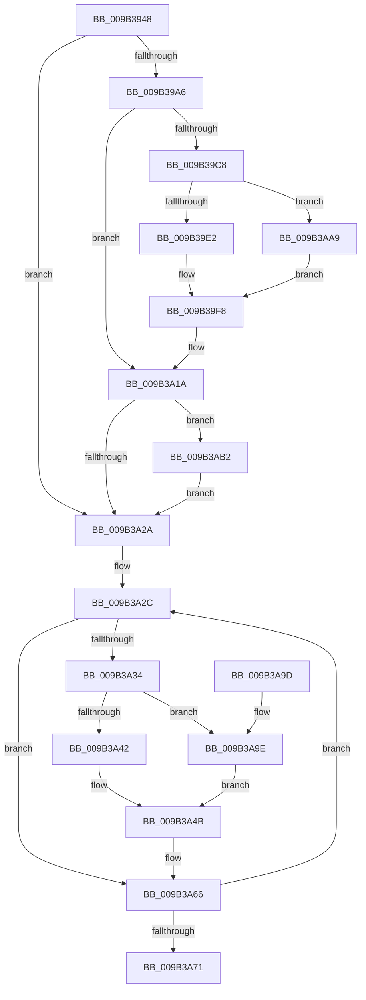

# CmpCmdHiveClose

- RVA: `0x009B3948`–`0x009B3AC1` (길이 `377` bytes)
- VA: `0x00000001409B3948`
- 실행 섹션: `PAGE`
- PDB 이름 있음: `예`; PDB Function 태그: `아니요`
- unwind 정보 RVA: `0x0009E4B4`
- 디코드: `95`개 명령, `377/377` bytes 표시
- 미해석 바이트: `0` (있으면 어셈블리에 `.byte`로 보존)

> 이 문서는 커널 이미지의 기계어와 PDB 기호를 분석해 생성했습니다. 4번과 5번은 함수 원형과 자료형을 바이너리 사용 방식에서 추정한 C 해석이며 원본 소스 복구 결과는 아닙니다.

## 1. Dependencies

- 직접 호출 지점: **8**; 고유 호출 대상: **7**
- 직접 호출자로 확인된 함수: **3**
- RIP 상대 이미지 참조: **1**

### Outgoing calls
- `0x009B398B` → [IoSetThreadHardErrorMode](../../text/46/IoSetThreadHardErrorMode_function_00466BF0.md) (function, `0x00466BF0`)
- `0x009B39BF` → [ZwQueryInformationFile](../../text/6A/ZwQueryInformationFile_function_006AD2F0.md) (function, `0x006AD2F0`)
- `0x009B3A15` → [ZwSetInformationFile](../../text/6A/ZwSetInformationFile_function_006AD5B0.md) (function, `0x006AD5B0`)
- `0x009B3A4B` → [ZwSetInformationObject](../../text/6A/ZwSetInformationObject_function_006ADC50.md) (function, `0x006ADC50`)
- `0x009B3A5D` → [ZwClose](../../text/6A/ZwClose_function_006AD2B0.md) (function, `0x006AD2B0`)
- `0x009B3A74` → [IoSetThreadHardErrorMode](../../text/46/IoSetThreadHardErrorMode_function_00466BF0.md) (function, `0x00466BF0`)
- `0x009B3A80` → [_security_check_cookie](../../text/6A/_security_check_cookie_function_006AC640.md) (function, `0x006AC640`)
- `0x009B3AB7` → [CmpAdjustFileCFSafety](../../text/4B/CmpAdjustFileCFSafety_function_004BCEF8.md) (function, `0x004BCEF8`)

### Direct callers
- [CmShutdownSystem2](../../text/66/CmShutdownSystem2_function_0066A7FC.md) at `0x0066A8D9`
- [CmpDestroyHive](CmpDestroyHive_function_009B1708.md) at `0x009B1731`
- [CmpCompleteUnloadKey](CmpCompleteUnloadKey_function_009B32FC.md) at `0x009B34A2`

### Static image references
- `0x009B3960` → RVA `0x00E0A740` (`.data`; read)

## 2. Other-region calls and transfers

- 다른 실행 섹션으로 향하는 call: **8**
  - `0x009B398B` → [IoSetThreadHardErrorMode](../../text/46/IoSetThreadHardErrorMode_function_00466BF0.md) (`PAGE` → `.text`)
  - `0x009B39BF` → [ZwQueryInformationFile](../../text/6A/ZwQueryInformationFile_function_006AD2F0.md) (`PAGE` → `.text`)
  - `0x009B3A15` → [ZwSetInformationFile](../../text/6A/ZwSetInformationFile_function_006AD5B0.md) (`PAGE` → `.text`)
  - `0x009B3A4B` → [ZwSetInformationObject](../../text/6A/ZwSetInformationObject_function_006ADC50.md) (`PAGE` → `.text`)
  - `0x009B3A5D` → [ZwClose](../../text/6A/ZwClose_function_006AD2B0.md) (`PAGE` → `.text`)
  - `0x009B3A74` → [IoSetThreadHardErrorMode](../../text/46/IoSetThreadHardErrorMode_function_00466BF0.md) (`PAGE` → `.text`)
  - `0x009B3A80` → [_security_check_cookie](../../text/6A/_security_check_cookie_function_006AC640.md) (`PAGE` → `.text`)
  - `0x009B3AB7` → [CmpAdjustFileCFSafety](../../text/4B/CmpAdjustFileCFSafety_function_004BCEF8.md) (`PAGE` → `.text`)
- 별도 외부 분기/꼬리 이동을 확인하지 못했습니다.

## 3. Assembly (complete function range)

```asm
009B3948  48 89 5C 24 10                  mov qword ptr [rsp + 0x10], rbx
009B394D  48 89 74 24 18                  mov qword ptr [rsp + 0x18], rsi
009B3952  55                              push rbp
009B3953  57                              push rdi
009B3954  41 56                           push r14
009B3956  48 8B EC                        mov rbp, rsp
009B3959  48 81 EC 80 00 00 00            sub rsp, 0x80
009B3960  48 8B 05 D9 6D 45 00            mov rax, qword ptr [rip + 0x456dd9]
009B3967  48 33 C4                        xor rax, rsp
009B396A  48 89 45 F0                     mov qword ptr [rbp - 0x10], rax
009B396E  0F 57 C9                        xorps xmm1, xmm1
009B3971  48 8B F9                        mov rdi, rcx
009B3974  0F 57 C0                        xorps xmm0, xmm0
009B3977  33 C0                           xor eax, eax
009B3979  33 C9                           xor ecx, ecx
009B397B  48 89 45 E8                     mov qword ptr [rbp - 0x18], rax
009B397F  0F 11 45 B8                     movups xmmword ptr [rbp - 0x48], xmm0
009B3983  0F 11 4D C8                     movups xmmword ptr [rbp - 0x38], xmm1
009B3987  0F 11 4D D8                     movups xmmword ptr [rbp - 0x28], xmm1
009B398B  E8 60 32 AB FF                  call 0x140466bf0
009B3990  48 8D B7 08 06 00 00            lea rsi, [rdi + 0x608]
009B3997  44 8A F0                        mov r14b, al
009B399A  48 8B 1E                        mov rbx, qword ptr [rsi]
009B399D  48 85 DB                        test rbx, rbx
009B39A0  0F 84 84 00 00 00               je 0x1409b3a2a
009B39A6  41 B9 28 00 00 00               mov r9d, 0x28
009B39AC  C7 44 24 20 04 00 00 00         mov dword ptr [rsp + 0x20], 4
009B39B4  4C 8D 45 C8                     lea r8, [rbp - 0x38]
009B39B8  48 8B CB                        mov rcx, rbx
009B39BB  48 8D 55 B8                     lea rdx, [rbp - 0x48]
009B39BF  E8 2C 99 CF FF                  call 0x1406ad2f0
009B39C4  85 C0                           test eax, eax
009B39C6  78 52                           js 0x1409b3a1a
009B39C8  48 B8 14 00 00 00 80 F7 FF FF   movabs rax, 0xfffff78000000014
009B39D2  48 8B 00                        mov rax, qword ptr [rax]
009B39D5  80 BF 8D 00 00 00 00            cmp byte ptr [rdi + 0x8d], 0
009B39DC  0F 85 C7 00 00 00               jne 0x1409b3aa9
009B39E2  48 8B 97 58 10 00 00            mov rdx, qword ptr [rdi + 0x1058]
009B39E9  48 8B 4D D8                     mov rcx, qword ptr [rbp - 0x28]
009B39ED  48 85 D2                        test rdx, rdx
009B39F0  48 0F 45 CA                     cmovne rcx, rdx
009B39F4  48 89 4D D8                     mov qword ptr [rbp - 0x28], rcx
009B39F8  41 B9 28 00 00 00               mov r9d, 0x28
009B39FE  48 89 45 D0                     mov qword ptr [rbp - 0x30], rax
009B3A02  4C 8D 45 C8                     lea r8, [rbp - 0x38]
009B3A06  C7 44 24 20 04 00 00 00         mov dword ptr [rsp + 0x20], 4
009B3A0E  48 8D 55 B8                     lea rdx, [rbp - 0x48]
009B3A12  48 8B CB                        mov rcx, rbx
009B3A15  E8 96 9B CF FF                  call 0x1406ad5b0
009B3A1A  F7 87 10 10 00 00 00 00 01 00   test dword ptr [rdi + 0x1010], 0x10000
009B3A24  0F 85 88 00 00 00               jne 0x1409b3ab2
009B3A2A  33 DB                           xor ebx, ebx
009B3A2C  48 8B 0E                        mov rcx, qword ptr [rsi]
009B3A2F  48 85 C9                        test rcx, rcx
009B3A32  74 32                           je 0x1409b3a66
009B3A34  41 B9 02 00 00 00               mov r9d, 2
009B3A3A  41 8D 51 02                     lea edx, [r9 + 2]
009B3A3E  85 DB                           test ebx, ebx
009B3A40  74 5C                           je 0x1409b3a9e
009B3A42  66 83 65 B4 00                  and word ptr [rbp - 0x4c], 0
009B3A47  4C 8D 45 B4                     lea r8, [rbp - 0x4c]
009B3A4B  E8 00 A2 CF FF                  call 0x1406adc50
009B3A50  48 8B C7                        mov rax, rdi
009B3A53  48 8B CE                        mov rcx, rsi
009B3A56  48 2B CF                        sub rcx, rdi
009B3A59  48 8B 0C 01                     mov rcx, qword ptr [rcx + rax]
009B3A5D  E8 4E 98 CF FF                  call 0x1406ad2b0
009B3A62  48 83 26 00                     and qword ptr [rsi], 0
009B3A66  FF C3                           inc ebx
009B3A68  48 83 C6 08                     add rsi, 8
009B3A6C  83 FB 06                        cmp ebx, 6
009B3A6F  72 BB                           jb 0x1409b3a2c
009B3A71  41 8A CE                        mov cl, r14b
009B3A74  E8 77 31 AB FF                  call 0x140466bf0
009B3A79  48 8B 4D F0                     mov rcx, qword ptr [rbp - 0x10]
009B3A7D  48 33 CC                        xor rcx, rsp
009B3A80  E8 BB 8B CF FF                  call 0x1406ac640
009B3A85  4C 8D 9C 24 80 00 00 00         lea r11, [rsp + 0x80]
009B3A8D  49 8B 5B 28                     mov rbx, qword ptr [r11 + 0x28]
009B3A91  49 8B 73 30                     mov rsi, qword ptr [r11 + 0x30]
009B3A95  49 8B E3                        mov rsp, r11
009B3A98  41 5E                           pop r14
009B3A9A  5F                              pop rdi
009B3A9B  5D                              pop rbp
009B3A9C  C3                              ret
009B3A9D  CC                              int3
009B3A9E  66 83 65 B0 00                  and word ptr [rbp - 0x50], 0
009B3AA3  4C 8D 45 B0                     lea r8, [rbp - 0x50]
009B3AA7  EB A2                           jmp 0x1409b3a4b
009B3AA9  48 89 45 D8                     mov qword ptr [rbp - 0x28], rax
009B3AAD  E9 46 FF FF FF                  jmp 0x1409b39f8
009B3AB2  33 D2                           xor edx, edx
009B3AB4  48 8B CB                        mov rcx, rbx
009B3AB7  E8 3C 94 B0 FF                  call 0x1404bcef8
009B3ABC  E9 69 FF FF FF                  jmp 0x1409b3a2a
```

## 4. C-style interpretation (structured pseudocode)

```c
__int64 __fastcall CmpCmdHiveClose(__int64 a1)
{
    __int64 result;
    __int64 v_rbx;
    __int64 v_rsi;
    __int64 v_rsp;
    unsigned __int64 v_stack_m18;
    unsigned __int64 v_stack_m28;
    unsigned __int64 v_stack_m30;
    unsigned __int64 v_stack_m40;
    unsigned __int64 v_stack_m48;
    unsigned __int64 v_stack_m50;
    unsigned __int64 v_stack_m60;
    unsigned __int16 v_stack_m64;
    unsigned __int16 v_stack_m68;
    unsigned int v_stack_m78;
    unsigned __int64 v_stack_p10;
    unsigned __int64 v_stack_p18;

    v_stack_p10 = v_rbx;
    v_stack_p18 = v_rsi;
    v_rsp = (v_rsp) - (128);
    result = (*(unsigned __int64 *)(v_rip + 4550105)) ^ (v_rsp);
    v_stack_m28 = result;
    result = 0;
    a1 = 0;
    v_stack_m30 = 0;
    v_stack_m60 = v_xmm0;
    v_stack_m50 = v_xmm1;
    v_stack_m40 = v_xmm1;
    result = IoSetThreadHardErrorMode(a1, a2, a3, a4);
    if (*(unsigned __int64 *)(a1 + 1544) == 0) goto loc_009B3A2A;
    v_stack_m78 = 4;
    result = ZwQueryInformationFile(*(unsigned __int64 *)(a1 + 1544), v_stack_m60, v_stack_m50, 40);
    if (sign_flag) goto loc_009B3A1A;
    if ((*(unsigned __int8 *)(a1 + 141)) != 0) goto loc_009B3AA9;
    a1 = v_stack_m40;
    if (*(unsigned __int64 *)(a1 + 4184) != 0) { a1 = *(unsigned __int64 *)(a1 + 4184); }
    v_stack_m40 = a1;
loc_009B39F8:
    v_stack_m48 = *(unsigned __int64 *)(result);
    v_stack_m78 = 4;
    result = ZwSetInformationFile(*(unsigned __int64 *)(a1 + 1544), v_stack_m60, v_stack_m50, 40);
loc_009B3A1A:
    if (((*(unsigned int *)(a1 + 4112)) & (0x10000ULL)) != 0) goto loc_009B3AB2;
loc_009B3A2A:
    v_rbx = 0;
loc_009B3A2C:
    if (*(unsigned __int64 *)(a1 + 1544) == 0) goto loc_009B3A66;
    if (0 == 0) goto loc_009B3A9E;
loc_009B3A4B:
    result = ZwSetInformationObject(*(unsigned __int64 *)(a1 + 1544), 2 + 2, v_stack_m64, 2);
    a1 = (a1 + 1544) - (a1);
    result = ZwClose(*(unsigned __int64 *)(a1 + a1 * 1), 2 + 2, v_stack_m64, 2);
loc_009B3A66:
    v_rbx = (unsigned int)((v_rbx) + 1);
    v_rsi = (a1 + 1544) + (8);
    if (((unsigned int)(v_rbx)) < 6) goto loc_009B3A2C;
    result = IoSetThreadHardErrorMode((unsigned __int8)((unsigned __int8)(result)), 2 + 2, v_stack_m64, 2);
    a1 = (v_stack_m28) ^ (v_rsp);
    result = _security_check_cookie(a1, 2 + 2, v_stack_m64, 2);
    return result;
loc_009B3A9E:
    goto loc_009B3A4B;
loc_009B3AA9:
    v_stack_m40 = result;
    goto loc_009B39F8;
loc_009B3AB2:
    a2 = 0;
    result = CmpAdjustFileCFSafety(*(unsigned __int64 *)(v_stack_m18 + 40), a2, v_stack_m68, 2);
    goto loc_009B3A2A;
}
```

## 5. (Beta) C Style

```c
int64_t CmpCmdHiveClose(void *Arg1)
{
    uint8_t *arg1 = (uint8_t *)Arg1;

    int64_t result;
    int64_t local_rbx;
    int64_t local_rsi;
    int64_t local_rsp;
    uint64_t v_stack_m18;
    uint64_t v_stack_m28;
    uint64_t v_stack_m30;
    uint64_t v_stack_m40;
    uint64_t v_stack_m48;
    uint64_t v_stack_m50;
    uint64_t v_stack_m60;
    uint16_t v_stack_m64;
    uint16_t v_stack_m68;
    uint32_t v_stack_m78;
    uint64_t v_stack_p10;
    uint64_t v_stack_p18;

    v_stack_p10 = local_rbx;
    v_stack_p18 = local_rsi;
    local_rsp = (local_rsp) - (128);
    result = (*(uint64_t *)(v_rip + 0x456DD9)) ^ (local_rsp);
    v_stack_m28 = result;
    result = 0;
    Arg1 = 0;
    v_stack_m30 = 0;
    v_stack_m60 = v_xmm0;
    v_stack_m50 = v_xmm1;
    v_stack_m40 = v_xmm1;
    result = IoSetThreadHardErrorMode(Arg1, a2, a3, a4);
    if (*(uint64_t *)(arg1 + 0x608) == 0) goto loc_009B3A2A;
    v_stack_m78 = 4;
    result = ZwQueryInformationFile(*(uint64_t *)(arg1 + 0x608), v_stack_m60, v_stack_m50, 40);
    if (sign_flag) goto loc_009B3A1A;
    if ((*(uint8_t *)(arg1 + 0x8D)) != 0) goto loc_009B3AA9;
    Arg1 = v_stack_m40;
    if (*(uint64_t *)(arg1 + 0x1058) != 0) { Arg1 = *(uint64_t *)(arg1 + 0x1058); }
    v_stack_m40 = Arg1;
loc_009B39F8:
    v_stack_m48 = *(uint64_t *)(result);
    v_stack_m78 = 4;
    result = ZwSetInformationFile(*(uint64_t *)(arg1 + 0x608), v_stack_m60, v_stack_m50, 40);
loc_009B3A1A:
    if (((*(uint32_t *)(arg1 + 0x1010)) & (0x10000ULL)) != 0) goto loc_009B3AB2;
loc_009B3A2A:
    local_rbx = 0;
loc_009B3A2C:
    if (*(uint64_t *)(arg1 + 0x608) == 0) goto loc_009B3A66;
    if (0 == 0) goto loc_009B3A9E;
loc_009B3A4B:
    result = ZwSetInformationObject(*(uint64_t *)(arg1 + 0x608), 2 + 2, v_stack_m64, 2);
    Arg1 = (Arg1 + 1544) - (Arg1);
    result = ZwClose(*(uint64_t *)(arg1 + arg1 * 1), 2 + 2, v_stack_m64, 2);
loc_009B3A66:
    local_rbx = (uint32_t)((local_rbx) + 1);
    local_rsi = (Arg1 + 1544) + (8);
    if (((uint32_t)(local_rbx)) < 6) goto loc_009B3A2C;
    result = IoSetThreadHardErrorMode((uint8_t)((uint8_t)(result)), 2 + 2, v_stack_m64, 2);
    Arg1 = (v_stack_m28) ^ (local_rsp);
    result = _security_check_cookie(Arg1, 2 + 2, v_stack_m64, 2);
    return result;
loc_009B3A9E:
    goto loc_009B3A4B;
loc_009B3AA9:
    v_stack_m40 = result;
    goto loc_009B39F8;
loc_009B3AB2:
    a2 = 0;
    result = CmpAdjustFileCFSafety(*(uint64_t *)(v_stack_m18 + 0x28), a2, v_stack_m68, 2);
    goto loc_009B3A2A;
}
```

### 관측된 메모리 오프셋

구조체 형식이 확인되지 않은 접근은 인자 기준의 오프셋으로만 기록했습니다.

| 기준 인자 | 오프셋 표현 | 폭 (bit) | 접근 |
|---|---:|---:|---|
| `Arg1` | `+ 0x0` | `64` | `R` |
| `Arg1` | `+ 0x0` | `64` | `R/W` |
| `Arg1` | `+ 0x0 + rax*1` | `64` | `R` |
| `Arg1` | `+ 0x8D` | `8` | `R` |
| `Arg1` | `+ 0x608` | `64` | `R` |
| `Arg1` | `+ 0x1010` | `32` | `R` |
| `Arg1` | `+ 0x1058` | `64` | `R` |

## 6. Execution-region graph

[열기: 2D/3D 그래프와 함수 탐색 컨트롤 패널](../../../control-panel.html?section=page&rva=0x009B3948&view=graph)

- 2D 그래프는 위에서 아래로 흐르고, 3D 그래프는 빈 공간을 드래그해 회전합니다. Shift+드래그는 이동, 휠은 확대·축소, 함수 노드 선택은 대상 보고서 이동입니다.

### Static fallback


