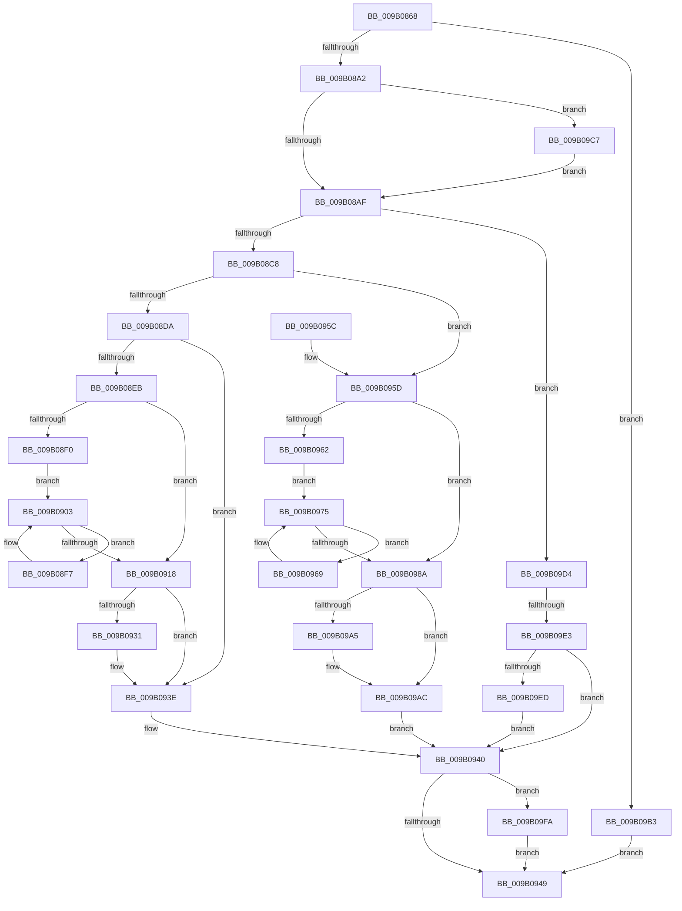

# CmpCommitLightWeightTransaction

- RVA: `0x009B0868`–`0x009B0A0F` (길이 `423` bytes)
- VA: `0x00000001409B0868`
- 실행 섹션: `PAGE`
- PDB 이름 있음: `예`; PDB Function 태그: `예`
- unwind 정보 RVA: `0x0009E1A4`
- 디코드: `119`개 명령, `423/423` bytes 표시
- 미해석 바이트: `0` (있으면 어셈블리에 `.byte`로 보존)

> 이 문서는 커널 이미지의 기계어와 PDB 기호를 분석해 생성했습니다. 4번과 5번은 함수 원형과 자료형을 바이너리 사용 방식에서 추정한 C 해석이며 원본 소스 복구 결과는 아닙니다.

## 1. Dependencies

- 직접 호출 지점: **15**; 고유 호출 대상: **11**
- 직접 호출자로 확인된 함수: **2**
- RIP 상대 이미지 참조: **0**

### Outgoing calls
- `0x009B088C` → [CmpInitializeDelayDerefContext](../../text/42/CmpInitializeDelayDerefContext_function_0042A7F0.md) (function, `0x0042A7F0`)
- `0x009B08B6` → [CmpPrepareLightWeightTransaction](CmpPrepareLightWeightTransaction_function_009B0D24.md) (function, `0x009B0D24`)
- `0x009B08E1` → [CmpCommitPreparedLightWeightTransaction](CmpCommitPreparedLightWeightTransaction_function_009B0B88.md) (function, `0x009B0B88`)
- `0x009B08FE` → [CmpCleanupLightWeightUoWData](CmpCleanupLightWeightUoWData_function_009B0A68.md) (function, `0x009B0A68`)
- `0x009B090E` → [CmListGetNextElement](../../pagecmrc/BC/CmListGetNextElement_function_00BC9940.md) (function, `0x00BC9940`)
- `0x009B091E` → [CmpDrainDelayDerefContext](../../text/41/CmpDrainDelayDerefContext_function_0041B9A0.md) (function, `0x0041B9A0`)
- `0x009B0923` → [CmpUnlockRegistry](../../pagecmrc/BC/CmpUnlockRegistry_function_00BC9A84.md) (function, `0x00BC9A84`)
- `0x009B0939` → [CmpCleanupLightWeightTransaction](CmpCleanupLightWeightTransaction_function_009B1340.md) (function, `0x009B1340`)
- `0x009B0970` → [CmpCleanupLightWeightUoWData](CmpCleanupLightWeightUoWData_function_009B0A68.md) (function, `0x009B0A68`)
- `0x009B0980` → [CmListGetNextElement](../../pagecmrc/BC/CmListGetNextElement_function_00BC9940.md) (function, `0x00BC9940`)
- `0x009B09A7` → [ExfUnblockPushLock](../../text/2A/ExfUnblockPushLock_function_002A3FE0.md) (function, `0x002A3FE0`)
- `0x009B09CA` → [CmpLockRegistryExclusive](../84/CmpLockRegistryExclusive_function_0084F9B4.md) (function, `0x0084F9B4`)
- `0x009B09F0` → [CmpAbortLightWeightTransaction](CmpAbortLightWeightTransaction_function_009B11F0.md) (function, `0x009B11F0`)
- `0x009B0A00` → [CmpDrainDelayDerefContext](../../text/41/CmpDrainDelayDerefContext_function_0041B9A0.md) (function, `0x0041B9A0`)
- `0x009B0A05` → [CmpUnlockRegistry](../../pagecmrc/BC/CmpUnlockRegistry_function_00BC9A84.md) (function, `0x00BC9A84`)

### Direct callers
- [CmpTransMgrCommit](../9A/CmpTransMgrCommit_function_009AE8AC.md) at `0x009AE933`
- [NtCommitRegistryTransaction](../9A/NtCommitRegistryTransaction_function_009AEAF0.md) at `0x009AEBE7`

### Static image references
- 디코드된 RIP-relative 메모리 참조가 없습니다.

## 2. Other-region calls and transfers

- 다른 실행 섹션으로 향하는 call: **8**
  - `0x009B088C` → [CmpInitializeDelayDerefContext](../../text/42/CmpInitializeDelayDerefContext_function_0042A7F0.md) (`PAGE` → `.text`)
  - `0x009B090E` → [CmListGetNextElement](../../pagecmrc/BC/CmListGetNextElement_function_00BC9940.md) (`PAGE` → `PAGECMRC`)
  - `0x009B091E` → [CmpDrainDelayDerefContext](../../text/41/CmpDrainDelayDerefContext_function_0041B9A0.md) (`PAGE` → `.text`)
  - `0x009B0923` → [CmpUnlockRegistry](../../pagecmrc/BC/CmpUnlockRegistry_function_00BC9A84.md) (`PAGE` → `PAGECMRC`)
  - `0x009B0980` → [CmListGetNextElement](../../pagecmrc/BC/CmListGetNextElement_function_00BC9940.md) (`PAGE` → `PAGECMRC`)
  - `0x009B09A7` → [ExfUnblockPushLock](../../text/2A/ExfUnblockPushLock_function_002A3FE0.md) (`PAGE` → `.text`)
  - `0x009B0A00` → [CmpDrainDelayDerefContext](../../text/41/CmpDrainDelayDerefContext_function_0041B9A0.md) (`PAGE` → `.text`)
  - `0x009B0A05` → [CmpUnlockRegistry](../../pagecmrc/BC/CmpUnlockRegistry_function_00BC9A84.md) (`PAGE` → `PAGECMRC`)
- call이 아닌 외부 분기/꼬리 이동: **1**
  - `0x009B09DD` → [sub_00B2DABC](../B2/Unknown_function_00B2DABC.md) (`tail-transfer`)

## 3. Assembly (complete function range)

```asm
009B0868  48 89 5C 24 20                  mov qword ptr [rsp + 0x20], rbx
009B086D  55                              push rbp
009B086E  56                              push rsi
009B086F  57                              push rdi
009B0870  41 54                           push r12
009B0872  41 56                           push r14
009B0874  48 8B EC                        mov rbp, rsp
009B0877  48 83 EC 30                     sub rsp, 0x30
009B087B  48 8B D9                        mov rbx, rcx
009B087E  0F 57 C0                        xorps xmm0, xmm0
009B0881  48 8D 4D F0                     lea rcx, [rbp - 0x10]
009B0885  45 32 F6                        xor r14b, r14b
009B0888  0F 11 45 F0                     movups xmmword ptr [rbp - 0x10], xmm0
009B088C  E8 5F 9F A7 FF                  call 0x14042a7f0
009B0891  33 C0                           xor eax, eax
009B0893  44 8D 60 01                     lea r12d, [rax + 1]
009B0897  F0 44 0F B1 23                  lock cmpxchg dword ptr [rbx], r12d
009B089C  0F 85 11 01 00 00               jne 0x1409b09b3
009B08A2  48 8B 73 10                     mov rsi, qword ptr [rbx + 0x10]
009B08A6  48 85 F6                        test rsi, rsi
009B08A9  0F 85 18 01 00 00               jne 0x1409b09c7
009B08AF  48 8D 55 F0                     lea rdx, [rbp - 0x10]
009B08B3  48 8B CE                        mov rcx, rsi
009B08B6  E8 69 04 00 00                  call 0x1409b0d24
009B08BB  8B F8                           mov edi, eax
009B08BD  85 C0                           test eax, eax
009B08BF  41 8B C4                        mov eax, r12d
009B08C2  0F 88 0C 01 00 00               js 0x1409b09d4
009B08C8  B9 02 00 00 00                  mov ecx, 2
009B08CD  F0 0F B1 0B                     lock cmpxchg dword ptr [rbx], ecx
009B08D1  83 F8 04                        cmp eax, 4
009B08D4  0F 84 83 00 00 00               je 0x1409b095d
009B08DA  48 8D 55 F0                     lea rdx, [rbp - 0x10]
009B08DE  48 8B CE                        mov rcx, rsi
009B08E1  E8 A2 02 00 00                  call 0x1409b0b88
009B08E6  45 84 F6                        test r14b, r14b
009B08E9  74 53                           je 0x1409b093e
009B08EB  48 85 F6                        test rsi, rsi
009B08EE  74 28                           je 0x1409b0918
009B08F0  48 83 65 40 00                  and qword ptr [rbp + 0x40], 0
009B08F5  EB 0C                           jmp 0x1409b0903
009B08F7  4C 8D 45 F0                     lea r8, [rbp - 0x10]
009B08FB  48 8B C8                        mov rcx, rax
009B08FE  E8 65 01 00 00                  call 0x1409b0a68
009B0903  45 33 C0                        xor r8d, r8d
009B0906  48 8D 55 40                     lea rdx, [rbp + 0x40]
009B090A  48 8D 4E 10                     lea rcx, [rsi + 0x10]
009B090E  E8 2D 90 21 00                  call 0x140bc9940
009B0913  48 85 C0                        test rax, rax
009B0916  75 DF                           jne 0x1409b08f7
009B0918  33 D2                           xor edx, edx
009B091A  48 8D 4D F0                     lea rcx, [rbp - 0x10]
009B091E  E8 7D B0 A6 FF                  call 0x14041b9a0
009B0923  E8 5C 91 21 00                  call 0x140bc9a84
009B0928  45 32 F6                        xor r14b, r14b
009B092B  44 38 73 18                     cmp byte ptr [rbx + 0x18], r14b
009B092F  75 0D                           jne 0x1409b093e
009B0931  BA 04 00 00 00                  mov edx, 4
009B0936  48 8B CE                        mov rcx, rsi
009B0939  E8 02 0A 00 00                  call 0x1409b1340
009B093E  33 FF                           xor edi, edi
009B0940  45 84 F6                        test r14b, r14b
009B0943  0F 85 B1 00 00 00               jne 0x1409b09fa
009B0949  48 8B 5C 24 78                  mov rbx, qword ptr [rsp + 0x78]
009B094E  8B C7                           mov eax, edi
009B0950  48 83 C4 30                     add rsp, 0x30
009B0954  41 5E                           pop r14
009B0956  41 5C                           pop r12
009B0958  5F                              pop rdi
009B0959  5E                              pop rsi
009B095A  5D                              pop rbp
009B095B  C3                              ret
009B095C  CC                              int3
009B095D  48 85 F6                        test rsi, rsi
009B0960  74 28                           je 0x1409b098a
009B0962  48 83 65 38 00                  and qword ptr [rbp + 0x38], 0
009B0967  EB 0C                           jmp 0x1409b0975
009B0969  4C 8D 45 F0                     lea r8, [rbp - 0x10]
009B096D  48 8B C8                        mov rcx, rax
009B0970  E8 F3 00 00 00                  call 0x1409b0a68
009B0975  45 33 C0                        xor r8d, r8d
009B0978  48 8D 55 38                     lea rdx, [rbp + 0x38]
009B097C  48 8D 4E 10                     lea rcx, [rsi + 0x10]
009B0980  E8 BB 8F 21 00                  call 0x140bc9940
009B0985  48 85 C0                        test rax, rax
009B0988  75 DF                           jne 0x1409b0969
009B098A  B9 03 00 00 00                  mov ecx, 3
009B098F  8D 41 01                        lea eax, [rcx + 1]
009B0992  F0 0F B1 0B                     lock cmpxchg dword ptr [rbx], ecx
009B0996  48 8D 4B 08                     lea rcx, [rbx + 8]
009B099A  F0 83 0C 24 00                  lock or dword ptr [rsp], 0
009B099F  48 83 39 00                     cmp qword ptr [rcx], 0
009B09A3  74 07                           je 0x1409b09ac
009B09A5  33 D2                           xor edx, edx
009B09A7  E8 34 36 8F FF                  call 0x1402a3fe0
009B09AC  BF 03 00 19 C0                  mov edi, 0xc0190003
009B09B1  EB 8D                           jmp 0x1409b0940
009B09B3  BF 03 00 19 C0                  mov edi, 0xc0190003
009B09B8  B9 03 00 00 00                  mov ecx, 3
009B09BD  3B C1                           cmp eax, ecx
009B09BF  8D 57 12                        lea edx, [rdi + 0x12]
009B09C2  0F 44 FA                        cmove edi, edx
009B09C5  EB 82                           jmp 0x1409b0949
009B09C7  45 8A F4                        mov r14b, r12b
009B09CA  E8 E5 EF E9 FF                  call 0x14084f9b4
009B09CF  E9 DB FE FF FF                  jmp 0x1409b08af
009B09D4  B9 03 00 00 00                  mov ecx, 3
009B09D9  F0 0F B1 0B                     lock cmpxchg dword ptr [rbx], ecx
009B09DD  0F 85 D9 D0 17 00               jne 0x140b2dabc
009B09E3  80 7B 18 00                     cmp byte ptr [rbx + 0x18], 0
009B09E7  0F 85 53 FF FF FF               jne 0x1409b0940
009B09ED  48 8B CB                        mov rcx, rbx
009B09F0  E8 FB 07 00 00                  call 0x1409b11f0
009B09F5  E9 46 FF FF FF                  jmp 0x1409b0940
009B09FA  33 D2                           xor edx, edx
009B09FC  48 8D 4D F0                     lea rcx, [rbp - 0x10]
009B0A00  E8 9B AF A6 FF                  call 0x14041b9a0
009B0A05  E8 7A 90 21 00                  call 0x140bc9a84
009B0A0A  E9 3A FF FF FF                  jmp 0x1409b0949
```

## 4. C-style interpretation (structured pseudocode)

```c
__int64 __fastcall CmpCommitLightWeightTransaction(__int64 a1)
{
    __int64 result;
    __int64 v_r14;
    __int64 v_rdi;
    __int64 v_rsp;
    unsigned __int64 v_stack_m38;
    unsigned int v_stack_p0;
    unsigned __int64 v_stack_p10;
    unsigned __int64 v_stack_p18;
    unsigned __int64 v_stack_p20;

    v_stack_p20 = v_rbx;
    v_rsp = (v_rsp) - (48);
    v_r14 = 0;
    v_stack_m38 = v_xmm0;
    result = CmpInitializeDelayDerefContext(v_stack_m38, a2, a3, a4);
    result = 0;
    if (condition_is_not_equal) goto loc_009B09B3;
    if (*(unsigned __int64 *)(a1 + 16) != 0) goto loc_009B09C7;
loc_009B08AF:
    result = CmpPrepareLightWeightTransaction(*(unsigned __int64 *)(a1 + 16), v_stack_m38, a3, a4);
    if (sign_flag) goto loc_009B09D4;
    if (((unsigned int)((unsigned int)((unsigned int)(result + 1)))) == 4) goto loc_009B095D;
    result = CmpCommitPreparedLightWeightTransaction(*(unsigned __int64 *)(a1 + 16), v_stack_m38, a3, a4);
    if (0 == 0) goto loc_009B093E;
    if (*(unsigned __int64 *)(a1 + 16) == 0) goto loc_009B0918;
    goto loc_009B0903;
loc_009B08F7:
    result = CmpCleanupLightWeightUoWData(result, v_stack_m38, v_stack_m38, a4);
loc_009B0903:
    a3 = 0;
    result = CmListGetNextElement(*(unsigned __int64 *)(a1 + 16) + 16, v_stack_p18, a3, a4);
    if (result != 0) goto loc_009B08F7;
loc_009B0918:
    a2 = 0;
    result = CmpDrainDelayDerefContext(v_stack_m38, a2, a3, a4);
    result = CmpUnlockRegistry(v_stack_m38, a2, a3, a4);
    v_r14 = 0;
    if ((*(unsigned __int8 *)(a1 + 24)) == 0) {
        a2 = 4;
        a1 = *(unsigned __int64 *)(a1 + 16);
        result = CmpCleanupLightWeightTransaction(a1, a2, a3, a4);
    }
    v_rdi = 0;
loc_009B0940:
    if (0 != 0) goto loc_009B09FA;
loc_009B0949:
    v_rsp = (v_rsp) + (48);
    return 0;
loc_009B095D:
    if (*(unsigned __int64 *)(a1 + 16) == 0) goto loc_009B098A;
    goto loc_009B0975;
loc_009B0969:
    result = CmpCleanupLightWeightUoWData(0, a2, v_stack_m38, a4);
loc_009B0975:
    a3 = 0;
    result = CmListGetNextElement(*(unsigned __int64 *)(a1 + 16) + 16, v_stack_p10, a3, a4);
    if (result != 0) goto loc_009B0969;
loc_009B098A:
    result = 3 + 1;
    if ((*(unsigned __int64 *)(v_stack_p20 + 8)) != 0) {
        a2 = 0;
        result = ExfUnblockPushLock(v_stack_p20 + 8, a2, a3, a4);
    }
    goto loc_009B0940;
loc_009B09B3:
    v_rdi = (unsigned int)(0xC0190003ULL);
    if (((unsigned int)(result)) == 3) { v_rdi = (unsigned int)((unsigned int)(0xC0190003ULL) + 18); }
    goto loc_009B0949;
loc_009B09C7:
    result = CmpLockRegistryExclusive(3, (unsigned int)(0xC0190003ULL) + 18, a3, a4);
    goto loc_009B08AF;
loc_009B09D4:
    if ((*(unsigned __int8 *)(v_stack_p20 + 24)) != 0) goto loc_009B0940;
    result = CmpAbortLightWeightTransaction(v_stack_p20, (unsigned int)(0xC0190003ULL) + 18, a3, a4);
    goto loc_009B0940;
loc_009B09FA:
    a2 = 0;
    result = CmpDrainDelayDerefContext(v_stack_m38, a2, a3, a4);
    result = CmpUnlockRegistry(v_stack_m38, a2, a3, a4);
    goto loc_009B0949;
}
```

## 5. (Beta) C Style

```c
int64_t CmpCommitLightWeightTransaction(void *Arg1)
{
    uint8_t *arg1 = (uint8_t *)Arg1;

    int64_t result;
    int64_t local_r14;
    int64_t local_rdi;
    int64_t local_rsp;
    uint64_t v_stack_m38;
    uint32_t v_stack_p0;
    uint64_t v_stack_p10;
    uint64_t v_stack_p18;
    uint64_t v_stack_p20;

    v_stack_p20 = local_rbx;
    local_rsp = (local_rsp) - (48);
    local_r14 = 0;
    v_stack_m38 = v_xmm0;
    result = CmpInitializeDelayDerefContext(v_stack_m38, a2, a3, a4);
    result = 0;
    if (condition_is_not_equal) goto loc_009B09B3;
    if (*(uint64_t *)(arg1 + 0x10) != 0) goto loc_009B09C7;
loc_009B08AF:
    result = CmpPrepareLightWeightTransaction(*(uint64_t *)(arg1 + 0x10), v_stack_m38, a3, a4);
    if (sign_flag) goto loc_009B09D4;
    if (((uint32_t)((uint32_t)((uint32_t)(result + 1)))) == 4) goto loc_009B095D;
    result = CmpCommitPreparedLightWeightTransaction(*(uint64_t *)(arg1 + 0x10), v_stack_m38, a3, a4);
    if (0 == 0) goto loc_009B093E;
    if (*(uint64_t *)(arg1 + 0x10) == 0) goto loc_009B0918;
    goto loc_009B0903;
loc_009B08F7:
    result = CmpCleanupLightWeightUoWData(result, v_stack_m38, v_stack_m38, a4);
loc_009B0903:
    a3 = 0;
    result = CmListGetNextElement(*(uint64_t *)(arg1 + 0x10) + 16, v_stack_p18, a3, a4);
    if (result != 0) goto loc_009B08F7;
loc_009B0918:
    a2 = 0;
    result = CmpDrainDelayDerefContext(v_stack_m38, a2, a3, a4);
    result = CmpUnlockRegistry(v_stack_m38, a2, a3, a4);
    local_r14 = 0;
    if ((*(uint8_t *)(arg1 + 0x18)) == 0) {
        a2 = 4;
        Arg1 = *(uint64_t *)(arg1 + 0x10);
        result = CmpCleanupLightWeightTransaction(Arg1, a2, a3, a4);
    }
    local_rdi = 0;
loc_009B0940:
    if (0 != 0) goto loc_009B09FA;
loc_009B0949:
    local_rsp = (local_rsp) + (48);
    return 0;
loc_009B095D:
    if (*(uint64_t *)(arg1 + 0x10) == 0) goto loc_009B098A;
    goto loc_009B0975;
loc_009B0969:
    result = CmpCleanupLightWeightUoWData(0, a2, v_stack_m38, a4);
loc_009B0975:
    a3 = 0;
    result = CmListGetNextElement(*(uint64_t *)(arg1 + 0x10) + 16, v_stack_p10, a3, a4);
    if (result != 0) goto loc_009B0969;
loc_009B098A:
    result = 3 + 1;
    if ((*(uint64_t *)(v_stack_p20 + 0x8)) != 0) {
        a2 = 0;
        result = ExfUnblockPushLock(v_stack_p20 + 8, a2, a3, a4);
    }
    goto loc_009B0940;
loc_009B09B3:
    local_rdi = (uint32_t)(0xC0190003ULL);
    if (((uint32_t)(result)) == 3) { local_rdi = (uint32_t)((uint32_t)(0xC0190003ULL) + 18); }
    goto loc_009B0949;
loc_009B09C7:
    result = CmpLockRegistryExclusive(3, (uint32_t)(0xC0190003ULL) + 18, a3, a4);
    goto loc_009B08AF;
loc_009B09D4:
    if ((*(uint8_t *)(v_stack_p20 + 0x18)) != 0) goto loc_009B0940;
    result = CmpAbortLightWeightTransaction(v_stack_p20, (uint32_t)(0xC0190003ULL) + 18, a3, a4);
    goto loc_009B0940;
loc_009B09FA:
    a2 = 0;
    result = CmpDrainDelayDerefContext(v_stack_m38, a2, a3, a4);
    result = CmpUnlockRegistry(v_stack_m38, a2, a3, a4);
    goto loc_009B0949;
}
```

### 관측된 메모리 오프셋

구조체 형식이 확인되지 않은 접근은 인자 기준의 오프셋으로만 기록했습니다.

| 기준 인자 | 오프셋 표현 | 폭 (bit) | 접근 |
|---|---:|---:|---|
| `Arg1` | `+ 0x0` | `32` | `R` |
| `Arg1` | `+ 0x0` | `64` | `R` |
| `Arg1` | `+ 0x8` | `64` | `R` |
| `Arg1` | `+ 0x10` | `64` | `R` |
| `Arg1` | `+ 0x18` | `8` | `R` |

## 6. Execution-region graph

[열기: 2D/3D 그래프와 함수 탐색 컨트롤 패널](../../../control-panel.html?section=page&rva=0x009B0868&view=graph)

- 2D 그래프는 위에서 아래로 흐르고, 3D 그래프는 빈 공간을 드래그해 회전합니다. Shift+드래그는 이동, 휠은 확대·축소, 함수 노드 선택은 대상 보고서 이동입니다.

### Static fallback


