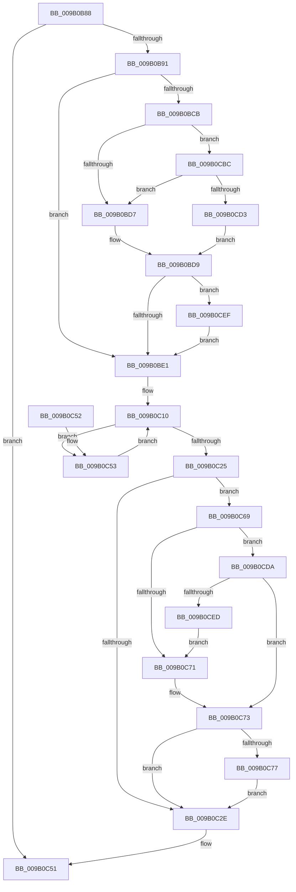

# CmpCommitPreparedLightWeightTransaction

- RVA: `0x009B0B88`–`0x009B0D1E` (길이 `406` bytes)
- VA: `0x00000001409B0B88`
- 실행 섹션: `PAGE`
- PDB 이름 있음: `예`; PDB Function 태그: `아니요`
- unwind 정보 RVA: `0x0009E1CC`
- 디코드: `98`개 명령, `406/406` bytes 표시
- 미해석 바이트: `0` (있으면 어셈블리에 `.byte`로 보존)

> 이 문서는 커널 이미지의 기계어와 PDB 기호를 분석해 생성했습니다. 4번과 5번은 함수 원형과 자료형을 바이너리 사용 방식에서 추정한 C 해석이며 원본 소스 복구 결과는 아닙니다.

## 1. Dependencies

- 직접 호출 지점: **8**; 고유 호출 대상: **7**
- 직접 호출자로 확인된 함수: **1**
- RIP 상대 이미지 참조: **7**

### Outgoing calls
- `0x009B0BF2` → [LOCK_TRANSACTION_LIST](../87/LOCK_TRANSACTION_LIST_function_00874AD4.md) (function, `0x00874AD4`)
- `0x009B0C02` → [ExReleaseFastMutexUnsafe](../../text/25/ExReleaseFastMutexUnsafe_function_002503A0.md) (function, `0x002503A0`)
- `0x009B0C07` → [KeLeaveCriticalRegion](../../text/25/KeLeaveCriticalRegion_function_0025D8B0.md) (function, `0x0025D8B0`)
- `0x009B0C1B` → [CmListGetNextElement](../../pagecmrc/BC/CmListGetNextElement_function_00BC9940.md) (function, `0x00BC9940`)
- `0x009B0C35` → [_security_check_cookie](../../text/6A/_security_check_cookie_function_006AC640.md) (function, `0x006AC640`)
- `0x009B0C60` → [CmpProcessLightWeightUOW](CmpProcessLightWeightUOW_function_009B0EAC.md) (function, `0x009B0EAC`)
- `0x009B0CB2` → [tlgWriteTransfer_EtwWriteTransfer](../../text/42/tlgWriteTransfer_EtwWriteTransfer_function_004260E0.md) (function, `0x004260E0`)
- `0x009B0D14` → [tlgWriteTransfer_EtwWriteTransfer](../../text/42/tlgWriteTransfer_EtwWriteTransfer_function_004260E0.md) (function, `0x004260E0`)

### Direct callers
- [CmpCommitLightWeightTransaction](CmpCommitLightWeightTransaction_function_009B0868.md) at `0x009B08E1`

### Static image references
- `0x009B0BA9` → RVA `0x00E0A740` (`.data`; read)
- `0x009B0BBC` → RVA `0x00E09F58` (`.data`; read)
- `0x009B0BCB` → RVA `0x00E09F68` (`.data`; reference)
- `0x009B0BFB` → RVA `0x00EF5820` (`.data`; read)
- `0x009B0C83` → RVA `0x00056B13` (`.rdata`; read)
- `0x009B0CBC` → RVA `0x00E09F70` (`.data`; read)
- `0x009B0CFB` → RVA `0x00056B56` (`.rdata`; read)

## 2. Other-region calls and transfers

- 다른 실행 섹션으로 향하는 call: **6**
  - `0x009B0C02` → [ExReleaseFastMutexUnsafe](../../text/25/ExReleaseFastMutexUnsafe_function_002503A0.md) (`PAGE` → `.text`)
  - `0x009B0C07` → [KeLeaveCriticalRegion](../../text/25/KeLeaveCriticalRegion_function_0025D8B0.md) (`PAGE` → `.text`)
  - `0x009B0C1B` → [CmListGetNextElement](../../pagecmrc/BC/CmListGetNextElement_function_00BC9940.md) (`PAGE` → `PAGECMRC`)
  - `0x009B0C35` → [_security_check_cookie](../../text/6A/_security_check_cookie_function_006AC640.md) (`PAGE` → `.text`)
  - `0x009B0CB2` → [tlgWriteTransfer_EtwWriteTransfer](../../text/42/tlgWriteTransfer_EtwWriteTransfer_function_004260E0.md) (`PAGE` → `.text`)
  - `0x009B0D14` → [tlgWriteTransfer_EtwWriteTransfer](../../text/42/tlgWriteTransfer_EtwWriteTransfer_function_004260E0.md) (`PAGE` → `.text`)
- 별도 외부 분기/꼬리 이동을 확인하지 못했습니다.

## 3. Assembly (complete function range)

```asm
009B0B88  48 85 C9                        test rcx, rcx
009B0B8B  0F 84 C0 00 00 00               je 0x1409b0c51
009B0B91  48 89 5C 24 18                  mov qword ptr [rsp + 0x18], rbx
009B0B96  48 89 74 24 20                  mov qword ptr [rsp + 0x20], rsi
009B0B9B  55                              push rbp
009B0B9C  57                              push rdi
009B0B9D  41 56                           push r14
009B0B9F  48 8B EC                        mov rbp, rsp
009B0BA2  48 81 EC 80 00 00 00            sub rsp, 0x80
009B0BA9  48 8B 05 90 9B 45 00            mov rax, qword ptr [rip + 0x459b90]
009B0BB0  48 33 C4                        xor rax, rsp
009B0BB3  48 89 45 F0                     mov qword ptr [rbp - 0x10], rax
009B0BB7  33 F6                           xor esi, esi
009B0BB9  4C 8B F2                        mov r14, rdx
009B0BBC  83 3D 95 93 45 00 05            cmp dword ptr [rip + 0x459395], 5
009B0BC3  48 8B F9                        mov rdi, rcx
009B0BC6  8D 5E 01                        lea ebx, [rsi + 1]
009B0BC9  76 16                           jbe 0x1409b0be1
009B0BCB  84 1D 97 93 45 00               test byte ptr [rip + 0x459397], bl
009B0BD1  0F 85 E5 00 00 00               jne 0x1409b0cbc
009B0BD7  32 C0                           xor al, al
009B0BD9  84 C0                           test al, al
009B0BDB  0F 85 0E 01 00 00               jne 0x1409b0cef
009B0BE1  48 B8 14 00 00 00 80 F7 FF FF   movabs rax, 0xfffff78000000014
009B0BEB  48 8B 00                        mov rax, qword ptr [rax]
009B0BEE  48 89 45 B8                     mov qword ptr [rbp - 0x48], rax
009B0BF2  E8 DD 3E EC FF                  call 0x140874ad4
009B0BF7  83 4F 30 04                     or dword ptr [rdi + 0x30], 4
009B0BFB  48 8D 0D 1E 4C 54 00            lea rcx, [rip + 0x544c1e]
009B0C02  E8 99 F7 89 FF                  call 0x1402503a0
009B0C07  E8 A4 CC 8A FF                  call 0x14025d8b0
009B0C0C  48 21 75 B0                     and qword ptr [rbp - 0x50], rsi
009B0C10  45 33 C0                        xor r8d, r8d
009B0C13  48 8D 55 B0                     lea rdx, [rbp - 0x50]
009B0C17  48 8D 4F 10                     lea rcx, [rdi + 0x10]
009B0C1B  E8 20 8D 21 00                  call 0x140bc9940
009B0C20  48 85 C0                        test rax, rax
009B0C23  75 2E                           jne 0x1409b0c53
009B0C25  83 3D 2C 93 45 00 05            cmp dword ptr [rip + 0x45932c], 5
009B0C2C  77 3B                           ja 0x1409b0c69
009B0C2E  48 8B 4D F0                     mov rcx, qword ptr [rbp - 0x10]
009B0C32  48 33 CC                        xor rcx, rsp
009B0C35  E8 06 BA CF FF                  call 0x1406ac640
009B0C3A  4C 8D 9C 24 80 00 00 00         lea r11, [rsp + 0x80]
009B0C42  49 8B 5B 30                     mov rbx, qword ptr [r11 + 0x30]
009B0C46  49 8B 73 38                     mov rsi, qword ptr [r11 + 0x38]
009B0C4A  49 8B E3                        mov rsp, r11
009B0C4D  41 5E                           pop r14
009B0C4F  5F                              pop rdi
009B0C50  5D                              pop rbp
009B0C51  C3                              ret
009B0C52  CC                              int3
009B0C53  4D 8B CE                        mov r9, r14
009B0C56  48 8D 55 B8                     lea rdx, [rbp - 0x48]
009B0C5A  44 8B C3                        mov r8d, ebx
009B0C5D  48 8B C8                        mov rcx, rax
009B0C60  E8 47 02 00 00                  call 0x1409b0eac
009B0C65  03 F3                           add esi, ebx
009B0C67  EB A7                           jmp 0x1409b0c10
009B0C69  84 1D F9 92 45 00               test byte ptr [rip + 0x4592f9], bl
009B0C6F  75 69                           jne 0x1409b0cda
009B0C71  32 DB                           xor bl, bl
009B0C73  84 DB                           test bl, bl
009B0C75  74 B7                           je 0x1409b0c2e
009B0C77  83 65 EC 00                     and dword ptr [rbp - 0x14], 0
009B0C7B  48 8D 45 B0                     lea rax, [rbp - 0x50]
009B0C7F  48 89 45 E0                     mov qword ptr [rbp - 0x20], rax
009B0C83  48 8D 15 89 5E 6A FF            lea rdx, [rip - 0x95a177]
009B0C8A  48 8D 45 C0                     lea rax, [rbp - 0x40]
009B0C8E  89 75 B0                        mov dword ptr [rbp - 0x50], esi
009B0C91  48 89 44 24 28                  mov qword ptr [rsp + 0x28], rax
009B0C96  48 8D 0D BB 92 45 00            lea rcx, [rip + 0x4592bb]
009B0C9D  45 33 C9                        xor r9d, r9d
009B0CA0  C7 44 24 20 03 00 00 00         mov dword ptr [rsp + 0x20], 3
009B0CA8  45 33 C0                        xor r8d, r8d
009B0CAB  C7 45 E8 04 00 00 00            mov dword ptr [rbp - 0x18], 4
009B0CB2  E8 29 54 A7 FF                  call 0x1404260e0
009B0CB7  E9 72 FF FF FF                  jmp 0x1409b0c2e
009B0CBC  48 8B 05 AD 92 45 00            mov rax, qword ptr [rip + 0x4592ad]
009B0CC3  48 23 C3                        and rax, rbx
009B0CC6  48 3B 05 A3 92 45 00            cmp rax, qword ptr [rip + 0x4592a3]
009B0CCD  0F 85 04 FF FF FF               jne 0x1409b0bd7
009B0CD3  8A C3                           mov al, bl
009B0CD5  E9 FF FE FF FF                  jmp 0x1409b0bd9
009B0CDA  48 8B 05 8F 92 45 00            mov rax, qword ptr [rip + 0x45928f]
009B0CE1  48 23 C3                        and rax, rbx
009B0CE4  48 3B 05 85 92 45 00            cmp rax, qword ptr [rip + 0x459285]
009B0CEB  74 86                           je 0x1409b0c73
009B0CED  EB 82                           jmp 0x1409b0c71
009B0CEF  48 8D 45 C0                     lea rax, [rbp - 0x40]
009B0CF3  45 33 C9                        xor r9d, r9d
009B0CF6  48 89 44 24 28                  mov qword ptr [rsp + 0x28], rax
009B0CFB  48 8D 15 54 5E 6A FF            lea rdx, [rip - 0x95a1ac]
009B0D02  45 33 C0                        xor r8d, r8d
009B0D05  C7 44 24 20 02 00 00 00         mov dword ptr [rsp + 0x20], 2
009B0D0D  48 8D 0D 44 92 45 00            lea rcx, [rip + 0x459244]
009B0D14  E8 C7 53 A7 FF                  call 0x1404260e0
009B0D19  E9 C3 FE FF FF                  jmp 0x1409b0be1
```

## 4. C-style interpretation (structured pseudocode)

```c
__int64 __fastcall CmpCommitPreparedLightWeightTransaction(__int64 a1, __int64 a2, int a3)
{
    __int64 result;
    __int64 v_rbx;
    __int64 v_rsi;
    __int64 v_rsp;
    unsigned __int64 v_stack_m18;
    unsigned __int64 v_stack_m28;
    unsigned int v_stack_m2C;
    unsigned int v_stack_m30;
    unsigned __int64 v_stack_m38;
    unsigned __int64 v_stack_m58;
    unsigned __int64 v_stack_m60;
    unsigned __int64 v_stack_m68;
    unsigned __int64 v_stack_p18;
    unsigned __int64 v_stack_p20;

    if (a1 == 0) goto loc_009B0C51;
    v_stack_p18 = v_rbx;
    v_stack_p20 = v_rsi;
    v_rsp = (v_rsp) - (128);
    result = (*(unsigned __int64 *)(v_rip + 4561808)) ^ (v_rsp);
    v_stack_m28 = result;
    v_rsi = 0;
    if ((*(unsigned int *)(v_rip + 4559765)) <= 5) goto loc_009B0BE1;
    if (((*(unsigned __int8 *)(v_rip + 4559767)) & ((unsigned __int8)(v_rsi + 1))) != 0) goto loc_009B0CBC;
loc_009B0BD7:
    result = 0;
loc_009B0BD9:
    if (0 != 0) goto loc_009B0CEF;
loc_009B0BE1:
    v_stack_m60 = *(unsigned __int64 *)(result);
    result = LOCK_TRANSACTION_LIST(a1, a2, a3, a4);
    result = ExReleaseFastMutexUnsafe(v_rip + 5524510, a2, a3, a4);
    result = KeLeaveCriticalRegion(v_rip + 5524510, a2, a3, a4);
loc_009B0C10:
    a3 = 0;
    result = CmListGetNextElement(a1 + 16, v_stack_m68, a3, a4);
    if (result != 0) goto loc_009B0C53;
    if ((*(unsigned int *)(v_rip + 4559660)) > 5) goto loc_009B0C69;
loc_009B0C2E:
    a1 = (v_stack_m28) ^ (v_rsp);
    result = _security_check_cookie(a1, v_stack_m68, a3, a4);
loc_009B0C51:
    return result;
loc_009B0C53:
    result = CmpProcessLightWeightUOW(result, v_stack_m60, (unsigned int)((unsigned int)(*(unsigned __int64 *)(v_stack_m18 + 48))), a2);
    v_rsi = (unsigned int)((*(unsigned __int64 *)(v_stack_m18 + 56)) + ((unsigned int)(*(unsigned __int64 *)(v_stack_m18 + 48))));
    goto loc_009B0C10;
loc_009B0C69:
    if (((*(unsigned __int8 *)(v_rip + 4559609)) & ((unsigned __int8)(*(unsigned __int64 *)(v_stack_m18 + 48)))) != 0) goto loc_009B0CDA;
loc_009B0C71:
    v_rbx = 0;
loc_009B0C73:
    if (0 == 0) goto loc_009B0C2E;
    v_stack_m38 = v_stack_m68;
    v_stack_m68 = (unsigned int)(v_rsi);
    v_stack_m58 = v_stack_m58;
    a4 = 0;
    v_stack_m60 = 3;
    a3 = 0;
    v_stack_m30 = 4;
    result = tlgWriteTransfer_EtwWriteTransfer(v_rip + 4559547, v_rip - 9806199, a3, a4);
    goto loc_009B0C2E;
loc_009B0CBC:
    result = (*(unsigned __int64 *)(v_rip + 4559533)) & (0);
    if (result != (*(unsigned __int64 *)(v_rip + 4559523))) goto loc_009B0BD7;
    goto loc_009B0BD9;
loc_009B0CDA:
    result = (*(unsigned __int64 *)(v_rip + 4559503)) & (0);
    if (result == (*(unsigned __int64 *)(v_rip + 4559493))) goto loc_009B0C73;
    goto loc_009B0C71;
loc_009B0CEF:
    a4 = 0;
    v_stack_m58 = v_stack_m58;
    a3 = 0;
    v_stack_m60 = 2;
    result = tlgWriteTransfer_EtwWriteTransfer(v_rip + 4559428, v_rip - 9806252, a3, a4);
    goto loc_009B0BE1;
}
```

## 5. (Beta) C Style

```c
int64_t CmpCommitPreparedLightWeightTransaction(int64_t Arg1, int64_t Arg2, int32_t Arg3)
{
    int64_t result;
    int64_t local_rbx;
    int64_t local_rsi;
    int64_t local_rsp;
    uint64_t v_stack_m18;
    uint64_t v_stack_m28;
    uint32_t v_stack_m2C;
    uint32_t v_stack_m30;
    uint64_t v_stack_m38;
    uint64_t v_stack_m58;
    uint64_t v_stack_m60;
    uint64_t v_stack_m68;
    uint64_t v_stack_p18;
    uint64_t v_stack_p20;

    if (Arg1 == 0) goto loc_009B0C51;
    v_stack_p18 = local_rbx;
    v_stack_p20 = local_rsi;
    local_rsp = (local_rsp) - (128);
    result = (*(uint64_t *)(v_rip + 0x459B90)) ^ (local_rsp);
    v_stack_m28 = result;
    local_rsi = 0;
    if ((*(uint32_t *)(v_rip + 0x459395)) <= 5) goto loc_009B0BE1;
    if (((*(uint8_t *)(v_rip + 0x459397)) & ((uint8_t)(local_rsi + 1))) != 0) goto loc_009B0CBC;
loc_009B0BD7:
    result = 0;
loc_009B0BD9:
    if (0 != 0) goto loc_009B0CEF;
loc_009B0BE1:
    v_stack_m60 = *(uint64_t *)(result);
    result = LOCK_TRANSACTION_LIST(Arg1, Arg2, Arg3, a4);
    result = ExReleaseFastMutexUnsafe(v_rip + 5524510, Arg2, Arg3, a4);
    result = KeLeaveCriticalRegion(v_rip + 5524510, Arg2, Arg3, a4);
loc_009B0C10:
    Arg3 = 0;
    result = CmListGetNextElement(Arg1 + 16, v_stack_m68, Arg3, a4);
    if (result != 0) goto loc_009B0C53;
    if ((*(uint32_t *)(v_rip + 0x45932C)) > 5) goto loc_009B0C69;
loc_009B0C2E:
    Arg1 = (v_stack_m28) ^ (local_rsp);
    result = _security_check_cookie(Arg1, v_stack_m68, Arg3, a4);
loc_009B0C51:
    return result;
loc_009B0C53:
    result = CmpProcessLightWeightUOW(result, v_stack_m60, (uint32_t)((uint32_t)(*(uint64_t *)(v_stack_m18 + 0x30))), Arg2);
    local_rsi = (uint32_t)((*(uint64_t *)(v_stack_m18 + 0x38)) + ((uint32_t)(*(uint64_t *)(v_stack_m18 + 0x30))));
    goto loc_009B0C10;
loc_009B0C69:
    if (((*(uint8_t *)(v_rip + 0x4592F9)) & ((uint8_t)(*(uint64_t *)(v_stack_m18 + 0x30)))) != 0) goto loc_009B0CDA;
loc_009B0C71:
    local_rbx = 0;
loc_009B0C73:
    if (0 == 0) goto loc_009B0C2E;
    v_stack_m38 = v_stack_m68;
    v_stack_m68 = (uint32_t)(local_rsi);
    v_stack_m58 = v_stack_m58;
    a4 = 0;
    v_stack_m60 = 3;
    Arg3 = 0;
    v_stack_m30 = 4;
    result = tlgWriteTransfer_EtwWriteTransfer(v_rip + 4559547, v_rip - 9806199, Arg3, a4);
    goto loc_009B0C2E;
loc_009B0CBC:
    result = (*(uint64_t *)(v_rip + 0x4592AD)) & (0);
    if (result != (*(uint64_t *)(v_rip + 0x4592A3))) goto loc_009B0BD7;
    goto loc_009B0BD9;
loc_009B0CDA:
    result = (*(uint64_t *)(v_rip + 0x45928F)) & (0);
    if (result == (*(uint64_t *)(v_rip + 0x459285))) goto loc_009B0C73;
    goto loc_009B0C71;
loc_009B0CEF:
    a4 = 0;
    v_stack_m58 = v_stack_m58;
    Arg3 = 0;
    v_stack_m60 = 2;
    result = tlgWriteTransfer_EtwWriteTransfer(v_rip + 4559428, v_rip - 9806252, Arg3, a4);
    goto loc_009B0BE1;
}
```

## 6. Execution-region graph

[열기: 2D/3D 그래프와 함수 탐색 컨트롤 패널](../../../control-panel.html?section=page&rva=0x009B0B88&view=graph)

- 2D 그래프는 위에서 아래로 흐르고, 3D 그래프는 빈 공간을 드래그해 회전합니다. Shift+드래그는 이동, 휠은 확대·축소, 함수 노드 선택은 대상 보고서 이동입니다.

### Static fallback


