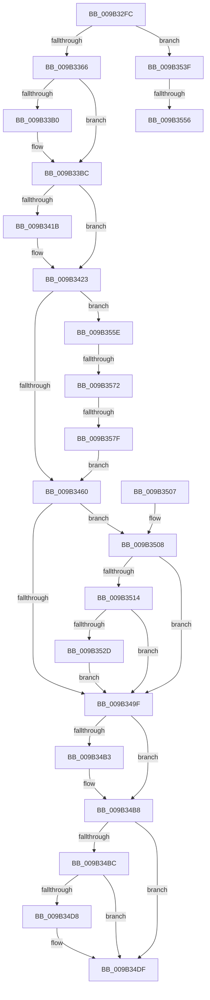

# CmpCompleteUnloadKey

- RVA: `0x009B32FC`–`0x009B358B` (길이 `655` bytes)
- VA: `0x00000001409B32FC`
- 실행 섹션: `PAGE`
- PDB 이름 있음: `예`; PDB Function 태그: `예`
- unwind 정보 RVA: `0x0009E450`
- 디코드: `153`개 명령, `655/655` bytes 표시
- 미해석 바이트: `0` (있으면 어셈블리에 `.byte`로 보존)

> 이 문서는 커널 이미지의 기계어와 PDB 기호를 분석해 생성했습니다. 4번과 5번은 함수 원형과 자료형을 바이너리 사용 방식에서 추정한 C 해석이며 원본 소스 복구 결과는 아닙니다.

## 1. Dependencies

- 직접 호출 지점: **25**; 고유 호출 대상: **25**
- 직접 호출자로 확인된 함수: **2**
- RIP 상대 이미지 참조: **1**

### Outgoing calls
- `0x009B3329` → [CmpInitializeDelayDerefContext](../../text/42/CmpInitializeDelayDerefContext_function_0042A7F0.md) (function, `0x0042A7F0`)
- `0x009B337E` → [CmpTraceHiveUnloadStart](CmpTraceHiveUnloadStart_function_009B3AC8.md) (function, `0x009B3AC8`)
- `0x009B338E` → [CmpRemoveHiveFromNamespace](../../text/49/CmpRemoveHiveFromNamespace_function_0049C4CC.md) (function, `0x0049C4CC`)
- `0x009B33B7` → [CmpDecrementAppHiveUnloadCount](../../text/2A/CmpDecrementAppHiveUnloadCount_function_002A5A38.md) (function, `0x002A5A38`)
- `0x009B33CA` → [CmpFlushNotifiesOnKeyBodyList](CmpFlushNotifiesOnKeyBodyList_function_009B3594.md) (function, `0x009B3594`)
- `0x009B33D7` → [CmpMarkKeyUnbacked](CmpMarkKeyUnbacked_function_009B3C4C.md) (function, `0x009B3C4C`)
- `0x009B33DF` → [CmpDiscardKcb](CmpDiscardKcb_function_009B2F34.md) (function, `0x009B2F34`)
- `0x009B33EC` → [CmpRemoveLayerLinkForDiscardedKcb](CmpRemoveLayerLinkForDiscardedKcb_function_009B3BE0.md) (function, `0x009B3BE0`)
- `0x009B33FC` → [CmpCleanUpSubKeyInfo](../84/CmpCleanUpSubKeyInfo_function_0084C6F4.md) (function, `0x0084C6F4`)
- `0x009B3408` → [CmpDrainDelayDerefContext](../../text/41/CmpDrainDelayDerefContext_function_0041B9A0.md) (function, `0x0041B9A0`)
- `0x009B340D` → [CmpUnlockRegistry](../../pagecmrc/BC/CmpUnlockRegistry_function_00BC9A84.md) (function, `0x00BC9A84`)
- `0x009B341B` → [UNLOCK_HIVE_LOAD](UNLOCK_HIVE_LOAD_function_009B2EBC.md) (function, `0x009B2EBC`)
- `0x009B342D` → [ZwDeleteValueKey](../../text/6A/ZwDeleteValueKey_function_006AECB0.md) (function, `0x006AECB0`)
- `0x009B3446` → [CmpUnJoinClassOfTrust](../../text/4A/CmpUnJoinClassOfTrust_function_004A27C0.md) (function, `0x004A27C0`)
- `0x009B344B` → [KeLeaveCriticalRegion](../../text/25/KeLeaveCriticalRegion_function_0025D8B0.md) (function, `0x0025D8B0`)
- `0x009B3463` → [CmpVERemoveHiveFromSIDMappingTable](CmpVERemoveHiveFromSIDMappingTable_function_009B3244.md) (function, `0x009B3244`)
- `0x009B346B` → [CmpDestroySecurityCache](CmpDestroySecurityCache_function_009B3808.md) (function, `0x009B3808`)
- `0x009B3478` → [CmpFlushHive](CmpFlushHive_function_009B3DC0.md) (function, `0x009B3DC0`)
- `0x009B3496` → [HvHiveCleanup](../84/HvHiveCleanup_function_0084D918.md) (function, `0x0084D918`)
- `0x009B34A2` → [CmpCmdHiveClose](CmpCmdHiveClose_function_009B3948.md) (function, `0x009B3948`)
- `0x009B34B3` → [CmpVolumeContextDecrementRefCount](CmpVolumeContextDecrementRefCount_function_009B2E14.md) (function, `0x009B2E14`)
- `0x009B34DA` → [ExfUnblockPushLock](../../text/2A/ExfUnblockPushLock_function_002A3FE0.md) (function, `0x002A3FE0`)
- `0x009B34E2` → [CmpSignalUnloadEventArrayForHive](CmpSignalUnloadEventArrayForHive_function_009B3788.md) (function, `0x009B3788`)
- `0x009B34E9` → [CmpTraceHiveUnloadStop](CmpTraceHiveUnloadStop_function_009B38B8.md) (function, `0x009B38B8`)
- `0x009B3535` → [CmpDoFileSetSizeEx](CmpDoFileSetSizeEx_function_009B2A4C.md) (function, `0x009B2A4C`)

### Direct callers
- [CmpPerformUnloadKey](../9A/CmpPerformUnloadKey_function_009AFA28.md) at `0x009AFCC2`
- [CmpLateUnloadHiveWorker](CmpLateUnloadHiveWorker_function_009B20D0.md) at `0x009B21E0`

### Static image references
- `0x009B3423` → RVA `0x00EEFC50` (`.data`; read)

## 2. Other-region calls and transfers

- 다른 실행 섹션으로 향하는 call: **9**
  - `0x009B3329` → [CmpInitializeDelayDerefContext](../../text/42/CmpInitializeDelayDerefContext_function_0042A7F0.md) (`PAGE` → `.text`)
  - `0x009B338E` → [CmpRemoveHiveFromNamespace](../../text/49/CmpRemoveHiveFromNamespace_function_0049C4CC.md) (`PAGE` → `.text`)
  - `0x009B33B7` → [CmpDecrementAppHiveUnloadCount](../../text/2A/CmpDecrementAppHiveUnloadCount_function_002A5A38.md) (`PAGE` → `.text`)
  - `0x009B3408` → [CmpDrainDelayDerefContext](../../text/41/CmpDrainDelayDerefContext_function_0041B9A0.md) (`PAGE` → `.text`)
  - `0x009B340D` → [CmpUnlockRegistry](../../pagecmrc/BC/CmpUnlockRegistry_function_00BC9A84.md) (`PAGE` → `PAGECMRC`)
  - `0x009B342D` → [ZwDeleteValueKey](../../text/6A/ZwDeleteValueKey_function_006AECB0.md) (`PAGE` → `.text`)
  - `0x009B3446` → [CmpUnJoinClassOfTrust](../../text/4A/CmpUnJoinClassOfTrust_function_004A27C0.md) (`PAGE` → `.text`)
  - `0x009B344B` → [KeLeaveCriticalRegion](../../text/25/KeLeaveCriticalRegion_function_0025D8B0.md) (`PAGE` → `.text`)
  - `0x009B34DA` → [ExfUnblockPushLock](../../text/2A/ExfUnblockPushLock_function_002A3FE0.md) (`PAGE` → `.text`)
- call이 아닌 외부 분기/꼬리 이동: **4**
  - `0x009B3550` → [sub_00B2DCB2](../B2/Unknown_function_00B2DCB2.md) (`tail-transfer`)
  - `0x009B3559` → [sub_00B2DCB2 + 0x3](../B2/Unknown_function_00B2DCB2.md) (`tail-transfer`)
  - `0x009B356C` → [sub_00B2DCB2 + 0x17](../B2/Unknown_function_00B2DCB2.md) (`tail-transfer`)
  - `0x009B3579` → [sub_00B2DCB2 + 0x17](../B2/Unknown_function_00B2DCB2.md) (`tail-transfer`)

## 3. Assembly (complete function range)

```asm
009B32FC  48 8B C4                        mov rax, rsp
009B32FF  48 89 58 08                     mov qword ptr [rax + 8], rbx
009B3303  48 89 68 10                     mov qword ptr [rax + 0x10], rbp
009B3307  48 89 70 18                     mov qword ptr [rax + 0x18], rsi
009B330B  57                              push rdi
009B330C  41 54                           push r12
009B330E  41 56                           push r14
009B3310  48 83 EC 30                     sub rsp, 0x30
009B3314  48 8B 59 20                     mov rbx, qword ptr [rcx + 0x20]
009B3318  48 8B F1                        mov rsi, rcx
009B331B  0F 57 C0                        xorps xmm0, xmm0
009B331E  48 8D 48 D8                     lea rcx, [rax - 0x28]
009B3322  0F 11 40 D8                     movups xmmword ptr [rax - 0x28], xmm0
009B3326  49 8B F8                        mov rdi, r8
009B3329  E8 C2 74 A7 FF                  call 0x14042a7f0
009B332E  8B AB 10 10 00 00               mov ebp, dword ptr [rbx + 0x1010]
009B3334  41 BC 01 00 00 00               mov r12d, 1
009B333A  83 E5 20                        and ebp, 0x20
009B333D  41 8B C4                        mov eax, r12d
009B3340  F0 0F C1 83 8C 10 00 00         lock xadd dword ptr [rbx + 0x108c], eax
009B3348  83 E0 7F                        and eax, 0x7f
009B334B  C7 84 83 90 10 00 00 06 00 00 00  mov dword ptr [rbx + rax*4 + 0x1090], 6
009B3356  48 8B 83 38 10 00 00            mov rax, qword ptr [rbx + 0x1038]
009B335D  48 85 C0                        test rax, rax
009B3360  0F 85 D9 01 00 00               jne 0x1409b353f
009B3366  83 8B A0 00 00 00 40            or dword ptr [rbx + 0xa0], 0x40
009B336D  4C 8D B3 40 07 00 00            lea r14, [rbx + 0x740]
009B3374  49 8B D6                        mov rdx, r14
009B3377  48 8D 8B 30 07 00 00            lea rcx, [rbx + 0x730]
009B337E  E8 45 07 00 00                  call 0x1409b3ac8
009B3383  4C 8D 44 24 20                  lea r8, [rsp + 0x20]
009B3388  48 8B D6                        mov rdx, rsi
009B338B  48 8B CB                        mov rcx, rbx
009B338E  E8 39 91 AE FF                  call 0x14049c4cc
009B3393  41 8B C4                        mov eax, r12d
009B3396  F0 0F C1 83 8C 10 00 00         lock xadd dword ptr [rbx + 0x108c], eax
009B339E  83 E0 7F                        and eax, 0x7f
009B33A1  C7 84 83 90 10 00 00 08 00 00 00  mov dword ptr [rbx + rax*4 + 0x1090], 8
009B33AC  85 ED                           test ebp, ebp
009B33AE  74 0C                           je 0x1409b33bc
009B33B0  44 89 A3 A0 12 00 00            mov dword ptr [rbx + 0x12a0], r12d
009B33B7  E8 7C 26 8F FF                  call 0x1402a5a38
009B33BC  45 33 C9                        xor r9d, r9d
009B33BF  4C 8D 44 24 20                  lea r8, [rsp + 0x20]
009B33C4  41 8B D4                        mov edx, r12d
009B33C7  48 8B CE                        mov rcx, rsi
009B33CA  E8 C5 01 00 00                  call 0x1409b3594
009B33CF  48 8D 54 24 20                  lea rdx, [rsp + 0x20]
009B33D4  48 8B CE                        mov rcx, rsi
009B33D7  E8 70 08 00 00                  call 0x1409b3c4c
009B33DC  48 8B CE                        mov rcx, rsi
009B33DF  E8 50 FB FF FF                  call 0x1409b2f34
009B33E4  48 8D 54 24 20                  lea rdx, [rsp + 0x20]
009B33E9  48 8B CE                        mov rcx, rsi
009B33EC  E8 EF 07 00 00                  call 0x1409b3be0
009B33F1  48 8B 4E 48                     mov rcx, qword ptr [rsi + 0x48]
009B33F5  41 8A D4                        mov dl, r12b
009B33F8  48 8B 49 48                     mov rcx, qword ptr [rcx + 0x48]
009B33FC  E8 F3 92 E9 FF                  call 0x14084c6f4
009B3401  33 D2                           xor edx, edx
009B3403  48 8D 4C 24 20                  lea rcx, [rsp + 0x20]
009B3408  E8 93 85 A6 FF                  call 0x14041b9a0
009B340D  E8 72 66 21 00                  call 0x140bc9a84
009B3412  83 27 FD                        and dword ptr [rdi], 0xfffffffd
009B3415  8B 07                           mov eax, dword ptr [rdi]
009B3417  A8 04                           test al, 4
009B3419  74 08                           je 0x1409b3423
009B341B  E8 9C FA FF FF                  call 0x1409b2ebc
009B3420  83 27 FB                        and dword ptr [rdi], 0xfffffffb
009B3423  48 8B 0D 26 C8 53 00            mov rcx, qword ptr [rip + 0x53c826]
009B342A  49 8B D6                        mov rdx, r14
009B342D  E8 7E B8 CF FF                  call 0x1406aecb0
009B3432  65 48 8B 04 25 88 01 00 00      mov rax, qword ptr gs:[0x188]
009B343B  48 8B CB                        mov rcx, rbx
009B343E  66 FF 88 E4 01 00 00            dec word ptr [rax + 0x1e4]
009B3445  90                              nop
009B3446  E8 75 F3 AE FF                  call 0x1404a27c0
009B344B  E8 60 A4 8A FF                  call 0x14025d8b0
009B3450  F7 83 A0 00 00 00 00 04 00 00   test dword ptr [rbx + 0xa0], 0x400
009B345A  0F 85 FE 00 00 00               jne 0x1409b355e
009B3460  48 8B CB                        mov rcx, rbx
009B3463  E8 DC FD FF FF                  call 0x1409b3244
009B3468  48 8B CB                        mov rcx, rbx
009B346B  E8 98 03 00 00                  call 0x1409b3808
009B3470  BA 2C 00 00 00                  mov edx, 0x2c
009B3475  48 8B CB                        mov rcx, rbx
009B3478  E8 43 09 00 00                  call 0x1409b3dc0
009B347D  8B B3 18 01 00 00               mov esi, dword ptr [rbx + 0x118]
009B3483  33 FF                           xor edi, edi
009B3485  3D 0D 00 00 C0                  cmp eax, 0xc000000d
009B348A  48 8B CB                        mov rcx, rbx
009B348D  0F 45 F8                        cmovne edi, eax
009B3490  81 C6 00 10 00 00               add esi, 0x1000
009B3496  E8 7D A4 E9 FF                  call 0x14084d918
009B349B  85 FF                           test edi, edi
009B349D  79 69                           jns 0x1409b3508
009B349F  48 8B CB                        mov rcx, rbx
009B34A2  E8 A1 04 00 00                  call 0x1409b3948
009B34A7  48 8B 8B B8 12 00 00            mov rcx, qword ptr [rbx + 0x12b8]
009B34AE  48 85 C9                        test rcx, rcx
009B34B1  74 05                           je 0x1409b34b8
009B34B3  E8 5C F9 FF FF                  call 0x1409b2e14
009B34B8  85 ED                           test ebp, ebp
009B34BA  74 23                           je 0x1409b34df
009B34BC  C7 83 A0 12 00 00 00 00 00 00   mov dword ptr [rbx + 0x12a0], 0
009B34C6  48 8D 8B A8 12 00 00            lea rcx, [rbx + 0x12a8]
009B34CD  F0 83 0C 24 00                  lock or dword ptr [rsp], 0
009B34D2  48 83 39 00                     cmp qword ptr [rcx], 0
009B34D6  74 07                           je 0x1409b34df
009B34D8  33 D2                           xor edx, edx
009B34DA  E8 01 0B 8F FF                  call 0x1402a3fe0
009B34DF  48 8B CB                        mov rcx, rbx
009B34E2  E8 A1 02 00 00                  call 0x1409b3788
009B34E7  8B CF                           mov ecx, edi
009B34E9  E8 CA 03 00 00                  call 0x1409b38b8
009B34EE  48 8B 5C 24 50                  mov rbx, qword ptr [rsp + 0x50]
009B34F3  48 8B 6C 24 58                  mov rbp, qword ptr [rsp + 0x58]
009B34F8  48 8B 74 24 60                  mov rsi, qword ptr [rsp + 0x60]
009B34FD  48 83 C4 30                     add rsp, 0x30
009B3501  41 5E                           pop r14
009B3503  41 5C                           pop r12
009B3505  5F                              pop rdi
009B3506  C3                              ret
009B3507  CC                              int3
009B3508  F7 83 A0 00 00 00 00 80 00 00   test dword ptr [rbx + 0xa0], 0x8000
009B3512  75 8B                           jne 0x1409b349f
009B3514  48 8B 83 08 07 00 00            mov rax, qword ptr [rbx + 0x708]
009B351B  44 8B C6                        mov r8d, esi
009B351E  49 2B C0                        sub rax, r8
009B3521  48 3D 00 00 10 00               cmp rax, 0x100000
009B3527  0F 8E 72 FF FF FF               jle 0x1409b349f
009B352D  45 33 C9                        xor r9d, r9d
009B3530  33 D2                           xor edx, edx
009B3532  48 8B CB                        mov rcx, rbx
009B3535  E8 12 F5 FF FF                  call 0x1409b2a4c
009B353A  E9 60 FF FF FF                  jmp 0x1409b349f
009B353F  48 8B 53 40                     mov rdx, qword ptr [rbx + 0x40]
009B3543  48 83 C0 10                     add rax, 0x10
009B3547  8B 8A 90 00 00 00               mov ecx, dword ptr [rdx + 0x90]
009B354D  48 39 00                        cmp qword ptr [rax], rax
009B3550  0F 85 5C A7 17 00               jne 0x140b2dcb2
009B3556  83 E1 FE                        and ecx, 0xfffffffe
009B3559  E9 57 A7 17 00                  jmp 0x140b2dcb5
009B355E  48 8D 83 58 06 00 00            lea rax, [rbx + 0x658]
009B3565  48 8B 10                        mov rdx, qword ptr [rax]
009B3568  48 39 42 08                     cmp qword ptr [rdx + 8], rax
009B356C  0F 85 57 A7 17 00               jne 0x140b2dcc9
009B3572  48 8B 48 08                     mov rcx, qword ptr [rax + 8]
009B3576  48 39 01                        cmp qword ptr [rcx], rax
009B3579  0F 85 4A A7 17 00               jne 0x140b2dcc9
009B357F  48 89 11                        mov qword ptr [rcx], rdx
009B3582  48 89 4A 08                     mov qword ptr [rdx + 8], rcx
009B3586  E9 D5 FE FF FF                  jmp 0x1409b3460
```

## 4. C-style interpretation (structured pseudocode)

```c
__int64 __fastcall CmpCompleteUnloadKey(__int64 a1, __int64 a2, __int64 a3, int a4)
{
    __int64 result;
    __int64 v_rbp;
    __int64 v_rdi;
    __int64 v_rsi;
    __int64 v_rsp;
    unsigned __int64 v_stack_m28;
    unsigned int v_stack_m48;
    unsigned __int64 v_stack_p10;
    unsigned __int64 v_stack_p18;
    unsigned __int64 v_stack_p8;

    *(unsigned __int64 *)(v_rsp + 8) = v_rbx;
    *(unsigned __int64 *)(v_rsp + 16) = v_rbp;
    *(unsigned __int64 *)(v_rsp + 24) = v_rsi;
    v_rsp = (v_rsp) - (48);
    *(unsigned __int64 *)(v_rsp - 40) = v_xmm0;
    result = CmpInitializeDelayDerefContext(v_rsp - 40, a2, a3, a4);
    v_rbp = (unsigned int)(((unsigned int)(*(unsigned int *)(*(unsigned __int64 *)(a1 + 32) + 4112))) & (32));
    result = (unsigned int)((1) & (127));
    *(unsigned int *)(*(unsigned __int64 *)(a1 + 32) + result * 4 + 4240) = 6;
    if (*(unsigned __int64 *)(*(unsigned __int64 *)(a1 + 32) + 4152) != 0) goto loc_009B353F;
    result = CmpTraceHiveUnloadStart(*(unsigned __int64 *)(a1 + 32) + 1840, *(unsigned __int64 *)(a1 + 32) + 1856, a3, a4);
    result = CmpRemoveHiveFromNamespace(*(unsigned __int64 *)(a1 + 32), a1, v_stack_m28, a4);
    result = (unsigned int)((1) & (127));
    *(unsigned int *)(*(unsigned __int64 *)(a1 + 32) + result * 4 + 4240) = 8;
    if ((unsigned int)(v_rbp) != 0) {
        *(unsigned int *)(*(unsigned __int64 *)(a1 + 32) + 4768) = 1;
        result = CmpDecrementAppHiveUnloadCount(*(unsigned __int64 *)(a1 + 32), a1, v_stack_m28, a4);
    }
    a4 = 0;
    result = CmpFlushNotifiesOnKeyBodyList(a1, 1, v_stack_m28, a4);
    result = CmpMarkKeyUnbacked(a1, v_stack_m28, v_stack_m28, a4);
    result = CmpDiscardKcb(a1, v_stack_m28, v_stack_m28, a4);
    result = CmpRemoveLayerLinkForDiscardedKcb(a1, v_stack_m28, v_stack_m28, a4);
    result = CmpCleanUpSubKeyInfo(*(unsigned __int64 *)(*(unsigned __int64 *)(a1 + 72) + 72), 1, v_stack_m28, a4);
    a2 = 0;
    result = CmpDrainDelayDerefContext(v_stack_m28, a2, v_stack_m28, a4);
    result = CmpUnlockRegistry(v_stack_m28, a2, v_stack_m28, a4);
    result = (unsigned int)(*(unsigned int *)(a3));
    if ((((unsigned __int8)((unsigned int)(*(unsigned int *)(a3)))) & (4)) != 0) {
        result = UNLOCK_HIVE_LOAD(v_stack_m28, a2, v_stack_m28, a4);
    }
    result = ZwDeleteValueKey(*(unsigned __int64 *)(v_rip + 5490726), *(unsigned __int64 *)(a1 + 32) + 1856, v_stack_m28, a4);
    result = CmpUnJoinClassOfTrust(*(unsigned __int64 *)(a1 + 32), *(unsigned __int64 *)(a1 + 32) + 1856, v_stack_m28, a4);
    result = KeLeaveCriticalRegion(*(unsigned __int64 *)(a1 + 32), *(unsigned __int64 *)(a1 + 32) + 1856, v_stack_m28, a4);
    if (((*(unsigned int *)(*(unsigned __int64 *)(a1 + 32) + 160)) & (0x400ULL)) != 0) goto loc_009B355E;
loc_009B3460:
    result = CmpVERemoveHiveFromSIDMappingTable(*(unsigned __int64 *)(a1 + 32), *(unsigned __int64 *)(a1 + 32) + 1856, v_stack_m28, a4);
    result = CmpDestroySecurityCache(*(unsigned __int64 *)(a1 + 32), *(unsigned __int64 *)(a1 + 32) + 1856, v_stack_m28, a4);
    result = CmpFlushHive(*(unsigned __int64 *)(a1 + 32), 44, v_stack_m28, a4);
    v_rdi = 0;
    if (((unsigned int)(result)) != 0xC000000DULL) { v_rdi = (unsigned int)(result); }
    v_rsi = (unsigned int)(((unsigned int)(*(unsigned int *)(*(unsigned __int64 *)(a1 + 32) + 280))) + (0x1000ULL));
    result = HvHiveCleanup(*(unsigned __int64 *)(a1 + 32), 44, v_stack_m28, a4);
    if (!sign_flag) goto loc_009B3508;
loc_009B349F:
    result = CmpCmdHiveClose(*(unsigned __int64 *)(a1 + 32), 44, v_stack_m28, a4);
    if (*(unsigned __int64 *)(*(unsigned __int64 *)(a1 + 32) + 4792) != 0) {
        result = CmpVolumeContextDecrementRefCount(*(unsigned __int64 *)(*(unsigned __int64 *)(a1 + 32) + 4792), 44, v_stack_m28, a4);
    }
    if ((unsigned int)(v_rbp) == 0) goto loc_009B34DF;
    *(unsigned int *)(*(unsigned __int64 *)(a1 + 32) + 4768) = 0;
    if ((*(unsigned __int64 *)(*(unsigned __int64 *)(a1 + 32) + 4776)) != 0) {
        a2 = 0;
        result = ExfUnblockPushLock(*(unsigned __int64 *)(a1 + 32) + 4776, a2, v_stack_m28, a4);
    }
    result = CmpSignalUnloadEventArrayForHive(*(unsigned __int64 *)(a1 + 32), a2, v_stack_m28, a4);
    result = CmpTraceHiveUnloadStop((unsigned int)((unsigned int)(v_rdi)), a2, v_stack_m28, a4);
    v_rsp = (v_rsp) + (48);
    return result;
loc_009B3508:
    if (((*(unsigned int *)(v_stack_p8 + 160)) & (0x8000ULL)) != 0) goto loc_009B349F;
    result = (*(unsigned __int64 *)(v_stack_p8 + 1800)) - ((unsigned int)((unsigned int)(v_stack_p18)));
    if (result <= 0x100000ULL) goto loc_009B349F;
    a4 = 0;
    a2 = 0;
    result = CmpDoFileSetSizeEx(v_stack_p8, a2, (unsigned int)((unsigned int)(v_stack_p18)), a4);
    goto loc_009B349F;
loc_009B353F:
    result = (result) + (16);
    a1 = (unsigned int)(((unsigned int)(*(unsigned int *)(*(unsigned __int64 *)(v_stack_p8 + 64) + 144))) & (0xFFFFFFFEULL));
loc_009B355E:
    *(unsigned __int64 *)(*(unsigned __int64 *)(v_stack_p8 + 1624 + 8)) = *(unsigned __int64 *)(v_stack_p8 + 1624);
    *(unsigned __int64 *)(*(unsigned __int64 *)(v_stack_p8 + 1624) + 8) = *(unsigned __int64 *)(v_stack_p8 + 1624 + 8);
    goto loc_009B3460;
}
```

## 5. (Beta) C Style

```c
int64_t CmpCompleteUnloadKey(void *Arg1, int64_t Arg2, void *Arg3, int32_t Arg4)
{
    uint8_t *arg1 = (uint8_t *)Arg1;
    uint8_t *arg3 = (uint8_t *)Arg3;

    int64_t result;
    int64_t local_rbp;
    int64_t local_rdi;
    int64_t local_rsi;
    int64_t local_rsp;
    uint64_t v_stack_m28;
    uint32_t v_stack_m48;
    uint64_t v_stack_p10;
    uint64_t v_stack_p18;
    uint64_t v_stack_p8;

    *(uint64_t *)(local_rsp + 0x8) = local_rbx;
    *(uint64_t *)(local_rsp + 0x10) = local_rbp;
    *(uint64_t *)(local_rsp + 0x18) = local_rsi;
    local_rsp = (local_rsp) - (48);
    *(uint64_t *)(local_rsp - 0x28) = v_xmm0;
    result = CmpInitializeDelayDerefContext(local_rsp - 40, Arg2, Arg3, Arg4);
    local_rbp = (uint32_t)(((uint32_t)(*(uint32_t *)(*(uint64_t *)(arg1 + 0x20) + 0x1010))) & (32));
    result = (uint32_t)((1) & (127));
    *(uint32_t *)(*(uint64_t *)(arg1 + 0x20) + result * 4 + 0x1090) = 6;
    if (*(uint64_t *)(*(uint64_t *)(arg1 + 0x20) + 0x1038) != 0) goto loc_009B353F;
    result = CmpTraceHiveUnloadStart(*(uint64_t *)(arg1 + 0x20) + 1840, *(uint64_t *)(arg1 + 0x20) + 1856, Arg3, Arg4);
    result = CmpRemoveHiveFromNamespace(*(uint64_t *)(arg1 + 0x20), Arg1, v_stack_m28, Arg4);
    result = (uint32_t)((1) & (127));
    *(uint32_t *)(*(uint64_t *)(arg1 + 0x20) + result * 4 + 0x1090) = 8;
    if ((uint32_t)(local_rbp) != 0) {
        *(uint32_t *)(*(uint64_t *)(arg1 + 0x20) + 0x12A0) = 1;
        result = CmpDecrementAppHiveUnloadCount(*(uint64_t *)(arg1 + 0x20), Arg1, v_stack_m28, Arg4);
    }
    Arg4 = 0;
    result = CmpFlushNotifiesOnKeyBodyList(Arg1, 1, v_stack_m28, Arg4);
    result = CmpMarkKeyUnbacked(Arg1, v_stack_m28, v_stack_m28, Arg4);
    result = CmpDiscardKcb(Arg1, v_stack_m28, v_stack_m28, Arg4);
    result = CmpRemoveLayerLinkForDiscardedKcb(Arg1, v_stack_m28, v_stack_m28, Arg4);
    result = CmpCleanUpSubKeyInfo(*(uint64_t *)(*(uint64_t *)(arg1 + 0x48) + 0x48), 1, v_stack_m28, Arg4);
    Arg2 = 0;
    result = CmpDrainDelayDerefContext(v_stack_m28, Arg2, v_stack_m28, Arg4);
    result = CmpUnlockRegistry(v_stack_m28, Arg2, v_stack_m28, Arg4);
    result = (uint32_t)(*(uint32_t *)(arg3));
    if ((((uint8_t)((uint32_t)(*(uint32_t *)(arg3)))) & (4)) != 0) {
        result = UNLOCK_HIVE_LOAD(v_stack_m28, Arg2, v_stack_m28, Arg4);
    }
    result = ZwDeleteValueKey(*(uint64_t *)(v_rip + 0x53C826), *(uint64_t *)(arg1 + 0x20) + 1856, v_stack_m28, Arg4);
    result = CmpUnJoinClassOfTrust(*(uint64_t *)(arg1 + 0x20), *(uint64_t *)(arg1 + 0x20) + 1856, v_stack_m28, Arg4);
    result = KeLeaveCriticalRegion(*(uint64_t *)(arg1 + 0x20), *(uint64_t *)(arg1 + 0x20) + 1856, v_stack_m28, Arg4);
    if (((*(uint32_t *)(*(uint64_t *)(arg1 + 0x20) + 0xA0)) & (0x400ULL)) != 0) goto loc_009B355E;
loc_009B3460:
    result = CmpVERemoveHiveFromSIDMappingTable(*(uint64_t *)(arg1 + 0x20), *(uint64_t *)(arg1 + 0x20) + 1856, v_stack_m28, Arg4);
    result = CmpDestroySecurityCache(*(uint64_t *)(arg1 + 0x20), *(uint64_t *)(arg1 + 0x20) + 1856, v_stack_m28, Arg4);
    result = CmpFlushHive(*(uint64_t *)(arg1 + 0x20), 44, v_stack_m28, Arg4);
    local_rdi = 0;
    if (((uint32_t)(result)) != 0xC000000DULL) { local_rdi = (uint32_t)(result); }
    local_rsi = (uint32_t)(((uint32_t)(*(uint32_t *)(*(uint64_t *)(arg1 + 0x20) + 0x118))) + (0x1000ULL));
    result = HvHiveCleanup(*(uint64_t *)(arg1 + 0x20), 44, v_stack_m28, Arg4);
    if (!sign_flag) goto loc_009B3508;
loc_009B349F:
    result = CmpCmdHiveClose(*(uint64_t *)(arg1 + 0x20), 44, v_stack_m28, Arg4);
    if (*(uint64_t *)(*(uint64_t *)(arg1 + 0x20) + 0x12B8) != 0) {
        result = CmpVolumeContextDecrementRefCount(*(uint64_t *)(*(uint64_t *)(arg1 + 0x20) + 0x12B8), 44, v_stack_m28, Arg4);
    }
    if ((uint32_t)(local_rbp) == 0) goto loc_009B34DF;
    *(uint32_t *)(*(uint64_t *)(arg1 + 0x20) + 0x12A0) = 0;
    if ((*(uint64_t *)(*(uint64_t *)(arg1 + 0x20) + 0x12A8)) != 0) {
        Arg2 = 0;
        result = ExfUnblockPushLock(*(uint64_t *)(arg1 + 0x20) + 4776, Arg2, v_stack_m28, Arg4);
    }
    result = CmpSignalUnloadEventArrayForHive(*(uint64_t *)(arg1 + 0x20), Arg2, v_stack_m28, Arg4);
    result = CmpTraceHiveUnloadStop((uint32_t)((uint32_t)(local_rdi)), Arg2, v_stack_m28, Arg4);
    local_rsp = (local_rsp) + (48);
    return result;
loc_009B3508:
    if (((*(uint32_t *)(v_stack_p8 + 0xA0)) & (0x8000ULL)) != 0) goto loc_009B349F;
    result = (*(uint64_t *)(v_stack_p8 + 0x708)) - ((uint32_t)((uint32_t)(v_stack_p18)));
    if (result <= 0x100000ULL) goto loc_009B349F;
    Arg4 = 0;
    Arg2 = 0;
    result = CmpDoFileSetSizeEx(v_stack_p8, Arg2, (uint32_t)((uint32_t)(v_stack_p18)), Arg4);
    goto loc_009B349F;
loc_009B353F:
    result = (result) + (16);
    Arg1 = (uint32_t)(((uint32_t)(*(uint32_t *)(*(uint64_t *)(v_stack_p8 + 0x40) + 0x90))) & (0xFFFFFFFEULL));
loc_009B355E:
    *(uint64_t *)(*(uint64_t *)(v_stack_p8 + 0x658 + 0x8)) = *(uint64_t *)(v_stack_p8 + 0x658);
    *(uint64_t *)(*(uint64_t *)(v_stack_p8 + 0x658) + 0x8) = *(uint64_t *)(v_stack_p8 + 0x658 + 0x8);
    goto loc_009B3460;
}
```

### 관측된 메모리 오프셋

구조체 형식이 확인되지 않은 접근은 인자 기준의 오프셋으로만 기록했습니다.

| 기준 인자 | 오프셋 표현 | 폭 (bit) | 접근 |
|---|---:|---:|---|
| `Arg1` | `+ 0x20` | `64` | `R` |
| `Arg1` | `+ 0x48` | `64` | `R` |
| `Arg3` | `+ 0x0` | `32` | `R` |
| `Arg3` | `+ 0x0` | `32` | `R/W` |

## 6. Execution-region graph

[열기: 2D/3D 그래프와 함수 탐색 컨트롤 패널](../../../control-panel.html?section=page&rva=0x009B32FC&view=graph)

- 2D 그래프는 위에서 아래로 흐르고, 3D 그래프는 빈 공간을 드래그해 회전합니다. Shift+드래그는 이동, 휠은 확대·축소, 함수 노드 선택은 대상 보고서 이동입니다.

### Static fallback


