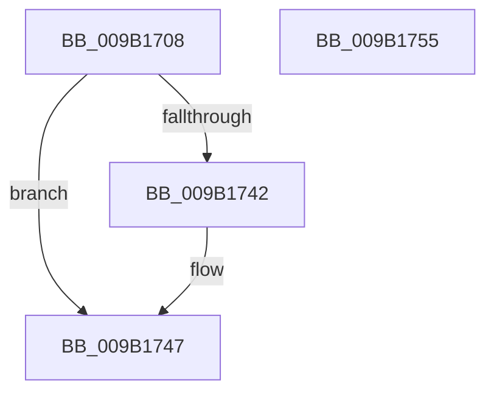

# CmpDestroyHive

- RVA: `0x009B1708`–`0x009B1756` (길이 `78` bytes)
- VA: `0x00000001409B1708`
- 실행 섹션: `PAGE`
- PDB 이름 있음: `예`; PDB Function 태그: `아니요`
- unwind 정보 RVA: `0x0005CF00`
- 디코드: `22`개 명령, `78/78` bytes 표시
- 미해석 바이트: `0` (있으면 어셈블리에 `.byte`로 보존)

> 이 문서는 커널 이미지의 기계어와 PDB 기호를 분석해 생성했습니다. 4번과 5번은 함수 원형과 자료형을 바이너리 사용 방식에서 추정한 C 해석이며 원본 소스 복구 결과는 아닙니다.

## 1. Dependencies

- 직접 호출 지점: **7**; 고유 호출 대상: **7**
- 직접 호출자로 확인된 함수: **15**
- RIP 상대 이미지 참조: **0**

### Outgoing calls
- `0x009B1711` → [CmpDestroySecurityCache](CmpDestroySecurityCache_function_009B3808.md) (function, `0x009B3808`)
- `0x009B1719` → [CmpUnJoinClassOfTrust](../../text/4A/CmpUnJoinClassOfTrust_function_004A27C0.md) (function, `0x004A27C0`)
- `0x009B1721` → [CmpVERemoveHiveFromSIDMappingTable](CmpVERemoveHiveFromSIDMappingTable_function_009B3244.md) (function, `0x009B3244`)
- `0x009B1729` → [HvHiveCleanup](../84/HvHiveCleanup_function_0084D918.md) (function, `0x0084D918`)
- `0x009B1731` → [CmpCmdHiveClose](CmpCmdHiveClose_function_009B3948.md) (function, `0x009B3948`)
- `0x009B1742` → [CmpVolumeContextDecrementRefCount](CmpVolumeContextDecrementRefCount_function_009B2E14.md) (function, `0x009B2E14`)
- `0x009B174A` → [CmpDereferenceHive](../86/CmpDereferenceHive_function_008632B0.md) (function, `0x008632B0`)

### Direct callers
- [CmpLoadKeyCommon](../../text/46/CmpLoadKeyCommon_function_0046E9F8.md) at `0x0046EDA4`
- [CmRestoreKey](../7D/CmRestoreKey_function_007DCF04.md) at `0x007DDA88`
- [CmRestoreKey](../7D/CmRestoreKey_function_007DCF04.md) at `0x007DDB2B`
- [CmSaveKey](../7D/CmSaveKey_function_007DDBDC.md) at `0x007DDFFA`
- [CmSaveMergedKeys](../7D/CmSaveMergedKeys_function_007DE040.md) at `0x007DE482`
- [CmpLoadHiveVolatile](../7D/CmpLoadHiveVolatile_function_007DE5F0.md) at `0x007DEA5E`
- [CmpLoadHiveVolatile](../7D/CmpLoadHiveVolatile_function_007DE5F0.md) at `0x007DEA6C`
- [CmpRefreshHive](../7D/CmpRefreshHive_function_007DEAD0.md) at `0x007DED8C`
- [CmpFreeAllMemory](../7E/CmpFreeAllMemory_function_007E51D0.md) at `0x007E5279`
- [CmReplaceKey](../7E/CmReplaceKey_function_007EA1C8.md) at `0x007EA433`
- [CmpFlushBackupHive](../7E/CmpFlushBackupHive_function_007EC1A8.md) at `0x007EC441`
- [CmpCreateEmptyHiveClone](../7E/CmpCreateEmptyHiveClone_function_007EE2E0.md) at `0x007EE487`
- [CmpHiveCacheEntryCleanup](../7F/CmpHiveCacheEntryCleanup_function_007F5B38.md) at `0x007F5B7C`
- [CmpHiveCachePopulateHiveEntryThread](../7F/CmpHiveCachePopulateHiveEntryThread_function_007F5FD0.md) at `0x007F6355`
- [CmLoadKey](../87/CmLoadKey_function_008787CC.md) at `0x0087905D`
- [CmpCreateHive](../87/CmpCreateHive_function_00879DF0.md) at `0x0087A41F`
- [sub_00B1845C](../B1/Unknown_function_00B1845C.md) at `0x00B18976`

### Static image references
- 디코드된 RIP-relative 메모리 참조가 없습니다.

## 2. Other-region calls and transfers

- 다른 실행 섹션으로 향하는 call: **1**
  - `0x009B1719` → [CmpUnJoinClassOfTrust](../../text/4A/CmpUnJoinClassOfTrust_function_004A27C0.md) (`PAGE` → `.text`)
- 별도 외부 분기/꼬리 이동을 확인하지 못했습니다.

## 3. Assembly (complete function range)

```asm
009B1708  40 53                           push rbx
009B170A  48 83 EC 20                     sub rsp, 0x20
009B170E  48 8B D9                        mov rbx, rcx
009B1711  E8 F2 20 00 00                  call 0x1409b3808
009B1716  48 8B CB                        mov rcx, rbx
009B1719  E8 A2 10 AF FF                  call 0x1404a27c0
009B171E  48 8B CB                        mov rcx, rbx
009B1721  E8 1E 1B 00 00                  call 0x1409b3244
009B1726  48 8B CB                        mov rcx, rbx
009B1729  E8 EA C1 E9 FF                  call 0x14084d918
009B172E  48 8B CB                        mov rcx, rbx
009B1731  E8 12 22 00 00                  call 0x1409b3948
009B1736  48 8B 8B B8 12 00 00            mov rcx, qword ptr [rbx + 0x12b8]
009B173D  48 85 C9                        test rcx, rcx
009B1740  74 05                           je 0x1409b1747
009B1742  E8 CD 16 00 00                  call 0x1409b2e14
009B1747  48 8B CB                        mov rcx, rbx
009B174A  E8 61 1B EB FF                  call 0x1408632b0
009B174F  48 83 C4 20                     add rsp, 0x20
009B1753  5B                              pop rbx
009B1754  C3                              ret
009B1755  CC                              int3
```

## 4. C-style interpretation (structured pseudocode)

```c
__int64 __fastcall CmpDestroyHive(__int64 a1)
{
    __int64 result;
    __int64 v_rsp;

    v_rsp = (v_rsp) - (32);
    result = CmpDestroySecurityCache(a1, a2, a3, a4);
    result = CmpUnJoinClassOfTrust(a1, a2, a3, a4);
    result = CmpVERemoveHiveFromSIDMappingTable(a1, a2, a3, a4);
    result = HvHiveCleanup(a1, a2, a3, a4);
    result = CmpCmdHiveClose(a1, a2, a3, a4);
    if (*(unsigned __int64 *)(a1 + 4792) != 0) {
        result = CmpVolumeContextDecrementRefCount(*(unsigned __int64 *)(a1 + 4792), a2, a3, a4);
    }
    result = CmpDereferenceHive(a1, a2, a3, a4);
    v_rsp = (v_rsp) + (32);
    return result;
}
```

## 5. (Beta) C Style

```c
int64_t CmpDestroyHive(void *Arg1)
{
    uint8_t *arg1 = (uint8_t *)Arg1;

    int64_t result;
    int64_t local_rsp;

    local_rsp = (local_rsp) - (32);
    result = CmpDestroySecurityCache(Arg1, a2, a3, a4);
    result = CmpUnJoinClassOfTrust(Arg1, a2, a3, a4);
    result = CmpVERemoveHiveFromSIDMappingTable(Arg1, a2, a3, a4);
    result = HvHiveCleanup(Arg1, a2, a3, a4);
    result = CmpCmdHiveClose(Arg1, a2, a3, a4);
    if (*(uint64_t *)(arg1 + 0x12B8) != 0) {
        result = CmpVolumeContextDecrementRefCount(*(uint64_t *)(arg1 + 0x12B8), a2, a3, a4);
    }
    result = CmpDereferenceHive(Arg1, a2, a3, a4);
    local_rsp = (local_rsp) + (32);
    return result;
}
```

### 관측된 메모리 오프셋

구조체 형식이 확인되지 않은 접근은 인자 기준의 오프셋으로만 기록했습니다.

| 기준 인자 | 오프셋 표현 | 폭 (bit) | 접근 |
|---|---:|---:|---|
| `Arg1` | `+ 0x12B8` | `64` | `R` |

## 6. Execution-region graph

[열기: 2D/3D 그래프와 함수 탐색 컨트롤 패널](../../../control-panel.html?section=page&rva=0x009B1708&view=graph)

- 2D 그래프는 위에서 아래로 흐르고, 3D 그래프는 빈 공간을 드래그해 회전합니다. Shift+드래그는 이동, 휠은 확대·축소, 함수 노드 선택은 대상 보고서 이동입니다.

### Static fallback


