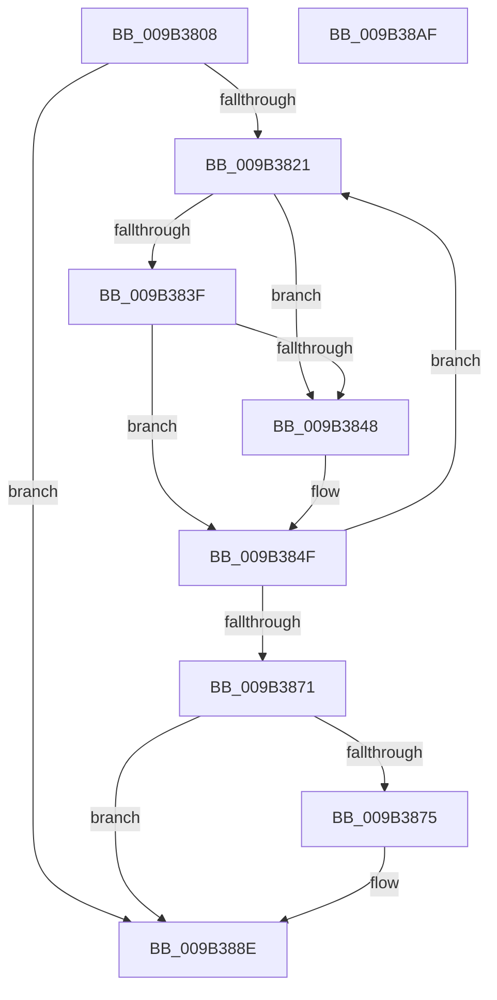

# CmpDestroySecurityCache

- RVA: `0x009B3808`–`0x009B38B0` (길이 `168` bytes)
- VA: `0x00000001409B3808`
- 실행 섹션: `PAGE`
- PDB 이름 있음: `예`; PDB Function 태그: `아니요`
- unwind 정보 RVA: `0x0005CAAC`
- 디코드: `46`개 명령, `168/168` bytes 표시
- 미해석 바이트: `0` (있으면 어셈블리에 `.byte`로 보존)

> 이 문서는 커널 이미지의 기계어와 PDB 기호를 분석해 생성했습니다. 4번과 5번은 함수 원형과 자료형을 바이너리 사용 방식에서 추정한 C 해석이며 원본 소스 복구 결과는 아닙니다.

## 1. Dependencies

- 직접 호출 지점: **2**; 고유 호출 대상: **1**
- 직접 호출자로 확인된 함수: **3**
- RIP 상대 이미지 참조: **0**

### Outgoing calls
- `0x009B3860` → [guard_dispatch_icall](../../text/6B/guard_dispatch_icall_function_006BAAD0.md) (function, `0x006BAAD0`)
- `0x009B3889` → [guard_dispatch_icall](../../text/6B/guard_dispatch_icall_function_006BAAD0.md) (function, `0x006BAAD0`)

### Direct callers
- [CmpDestroyHive](CmpDestroyHive_function_009B1708.md) at `0x009B1711`
- [CmpCompleteUnloadKey](CmpCompleteUnloadKey_function_009B32FC.md) at `0x009B346B`
- [sub_00B28A98](../B2/Unknown_function_00B28A98.md) at `0x00B28BEE`

### Static image references
- 디코드된 RIP-relative 메모리 참조가 없습니다.

## 2. Other-region calls and transfers

- 다른 실행 섹션으로 향하는 call: **2**
  - `0x009B3860` → [guard_dispatch_icall](../../text/6B/guard_dispatch_icall_function_006BAAD0.md) (`PAGE` → `.text`)
  - `0x009B3889` → [guard_dispatch_icall](../../text/6B/guard_dispatch_icall_function_006BAAD0.md) (`PAGE` → `.text`)
- 별도 외부 분기/꼬리 이동을 확인하지 못했습니다.

## 3. Assembly (complete function range)

```asm
009B3808  48 89 5C 24 08                  mov qword ptr [rsp + 8], rbx
009B380D  57                              push rdi
009B380E  48 83 EC 20                     sub rsp, 0x20
009B3812  8B 81 50 07 00 00               mov eax, dword ptr [rcx + 0x750]
009B3818  33 FF                           xor edi, edi
009B381A  48 8B D9                        mov rbx, rcx
009B381D  85 C0                           test eax, eax
009B381F  74 6D                           je 0x1409b388e
009B3821  48 8B 83 60 07 00 00            mov rax, qword ptr [rbx + 0x760]
009B3828  8B CF                           mov ecx, edi
009B382A  48 03 C9                        add rcx, rcx
009B382D  48 8B 4C C8 08                  mov rcx, qword ptr [rax + rcx*8 + 8]
009B3832  48 8D 41 08                     lea rax, [rcx + 8]
009B3836  4C 8B 00                        mov r8, qword ptr [rax]
009B3839  49 39 40 08                     cmp qword ptr [r8 + 8], rax
009B383D  75 09                           jne 0x1409b3848
009B383F  48 8B 50 08                     mov rdx, qword ptr [rax + 8]
009B3843  48 39 02                        cmp qword ptr [rdx], rax
009B3846  74 07                           je 0x1409b384f
009B3848  B9 03 00 00 00                  mov ecx, 3
009B384D  CD 29                           int 0x29
009B384F  4C 89 02                        mov qword ptr [rdx], r8
009B3852  49 89 50 08                     mov qword ptr [r8 + 8], rdx
009B3856  8B 51 18                        mov edx, dword ptr [rcx + 0x18]
009B3859  48 8B 43 20                     mov rax, qword ptr [rbx + 0x20]
009B385D  83 C2 20                        add edx, 0x20
009B3860  E8 6B 72 D0 FF                  call 0x1406baad0
009B3865  8B 83 50 07 00 00               mov eax, dword ptr [rbx + 0x750]
009B386B  FF C7                           inc edi
009B386D  3B F8                           cmp edi, eax
009B386F  72 B0                           jb 0x1409b3821
009B3871  85 C0                           test eax, eax
009B3873  74 19                           je 0x1409b388e
009B3875  8B 93 54 07 00 00               mov edx, dword ptr [rbx + 0x754]
009B387B  48 8B 43 20                     mov rax, qword ptr [rbx + 0x20]
009B387F  48 8B 8B 60 07 00 00            mov rcx, qword ptr [rbx + 0x760]
009B3886  C1 E2 04                        shl edx, 4
009B3889  E8 42 72 D0 FF                  call 0x1406baad0
009B388E  48 83 A3 60 07 00 00 00         and qword ptr [rbx + 0x760], 0
009B3896  83 A3 50 07 00 00 00            and dword ptr [rbx + 0x750], 0
009B389D  83 A3 54 07 00 00 00            and dword ptr [rbx + 0x754], 0
009B38A4  48 8B 5C 24 30                  mov rbx, qword ptr [rsp + 0x30]
009B38A9  48 83 C4 20                     add rsp, 0x20
009B38AD  5F                              pop rdi
009B38AE  C3                              ret
009B38AF  CC                              int3
```

## 4. C-style interpretation (structured pseudocode)

```c
__int64 __fastcall CmpDestroySecurityCache(__int64 a1)
{
    __int64 result;
    __int64 v_rdi;
    __int64 v_rsp;
    unsigned __int64 v_stack_p8;

    v_stack_p8 = v_rbx;
    v_rsp = (v_rsp) - (32);
    v_rdi = 0;
    if ((unsigned int)((unsigned int)(*(unsigned int *)(a1 + 1872))) == 0) goto loc_009B388E;
loc_009B3821:
    a1 = (0) + (0);
    if ((*(unsigned __int64 *)(*(unsigned __int64 *)(*(unsigned __int64 *)(*(unsigned __int64 *)(a1 + 1888) + a1 * 8 + 8) + 8) + 8)) != (*(unsigned __int64 *)(*(unsigned __int64 *)(a1 + 1888) + a1 * 8 + 8) + 8)) goto loc_009B3848;
    if ((*(unsigned __int64 *)(*(unsigned __int64 *)(*(unsigned __int64 *)(*(unsigned __int64 *)(a1 + 1888) + a1 * 8 + 8) + 8 + 8))) != (*(unsigned __int64 *)(*(unsigned __int64 *)(a1 + 1888) + a1 * 8 + 8) + 8)) {
        a1 = 3;
    }
    *(unsigned __int64 *)(*(unsigned __int64 *)(*(unsigned __int64 *)(*(unsigned __int64 *)(a1 + 1888) + a1 * 8 + 8) + 8 + 8)) = *(unsigned __int64 *)(*(unsigned __int64 *)(*(unsigned __int64 *)(a1 + 1888) + a1 * 8 + 8) + 8);
    *(unsigned __int64 *)(*(unsigned __int64 *)(*(unsigned __int64 *)(*(unsigned __int64 *)(a1 + 1888) + a1 * 8 + 8) + 8) + 8) = *(unsigned __int64 *)(*(unsigned __int64 *)(*(unsigned __int64 *)(a1 + 1888) + a1 * 8 + 8) + 8 + 8);
    a2 = (unsigned int)(((unsigned int)(*(unsigned int *)(a1 + 24))) + (32));
    result = guard_dispatch_icall(a1, a2, *(unsigned __int64 *)(*(unsigned __int64 *)(*(unsigned __int64 *)(a1 + 1888) + a1 * 8 + 8) + 8), a4);
    v_rdi = (unsigned int)((v_rdi) + 1);
    if (((unsigned int)(v_rdi)) < ((unsigned int)((unsigned int)(*(unsigned int *)(a1 + 1872))))) goto loc_009B3821;
    result = (unsigned int)(*(unsigned int *)(a1 + 1872));
    if ((unsigned int)((unsigned int)(*(unsigned int *)(a1 + 1872))) != 0) {
        a2 = *(unsigned int *)(a1 + 1876);
        result = *(unsigned __int64 *)(a1 + 32);
        a1 = *(unsigned __int64 *)(a1 + 1888);
        a2 = (unsigned int)((a2) << (4));
        result = guard_dispatch_icall(a1, a2, *(unsigned __int64 *)(*(unsigned __int64 *)(*(unsigned __int64 *)(a1 + 1888) + a1 * 8 + 8) + 8), a4);
    }
    v_rsp = (v_rsp) + (32);
    return result;
}
```

## 5. (Beta) C Style

```c
int64_t CmpDestroySecurityCache(void *Arg1)
{
    uint8_t *arg1 = (uint8_t *)Arg1;

    int64_t result;
    int64_t local_rdi;
    int64_t local_rsp;
    uint64_t v_stack_p8;

    v_stack_p8 = local_rbx;
    local_rsp = (local_rsp) - (32);
    local_rdi = 0;
    if ((uint32_t)((uint32_t)(*(uint32_t *)(arg1 + 0x750))) == 0) goto loc_009B388E;
loc_009B3821:
    Arg1 = (0) + (0);
    if ((*(uint64_t *)(*(uint64_t *)(*(uint64_t *)(*(uint64_t *)(arg1 + 0x760) + arg1 * 8 + 0x8) + 0x8) + 0x8)) != (*(uint64_t *)(*(uint64_t *)(arg1 + 0x760) + arg1 * 8 + 0x8) + 8)) goto loc_009B3848;
    if ((*(uint64_t *)(*(uint64_t *)(*(uint64_t *)(*(uint64_t *)(arg1 + 0x760) + arg1 * 8 + 0x8) + 0x8 + 0x8))) != (*(uint64_t *)(*(uint64_t *)(arg1 + 0x760) + arg1 * 8 + 0x8) + 8)) {
        Arg1 = 3;
    }
    *(uint64_t *)(*(uint64_t *)(*(uint64_t *)(*(uint64_t *)(arg1 + 0x760) + arg1 * 8 + 0x8) + 0x8 + 0x8)) = *(uint64_t *)(*(uint64_t *)(*(uint64_t *)(arg1 + 0x760) + arg1 * 8 + 0x8) + 0x8);
    *(uint64_t *)(*(uint64_t *)(*(uint64_t *)(*(uint64_t *)(arg1 + 0x760) + arg1 * 8 + 0x8) + 0x8) + 0x8) = *(uint64_t *)(*(uint64_t *)(*(uint64_t *)(arg1 + 0x760) + arg1 * 8 + 0x8) + 0x8 + 0x8);
    a2 = (uint32_t)(((uint32_t)(*(uint32_t *)(arg1 + 0x18))) + (32));
    result = guard_dispatch_icall(Arg1, a2, *(uint64_t *)(*(uint64_t *)(*(uint64_t *)(arg1 + 0x760) + arg1 * 8 + 0x8) + 0x8), a4);
    local_rdi = (uint32_t)((local_rdi) + 1);
    if (((uint32_t)(local_rdi)) < ((uint32_t)((uint32_t)(*(uint32_t *)(arg1 + 0x750))))) goto loc_009B3821;
    result = (uint32_t)(*(uint32_t *)(arg1 + 0x750));
    if ((uint32_t)((uint32_t)(*(uint32_t *)(arg1 + 0x750))) != 0) {
        a2 = *(uint32_t *)(arg1 + 0x754);
        result = *(uint64_t *)(arg1 + 0x20);
        Arg1 = *(uint64_t *)(arg1 + 0x760);
        a2 = (uint32_t)((a2) << (4));
        result = guard_dispatch_icall(Arg1, a2, *(uint64_t *)(*(uint64_t *)(*(uint64_t *)(arg1 + 0x760) + arg1 * 8 + 0x8) + 0x8), a4);
    }
    local_rsp = (local_rsp) + (32);
    return result;
}
```

### 관측된 메모리 오프셋

구조체 형식이 확인되지 않은 접근은 인자 기준의 오프셋으로만 기록했습니다.

| 기준 인자 | 오프셋 표현 | 폭 (bit) | 접근 |
|---|---:|---:|---|
| `Arg1` | `+ 0x20` | `64` | `R` |
| `Arg1` | `+ 0x750` | `32` | `R` |
| `Arg1` | `+ 0x750` | `32` | `R/W` |
| `Arg1` | `+ 0x754` | `32` | `R` |
| `Arg1` | `+ 0x754` | `32` | `R/W` |
| `Arg1` | `+ 0x760` | `64` | `R` |
| `Arg1` | `+ 0x760` | `64` | `R/W` |

## 6. Execution-region graph

[열기: 2D/3D 그래프와 함수 탐색 컨트롤 패널](../../../control-panel.html?section=page&rva=0x009B3808&view=graph)

- 2D 그래프는 위에서 아래로 흐르고, 3D 그래프는 빈 공간을 드래그해 회전합니다. Shift+드래그는 이동, 휠은 확대·축소, 함수 노드 선택은 대상 보고서 이동입니다.

### Static fallback


