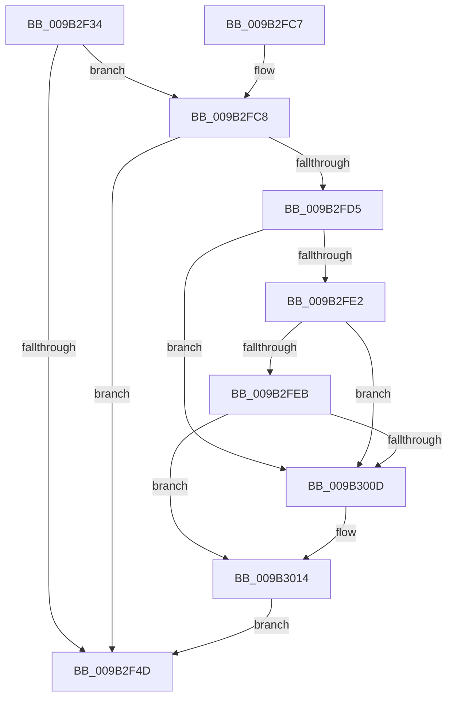

# CmpDiscardKcb

- RVA: `0x009B2F34`–`0x009B3027` (길이 `243` bytes)
- VA: `0x00000001409B2F34`
- 실행 섹션: `PAGE`
- PDB 이름 있음: `예`; PDB Function 태그: `아니요`
- unwind 정보 RVA: `0x0009E440`
- 디코드: `65`개 명령, `243/243` bytes 표시
- 미해석 바이트: `0` (있으면 어셈블리에 `.byte`로 보존)

> 이 문서는 커널 이미지의 기계어와 PDB 기호를 분석해 생성했습니다. 4번과 5번은 함수 원형과 자료형을 바이너리 사용 방식에서 추정한 C 해석이며 원본 소스 복구 결과는 아닙니다.

## 1. Dependencies

- 직접 호출 지점: **3**; 고유 호출 대상: **3**
- 직접 호출자로 확인된 함수: **12**
- RIP 상대 이미지 참조: **0**

### Outgoing calls
- `0x009B2F64` → [CmpRemoveKeyHash](CmpRemoveKeyHash_function_009B31D8.md) (function, `0x009B31D8`)
- `0x009B2F6C` → [CmpLockDeletedHashEntryExclusiveByKcb](CmpLockDeletedHashEntryExclusiveByKcb_function_009B3030.md) (function, `0x009B3030`)
- `0x009B2FB7` → [CmpUnlockDeletedHashEntryByKcb](CmpUnlockDeletedHashEntryByKcb_function_009B3100.md) (function, `0x009B3100`)

### Direct callers
- [CmDeleteLayeredKey](../../text/41/CmDeleteLayeredKey_function_0041B598.md) at `0x0041B7EC`
- [CmpRemoveHiveFromNamespace](../../text/49/CmpRemoveHiveFromNamespace_function_0049C4CC.md) at `0x0049C53E`
- [sub_006ED542](../../text/6E/Unknown_function_006ED542.md) at `0x006ED64C`
- [CmpRefreshWorkerRoutine](../7D/CmpRefreshWorkerRoutine_function_007DEF60.md) at `0x007DEF9D`
- [CmRenameKey](../7E/CmRenameKey_function_007E8F48.md) at `0x007E9767`
- [CmpInvalidateAllHigherLayerKcbsPostCallback](../7F/CmpInvalidateAllHigherLayerKcbsPostCallback_function_007F15A0.md) at `0x007F15F1`
- [CmDeleteKey](../84/CmDeleteKey_function_00848E5C.md) at `0x008492D2`
- [CmpCommitDiscardReplacePost](../86/CmpCommitDiscardReplacePost_function_008624D4.md) at `0x0086256A`
- [CmpCompleteUnloadKey](CmpCompleteUnloadKey_function_009B32FC.md) at `0x009B33DF`
- [CmpLightWeightCommitDeleteKeyUoW](../A5/CmpLightWeightCommitDeleteKeyUoW_function_00A54610.md) at `0x00A54731`
- [CmpInvalidateSubtreeWorker](../AA/CmpInvalidateSubtreeWorker_function_00AA3970.md) at `0x00AA39B8`
- [sub_00B1787E](../B1/Unknown_function_00B1787E.md) at `0x00B1791F`

### Static image references
- 디코드된 RIP-relative 메모리 참조가 없습니다.

## 2. Other-region calls and transfers

- 다른 실행 섹션으로 향하는 call: **0**
- 별도 외부 분기/꼬리 이동을 확인하지 못했습니다.

## 3. Assembly (complete function range)

```asm
009B2F34  48 89 5C 24 08                  mov qword ptr [rsp + 8], rbx
009B2F39  57                              push rdi
009B2F3A  48 83 EC 20                     sub rsp, 0x20
009B2F3E  48 8B 81 C0 00 00 00            mov rax, qword ptr [rcx + 0xc0]
009B2F45  48 8B F9                        mov rdi, rcx
009B2F48  48 85 C0                        test rax, rax
009B2F4B  75 7B                           jne 0x1409b2fc8
009B2F4D  48 8B 4F 20                     mov rcx, qword ptr [rdi + 0x20]
009B2F51  48 8D 5F 10                     lea rbx, [rdi + 0x10]
009B2F55  48 FF 87 30 01 00 00            inc qword ptr [rdi + 0x130]
009B2F5C  48 8B D3                        mov rdx, rbx
009B2F5F  0F BA 6F 08 11                  bts dword ptr [rdi + 8], 0x11
009B2F64  E8 6F 02 00 00                  call 0x1409b31d8
009B2F69  48 8B CF                        mov rcx, rdi
009B2F6C  E8 BF 00 00 00                  call 0x1409b3030
009B2F71  8B 03                           mov eax, dword ptr [rbx]
009B2F73  8B C8                           mov ecx, eax
009B2F75  4C 8B 47 20                     mov r8, qword ptr [rdi + 0x20]
009B2F79  C1 E9 09                        shr ecx, 9
009B2F7C  33 C8                           xor ecx, eax
009B2F7E  69 C1 A3 8A 01 00               imul eax, ecx, 0x18aa3
009B2F84  8B C8                           mov ecx, eax
009B2F86  8B D0                           mov edx, eax
009B2F88  48 C1 EA 09                     shr rdx, 9
009B2F8C  48 33 D1                        xor rdx, rcx
009B2F8F  41 8B 88 88 06 00 00            mov ecx, dword ptr [r8 + 0x688]
009B2F96  FF C9                           dec ecx
009B2F98  48 23 D1                        and rdx, rcx
009B2F9B  49 8B 88 80 06 00 00            mov rcx, qword ptr [r8 + 0x680]
009B2FA2  48 8D 14 52                     lea rdx, [rdx + rdx*2]
009B2FA6  48 8B 44 D1 10                  mov rax, qword ptr [rcx + rdx*8 + 0x10]
009B2FAB  48 89 43 08                     mov qword ptr [rbx + 8], rax
009B2FAF  48 89 5C D1 10                  mov qword ptr [rcx + rdx*8 + 0x10], rbx
009B2FB4  48 8B CF                        mov rcx, rdi
009B2FB7  E8 44 01 00 00                  call 0x1409b3100
009B2FBC  48 8B 5C 24 30                  mov rbx, qword ptr [rsp + 0x30]
009B2FC1  48 83 C4 20                     add rsp, 0x20
009B2FC5  5F                              pop rdi
009B2FC6  C3                              ret
009B2FC7  CC                              int3
009B2FC8  48 8B 48 18                     mov rcx, qword ptr [rax + 0x18]
009B2FCC  48 85 C9                        test rcx, rcx
009B2FCF  0F 84 78 FF FF FF               je 0x1409b2f4d
009B2FD5  48 8B 10                        mov rdx, qword ptr [rax]
009B2FD8  4C 8B 41 10                     mov r8, qword ptr [rcx + 0x10]
009B2FDC  48 39 42 08                     cmp qword ptr [rdx + 8], rax
009B2FE0  75 2B                           jne 0x1409b300d
009B2FE2  48 8B 48 08                     mov rcx, qword ptr [rax + 8]
009B2FE6  48 39 01                        cmp qword ptr [rcx], rax
009B2FE9  75 22                           jne 0x1409b300d
009B2FEB  48 89 11                        mov qword ptr [rcx], rdx
009B2FEE  48 89 4A 08                     mov qword ptr [rdx + 8], rcx
009B2FF2  49 8B 80 C0 00 00 00            mov rax, qword ptr [r8 + 0xc0]
009B2FF9  48 8B 8F C0 00 00 00            mov rcx, qword ptr [rdi + 0xc0]
009B3000  48 83 C0 30                     add rax, 0x30
009B3004  48 8B 50 08                     mov rdx, qword ptr [rax + 8]
009B3008  48 39 02                        cmp qword ptr [rdx], rax
009B300B  74 07                           je 0x1409b3014
009B300D  B9 03 00 00 00                  mov ecx, 3
009B3012  CD 29                           int 0x29
009B3014  48 89 01                        mov qword ptr [rcx], rax
009B3017  48 89 51 08                     mov qword ptr [rcx + 8], rdx
009B301B  48 89 0A                        mov qword ptr [rdx], rcx
009B301E  48 89 48 08                     mov qword ptr [rax + 8], rcx
009B3022  E9 26 FF FF FF                  jmp 0x1409b2f4d
```

## 4. C-style interpretation (structured pseudocode)

```c
__int64 __fastcall CmpDiscardKcb(__int64 a1)
{
    __int64 result;
    __int64 v_rsp;
    unsigned __int64 v_stack_p8;

    v_stack_p8 = v_rbx;
    v_rsp = (v_rsp) - (32);
    if (*(unsigned __int64 *)(a1 + 192) != 0) goto loc_009B2FC8;
loc_009B2F4D:
    result = CmpRemoveKeyHash(*(unsigned __int64 *)(a1 + 32), a1 + 16, a3, a4);
    result = CmpLockDeletedHashEntryExclusiveByKcb(a1, a1 + 16, a3, a4);
    a1 = (unsigned int)(((unsigned int)((unsigned int)((unsigned int)(*(unsigned int *)(a1 + 16))))) >> (9));
    a1 = (unsigned int)((a1) ^ ((unsigned int)((unsigned int)(*(unsigned int *)(a1 + 16)))));
    result = (unsigned int)(((unsigned int)(*(unsigned int *)(a1 + 16))) * ((unsigned int)(a1)));
    a2 = ((unsigned int)((unsigned int)(result))) >> (9);
    a2 = (a2) ^ ((unsigned int)((unsigned int)(result)));
    a1 = (unsigned int)(((unsigned int)(*(unsigned int *)(*(unsigned __int64 *)(a1 + 32) + 1672))) - 1);
    a2 = (a2) & (a1);
    *(unsigned __int64 *)(a1 + 16 + 8) = *(unsigned __int64 *)(*(unsigned __int64 *)(*(unsigned __int64 *)(a1 + 32) + 1664) + a2 + a2 * 2 * 8 + 16);
    *(unsigned __int64 *)(*(unsigned __int64 *)(*(unsigned __int64 *)(a1 + 32) + 1664) + a2 + a2 * 2 * 8 + 16) = a1 + 16;
    result = CmpUnlockDeletedHashEntryByKcb(a1, a2 + a2 * 2, *(unsigned __int64 *)(a1 + 32), a4);
    v_rsp = (v_rsp) + (32);
    return result;
loc_009B2FC8:
    if (*(unsigned __int64 *)(result + 24) == 0) goto loc_009B2F4D;
    if ((*(unsigned __int64 *)(*(unsigned __int64 *)(result) + 8)) != result) goto loc_009B300D;
    if ((*(unsigned __int64 *)(*(unsigned __int64 *)(result + 8))) != result) goto loc_009B300D;
    *(unsigned __int64 *)(*(unsigned __int64 *)(result + 8)) = *(unsigned __int64 *)(result);
    *(unsigned __int64 *)(*(unsigned __int64 *)(result) + 8) = *(unsigned __int64 *)(result + 8);
    result = (*(unsigned __int64 *)(*(unsigned __int64 *)(*(unsigned __int64 *)(result + 24) + 16) + 192)) + (48);
    if ((*(unsigned __int64 *)(*(unsigned __int64 *)(result + 8))) != result) {
        a1 = 3;
    }
    *(unsigned __int64 *)(a1) = result;
    *(unsigned __int64 *)(a1 + 8) = *(unsigned __int64 *)(result + 8);
    *(unsigned __int64 *)(*(unsigned __int64 *)(result + 8)) = a1;
    *(unsigned __int64 *)(result + 8) = a1;
    goto loc_009B2F4D;
}
```

## 5. (Beta) C Style

```c
int64_t CmpDiscardKcb(void *Arg1)
{
    uint8_t *arg1 = (uint8_t *)Arg1;

    int64_t result;
    int64_t local_rsp;
    uint64_t v_stack_p8;

    v_stack_p8 = local_rbx;
    local_rsp = (local_rsp) - (32);
    if (*(uint64_t *)(arg1 + 0xC0) != 0) goto loc_009B2FC8;
loc_009B2F4D:
    result = CmpRemoveKeyHash(*(uint64_t *)(arg1 + 0x20), Arg1 + 16, a3, a4);
    result = CmpLockDeletedHashEntryExclusiveByKcb(Arg1, Arg1 + 16, a3, a4);
    Arg1 = (uint32_t)(((uint32_t)((uint32_t)((uint32_t)(*(uint32_t *)(arg1 + 0x10))))) >> (9));
    Arg1 = (uint32_t)((Arg1) ^ ((uint32_t)((uint32_t)(*(uint32_t *)(arg1 + 0x10)))));
    result = (uint32_t)(((uint32_t)(*(uint32_t *)(arg1 + 0x10))) * ((uint32_t)(Arg1)));
    a2 = ((uint32_t)((uint32_t)(result))) >> (9);
    a2 = (a2) ^ ((uint32_t)((uint32_t)(result)));
    Arg1 = (uint32_t)(((uint32_t)(*(uint32_t *)(*(uint64_t *)(arg1 + 0x20) + 0x688))) - 1);
    a2 = (a2) & (Arg1);
    *(uint64_t *)(arg1 + 0x10 + 0x8) = *(uint64_t *)(*(uint64_t *)(*(uint64_t *)(arg1 + 0x20) + 0x680) + a2 + a2 * 2 * 8 + 0x10);
    *(void **)(*(uint64_t *)(*(uint64_t *)(arg1 + 0x20) + 0x680) + a2 + a2 * 2 * 8 + 0x10) = Arg1 + 16;
    result = CmpUnlockDeletedHashEntryByKcb(Arg1, a2 + a2 * 2, *(uint64_t *)(arg1 + 0x20), a4);
    local_rsp = (local_rsp) + (32);
    return result;
loc_009B2FC8:
    if (*(uint64_t *)(result + 0x18) == 0) goto loc_009B2F4D;
    if ((*(uint64_t *)(*(uint64_t *)(result) + 0x8)) != result) goto loc_009B300D;
    if ((*(uint64_t *)(*(uint64_t *)(result + 0x8))) != result) goto loc_009B300D;
    *(uint64_t *)(*(uint64_t *)(result + 0x8)) = *(uint64_t *)(result);
    *(uint64_t *)(*(uint64_t *)(result) + 0x8) = *(uint64_t *)(result + 0x8);
    result = (*(uint64_t *)(*(uint64_t *)(*(uint64_t *)(result + 0x18) + 0x10) + 0xC0)) + (48);
    if ((*(uint64_t *)(*(uint64_t *)(result + 0x8))) != result) {
        Arg1 = 3;
    }
    *(uint64_t *)(arg1) = result;
    *(uint64_t *)(arg1 + 0x8) = *(uint64_t *)(result + 0x8);
    *(void **)(*(uint64_t *)(result + 0x8)) = Arg1;
    *(void **)(result + 0x8) = Arg1;
    goto loc_009B2F4D;
}
```

### 관측된 메모리 오프셋

구조체 형식이 확인되지 않은 접근은 인자 기준의 오프셋으로만 기록했습니다.

| 기준 인자 | 오프셋 표현 | 폭 (bit) | 접근 |
|---|---:|---:|---|
| `Arg1` | `+ 0x0` | `32` | `R` |
| `Arg1` | `+ 0x8` | `32` | `R/W` |
| `Arg1` | `+ 0x8` | `64` | `W` |
| `Arg1` | `+ 0x10` | `64` | `R` |
| `Arg1` | `+ 0x20` | `64` | `R` |
| `Arg1` | `+ 0xC0` | `64` | `R` |
| `Arg1` | `+ 0x130` | `64` | `R/W` |

## 6. Execution-region graph

[열기: 2D/3D 그래프와 함수 탐색 컨트롤 패널](../../../control-panel.html?section=page&rva=0x009B2F34&view=graph)

- 2D 그래프는 위에서 아래로 흐르고, 3D 그래프는 빈 공간을 드래그해 회전합니다. Shift+드래그는 이동, 휠은 확대·축소, 함수 노드 선택은 대상 보고서 이동입니다.

### Static fallback


