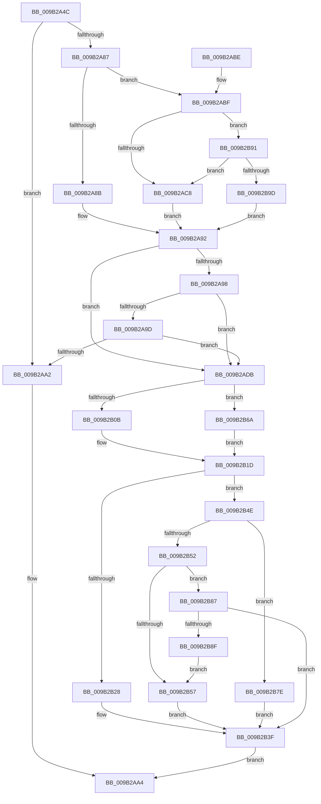

# CmpDoFileSetSizeEx

- RVA: `0x009B2A4C`–`0x009B2BA4` (길이 `344` bytes)
- VA: `0x00000001409B2A4C`
- 실행 섹션: `PAGE`
- PDB 이름 있음: `예`; PDB Function 태그: `아니요`
- unwind 정보 RVA: `0x0009E3EC`
- 디코드: `96`개 명령, `344/344` bytes 표시
- 미해석 바이트: `0` (있으면 어셈블리에 `.byte`로 보존)

> 이 문서는 커널 이미지의 기계어와 PDB 기호를 분석해 생성했습니다. 4번과 5번은 함수 원형과 자료형을 바이너리 사용 방식에서 추정한 C 해석이며 원본 소스 복구 결과는 아닙니다.

## 1. Dependencies

- 직접 호출 지점: **6**; 고유 호출 대상: **4**
- 직접 호출자로 확인된 함수: **11**
- RIP 상대 이미지 참조: **3**

### Outgoing calls
- `0x009B2ACA` → [HvpLogTypeToLogArrayIndex](HvpLogTypeToLogArrayIndex_function_009B2DFC.md) (function, `0x009B2DFC`)
- `0x009B2AE6` → [CmpAdjustRequestedFileSize](CmpAdjustRequestedFileSize_function_009B14C0.md) (function, `0x009B14C0`)
- `0x009B2AF0` → [IoSetThreadHardErrorMode](../../text/46/IoSetThreadHardErrorMode_function_00466BF0.md) (function, `0x00466BF0`)
- `0x009B2B1D` → [ZwSetInformationFile](../../text/6A/ZwSetInformationFile_function_006AD5B0.md) (function, `0x006AD5B0`)
- `0x009B2B42` → [IoSetThreadHardErrorMode](../../text/46/IoSetThreadHardErrorMode_function_00466BF0.md) (function, `0x00466BF0`)
- `0x009B2B59` → [HvpLogTypeToLogArrayIndex](HvpLogTypeToLogArrayIndex_function_009B2DFC.md) (function, `0x009B2DFC`)

### Direct callers
- [CmShutdownSystem2](../../text/66/CmShutdownSystem2_function_0066A7FC.md) at `0x0066A8D1`
- [CmpLoadHiveThread](../7D/CmpLoadHiveThread_function_007DB040.md) at `0x007DB7E1`
- [CmpMountPreloadedHives](../7D/CmpMountPreloadedHives_function_007DBE18.md) at `0x007DC267`
- [HvTruncateCurrentLogFileIfRequired](HvTruncateCurrentLogFileIfRequired_function_009B2728.md) at `0x009B279B`
- [HvWriteLogFile](HvWriteLogFile_function_009B28E4.md) at `0x009B2979`
- [CmpCompleteUnloadKey](CmpCompleteUnloadKey_function_009B32FC.md) at `0x009B3535`
- [HvTruncateAllLogFilesIfRequired](HvTruncateAllLogFilesIfRequired_function_009B6E1C.md) at `0x009B6E82`
- [HvpPerformLogFileRecovery](HvpPerformLogFileRecovery_function_009B7994.md) at `0x009B7A19`
- [HvWriteExternal](../A8/HvWriteExternal_function_00A83C20.md) at `0x00A83C7E`
- [HvpAddBin](../AF/HvpAddBin_function_00AF7D48.md) at `0x00AF7F07`
- [sub_00B2DE30](../B2/Unknown_function_00B2DE30.md) at `0x00B2DE39`

### Static image references
- `0x009B2B28` → RVA `0x00FD9EE0` (`PAGEDATA`; write)
- `0x009B2B32` → RVA `0x00FD9EE8` (`PAGEDATA`; write)
- `0x009B2B39` → RVA `0x00FD9EF0` (`PAGEDATA`; write)

## 2. Other-region calls and transfers

- 다른 실행 섹션으로 향하는 call: **3**
  - `0x009B2AF0` → [IoSetThreadHardErrorMode](../../text/46/IoSetThreadHardErrorMode_function_00466BF0.md) (`PAGE` → `.text`)
  - `0x009B2B1D` → [ZwSetInformationFile](../../text/6A/ZwSetInformationFile_function_006AD5B0.md) (`PAGE` → `.text`)
  - `0x009B2B42` → [IoSetThreadHardErrorMode](../../text/46/IoSetThreadHardErrorMode_function_00466BF0.md) (`PAGE` → `.text`)
- 별도 외부 분기/꼬리 이동을 확인하지 못했습니다.

## 3. Assembly (complete function range)

```asm
009B2A4C  48 8B C4                        mov rax, rsp
009B2A4F  48 89 58 10                     mov qword ptr [rax + 0x10], rbx
009B2A53  48 89 68 18                     mov qword ptr [rax + 0x18], rbp
009B2A57  48 89 70 20                     mov qword ptr [rax + 0x20], rsi
009B2A5B  57                              push rdi
009B2A5C  41 56                           push r14
009B2A5E  41 57                           push r15
009B2A60  48 83 EC 50                     sub rsp, 0x50
009B2A64  48 83 60 C8 00                  and qword ptr [rax - 0x38], 0
009B2A69  0F 57 C0                        xorps xmm0, xmm0
009B2A6C  48 83 60 08 00                  and qword ptr [rax + 8], 0
009B2A71  48 8B F1                        mov rsi, rcx
009B2A74  8B DA                           mov ebx, edx
009B2A76  0F 11 40 D0                     movups xmmword ptr [rax - 0x30], xmm0
009B2A7A  4C 8B B4 D9 08 06 00 00         mov r14, qword ptr [rcx + rbx*8 + 0x608]
009B2A82  4D 85 F6                        test r14, r14
009B2A85  74 1B                           je 0x1409b2aa2
009B2A87  85 D2                           test edx, edx
009B2A89  75 34                           jne 0x1409b2abf
009B2A8B  48 8B B9 08 07 00 00            mov rdi, qword ptr [rcx + 0x708]
009B2A92  41 F6 C1 01                     test r9b, 1
009B2A96  74 43                           je 0x1409b2adb
009B2A98  48 85 FF                        test rdi, rdi
009B2A9B  74 3E                           je 0x1409b2adb
009B2A9D  4C 3B C7                        cmp r8, rdi
009B2AA0  77 39                           ja 0x1409b2adb
009B2AA2  33 C0                           xor eax, eax
009B2AA4  4C 8D 5C 24 50                  lea r11, [rsp + 0x50]
009B2AA9  49 8B 5B 28                     mov rbx, qword ptr [r11 + 0x28]
009B2AAD  49 8B 6B 30                     mov rbp, qword ptr [r11 + 0x30]
009B2AB1  49 8B 73 38                     mov rsi, qword ptr [r11 + 0x38]
009B2AB5  49 8B E3                        mov rsp, r11
009B2AB8  41 5F                           pop r15
009B2ABA  41 5E                           pop r14
009B2ABC  5F                              pop rdi
009B2ABD  C3                              ret
009B2ABE  CC                              int3
009B2ABF  83 FB 01                        cmp ebx, 1
009B2AC2  0F 85 C9 00 00 00               jne 0x1409b2b91
009B2AC8  8B CB                           mov ecx, ebx
009B2ACA  E8 2D 03 00 00                  call 0x1409b2dfc
009B2ACF  8B C8                           mov ecx, eax
009B2AD1  48 8B BC CE 10 07 00 00         mov rdi, qword ptr [rsi + rcx*8 + 0x710]
009B2AD9  EB B7                           jmp 0x1409b2a92
009B2ADB  4D 8B C8                        mov r9, r8
009B2ADE  8B D3                           mov edx, ebx
009B2AE0  4C 8B C7                        mov r8, rdi
009B2AE3  48 8B CE                        mov rcx, rsi
009B2AE6  E8 D5 E9 FF FF                  call 0x1409b14c0
009B2AEB  33 C9                           xor ecx, ecx
009B2AED  48 8B E8                        mov rbp, rax
009B2AF0  E8 FB 40 AB FF                  call 0x140466bf0
009B2AF5  48 8D 54 24 38                  lea rdx, [rsp + 0x38]
009B2AFA  44 8A F8                        mov r15b, al
009B2AFD  41 B9 08 00 00 00               mov r9d, 8
009B2B03  49 8B CE                        mov rcx, r14
009B2B06  48 3B EF                        cmp rbp, rdi
009B2B09  72 5F                           jb 0x1409b2b6a
009B2B0B  48 89 6C 24 30                  mov qword ptr [rsp + 0x30], rbp
009B2B10  4C 8D 44 24 30                  lea r8, [rsp + 0x30]
009B2B15  C7 44 24 20 14 00 00 00         mov dword ptr [rsp + 0x20], 0x14
009B2B1D  E8 8E AA CF FF                  call 0x1406ad5b0
009B2B22  8B F8                           mov edi, eax
009B2B24  85 C0                           test eax, eax
009B2B26  79 26                           jns 0x1409b2b4e
009B2B28  C7 05 AE 73 62 00 03 00 00 00   mov dword ptr [rip + 0x6273ae], 3
009B2B32  4C 89 35 AF 73 62 00            mov qword ptr [rip + 0x6273af], r14
009B2B39  89 05 B1 73 62 00               mov dword ptr [rip + 0x6273b1], eax
009B2B3F  41 8A CF                        mov cl, r15b
009B2B42  E8 A9 40 AB FF                  call 0x140466bf0
009B2B47  8B C7                           mov eax, edi
009B2B49  E9 56 FF FF FF                  jmp 0x1409b2aa4
009B2B4E  85 DB                           test ebx, ebx
009B2B50  74 2C                           je 0x1409b2b7e
009B2B52  83 FB 01                        cmp ebx, 1
009B2B55  75 30                           jne 0x1409b2b87
009B2B57  8B CB                           mov ecx, ebx
009B2B59  E8 9E 02 00 00                  call 0x1409b2dfc
009B2B5E  8B C8                           mov ecx, eax
009B2B60  48 89 AC CE 10 07 00 00         mov qword ptr [rsi + rcx*8 + 0x710], rbp
009B2B68  EB D5                           jmp 0x1409b2b3f
009B2B6A  48 89 6C 24 70                  mov qword ptr [rsp + 0x70], rbp
009B2B6F  4C 8D 44 24 70                  lea r8, [rsp + 0x70]
009B2B74  C7 44 24 20 13 00 00 00         mov dword ptr [rsp + 0x20], 0x13
009B2B7C  EB 9F                           jmp 0x1409b2b1d
009B2B7E  48 89 AE 08 07 00 00            mov qword ptr [rsi + 0x708], rbp
009B2B85  EB B8                           jmp 0x1409b2b3f
009B2B87  8D 43 FC                        lea eax, [rbx - 4]
009B2B8A  83 F8 01                        cmp eax, 1
009B2B8D  77 B0                           ja 0x1409b2b3f
009B2B8F  EB C6                           jmp 0x1409b2b57
009B2B91  8D 43 FC                        lea eax, [rbx - 4]
009B2B94  83 F8 01                        cmp eax, 1
009B2B97  0F 86 2B FF FF FF               jbe 0x1409b2ac8
009B2B9D  33 FF                           xor edi, edi
009B2B9F  E9 EE FE FF FF                  jmp 0x1409b2a92
```

## 4. C-style interpretation (structured pseudocode)

```c
__int64 __fastcall CmpDoFileSetSizeEx(__int64 a1, int a2, __int64 a3, unsigned __int8 a4)
{
    __int64 result;
    __int64 v_rdi;
    __int64 v_rsp;
    unsigned __int64 v_stack_m18;
    unsigned __int64 v_stack_m20;
    unsigned int v_stack_m30;
    unsigned __int64 v_stack_p20;

    *(unsigned __int64 *)(v_rsp + 16) = v_rbx;
    *(unsigned __int64 *)(v_rsp + 24) = v_rbp;
    *(unsigned __int64 *)(v_rsp + 32) = v_rsi;
    v_rsp = (v_rsp) - (80);
    *(unsigned __int64 *)(v_rsp - 48) = v_xmm0;
    if (*(unsigned __int64 *)(a1 + (unsigned int)(a2) * 8 + 1544) == 0) goto loc_009B2AA2;
    if (a2 != 0) goto loc_009B2ABF;
loc_009B2A92:
    if (((a4) & (1)) == 0) goto loc_009B2ADB;
    if (*(unsigned __int64 *)(a1 + 1800) == 0) goto loc_009B2ADB;
    if (a3 > (*(unsigned __int64 *)(a1 + 1800))) goto loc_009B2ADB;
loc_009B2AA2:
    result = 0;
loc_009B2AA4:
    return result;
loc_009B2ABF:
    if (((unsigned int)(*(unsigned __int64 *)(v_stack_m18 + 40))) != 1) goto loc_009B2B91;
loc_009B2AC8:
    result = HvpLogTypeToLogArrayIndex((unsigned int)((unsigned int)(*(unsigned __int64 *)(v_stack_m18 + 40))), a2, a3, a4);
    goto loc_009B2A92;
loc_009B2ADB:
    result = CmpAdjustRequestedFileSize(*(unsigned __int64 *)(v_stack_m18 + 56), (unsigned int)((unsigned int)(*(unsigned __int64 *)(v_stack_m18 + 40))), *(unsigned __int64 *)(*(unsigned __int64 *)(v_stack_m18 + 56) + (unsigned int)((unsigned int)(result)) * 8 + 1808), a3);
    a1 = 0;
    result = IoSetThreadHardErrorMode(a1, (unsigned int)((unsigned int)(*(unsigned __int64 *)(v_stack_m18 + 40))), *(unsigned __int64 *)(*(unsigned __int64 *)(v_stack_m18 + 56) + (unsigned int)((unsigned int)(result)) * 8 + 1808), a3);
    if (result < (*(unsigned __int64 *)(*(unsigned __int64 *)(v_stack_m18 + 56) + (unsigned int)((unsigned int)(result)) * 8 + 1808))) goto loc_009B2B6A;
    v_stack_m20 = result;
    v_stack_m30 = 20;
loc_009B2B1D:
    result = ZwSetInformationFile(*(unsigned __int64 *)(a1 + (unsigned int)(a2) * 8 + 1544), v_stack_m18, v_stack_m20, 8);
    if (!sign_flag) goto loc_009B2B4E;
    *(unsigned int *)(v_rip + 6452142) = 3;
    *(unsigned __int64 *)(v_rip + 6452143) = *(unsigned __int64 *)(a1 + (unsigned int)(a2) * 8 + 1544);
    *(unsigned int *)(v_rip + 6452145) = (unsigned int)(result);
loc_009B2B3F:
    result = IoSetThreadHardErrorMode((unsigned __int8)((unsigned __int8)(result)), v_stack_m18, v_stack_m20, 8);
    goto loc_009B2AA4;
loc_009B2B4E:
    if ((unsigned int)(*(unsigned __int64 *)(v_stack_m18 + 40)) == 0) goto loc_009B2B7E;
    if (((unsigned int)(*(unsigned __int64 *)(v_stack_m18 + 40))) != 1) goto loc_009B2B87;
loc_009B2B57:
    result = HvpLogTypeToLogArrayIndex((unsigned int)((unsigned int)(*(unsigned __int64 *)(v_stack_m18 + 40))), v_stack_m18, v_stack_m20, 8);
    *(unsigned __int64 *)(*(unsigned __int64 *)(v_stack_m18 + 56) + (unsigned int)((unsigned int)(result)) * 8 + 1808) = result;
    goto loc_009B2B3F;
loc_009B2B6A:
    v_stack_p20 = result;
    v_stack_m30 = 19;
    goto loc_009B2B1D;
loc_009B2B7E:
    *(unsigned __int64 *)(*(unsigned __int64 *)(v_stack_m18 + 56) + 1800) = result;
    goto loc_009B2B3F;
loc_009B2B87:
    if (((unsigned int)(*(unsigned __int64 *)(v_stack_m18 + 40) - 4)) > 1) goto loc_009B2B3F;
    goto loc_009B2B57;
loc_009B2B91:
    if (((unsigned int)(*(unsigned __int64 *)(v_stack_m18 + 40) - 4)) <= 1) goto loc_009B2AC8;
    v_rdi = 0;
    goto loc_009B2A92;
}
```

## 5. (Beta) C Style

```c
int64_t CmpDoFileSetSizeEx(void *Arg1, int32_t Arg2, int64_t Arg3, uint8_t Arg4)
{
    uint8_t *arg1 = (uint8_t *)Arg1;

    int64_t result;
    int64_t local_rdi;
    int64_t local_rsp;
    uint64_t v_stack_m18;
    uint64_t v_stack_m20;
    uint32_t v_stack_m30;
    uint64_t v_stack_p20;

    *(uint64_t *)(local_rsp + 0x10) = local_rbx;
    *(uint64_t *)(local_rsp + 0x18) = local_rbp;
    *(uint64_t *)(local_rsp + 0x20) = local_rsi;
    local_rsp = (local_rsp) - (80);
    *(uint64_t *)(local_rsp - 0x30) = v_xmm0;
    if (*(uint64_t *)(arg1 + (uint32_t)(Arg2) * 8 + 0x608) == 0) goto loc_009B2AA2;
    if (Arg2 != 0) goto loc_009B2ABF;
loc_009B2A92:
    if (((Arg4) & (1)) == 0) goto loc_009B2ADB;
    if (*(uint64_t *)(arg1 + 0x708) == 0) goto loc_009B2ADB;
    if (Arg3 > (*(uint64_t *)(arg1 + 0x708))) goto loc_009B2ADB;
loc_009B2AA2:
    result = 0;
loc_009B2AA4:
    return result;
loc_009B2ABF:
    if (((uint32_t)(*(uint64_t *)(v_stack_m18 + 0x28))) != 1) goto loc_009B2B91;
loc_009B2AC8:
    result = HvpLogTypeToLogArrayIndex((uint32_t)((uint32_t)(*(uint64_t *)(v_stack_m18 + 0x28))), Arg2, Arg3, Arg4);
    goto loc_009B2A92;
loc_009B2ADB:
    result = CmpAdjustRequestedFileSize(*(uint64_t *)(v_stack_m18 + 0x38), (uint32_t)((uint32_t)(*(uint64_t *)(v_stack_m18 + 0x28))), *(uint64_t *)(*(uint64_t *)(v_stack_m18 + 0x38) + (uint32_t)((uint32_t)(result)) * 8 + 0x710), Arg3);
    Arg1 = 0;
    result = IoSetThreadHardErrorMode(Arg1, (uint32_t)((uint32_t)(*(uint64_t *)(v_stack_m18 + 0x28))), *(uint64_t *)(*(uint64_t *)(v_stack_m18 + 0x38) + (uint32_t)((uint32_t)(result)) * 8 + 0x710), Arg3);
    if (result < (*(uint64_t *)(*(uint64_t *)(v_stack_m18 + 0x38) + (uint32_t)((uint32_t)(result)) * 8 + 0x710))) goto loc_009B2B6A;
    v_stack_m20 = result;
    v_stack_m30 = 20;
loc_009B2B1D:
    result = ZwSetInformationFile(*(uint64_t *)(arg1 + (uint32_t)(Arg2) * 8 + 0x608), v_stack_m18, v_stack_m20, 8);
    if (!sign_flag) goto loc_009B2B4E;
    *(uint32_t *)(v_rip + 0x6273AE) = 3;
    *(uint64_t *)(v_rip + 0x6273AF) = *(uint64_t *)(arg1 + (uint32_t)(Arg2) * 8 + 0x608);
    *(uint32_t *)(v_rip + 0x6273B1) = (uint32_t)(result);
loc_009B2B3F:
    result = IoSetThreadHardErrorMode((uint8_t)((uint8_t)(result)), v_stack_m18, v_stack_m20, 8);
    goto loc_009B2AA4;
loc_009B2B4E:
    if ((uint32_t)(*(uint64_t *)(v_stack_m18 + 0x28)) == 0) goto loc_009B2B7E;
    if (((uint32_t)(*(uint64_t *)(v_stack_m18 + 0x28))) != 1) goto loc_009B2B87;
loc_009B2B57:
    result = HvpLogTypeToLogArrayIndex((uint32_t)((uint32_t)(*(uint64_t *)(v_stack_m18 + 0x28))), v_stack_m18, v_stack_m20, 8);
    *(uint64_t *)(*(uint64_t *)(v_stack_m18 + 0x38) + (uint32_t)((uint32_t)(result)) * 8 + 0x710) = result;
    goto loc_009B2B3F;
loc_009B2B6A:
    v_stack_p20 = result;
    v_stack_m30 = 19;
    goto loc_009B2B1D;
loc_009B2B7E:
    *(uint64_t *)(*(uint64_t *)(v_stack_m18 + 0x38) + 0x708) = result;
    goto loc_009B2B3F;
loc_009B2B87:
    if (((uint32_t)(*(uint64_t *)(v_stack_m18 + 0x28) - 4)) > 1) goto loc_009B2B3F;
    goto loc_009B2B57;
loc_009B2B91:
    if (((uint32_t)(*(uint64_t *)(v_stack_m18 + 0x28) - 4)) <= 1) goto loc_009B2AC8;
    local_rdi = 0;
    goto loc_009B2A92;
}
```

### 관측된 메모리 오프셋

구조체 형식이 확인되지 않은 접근은 인자 기준의 오프셋으로만 기록했습니다.

| 기준 인자 | 오프셋 표현 | 폭 (bit) | 접근 |
|---|---:|---:|---|
| `Arg1` | `+ 0x608 + rbx*8` | `64` | `R` |
| `Arg1` | `+ 0x708` | `64` | `R` |
| `Arg1` | `+ 0x708` | `64` | `W` |
| `Arg1` | `+ 0x710 + rcx*8` | `64` | `R` |
| `Arg1` | `+ 0x710 + rcx*8` | `64` | `W` |

## 6. Execution-region graph

[열기: 2D/3D 그래프와 함수 탐색 컨트롤 패널](../../../control-panel.html?section=page&rva=0x009B2A4C&view=graph)

- 2D 그래프는 위에서 아래로 흐르고, 3D 그래프는 빈 공간을 드래그해 회전합니다. Shift+드래그는 이동, 휠은 확대·축소, 함수 노드 선택은 대상 보고서 이동입니다.

### Static fallback


