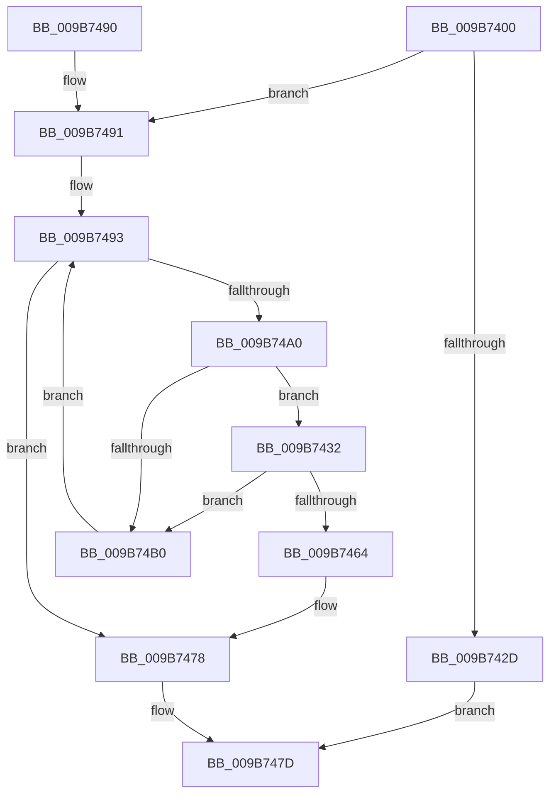

# CmpDoLocalizeNextHive

- RVA: `0x009B7400`–`0x009B74BA` (길이 `186` bytes)
- VA: `0x00000001409B7400`
- 실행 섹션: `PAGE`
- PDB 이름 있음: `예`; PDB Function 태그: `아니요`
- unwind 정보 RVA: `0x000704BC`
- 디코드: `51`개 명령, `186/186` bytes 표시
- 미해석 바이트: `0` (있으면 어셈블리에 `.byte`로 보존)

> 이 문서는 커널 이미지의 기계어와 PDB 기호를 분석해 생성했습니다. 4번과 5번은 함수 원형과 자료형을 바이너리 사용 방식에서 추정한 C 해석이며 원본 소스 복구 결과는 아닙니다.

## 1. Dependencies

- 직접 호출 지점: **12**; 고유 호출 대상: **11**
- 직접 호출자로 확인된 함수: **0**
- RIP 상대 이미지 참조: **1**

### Outgoing calls
- `0x009B7424` → [CmpAcquireShutdownRundown](../../pagecmrc/BC/CmpAcquireShutdownRundown_function_00BC9400.md) (function, `0x00BC9400`)
- `0x009B7435` → [HvLockHiveFlusherShared](../84/HvLockHiveFlusherShared_function_0084F95C.md) (function, `0x0084F95C`)
- `0x009B743D` → [HvLockHiveWriter](../85/HvLockHiveWriter_function_00859894.md) (function, `0x00859894`)
- `0x009B7449` → [HvpViewMapConvertLockedPagesToCOWByPolicy](HvpViewMapConvertLockedPagesToCOWByPolicy_function_009B74C0.md) (function, `0x009B74C0`)
- `0x009B7453` → [HvUnlockHiveWriter](../85/HvUnlockHiveWriter_function_008598E4.md) (function, `0x008598E4`)
- `0x009B745B` → [HvUnlockHiveFlusherShared](../84/HvUnlockHiveFlusherShared_function_00848738.md) (function, `0x00848738`)
- `0x009B7464` → [CmpUnlockRegistry](../../pagecmrc/BC/CmpUnlockRegistry_function_00BC9A84.md) (function, `0x00BC9A84`)
- `0x009B7470` → [ExReleaseRundownProtection](../../text/34/ExReleaseRundownProtection_function_00349E80.md) (function, `0x00349E80`)
- `0x009B7478` → [CmpReleaseShutdownRundown](../../pagecmrc/BC/CmpReleaseShutdownRundown_function_00BC9880.md) (function, `0x00BC9880`)
- `0x009B7493` → [CmpGetNextActiveHive](../84/CmpGetNextActiveHive_function_0084E2A0.md) (function, `0x0084E2A0`)
- `0x009B74A0` → [CmpLockRegistry](../../pagecmrc/BC/CmpLockRegistry_function_00BC9B34.md) (function, `0x00BC9B34`)
- `0x009B74B0` → [CmpUnlockRegistry](../../pagecmrc/BC/CmpUnlockRegistry_function_00BC9A84.md) (function, `0x00BC9A84`)

### Direct callers
- 이 함수 시작 RVA로 연결되는 직접 call은 확인되지 않았습니다. 간접 호출은 완전히 역산할 수 없습니다.

### Static image references
- `0x009B740F` → RVA `0x00E03944` (`.data`; read)

## 2. Other-region calls and transfers

- 다른 실행 섹션으로 향하는 call: **6**
  - `0x009B7424` → [CmpAcquireShutdownRundown](../../pagecmrc/BC/CmpAcquireShutdownRundown_function_00BC9400.md) (`PAGE` → `PAGECMRC`)
  - `0x009B7464` → [CmpUnlockRegistry](../../pagecmrc/BC/CmpUnlockRegistry_function_00BC9A84.md) (`PAGE` → `PAGECMRC`)
  - `0x009B7470` → [ExReleaseRundownProtection](../../text/34/ExReleaseRundownProtection_function_00349E80.md) (`PAGE` → `.text`)
  - `0x009B7478` → [CmpReleaseShutdownRundown](../../pagecmrc/BC/CmpReleaseShutdownRundown_function_00BC9880.md) (`PAGE` → `PAGECMRC`)
  - `0x009B74A0` → [CmpLockRegistry](../../pagecmrc/BC/CmpLockRegistry_function_00BC9B34.md) (`PAGE` → `PAGECMRC`)
  - `0x009B74B0` → [CmpUnlockRegistry](../../pagecmrc/BC/CmpUnlockRegistry_function_00BC9A84.md) (`PAGE` → `PAGECMRC`)
- 별도 외부 분기/꼬리 이동을 확인하지 못했습니다.

## 3. Assembly (complete function range)

```asm
009B7400  48 89 5C 24 08                  mov qword ptr [rsp + 8], rbx
009B7405  48 89 74 24 10                  mov qword ptr [rsp + 0x10], rsi
009B740A  57                              push rdi
009B740B  48 83 EC 20                     sub rsp, 0x20
009B740F  8B 05 2F C5 44 00               mov eax, dword ptr [rip + 0x44c52f]
009B7415  33 F6                           xor esi, esi
009B7417  4C 69 C0 80 96 98 00            imul r8, rax, 0x989680
009B741E  4C 89 02                        mov qword ptr [rdx], r8
009B7421  40 88 31                        mov byte ptr [rcx], sil
009B7424  E8 D7 1F 21 00                  call 0x140bc9400
009B7429  84 C0                           test al, al
009B742B  75 64                           jne 0x1409b7491
009B742D  40 B6 01                        mov sil, 1
009B7430  EB 4B                           jmp 0x1409b747d
009B7432  48 8B CF                        mov rcx, rdi
009B7435  E8 22 85 E9 FF                  call 0x14084f95c
009B743A  48 8B CF                        mov rcx, rdi
009B743D  E8 52 24 EA FF                  call 0x140859894
009B7442  48 8D 8F E0 00 00 00            lea rcx, [rdi + 0xe0]
009B7449  E8 72 00 00 00                  call 0x1409b74c0
009B744E  48 8B CF                        mov rcx, rdi
009B7451  8B D8                           mov ebx, eax
009B7453  E8 8C 24 EA FF                  call 0x1408598e4
009B7458  48 8B CF                        mov rcx, rdi
009B745B  E8 D8 12 E9 FF                  call 0x140848738
009B7460  85 DB                           test ebx, ebx
009B7462  79 4C                           jns 0x1409b74b0
009B7464  E8 1B 26 21 00                  call 0x140bc9a84
009B7469  48 8D 8F 68 06 00 00            lea rcx, [rdi + 0x668]
009B7470  E8 0B 2A 99 FF                  call 0x140349e80
009B7475  40 B6 01                        mov sil, 1
009B7478  E8 03 24 21 00                  call 0x140bc9880
009B747D  48 8B 5C 24 30                  mov rbx, qword ptr [rsp + 0x30]
009B7482  40 8A C6                        mov al, sil
009B7485  48 8B 74 24 38                  mov rsi, qword ptr [rsp + 0x38]
009B748A  48 83 C4 20                     add rsp, 0x20
009B748E  5F                              pop rdi
009B748F  C3                              ret
009B7490  CC                              int3
009B7491  33 C9                           xor ecx, ecx
009B7493  E8 08 6E E9 FF                  call 0x14084e2a0
009B7498  48 8B F8                        mov rdi, rax
009B749B  48 85 C0                        test rax, rax
009B749E  74 D8                           je 0x1409b7478
009B74A0  E8 8F 26 21 00                  call 0x140bc9b34
009B74A5  8B 97 00 01 00 00               mov edx, dword ptr [rdi + 0x100]
009B74AB  F6 C2 04                        test dl, 4
009B74AE  75 82                           jne 0x1409b7432
009B74B0  E8 CF 25 21 00                  call 0x140bc9a84
009B74B5  48 8B CF                        mov rcx, rdi
009B74B8  EB D9                           jmp 0x1409b7493
```

## 4. C-style interpretation (structured pseudocode)

```c
__int64 __fastcall CmpDoLocalizeNextHive(__int64 a1, __int64 a2)
{
    __int64 result;
    __int64 v_rsi;
    __int64 v_rsp;
    unsigned __int64 v_stack_p10;
    unsigned __int64 v_stack_p8;

    v_stack_p8 = v_rbx;
    v_stack_p10 = v_rsi;
    v_rsp = (v_rsp) - (32);
    v_rsi = 0;
    a3 = (a3) * ((unsigned int)(*(unsigned int *)(v_rip + 4506927)));
    *(unsigned __int64 *)(a2) = a3;
    *(unsigned __int8 *)(a1) = 0;
    result = CmpAcquireShutdownRundown(a1, a2, a3, a4);
    if ((unsigned __int8)(result) != 0) goto loc_009B7491;
    goto loc_009B747D;
loc_009B7432:
    result = HvLockHiveFlusherShared(v_rdi, a2, a3, a4);
    result = HvLockHiveWriter(v_rdi, a2, a3, a4);
    result = HvpViewMapConvertLockedPagesToCOWByPolicy(v_rdi + 224, a2, a3, a4);
    result = HvUnlockHiveWriter(v_rdi, a2, a3, a4);
    result = HvUnlockHiveFlusherShared(v_rdi, a2, a3, a4);
    if (!sign_flag) goto loc_009B74B0;
    result = CmpUnlockRegistry(v_rdi, a2, a3, a4);
    result = ExReleaseRundownProtection(v_rdi + 1640, a2, a3, a4);
loc_009B7478:
    result = CmpReleaseShutdownRundown(v_rdi + 1640, a2, a3, a4);
loc_009B747D:
    v_rsp = (v_rsp) + (32);
    return 1;
loc_009B7491:
    a1 = 0;
loc_009B7493:
    result = CmpGetNextActiveHive(a1, a2, a3, a4);
    if (result == 0) goto loc_009B7478;
    result = CmpLockRegistry(a1, a2, a3, a4);
    if ((((unsigned __int8)((unsigned int)(*(unsigned int *)(result + 256)))) & (4)) != 0) goto loc_009B7432;
loc_009B74B0:
    result = CmpUnlockRegistry(a1, (unsigned int)(*(unsigned int *)(result + 256)), a3, a4);
    goto loc_009B7493;
}
```

## 5. (Beta) C Style

```c
int64_t CmpDoLocalizeNextHive(void *Arg1, void *Arg2)
{
    uint8_t *arg1 = (uint8_t *)Arg1;
    uint8_t *arg2 = (uint8_t *)Arg2;

    int64_t result;
    int64_t local_rsi;
    int64_t local_rsp;
    uint64_t v_stack_p10;
    uint64_t v_stack_p8;

    v_stack_p8 = local_rbx;
    v_stack_p10 = local_rsi;
    local_rsp = (local_rsp) - (32);
    local_rsi = 0;
    a3 = (a3) * ((uint32_t)(*(uint32_t *)(v_rip + 0x44C52F)));
    *(uint64_t *)(arg2) = a3;
    *(uint8_t *)(arg1) = 0;
    result = CmpAcquireShutdownRundown(Arg1, Arg2, a3, a4);
    if ((uint8_t)(result) != 0) goto loc_009B7491;
    goto loc_009B747D;
loc_009B7432:
    result = HvLockHiveFlusherShared(local_rdi, Arg2, a3, a4);
    result = HvLockHiveWriter(local_rdi, Arg2, a3, a4);
    result = HvpViewMapConvertLockedPagesToCOWByPolicy(local_rdi + 224, Arg2, a3, a4);
    result = HvUnlockHiveWriter(local_rdi, Arg2, a3, a4);
    result = HvUnlockHiveFlusherShared(local_rdi, Arg2, a3, a4);
    if (!sign_flag) goto loc_009B74B0;
    result = CmpUnlockRegistry(local_rdi, Arg2, a3, a4);
    result = ExReleaseRundownProtection(local_rdi + 1640, Arg2, a3, a4);
loc_009B7478:
    result = CmpReleaseShutdownRundown(local_rdi + 1640, Arg2, a3, a4);
loc_009B747D:
    local_rsp = (local_rsp) + (32);
    return 1;
loc_009B7491:
    Arg1 = 0;
loc_009B7493:
    result = CmpGetNextActiveHive(Arg1, Arg2, a3, a4);
    if (result == 0) goto loc_009B7478;
    result = CmpLockRegistry(Arg1, Arg2, a3, a4);
    if ((((uint8_t)((uint32_t)(*(uint32_t *)(result + 0x100)))) & (4)) != 0) goto loc_009B7432;
loc_009B74B0:
    result = CmpUnlockRegistry(Arg1, (uint32_t)(*(uint32_t *)(result + 0x100)), a3, a4);
    goto loc_009B7493;
}
```

### 관측된 메모리 오프셋

구조체 형식이 확인되지 않은 접근은 인자 기준의 오프셋으로만 기록했습니다.

| 기준 인자 | 오프셋 표현 | 폭 (bit) | 접근 |
|---|---:|---:|---|
| `Arg1` | `+ 0x0` | `8` | `W` |
| `Arg2` | `+ 0x0` | `64` | `W` |

## 6. Execution-region graph

[열기: 2D/3D 그래프와 함수 탐색 컨트롤 패널](../../../control-panel.html?section=page&rva=0x009B7400&view=graph)

- 2D 그래프는 위에서 아래로 흐르고, 3D 그래프는 빈 공간을 드래그해 회전합니다. Shift+드래그는 이동, 휠은 확대·축소, 함수 노드 선택은 대상 보고서 이동입니다.

### Static fallback


