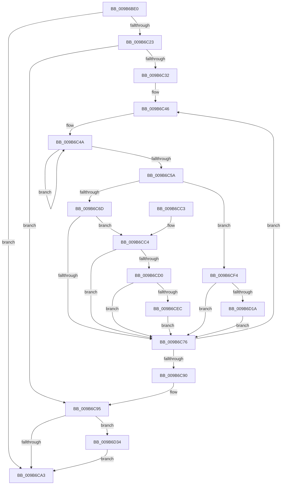

# CmpDoReconcileNextHive

- RVA: `0x009B6BE0`–`0x009B6D3C` (길이 `348` bytes)
- VA: `0x00000001409B6BE0`
- 실행 섹션: `PAGE`
- PDB 이름 있음: `예`; PDB Function 태그: `아니요`
- unwind 정보 RVA: `0x0009E7AC`
- 디코드: `90`개 명령, `348/348` bytes 표시
- 미해석 바이트: `0` (있으면 어셈블리에 `.byte`로 보존)

> 이 문서는 커널 이미지의 기계어와 PDB 기호를 분석해 생성했습니다. 4번과 5번은 함수 원형과 자료형을 바이너리 사용 방식에서 추정한 C 해석이며 원본 소스 복구 결과는 아닙니다.

## 1. Dependencies

- 직접 호출 지점: **6**; 고유 호출 대상: **5**
- 직접 호출자로 확인된 함수: **0**
- RIP 상대 이미지 참조: **4**

### Outgoing calls
- `0x009B6C25` → [CmpGetNextActiveHive](../84/CmpGetNextActiveHive_function_0084E2A0.md) (function, `0x0084E2A0`)
- `0x009B6C60` → [CmpIsHiveEligibleForLazyReconcile](CmpIsHiveEligibleForLazyReconcile_function_009B6D44.md) (function, `0x009B6D44`)
- `0x009B6C83` → [CmpGetNextActiveHive](../84/CmpGetNextActiveHive_function_0084E2A0.md) (function, `0x0084E2A0`)
- `0x009B6C95` → [CmpFlushUnsupportedOperationTelemetry](../AB/CmpFlushUnsupportedOperationTelemetry_function_00AB77B4.md) (function, `0x00AB77B4`)
- `0x009B6CF7` → [HvGetEffectiveLogSizeCapForHive](HvGetEffectiveLogSizeCapForHive_function_009B6408.md) (function, `0x009B6408`)
- `0x009B6D0D` → [CmpFlushHive](CmpFlushHive_function_009B3DC0.md) (function, `0x009B3DC0`)

### Direct callers
- 이 함수 시작 RVA로 연결되는 직접 call은 확인되지 않았습니다. 간접 호출은 완전히 역산할 수 없습니다.

### Static image references
- `0x009B6C00` → RVA `0x00E03884` (`.data`; read)
- `0x009B6C10` → RVA `0x00FD8001` (`PAGEDATA`; read)
- `0x009B6CD0` → RVA `0x00E03880` (`.data`; read)
- `0x009B6D1F` → RVA `0x00E0388C` (`.data`; read)

## 2. Other-region calls and transfers

- 다른 실행 섹션으로 향하는 call: **0**
- 별도 외부 분기/꼬리 이동을 확인하지 못했습니다.

## 3. Assembly (complete function range)

```asm
009B6BE0  48 8B C4                        mov rax, rsp
009B6BE3  48 89 58 08                     mov qword ptr [rax + 8], rbx
009B6BE7  48 89 68 18                     mov qword ptr [rax + 0x18], rbp
009B6BEB  48 89 70 20                     mov qword ptr [rax + 0x20], rsi
009B6BEF  48 89 50 10                     mov qword ptr [rax + 0x10], rdx
009B6BF3  57                              push rdi
009B6BF4  41 54                           push r12
009B6BF6  41 55                           push r13
009B6BF8  41 56                           push r14
009B6BFA  41 57                           push r15
009B6BFC  48 83 EC 20                     sub rsp, 0x20
009B6C00  8B 05 7E CC 44 00               mov eax, dword ptr [rip + 0x44cc7e]
009B6C06  45 32 F6                        xor r14b, r14b
009B6C09  48 69 F0 80 96 98 00            imul rsi, rax, 0x989680
009B6C10  44 38 35 EA 13 62 00            cmp byte ptr [rip + 0x6213ea], r14b
009B6C17  4C 8B FA                        mov r15, rdx
009B6C1A  4C 8B E1                        mov r12, rcx
009B6C1D  0F 85 80 00 00 00               jne 0x1409b6ca3
009B6C23  33 C9                           xor ecx, ecx
009B6C25  E8 76 76 E9 FF                  call 0x14084e2a0
009B6C2A  48 8B D8                        mov rbx, rax
009B6C2D  48 85 C0                        test rax, rax
009B6C30  74 63                           je 0x1409b6c95
009B6C32  49 BD B0 03 00 00 80 F7 FF FF   movabs r13, 0xfffff780000003b0
009B6C3C  49 BF 08 00 00 00 80 F7 FF FF   movabs r15, 0xfffff78000000008
009B6C46  48 83 CF FF                     or rdi, 0xffffffffffffffff
009B6C4A  49 8B 4D 00                     mov rcx, qword ptr [r13]
009B6C4E  49 8B 2F                        mov rbp, qword ptr [r15]
009B6C51  49 8B 45 00                     mov rax, qword ptr [r13]
009B6C55  48 3B C8                        cmp rcx, rax
009B6C58  75 F0                           jne 0x1409b6c4a
009B6C5A  48 2B E9                        sub rbp, rcx
009B6C5D  48 8B CB                        mov rcx, rbx
009B6C60  E8 DF 00 00 00                  call 0x1409b6d44
009B6C65  84 C0                           test al, al
009B6C67  0F 85 87 00 00 00               jne 0x1409b6cf4
009B6C6D  83 BB 80 00 00 00 00            cmp dword ptr [rbx + 0x80], 0
009B6C74  75 4E                           jne 0x1409b6cc4
009B6C76  48 3B FE                        cmp rdi, rsi
009B6C79  48 8B CB                        mov rcx, rbx
009B6C7C  48 0F 43 FE                     cmovae rdi, rsi
009B6C80  48 8B F7                        mov rsi, rdi
009B6C83  E8 18 76 E9 FF                  call 0x14084e2a0
009B6C88  48 8B D8                        mov rbx, rax
009B6C8B  48 85 C0                        test rax, rax
009B6C8E  75 B6                           jne 0x1409b6c46
009B6C90  4C 8B 7C 24 58                  mov r15, qword ptr [rsp + 0x58]
009B6C95  E8 1A 0B 10 00                  call 0x140ab77b4
009B6C9A  45 84 F6                        test r14b, r14b
009B6C9D  0F 85 91 00 00 00               jne 0x1409b6d34
009B6CA3  48 8B 5C 24 50                  mov rbx, qword ptr [rsp + 0x50]
009B6CA8  41 8A C6                        mov al, r14b
009B6CAB  48 8B 6C 24 60                  mov rbp, qword ptr [rsp + 0x60]
009B6CB0  48 8B 74 24 68                  mov rsi, qword ptr [rsp + 0x68]
009B6CB5  48 83 C4 20                     add rsp, 0x20
009B6CB9  41 5F                           pop r15
009B6CBB  41 5E                           pop r14
009B6CBD  41 5D                           pop r13
009B6CBF  41 5C                           pop r12
009B6CC1  5F                              pop rdi
009B6CC2  C3                              ret
009B6CC3  CC                              int3
009B6CC4  F7 83 A0 00 00 00 01 80 00 00   test dword ptr [rbx + 0xa0], 0x8001
009B6CCE  75 A6                           jne 0x1409b6c76
009B6CD0  8B 05 AA CB 44 00               mov eax, dword ptr [rip + 0x44cbaa]
009B6CD6  41 B6 01                        mov r14b, 1
009B6CD9  48 69 C8 80 96 98 00            imul rcx, rax, 0x989680
009B6CE0  48 03 8B 30 10 00 00            add rcx, qword ptr [rbx + 0x1030]
009B6CE7  48 3B E9                        cmp rbp, rcx
009B6CEA  73 8A                           jae 0x1409b6c76
009B6CEC  48 8B F9                        mov rdi, rcx
009B6CEF  48 2B FD                        sub rdi, rbp
009B6CF2  EB 82                           jmp 0x1409b6c76
009B6CF4  48 8B CB                        mov rcx, rbx
009B6CF7  E8 0C F7 FF FF                  call 0x1409b6408
009B6CFC  39 83 B4 00 00 00               cmp dword ptr [rbx + 0xb4], eax
009B6D02  48 8B CB                        mov rcx, rbx
009B6D05  1B D2                           sbb edx, edx
009B6D07  83 E2 10                        and edx, 0x10
009B6D0A  83 C2 06                        add edx, 6
009B6D0D  E8 AE D0 FF FF                  call 0x1409b3dc0
009B6D12  85 C0                           test eax, eax
009B6D14  0F 89 5C FF FF FF               jns 0x1409b6c76
009B6D1A  41 C6 04 24 01                  mov byte ptr [r12], 1
009B6D1F  8B 05 67 CB 44 00               mov eax, dword ptr [rip + 0x44cb67]
009B6D25  48 69 F8 80 96 98 00            imul rdi, rax, 0x989680
009B6D2C  48 03 FD                        add rdi, rbp
009B6D2F  E9 42 FF FF FF                  jmp 0x1409b6c76
009B6D34  49 89 37                        mov qword ptr [r15], rsi
009B6D37  E9 67 FF FF FF                  jmp 0x1409b6ca3
```

## 4. C-style interpretation (structured pseudocode)

```c
__int64 __fastcall CmpDoReconcileNextHive(__int64 a1, __int64 a2)
{
    __int64 result;
    __int64 v_r14;
    __int64 v_rbp;
    __int64 v_rdi;
    __int64 v_rsi;
    __int64 v_rsp;
    unsigned __int64 v_stack_p10;
    unsigned __int64 v_stack_p18;
    unsigned __int64 v_stack_p20;
    unsigned __int64 v_stack_p8;

    *(unsigned __int64 *)(v_rsp + 8) = v_rbx;
    *(unsigned __int64 *)(v_rsp + 24) = v_rbp;
    *(unsigned __int64 *)(v_rsp + 32) = v_rsi;
    *(unsigned __int64 *)(v_rsp + 16) = a2;
    v_rsp = (v_rsp) - (32);
    v_r14 = 0;
    v_rsi = (v_rsi) * ((unsigned int)(*(unsigned int *)(v_rip + 4508798)));
    if ((*(unsigned __int8 *)(v_rip + 6427626)) != 0) goto loc_009B6CA3;
    a1 = 0;
    result = CmpGetNextActiveHive(a1, a2, a3, a4);
    if (result == 0) goto loc_009B6C95;
loc_009B6C46:
    v_rdi = (v_rdi) | (-1);
loc_009B6C4A:
    if ((*(unsigned __int64 *)(v_r13)) != (*(unsigned __int64 *)(v_r13))) goto loc_009B6C4A;
    v_rbp = (*(unsigned __int64 *)(a2)) - (*(unsigned __int64 *)(v_r13));
    result = CmpIsHiveEligibleForLazyReconcile(result, a2, a3, a4);
    if ((unsigned __int8)(result) != 0) goto loc_009B6CF4;
    if ((*(unsigned int *)(result + 128)) != 0) goto loc_009B6CC4;
loc_009B6C76:
    if (v_rdi >= v_rsi) { v_rdi = v_rsi; }
    result = CmpGetNextActiveHive(result, a2, a3, a4);
    if (result != 0) goto loc_009B6C46;
loc_009B6C95:
    result = CmpFlushUnsupportedOperationTelemetry(result, a2, a3, a4);
    if (0 != 0) goto loc_009B6D34;
loc_009B6CA3:
    v_rsp = (v_rsp) + (32);
    return 0;
loc_009B6CC4:
    if (((*(unsigned int *)(v_stack_p8 + 160)) & (0x8001ULL)) != 0) goto loc_009B6C76;
    a1 = (result) * ((unsigned int)(*(unsigned int *)(v_rip + 4508586)));
    a1 = (a1) + (*(unsigned __int64 *)(v_stack_p8 + 4144));
    if (v_stack_p18 >= a1) goto loc_009B6C76;
    v_rdi = (a1) - (v_stack_p18);
    goto loc_009B6C76;
loc_009B6CF4:
    result = HvGetEffectiveLogSizeCapForHive(v_stack_p8, a2, a3, a4);
    a2 = (unsigned int)((a2) & (16));
    a2 = (unsigned int)((a2) + (6));
    result = CmpFlushHive(v_stack_p8, a2, a3, a4);
    if (!sign_flag) goto loc_009B6C76;
    *(unsigned __int8 *)(a1) = 1;
    v_rdi = (v_rdi) * ((unsigned int)(*(unsigned int *)(v_rip + 4508519)));
    v_rdi = (v_rdi) + (v_stack_p18);
    goto loc_009B6C76;
loc_009B6D34:
    *(unsigned __int64 *)(v_stack_p10) = v_stack_p20;
    goto loc_009B6CA3;
}
```

## 5. (Beta) C Style

```c
int64_t CmpDoReconcileNextHive(void *Arg1, int64_t Arg2)
{
    uint8_t *arg1 = (uint8_t *)Arg1;

    int64_t result;
    int64_t local_r14;
    int64_t local_rbp;
    int64_t local_rdi;
    int64_t local_rsi;
    int64_t local_rsp;
    uint64_t v_stack_p10;
    uint64_t v_stack_p18;
    uint64_t v_stack_p20;
    uint64_t v_stack_p8;

    *(uint64_t *)(local_rsp + 0x8) = local_rbx;
    *(uint64_t *)(local_rsp + 0x18) = local_rbp;
    *(uint64_t *)(local_rsp + 0x20) = local_rsi;
    *(uint64_t *)(local_rsp + 0x10) = Arg2;
    local_rsp = (local_rsp) - (32);
    local_r14 = 0;
    local_rsi = (local_rsi) * ((uint32_t)(*(uint32_t *)(v_rip + 0x44CC7E)));
    if ((*(uint8_t *)(v_rip + 0x6213EA)) != 0) goto loc_009B6CA3;
    Arg1 = 0;
    result = CmpGetNextActiveHive(Arg1, Arg2, a3, a4);
    if (result == 0) goto loc_009B6C95;
loc_009B6C46:
    local_rdi = (local_rdi) | (-1);
loc_009B6C4A:
    if ((*(uint64_t *)(local_r13)) != (*(uint64_t *)(local_r13))) goto loc_009B6C4A;
    local_rbp = (*(uint64_t *)(Arg2)) - (*(uint64_t *)(local_r13));
    result = CmpIsHiveEligibleForLazyReconcile(result, Arg2, a3, a4);
    if ((uint8_t)(result) != 0) goto loc_009B6CF4;
    if ((*(uint32_t *)(result + 0x80)) != 0) goto loc_009B6CC4;
loc_009B6C76:
    if (local_rdi >= local_rsi) { local_rdi = local_rsi; }
    result = CmpGetNextActiveHive(result, Arg2, a3, a4);
    if (result != 0) goto loc_009B6C46;
loc_009B6C95:
    result = CmpFlushUnsupportedOperationTelemetry(result, Arg2, a3, a4);
    if (0 != 0) goto loc_009B6D34;
loc_009B6CA3:
    local_rsp = (local_rsp) + (32);
    return 0;
loc_009B6CC4:
    if (((*(uint32_t *)(v_stack_p8 + 0xA0)) & (0x8001ULL)) != 0) goto loc_009B6C76;
    Arg1 = (result) * ((uint32_t)(*(uint32_t *)(v_rip + 0x44CBAA)));
    Arg1 = (Arg1) + (*(uint64_t *)(v_stack_p8 + 0x1030));
    if (v_stack_p18 >= Arg1) goto loc_009B6C76;
    local_rdi = (Arg1) - (v_stack_p18);
    goto loc_009B6C76;
loc_009B6CF4:
    result = HvGetEffectiveLogSizeCapForHive(v_stack_p8, Arg2, a3, a4);
    Arg2 = (uint32_t)((Arg2) & (16));
    Arg2 = (uint32_t)((Arg2) + (6));
    result = CmpFlushHive(v_stack_p8, Arg2, a3, a4);
    if (!sign_flag) goto loc_009B6C76;
    *(uint8_t *)(arg1) = 1;
    local_rdi = (local_rdi) * ((uint32_t)(*(uint32_t *)(v_rip + 0x44CB67)));
    local_rdi = (local_rdi) + (v_stack_p18);
    goto loc_009B6C76;
loc_009B6D34:
    *(uint64_t *)(v_stack_p10) = v_stack_p20;
    goto loc_009B6CA3;
}
```

### 관측된 메모리 오프셋

구조체 형식이 확인되지 않은 접근은 인자 기준의 오프셋으로만 기록했습니다.

| 기준 인자 | 오프셋 표현 | 폭 (bit) | 접근 |
|---|---:|---:|---|
| `Arg1` | `+ 0x0` | `8` | `W` |

## 6. Execution-region graph

[열기: 2D/3D 그래프와 함수 탐색 컨트롤 패널](../../../control-panel.html?section=page&rva=0x009B6BE0&view=graph)

- 2D 그래프는 위에서 아래로 흐르고, 3D 그래프는 빈 공간을 드래그해 회전합니다. Shift+드래그는 이동, 휠은 확대·축소, 함수 노드 선택은 대상 보고서 이동입니다.

### Static fallback


