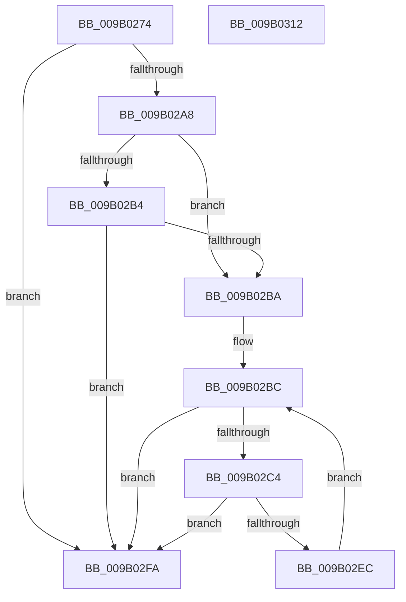

# CmpDoesKeyHaveOpenSubkeys

- RVA: `0x009B0274`–`0x009B0313` (길이 `159` bytes)
- VA: `0x00000001409B0274`
- 실행 섹션: `PAGE`
- PDB 이름 있음: `예`; PDB Function 태그: `아니요`
- unwind 정보 RVA: `0x000718AC`
- 디코드: `44`개 명령, `159/159` bytes 표시
- 미해석 바이트: `0` (있으면 어셈블리에 `.byte`로 보존)

> 이 문서는 커널 이미지의 기계어와 PDB 기호를 분석해 생성했습니다. 4번과 5번은 함수 원형과 자료형을 바이너리 사용 방식에서 추정한 C 해석이며 원본 소스 복구 결과는 아닙니다.

## 1. Dependencies

- 직접 호출 지점: **2**; 고유 호출 대상: **2**
- 직접 호출자로 확인된 함수: **3**
- RIP 상대 이미지 참조: **1**

### Outgoing calls
- `0x009B029A` → [CmpCleanUpKCBCacheTable](CmpCleanUpKCBCacheTable_function_009B0478.md) (function, `0x009B0478`)
- `0x009B02E2` → [CmpEnumerateKcbCacheBucket](CmpEnumerateKcbCacheBucket_function_009B03E4.md) (function, `0x009B03E4`)

### Direct callers
- [CmpTryToRundownHive](../../text/2A/CmpTryToRundownHive_function_002A4A60.md) at `0x002A4BDB`
- [CmRestoreKey](../7D/CmRestoreKey_function_007DCF04.md) at `0x007DD55D`
- [CmpPerformUnloadKey](../9A/CmpPerformUnloadKey_function_009AFA28.md) at `0x009AFC1A`

### Static image references
- `0x009B02D4` → RVA `0x00AC3ED0` (`CmpDoesKeyHaveOpenSubkeysWorker`; read)

## 2. Other-region calls and transfers

- 다른 실행 섹션으로 향하는 call: **0**
- 별도 외부 분기/꼬리 이동을 확인하지 못했습니다.

## 3. Assembly (complete function range)

```asm
009B0274  48 8B C4                        mov rax, rsp
009B0277  48 89 58 08                     mov qword ptr [rax + 8], rbx
009B027B  48 89 70 10                     mov qword ptr [rax + 0x10], rsi
009B027F  57                              push rdi
009B0280  48 83 EC 40                     sub rsp, 0x40
009B0284  48 8B 71 20                     mov rsi, qword ptr [rcx + 0x20]
009B0288  48 8B F9                        mov rdi, rcx
009B028B  0F 57 C0                        xorps xmm0, xmm0
009B028E  48 89 48 D8                     mov qword ptr [rax - 0x28], rcx
009B0292  48 8B CE                        mov rcx, rsi
009B0295  F3 0F 7F 40 E0                  movdqu xmmword ptr [rax - 0x20], xmm0
009B029A  E8 D9 01 00 00                  call 0x1409b0478
009B029F  48 8B 0F                        mov rcx, qword ptr [rdi]
009B02A2  48 83 F9 01                     cmp rcx, 1
009B02A6  74 52                           je 0x1409b02fa
009B02A8  F7 87 B8 00 00 00 00 00 04 00   test dword ptr [rdi + 0xb8], 0x40000
009B02B2  74 06                           je 0x1409b02ba
009B02B4  48 83 F9 02                     cmp rcx, 2
009B02B8  74 40                           je 0x1409b02fa
009B02BA  33 DB                           xor ebx, ebx
009B02BC  3B 9E 78 06 00 00               cmp ebx, dword ptr [rsi + 0x678]
009B02C2  73 36                           jae 0x1409b02fa
009B02C4  48 8B 86 70 06 00 00            mov rax, qword ptr [rsi + 0x670]
009B02CB  48 8D 0C 5B                     lea rcx, [rbx + rbx*2]
009B02CF  4C 8D 4C 24 20                  lea r9, [rsp + 0x20]
009B02D4  4C 8D 05 F5 3B 11 00            lea r8, [rip + 0x113bf5]
009B02DB  48 8D 14 C8                     lea rdx, [rax + rcx*8]
009B02DF  48 8B CF                        mov rcx, rdi
009B02E2  E8 FD 00 00 00                  call 0x1409b03e4
009B02E7  83 F8 01                        cmp eax, 1
009B02EA  74 0E                           je 0x1409b02fa
009B02EC  8D 4B FF                        lea ecx, [rbx - 1]
009B02EF  83 F8 02                        cmp eax, 2
009B02F2  0F 45 CB                        cmovne ecx, ebx
009B02F5  8D 59 01                        lea ebx, [rcx + 1]
009B02F8  EB C2                           jmp 0x1409b02bc
009B02FA  83 7C 24 28 00                  cmp dword ptr [rsp + 0x28], 0
009B02FF  48 8B 5C 24 50                  mov rbx, qword ptr [rsp + 0x50]
009B0304  48 8B 74 24 58                  mov rsi, qword ptr [rsp + 0x58]
009B0309  0F 95 C0                        setne al
009B030C  48 83 C4 40                     add rsp, 0x40
009B0310  5F                              pop rdi
009B0311  C3                              ret
009B0312  CC                              int3
```

## 4. C-style interpretation (structured pseudocode)

```c
__int64 __fastcall CmpDoesKeyHaveOpenSubkeys(__int64 a1)
{
    __int64 result;
    __int64 v_rbx;
    __int64 v_rsp;
    unsigned int v_stack_m20;
    unsigned __int64 v_stack_m28;
    unsigned __int64 v_stack_p10;
    unsigned __int64 v_stack_p8;

    *(unsigned __int64 *)(v_rsp + 8) = v_rbx;
    *(unsigned __int64 *)(v_rsp + 16) = v_rsi;
    v_rsp = (v_rsp) - (64);
    *(unsigned __int64 *)(v_rsp - 40) = a1;
    *(unsigned __int64 *)(v_rsp - 32) = v_xmm0;
    result = CmpCleanUpKCBCacheTable(*(unsigned __int64 *)(a1 + 32), a2, a3, a4);
    if ((*(unsigned __int64 *)(a1)) == 1) goto loc_009B02FA;
    if (((*(unsigned int *)(a1 + 184)) & (0x40000ULL)) == 0) goto loc_009B02BA;
    if ((*(unsigned __int64 *)(a1)) == 2) goto loc_009B02FA;
loc_009B02BA:
    v_rbx = 0;
loc_009B02BC:
    if (0 >= (*(unsigned int *)(*(unsigned __int64 *)(a1 + 32) + 1656))) goto loc_009B02FA;
    result = CmpEnumerateKcbCacheBucket(a1, *(unsigned __int64 *)(*(unsigned __int64 *)(a1 + 32) + 1648) + v_rbx + v_rbx * 2 * 8, v_rip + 1129461, v_stack_m28);
    if (((unsigned int)(result)) == 1) goto loc_009B02FA;
    a1 = v_rbx - 1;
    if (((unsigned int)(result)) != 2) { a1 = 0; }
    goto loc_009B02BC;
loc_009B02FA:
    result = (v_stack_m20 != 0) ? 1 : 0;
    v_rsp = (v_rsp) + (64);
    return result;
}
```

## 5. (Beta) C Style

```c
int64_t CmpDoesKeyHaveOpenSubkeys(void *Arg1)
{
    uint8_t *arg1 = (uint8_t *)Arg1;

    int64_t result;
    int64_t local_rbx;
    int64_t local_rsp;
    uint32_t v_stack_m20;
    uint64_t v_stack_m28;
    uint64_t v_stack_p10;
    uint64_t v_stack_p8;

    *(uint64_t *)(local_rsp + 0x8) = local_rbx;
    *(uint64_t *)(local_rsp + 0x10) = local_rsi;
    local_rsp = (local_rsp) - (64);
    *(void **)(local_rsp - 0x28) = Arg1;
    *(uint64_t *)(local_rsp - 0x20) = v_xmm0;
    result = CmpCleanUpKCBCacheTable(*(uint64_t *)(arg1 + 0x20), a2, a3, a4);
    if ((*(uint64_t *)(arg1)) == 1) goto loc_009B02FA;
    if (((*(uint32_t *)(arg1 + 0xB8)) & (0x40000ULL)) == 0) goto loc_009B02BA;
    if ((*(uint64_t *)(arg1)) == 2) goto loc_009B02FA;
loc_009B02BA:
    local_rbx = 0;
loc_009B02BC:
    if (0 >= (*(uint32_t *)(*(uint64_t *)(arg1 + 0x20) + 0x678))) goto loc_009B02FA;
    result = CmpEnumerateKcbCacheBucket(Arg1, *(uint64_t *)(*(uint64_t *)(arg1 + 0x20) + 0x670) + local_rbx + local_rbx * 2 * 8, v_rip + 1129461, v_stack_m28);
    if (((uint32_t)(result)) == 1) goto loc_009B02FA;
    Arg1 = local_rbx - 1;
    if (((uint32_t)(result)) != 2) { Arg1 = 0; }
    goto loc_009B02BC;
loc_009B02FA:
    result = (v_stack_m20 != 0) ? 1 : 0;
    local_rsp = (local_rsp) + (64);
    return result;
}
```

### 관측된 메모리 오프셋

구조체 형식이 확인되지 않은 접근은 인자 기준의 오프셋으로만 기록했습니다.

| 기준 인자 | 오프셋 표현 | 폭 (bit) | 접근 |
|---|---:|---:|---|
| `Arg1` | `+ 0x0` | `64` | `R` |
| `Arg1` | `+ 0x20` | `64` | `R` |
| `Arg1` | `+ 0xB8` | `32` | `R` |

## 6. Execution-region graph

[열기: 2D/3D 그래프와 함수 탐색 컨트롤 패널](../../../control-panel.html?section=page&rva=0x009B0274&view=graph)

- 2D 그래프는 위에서 아래로 흐르고, 3D 그래프는 빈 공간을 드래그해 회전합니다. Shift+드래그는 이동, 휠은 확대·축소, 함수 노드 선택은 대상 보고서 이동입니다.

### Static fallback


