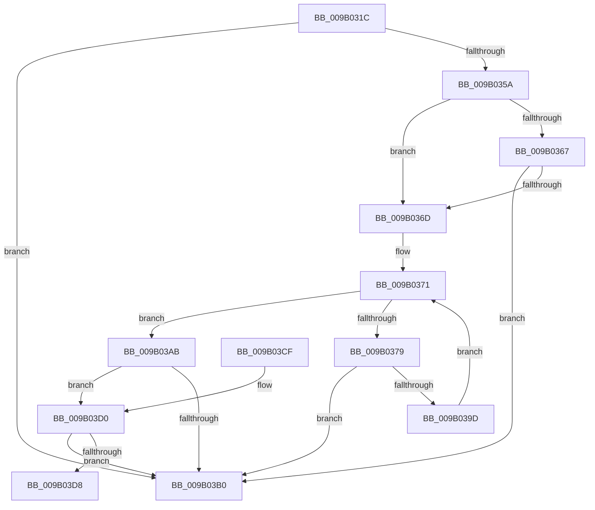

# CmpEnumerateAllOpenSubKeys

- RVA: `0x009B031C`–`0x009B03DD` (길이 `193` bytes)
- VA: `0x00000001409B031C`
- 실행 섹션: `PAGE`
- PDB 이름 있음: `예`; PDB Function 태그: `예`
- unwind 정보 RVA: `0x0009E140`
- 디코드: `57`개 명령, `193/193` bytes 표시
- 미해석 바이트: `0` (있으면 어셈블리에 `.byte`로 보존)

> 이 문서는 커널 이미지의 기계어와 PDB 기호를 분석해 생성했습니다. 4번과 5번은 함수 원형과 자료형을 바이너리 사용 방식에서 추정한 C 해석이며 원본 소스 복구 결과는 아닙니다.

## 1. Dependencies

- 직접 호출 지점: **2**; 고유 호출 대상: **2**
- 직접 호출자로 확인된 함수: **3**
- RIP 상대 이미지 참조: **0**

### Outgoing calls
- `0x009B034C` → [CmpCleanUpKCBCacheTable](CmpCleanUpKCBCacheTable_function_009B0478.md) (function, `0x009B0478`)
- `0x009B0393` → [CmpEnumerateKcbCacheBucket](CmpEnumerateKcbCacheBucket_function_009B03E4.md) (function, `0x009B03E4`)

### Direct callers
- [CmpInvalidateSubtree](../7E/CmpInvalidateSubtree_function_007EAEC0.md) at `0x007EAEEE`
- [CmpSearchForOpenSubKeys](../9A/CmpSearchForOpenSubKeys_function_009AE76C.md) at `0x009AE7D2`
- [CmpFreezeHive](../9A/CmpFreezeHive_function_009AE818.md) at `0x009AE878`

### Static image references
- 디코드된 RIP-relative 메모리 참조가 없습니다.

## 2. Other-region calls and transfers

- 다른 실행 섹션으로 향하는 call: **0**
- call이 아닌 외부 분기/꼬리 이동: **1**
  - `0x009B03D8` → [sub_00B2DA7C](../B2/Unknown_function_00B2DA7C.md) (`tail-transfer`)

## 3. Assembly (complete function range)

```asm
009B031C  48 8B C4                        mov rax, rsp
009B031F  48 89 58 08                     mov qword ptr [rax + 8], rbx
009B0323  48 89 68 10                     mov qword ptr [rax + 0x10], rbp
009B0327  48 89 70 18                     mov qword ptr [rax + 0x18], rsi
009B032B  48 89 78 20                     mov qword ptr [rax + 0x20], rdi
009B032F  41 54                           push r12
009B0331  41 56                           push r14
009B0333  41 57                           push r15
009B0335  48 83 EC 20                     sub rsp, 0x20
009B0339  48 8B 71 20                     mov rsi, qword ptr [rcx + 0x20]
009B033D  4C 8B F1                        mov r14, rcx
009B0340  48 8B CE                        mov rcx, rsi
009B0343  4D 8B F9                        mov r15, r9
009B0346  4D 8B E0                        mov r12, r8
009B0349  40 8A EA                        mov bpl, dl
009B034C  E8 27 01 00 00                  call 0x1409b0478
009B0351  49 8B 0E                        mov rcx, qword ptr [r14]
009B0354  48 83 F9 01                     cmp rcx, 1
009B0358  74 56                           je 0x1409b03b0
009B035A  41 F7 86 B8 00 00 00 00 00 04 00  test dword ptr [r14 + 0xb8], 0x40000
009B0365  74 06                           je 0x1409b036d
009B0367  48 83 F9 02                     cmp rcx, 2
009B036B  74 43                           je 0x1409b03b0
009B036D  33 DB                           xor ebx, ebx
009B036F  8B FB                           mov edi, ebx
009B0371  3B BE 78 06 00 00               cmp edi, dword ptr [rsi + 0x678]
009B0377  73 32                           jae 0x1409b03ab
009B0379  8B C7                           mov eax, edi
009B037B  4D 8B CF                        mov r9, r15
009B037E  4D 8B C4                        mov r8, r12
009B0381  48 8D 0C 40                     lea rcx, [rax + rax*2]
009B0385  48 8B 86 70 06 00 00            mov rax, qword ptr [rsi + 0x670]
009B038C  48 8D 14 C8                     lea rdx, [rax + rcx*8]
009B0390  49 8B CE                        mov rcx, r14
009B0393  E8 4C 00 00 00                  call 0x1409b03e4
009B0398  83 F8 01                        cmp eax, 1
009B039B  74 13                           je 0x1409b03b0
009B039D  8D 4F FF                        lea ecx, [rdi - 1]
009B03A0  83 F8 02                        cmp eax, 2
009B03A3  0F 45 CF                        cmovne ecx, edi
009B03A6  8D 79 01                        lea edi, [rcx + 1]
009B03A9  EB C6                           jmp 0x1409b0371
009B03AB  40 84 ED                        test bpl, bpl
009B03AE  75 20                           jne 0x1409b03d0
009B03B0  48 8B 5C 24 40                  mov rbx, qword ptr [rsp + 0x40]
009B03B5  48 8B 6C 24 48                  mov rbp, qword ptr [rsp + 0x48]
009B03BA  48 8B 74 24 50                  mov rsi, qword ptr [rsp + 0x50]
009B03BF  48 8B 7C 24 58                  mov rdi, qword ptr [rsp + 0x58]
009B03C4  48 83 C4 20                     add rsp, 0x20
009B03C8  41 5F                           pop r15
009B03CA  41 5E                           pop r14
009B03CC  41 5C                           pop r12
009B03CE  C3                              ret
009B03CF  CC                              int3
009B03D0  39 9E 88 06 00 00               cmp dword ptr [rsi + 0x688], ebx
009B03D6  76 D8                           jbe 0x1409b03b0
009B03D8  E9 9F D6 17 00                  jmp 0x140b2da7c
```

## 4. C-style interpretation (structured pseudocode)

```c
__int64 __fastcall CmpEnumerateAllOpenSubKeys(__int64 a1, unsigned __int8 a2, __int64 a3, __int64 a4)
{
    __int64 result;
    __int64 v_rbx;
    __int64 v_rsp;
    unsigned __int64 v_stack_p10;
    unsigned __int64 v_stack_p18;
    unsigned __int64 v_stack_p20;
    unsigned __int64 v_stack_p8;

    *(unsigned __int64 *)(v_rsp + 8) = v_rbx;
    *(unsigned __int64 *)(v_rsp + 16) = v_rbp;
    *(unsigned __int64 *)(v_rsp + 24) = v_rsi;
    *(unsigned __int64 *)(v_rsp + 32) = v_rdi;
    v_rsp = (v_rsp) - (32);
    result = CmpCleanUpKCBCacheTable(*(unsigned __int64 *)(a1 + 32), a2, a3, a4);
    if ((*(unsigned __int64 *)(a1)) == 1) goto loc_009B03B0;
    if (((*(unsigned int *)(a1 + 184)) & (0x40000ULL)) == 0) goto loc_009B036D;
    if ((*(unsigned __int64 *)(a1)) == 2) goto loc_009B03B0;
loc_009B036D:
    v_rbx = 0;
loc_009B0371:
    if (0 >= (*(unsigned int *)(*(unsigned __int64 *)(a1 + 32) + 1656))) goto loc_009B03AB;
    result = CmpEnumerateKcbCacheBucket(a1, *(unsigned __int64 *)(*(unsigned __int64 *)(a1 + 32) + 1648) + 0 + 0 * 2 * 8, a3, a4);
    if (((unsigned int)(result)) == 1) goto loc_009B03B0;
    a1 = 0 - 1;
    if (((unsigned int)(result)) != 2) { a1 = 0; }
    goto loc_009B0371;
loc_009B03AB:
    if (a2 != 0) goto loc_009B03D0;
loc_009B03B0:
    v_rsp = (v_rsp) + (32);
    return result;
loc_009B03D0:
    if ((*(unsigned int *)(v_stack_p18 + 1672)) <= ((unsigned int)(v_stack_p8))) goto loc_009B03B0;
}
```

## 5. (Beta) C Style

```c
int64_t CmpEnumerateAllOpenSubKeys(void *Arg1, uint8_t Arg2, int64_t Arg3, int64_t Arg4)
{
    uint8_t *arg1 = (uint8_t *)Arg1;

    int64_t result;
    int64_t local_rbx;
    int64_t local_rsp;
    uint64_t v_stack_p10;
    uint64_t v_stack_p18;
    uint64_t v_stack_p20;
    uint64_t v_stack_p8;

    *(uint64_t *)(local_rsp + 0x8) = local_rbx;
    *(uint64_t *)(local_rsp + 0x10) = local_rbp;
    *(uint64_t *)(local_rsp + 0x18) = local_rsi;
    *(uint64_t *)(local_rsp + 0x20) = local_rdi;
    local_rsp = (local_rsp) - (32);
    result = CmpCleanUpKCBCacheTable(*(uint64_t *)(arg1 + 0x20), Arg2, Arg3, Arg4);
    if ((*(uint64_t *)(arg1)) == 1) goto loc_009B03B0;
    if (((*(uint32_t *)(arg1 + 0xB8)) & (0x40000ULL)) == 0) goto loc_009B036D;
    if ((*(uint64_t *)(arg1)) == 2) goto loc_009B03B0;
loc_009B036D:
    local_rbx = 0;
loc_009B0371:
    if (0 >= (*(uint32_t *)(*(uint64_t *)(arg1 + 0x20) + 0x678))) goto loc_009B03AB;
    result = CmpEnumerateKcbCacheBucket(Arg1, *(uint64_t *)(*(uint64_t *)(arg1 + 0x20) + 0x670) + 0 + 0 * 2 * 8, Arg3, Arg4);
    if (((uint32_t)(result)) == 1) goto loc_009B03B0;
    Arg1 = 0 - 1;
    if (((uint32_t)(result)) != 2) { Arg1 = 0; }
    goto loc_009B0371;
loc_009B03AB:
    if (Arg2 != 0) goto loc_009B03D0;
loc_009B03B0:
    local_rsp = (local_rsp) + (32);
    return result;
loc_009B03D0:
    if ((*(uint32_t *)(v_stack_p18 + 0x688)) <= ((uint32_t)(v_stack_p8))) goto loc_009B03B0;
}
```

### 관측된 메모리 오프셋

구조체 형식이 확인되지 않은 접근은 인자 기준의 오프셋으로만 기록했습니다.

| 기준 인자 | 오프셋 표현 | 폭 (bit) | 접근 |
|---|---:|---:|---|
| `Arg1` | `+ 0x0` | `64` | `R` |
| `Arg1` | `+ 0x20` | `64` | `R` |
| `Arg1` | `+ 0xB8` | `32` | `R` |

## 6. Execution-region graph

[열기: 2D/3D 그래프와 함수 탐색 컨트롤 패널](../../../control-panel.html?section=page&rva=0x009B031C&view=graph)

- 2D 그래프는 위에서 아래로 흐르고, 3D 그래프는 빈 공간을 드래그해 회전합니다. Shift+드래그는 이동, 휠은 확대·축소, 함수 노드 선택은 대상 보고서 이동입니다.

### Static fallback


