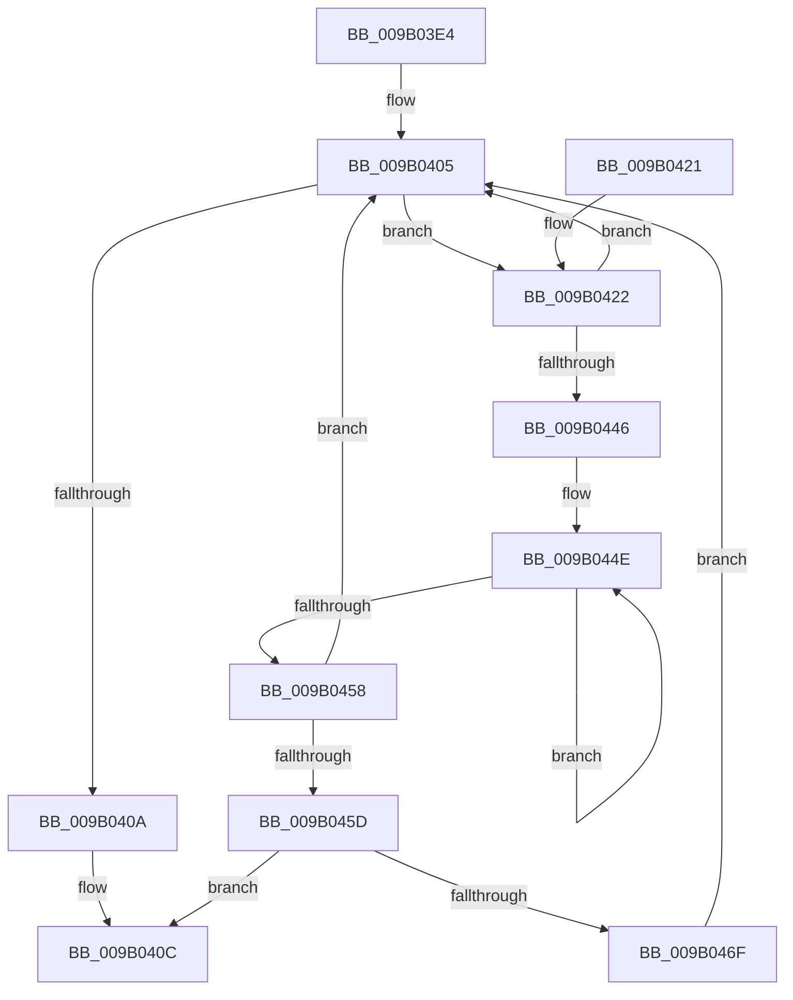

# CmpEnumerateKcbCacheBucket

- RVA: `0x009B03E4`–`0x009B0471` (길이 `141` bytes)
- VA: `0x00000001409B03E4`
- 실행 섹션: `PAGE`
- PDB 이름 있음: `예`; PDB Function 태그: `아니요`
- unwind 정보 RVA: `0x0006E40C`
- 디코드: `44`개 명령, `141/141` bytes 표시
- 미해석 바이트: `0` (있으면 어셈블리에 `.byte`로 보존)

> 이 문서는 커널 이미지의 기계어와 PDB 기호를 분석해 생성했습니다. 4번과 5번은 함수 원형과 자료형을 바이너리 사용 방식에서 추정한 C 해석이며 원본 소스 복구 결과는 아닙니다.

## 1. Dependencies

- 직접 호출 지점: **1**; 고유 호출 대상: **1**
- 직접 호출자로 확인된 함수: **4**
- RIP 상대 이미지 참조: **0**

### Outgoing calls
- `0x009B0466` → [guard_dispatch_icall](../../text/6B/guard_dispatch_icall_function_006BAAD0.md) (function, `0x006BAAD0`)

### Direct callers
- [CmpPrepareForSubtreeInvalidation](CmpPrepareForSubtreeInvalidation_function_009B01B0.md) at `0x009B022A`
- [CmpDoesKeyHaveOpenSubkeys](CmpDoesKeyHaveOpenSubkeys_function_009B0274.md) at `0x009B02E2`
- [CmpEnumerateAllOpenSubKeys](CmpEnumerateAllOpenSubKeys_function_009B031C.md) at `0x009B0393`
- [sub_00B2DA7C](../B2/Unknown_function_00B2DA7C.md) at `0x00B2DA94`

### Static image references
- 디코드된 RIP-relative 메모리 참조가 없습니다.

## 2. Other-region calls and transfers

- 다른 실행 섹션으로 향하는 call: **1**
  - `0x009B0466` → [guard_dispatch_icall](../../text/6B/guard_dispatch_icall_function_006BAAD0.md) (`PAGE` → `.text`)
- 별도 외부 분기/꼬리 이동을 확인하지 못했습니다.

## 3. Assembly (complete function range)

```asm
009B03E4  48 89 5C 24 08                  mov qword ptr [rsp + 8], rbx
009B03E9  48 89 6C 24 10                  mov qword ptr [rsp + 0x10], rbp
009B03EE  48 89 74 24 18                  mov qword ptr [rsp + 0x18], rsi
009B03F3  57                              push rdi
009B03F4  48 83 EC 20                     sub rsp, 0x20
009B03F8  48 8B 5A 10                     mov rbx, qword ptr [rdx + 0x10]
009B03FC  49 8B F1                        mov rsi, r9
009B03FF  49 8B E8                        mov rbp, r8
009B0402  48 8B F9                        mov rdi, rcx
009B0405  48 85 DB                        test rbx, rbx
009B0408  75 18                           jne 0x1409b0422
009B040A  33 C0                           xor eax, eax
009B040C  48 8B 5C 24 30                  mov rbx, qword ptr [rsp + 0x30]
009B0411  48 8B 6C 24 38                  mov rbp, qword ptr [rsp + 0x38]
009B0416  48 8B 74 24 40                  mov rsi, qword ptr [rsp + 0x40]
009B041B  48 83 C4 20                     add rsp, 0x20
009B041F  5F                              pop rdi
009B0420  C3                              ret
009B0421  CC                              int3
009B0422  8B 4F 08                        mov ecx, dword ptr [rdi + 8]
009B0425  4C 8D 53 F0                     lea r10, [rbx - 0x10]
009B0429  41 8B 42 08                     mov eax, dword ptr [r10 + 8]
009B042D  48 8B 5B 08                     mov rbx, qword ptr [rbx + 8]
009B0431  C1 E8 15                        shr eax, 0x15
009B0434  C1 E9 15                        shr ecx, 0x15
009B0437  25 FF 03 00 00                  and eax, 0x3ff
009B043C  81 E1 FF 03 00 00               and ecx, 0x3ff
009B0442  3B C8                           cmp ecx, eax
009B0444  73 BF                           jae 0x1409b0405
009B0446  2B C1                           sub eax, ecx
009B0448  49 8B D2                        mov rdx, r10
009B044B  44 8B C0                        mov r8d, eax
009B044E  48 8B 52 48                     mov rdx, qword ptr [rdx + 0x48]
009B0452  49 83 E8 01                     sub r8, 1
009B0456  75 F6                           jne 0x1409b044e
009B0458  48 3B D7                        cmp rdx, rdi
009B045B  75 A8                           jne 0x1409b0405
009B045D  48 8B D6                        mov rdx, rsi
009B0460  49 8B CA                        mov rcx, r10
009B0463  48 8B C5                        mov rax, rbp
009B0466  E8 65 A6 D0 FF                  call 0x1406baad0
009B046B  85 C0                           test eax, eax
009B046D  75 9D                           jne 0x1409b040c
009B046F  EB 94                           jmp 0x1409b0405
```

## 4. C-style interpretation (structured pseudocode)

```c
__int64 __fastcall CmpEnumerateKcbCacheBucket(__int64 a1, __int64 a2, __int64 a3, __int64 a4)
{
    __int64 result;
    __int64 v_rsp;
    unsigned __int64 v_stack_p10;
    unsigned __int64 v_stack_p18;
    unsigned __int64 v_stack_p8;

    v_stack_p8 = v_rbx;
    v_stack_p10 = v_rbp;
    v_stack_p18 = v_rsi;
    v_rsp = (v_rsp) - (32);
loc_009B0405:
    if (*(unsigned __int64 *)(a2 + 16) != 0) goto loc_009B0422;
    result = 0;
loc_009B040C:
    v_rsp = (v_rsp) + (32);
    return result;
loc_009B0422:
    result = (unsigned int)(((unsigned int)(*(unsigned int *)(v_stack_p8 - 16 + 8))) >> (21));
    a1 = (unsigned int)(((unsigned int)(*(unsigned int *)(a1 + 8))) >> (21));
    result = (unsigned int)((result) & (0x3FFULL));
    a1 = (unsigned int)((a1) & (0x3FFULL));
    if (((unsigned int)(a1)) >= ((unsigned int)(result))) goto loc_009B0405;
    result = (unsigned int)((result) - ((unsigned int)(a1)));
loc_009B044E:
    a3 = ((unsigned int)((unsigned int)(result))) - (1);
    if (condition_is_not_equal) goto loc_009B044E;
    if ((*(unsigned __int64 *)(v_stack_p8 - 16 + 72)) != a1) goto loc_009B0405;
    result = guard_dispatch_icall(v_stack_p8 - 16, v_stack_p18, a3, a4);
    if ((unsigned int)(result) != 0) goto loc_009B040C;
    goto loc_009B0405;
}
```

## 5. (Beta) C Style

```c
int64_t CmpEnumerateKcbCacheBucket(void *Arg1, void *Arg2, int64_t Arg3, int64_t Arg4)
{
    uint8_t *arg1 = (uint8_t *)Arg1;
    uint8_t *arg2 = (uint8_t *)Arg2;

    int64_t result;
    int64_t local_rsp;
    uint64_t v_stack_p10;
    uint64_t v_stack_p18;
    uint64_t v_stack_p8;

    v_stack_p8 = local_rbx;
    v_stack_p10 = local_rbp;
    v_stack_p18 = local_rsi;
    local_rsp = (local_rsp) - (32);
loc_009B0405:
    if (*(uint64_t *)(arg2 + 0x10) != 0) goto loc_009B0422;
    result = 0;
loc_009B040C:
    local_rsp = (local_rsp) + (32);
    return result;
loc_009B0422:
    result = (uint32_t)(((uint32_t)(*(uint32_t *)(v_stack_p8 - 0x10 + 0x8))) >> (21));
    Arg1 = (uint32_t)(((uint32_t)(*(uint32_t *)(arg1 + 0x8))) >> (21));
    result = (uint32_t)((result) & (0x3FFULL));
    Arg1 = (uint32_t)((Arg1) & (0x3FFULL));
    if (((uint32_t)(Arg1)) >= ((uint32_t)(result))) goto loc_009B0405;
    result = (uint32_t)((result) - ((uint32_t)(Arg1)));
loc_009B044E:
    Arg3 = ((uint32_t)((uint32_t)(result))) - (1);
    if (condition_is_not_equal) goto loc_009B044E;
    if ((*(uint64_t *)(v_stack_p8 - 0x10 + 0x48)) != Arg1) goto loc_009B0405;
    result = guard_dispatch_icall(v_stack_p8 - 16, v_stack_p18, Arg3, Arg4);
    if ((uint32_t)(result) != 0) goto loc_009B040C;
    goto loc_009B0405;
}
```

### 관측된 메모리 오프셋

구조체 형식이 확인되지 않은 접근은 인자 기준의 오프셋으로만 기록했습니다.

| 기준 인자 | 오프셋 표현 | 폭 (bit) | 접근 |
|---|---:|---:|---|
| `Arg1` | `+ 0x8` | `32` | `R` |
| `Arg2` | `+ 0x10` | `64` | `R` |

## 6. Execution-region graph

[열기: 2D/3D 그래프와 함수 탐색 컨트롤 패널](../../../control-panel.html?section=page&rva=0x009B03E4&view=graph)

- 2D 그래프는 위에서 아래로 흐르고, 3D 그래프는 빈 공간을 드래그해 회전합니다. Shift+드래그는 이동, 휠은 확대·축소, 함수 노드 선택은 대상 보고서 이동입니다.

### Static fallback


