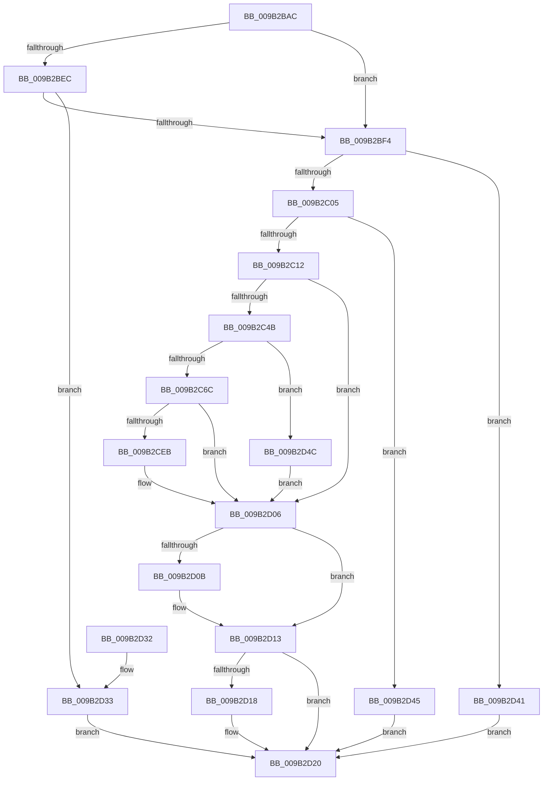

# CmpFileFlushAndPurge

- RVA: `0x009B2BAC`–`0x009B2D53` (길이 `423` bytes)
- VA: `0x00000001409B2BAC`
- 실행 섹션: `PAGE`
- PDB 이름 있음: `예`; PDB Function 태그: `아니요`
- unwind 정보 RVA: `0x0009E408`
- 디코드: `105`개 명령, `423/423` bytes 표시
- 미해석 바이트: `0` (있으면 어셈블리에 `.byte`로 보존)

> 이 문서는 커널 이미지의 기계어와 PDB 기호를 분석해 생성했습니다. 4번과 5번은 함수 원형과 자료형을 바이너리 사용 방식에서 추정한 C 해석이며 원본 소스 복구 결과는 아닙니다.

## 1. Dependencies

- 직접 호출 지점: **9**; 고유 호출 대상: **9**
- 직접 호출자로 확인된 함수: **5**
- RIP 상대 이미지 참조: **3**

### Outgoing calls
- `0x009B2BD9` → [KeInitializeEvent](../../text/40/KeInitializeEvent_function_0040DD10.md) (function, `0x0040DD10`)
- `0x009B2C37` → [ObReferenceObjectByHandle](../86/ObReferenceObjectByHandle_function_00868DB0.md) (function, `0x00868DB0`)
- `0x009B2C4E` → [IoGetRelatedDeviceObject](../../text/29/IoGetRelatedDeviceObject_function_0029B120.md) (function, `0x0029B120`)
- `0x009B2C5B` → [IoAllocateIrp](../../text/20/IoAllocateIrp_function_002065D0.md) (function, `0x002065D0`)
- `0x009B2CDD` → [IofCallDriver](../../text/29/IofCallDriver_function_0029B4B0.md) (function, `0x0029B4B0`)
- `0x009B2CFE` → [KeWaitForSingleObject](../../text/20/KeWaitForSingleObject_function_0020E6B0.md) (function, `0x0020E6B0`)
- `0x009B2D0E` → [ObfDereferenceObject](../../text/2F/ObfDereferenceObject_function_002F9350.md) (function, `0x002F9350`)
- `0x009B2D1B` → [IoFreeIrp](../../text/24/IoFreeIrp_function_0024DF70.md) (function, `0x0024DF70`)
- `0x009B2D38` → [CmpFileFlush](CmpFileFlush_function_009B9A04.md) (function, `0x009B9A04`)

### Direct callers
- [HvWriteHivePrimaryFile](HvWriteHivePrimaryFile_function_009B2374.md) at `0x009B24D8`
- [HvValidateOrInvalidatePrimaryFileHeader](HvValidateOrInvalidatePrimaryFileHeader_function_009B27A8.md) at `0x009B2854`
- [HvWriteLogFile](HvWriteLogFile_function_009B28E4.md) at `0x009B298D`
- [CmpFlushHive](CmpFlushHive_function_009B3DC0.md) at `0x009B45E8`
- [HvExtendHivePrimaryFileValidDataLength](../AD/HvExtendHivePrimaryFileValidDataLength_function_00AD49C0.md) at `0x00AD4A1B`

### Static image references
- `0x009B2C05` → RVA `0x00FD8001` (`PAGEDATA`; read)
- `0x009B2C12` → RVA `0x00EF7C68` (`.data`; read)
- `0x009B2C73` → RVA `0x0048B010` (`CmpCompleteFlushAndPurgeIrp`; read)

## 2. Other-region calls and transfers

- 다른 실행 섹션으로 향하는 call: **7**
  - `0x009B2BD9` → [KeInitializeEvent](../../text/40/KeInitializeEvent_function_0040DD10.md) (`PAGE` → `.text`)
  - `0x009B2C4E` → [IoGetRelatedDeviceObject](../../text/29/IoGetRelatedDeviceObject_function_0029B120.md) (`PAGE` → `.text`)
  - `0x009B2C5B` → [IoAllocateIrp](../../text/20/IoAllocateIrp_function_002065D0.md) (`PAGE` → `.text`)
  - `0x009B2CDD` → [IofCallDriver](../../text/29/IofCallDriver_function_0029B4B0.md) (`PAGE` → `.text`)
  - `0x009B2CFE` → [KeWaitForSingleObject](../../text/20/KeWaitForSingleObject_function_0020E6B0.md) (`PAGE` → `.text`)
  - `0x009B2D0E` → [ObfDereferenceObject](../../text/2F/ObfDereferenceObject_function_002F9350.md) (`PAGE` → `.text`)
  - `0x009B2D1B` → [IoFreeIrp](../../text/24/IoFreeIrp_function_0024DF70.md) (`PAGE` → `.text`)
- 별도 외부 분기/꼬리 이동을 확인하지 못했습니다.

## 3. Assembly (complete function range)

```asm
009B2BAC  4C 8B DC                        mov r11, rsp
009B2BAF  49 89 5B 10                     mov qword ptr [r11 + 0x10], rbx
009B2BB3  49 89 73 18                     mov qword ptr [r11 + 0x18], rsi
009B2BB7  57                              push rdi
009B2BB8  48 83 EC 50                     sub rsp, 0x50
009B2BBC  33 C0                           xor eax, eax
009B2BBE  8B F2                           mov esi, edx
009B2BC0  0F 57 C0                        xorps xmm0, xmm0
009B2BC3  48 8B D9                        mov rbx, rcx
009B2BC6  0F 11 44 24 30                  movups xmmword ptr [rsp + 0x30], xmm0
009B2BCB  45 33 C0                        xor r8d, r8d
009B2BCE  49 89 43 E8                     mov qword ptr [r11 - 0x18], rax
009B2BD2  8D 50 01                        lea edx, [rax + 1]
009B2BD5  49 8D 4B D8                     lea rcx, [r11 - 0x28]
009B2BD9  E8 32 B1 A5 FF                  call 0x14040dd10
009B2BDE  33 FF                           xor edi, edi
009B2BE0  F7 83 A0 00 00 00 00 00 02 00   test dword ptr [rbx + 0xa0], 0x20000
009B2BEA  74 08                           je 0x1409b2bf4
009B2BEC  85 F6                           test esi, esi
009B2BEE  0F 84 3F 01 00 00               je 0x1409b2d33
009B2BF4  48 8B 8C F3 08 06 00 00         mov rcx, qword ptr [rbx + rsi*8 + 0x608]
009B2BFC  48 85 C9                        test rcx, rcx
009B2BFF  0F 84 3C 01 00 00               je 0x1409b2d41
009B2C05  40 38 3D F5 53 62 00            cmp byte ptr [rip + 0x6253f5], dil
009B2C0C  0F 85 33 01 00 00               jne 0x1409b2d45
009B2C12  48 8B 05 4F 50 54 00            mov rax, qword ptr [rip + 0x54504f]
009B2C19  45 33 C9                        xor r9d, r9d
009B2C1C  48 21 7C 24 28                  and qword ptr [rsp + 0x28], rdi
009B2C21  48 21 7C 24 60                  and qword ptr [rsp + 0x60], rdi
009B2C26  4C 8B 00                        mov r8, qword ptr [rax]
009B2C29  41 8D 51 02                     lea edx, [r9 + 2]
009B2C2D  48 8D 44 24 60                  lea rax, [rsp + 0x60]
009B2C32  48 89 44 24 20                  mov qword ptr [rsp + 0x20], rax
009B2C37  E8 74 61 EB FF                  call 0x140868db0
009B2C3C  48 8B 74 24 60                  mov rsi, qword ptr [rsp + 0x60]
009B2C41  8B D8                           mov ebx, eax
009B2C43  85 C0                           test eax, eax
009B2C45  0F 88 BB 00 00 00               js 0x1409b2d06
009B2C4B  48 8B CE                        mov rcx, rsi
009B2C4E  E8 CD 84 8E FF                  call 0x14029b120
009B2C53  33 D2                           xor edx, edx
009B2C55  48 8B D8                        mov rbx, rax
009B2C58  8A 48 4C                        mov cl, byte ptr [rax + 0x4c]
009B2C5B  E8 70 39 85 FF                  call 0x1402065d0
009B2C60  48 8B F8                        mov rdi, rax
009B2C63  48 85 C0                        test rax, rax
009B2C66  0F 84 E0 00 00 00               je 0x1409b2d4c
009B2C6C  48 89 B0 C0 00 00 00            mov qword ptr [rax + 0xc0], rsi
009B2C73  48 8D 0D 96 83 AD FF            lea rcx, [rip - 0x527c6a]
009B2C7A  65 48 8B 04 25 88 01 00 00      mov rax, qword ptr gs:[0x188]
009B2C83  48 8B D7                        mov rdx, rdi
009B2C86  48 83 A7 A0 00 00 00 00         and qword ptr [rdi + 0xa0], 0
009B2C8E  66 83 67 40 00                  and word ptr [rdi + 0x40], 0
009B2C93  48 83 67 58 00                  and qword ptr [rdi + 0x58], 0
009B2C98  48 83 67 68 00                  and qword ptr [rdi + 0x68], 0
009B2C9D  48 8B 74 24 60                  mov rsi, qword ptr [rsp + 0x60]
009B2CA2  48 89 87 98 00 00 00            mov qword ptr [rdi + 0x98], rax
009B2CA9  48 8B 87 B8 00 00 00            mov rax, qword ptr [rdi + 0xb8]
009B2CB0  C6 47 44 00                     mov byte ptr [rdi + 0x44], 0
009B2CB4  66 C7 40 B8 09 01               mov word ptr [rax - 0x48], 0x109
009B2CBA  48 89 70 E8                     mov qword ptr [rax - 0x18], rsi
009B2CBE  48 89 58 E0                     mov qword ptr [rax - 0x20], rbx
009B2CC2  48 8B 87 B8 00 00 00            mov rax, qword ptr [rdi + 0xb8]
009B2CC9  48 89 48 F0                     mov qword ptr [rax - 0x10], rcx
009B2CCD  48 8D 4C 24 30                  lea rcx, [rsp + 0x30]
009B2CD2  48 89 48 F8                     mov qword ptr [rax - 8], rcx
009B2CD6  48 8B CB                        mov rcx, rbx
009B2CD9  C6 40 BB E0                     mov byte ptr [rax - 0x45], 0xe0
009B2CDD  E8 CE 87 8E FF                  call 0x14029b4b0
009B2CE2  8B D8                           mov ebx, eax
009B2CE4  3D 03 01 00 00                  cmp eax, 0x103
009B2CE9  75 1B                           jne 0x1409b2d06
009B2CEB  48 83 64 24 20 00               and qword ptr [rsp + 0x20], 0
009B2CF1  48 8D 4C 24 30                  lea rcx, [rsp + 0x30]
009B2CF6  45 33 C9                        xor r9d, r9d
009B2CF9  45 33 C0                        xor r8d, r8d
009B2CFC  33 D2                           xor edx, edx
009B2CFE  E8 AD B9 85 FF                  call 0x14020e6b0
009B2D03  8B 5F 30                        mov ebx, dword ptr [rdi + 0x30]
009B2D06  48 85 F6                        test rsi, rsi
009B2D09  74 08                           je 0x1409b2d13
009B2D0B  48 8B CE                        mov rcx, rsi
009B2D0E  E8 3D 66 94 FF                  call 0x1402f9350
009B2D13  48 85 FF                        test rdi, rdi
009B2D16  74 08                           je 0x1409b2d20
009B2D18  48 8B CF                        mov rcx, rdi
009B2D1B  E8 50 B2 89 FF                  call 0x14024df70
009B2D20  48 8B 74 24 70                  mov rsi, qword ptr [rsp + 0x70]
009B2D25  8B C3                           mov eax, ebx
009B2D27  48 8B 5C 24 68                  mov rbx, qword ptr [rsp + 0x68]
009B2D2C  48 83 C4 50                     add rsp, 0x50
009B2D30  5F                              pop rdi
009B2D31  C3                              ret
009B2D32  CC                              int3
009B2D33  33 D2                           xor edx, edx
009B2D35  48 8B CB                        mov rcx, rbx
009B2D38  E8 C7 6C 00 00                  call 0x1409b9a04
009B2D3D  8B D8                           mov ebx, eax
009B2D3F  EB DF                           jmp 0x1409b2d20
009B2D41  33 DB                           xor ebx, ebx
009B2D43  EB DB                           jmp 0x1409b2d20
009B2D45  BB 01 00 00 C0                  mov ebx, 0xc0000001
009B2D4A  EB D4                           jmp 0x1409b2d20
009B2D4C  BB 9A 00 00 C0                  mov ebx, 0xc000009a
009B2D51  EB B3                           jmp 0x1409b2d06
```

## 4. C-style interpretation (structured pseudocode)

```c
__int64 __fastcall CmpFileFlushAndPurge(__int64 a1, int a2, int a3, int a4)
{
    __int64 result;
    __int64 v_rbx;
    __int64 v_rdi;
    __int64 v_rsp;
    unsigned __int64 v_stack_m28;
    unsigned __int64 v_stack_m30;
    unsigned __int64 v_stack_m38;
    unsigned __int64 v_stack_p10;
    unsigned __int64 v_stack_p18;
    unsigned __int64 v_stack_p8;

    *(unsigned __int64 *)(v_rsp + 16) = v_rbx;
    *(unsigned __int64 *)(v_rsp + 24) = v_rsi;
    v_rsp = (v_rsp) - (80);
    result = 0;
    v_stack_m28 = v_xmm0;
    a3 = 0;
    *(unsigned __int64 *)(v_rsp - 24) = 0;
    result = KeInitializeEvent(v_rsp - 40, result + 1, a3, a4);
    v_rdi = 0;
    if (((*(unsigned int *)(a1 + 160)) & (0x20000ULL)) == 0) goto loc_009B2BF4;
    if ((unsigned int)((unsigned int)(a2)) == 0) goto loc_009B2D33;
loc_009B2BF4:
    if (*(unsigned __int64 *)(a1 + (unsigned int)(a2) * 8 + 1544) == 0) goto loc_009B2D41;
    if ((*(unsigned __int8 *)(v_rip + 6444021)) != 0) goto loc_009B2D45;
    a4 = 0;
    v_stack_m38 = v_stack_p8;
    result = ObReferenceObjectByHandle(*(unsigned __int64 *)(a1 + (unsigned int)(a2) * 8 + 1544), a4 + 2, *(unsigned __int64 *)(*(unsigned __int64 *)(v_rip + 5525583)), a4);
    if (sign_flag) goto loc_009B2D06;
    result = IoGetRelatedDeviceObject(v_stack_p8, a4 + 2, *(unsigned __int64 *)(*(unsigned __int64 *)(v_rip + 5525583)), a4);
    a2 = 0;
    result = IoAllocateIrp(*(unsigned __int8 *)(result + 76), a2, *(unsigned __int64 *)(*(unsigned __int64 *)(v_rip + 5525583)), a4);
    if (result == 0) goto loc_009B2D4C;
    *(unsigned __int64 *)(result + 192) = v_stack_p8;
    *(unsigned __int64 *)(result + 152) = *(unsigned __int64 *)(gs_base + (0 + 392));
    *(unsigned __int8 *)(result + 68) = 0;
    *(unsigned __int16 *)(*(unsigned __int64 *)(result + 184) - 72) = 265;
    *(unsigned __int64 *)(*(unsigned __int64 *)(result + 184) - 24) = v_stack_p8;
    *(unsigned __int64 *)(*(unsigned __int64 *)(result + 184) - 32) = result;
    *(unsigned __int64 *)(*(unsigned __int64 *)(result + 184) - 16) = v_rip - 5405802;
    *(unsigned __int64 *)(*(unsigned __int64 *)(result + 184) - 8) = v_stack_m28;
    *(unsigned __int8 *)(*(unsigned __int64 *)(result + 184) - 69) = 224;
    result = IofCallDriver(result, result, *(unsigned __int64 *)(*(unsigned __int64 *)(v_rip + 5525583)), a4);
    v_rbx = (unsigned int)((unsigned int)(result));
    if (((unsigned int)(result)) == 259) {
        a1 = v_stack_m28;
        a4 = 0;
        a3 = 0;
        a2 = 0;
        result = KeWaitForSingleObject(a1, a2, a3, a4);
        v_rbx = *(unsigned int *)(result + 48);
    }
    if (v_stack_p8 != 0) {
        a1 = v_stack_p8;
        result = ObfDereferenceObject(a1, a2, a3, a4);
    }
    if (result != 0) {
        a1 = result;
        result = IoFreeIrp(a1, a2, a3, a4);
    }
    v_rsp = (v_rsp) + (80);
    return (unsigned int)((unsigned int)(v_rbx));
loc_009B2D33:
    a2 = 0;
    result = CmpFileFlush(v_stack_p10, a2, a3, a4);
    goto loc_009B2D20;
loc_009B2D41:
    v_rbx = 0;
    goto loc_009B2D20;
loc_009B2D45:
    goto loc_009B2D20;
loc_009B2D4C:
    goto loc_009B2D06;
}
```

## 5. (Beta) C Style

```c
int64_t CmpFileFlushAndPurge(void *Arg1, int32_t Arg2, int32_t Arg3, int32_t Arg4)
{
    uint8_t *arg1 = (uint8_t *)Arg1;

    int64_t result;
    int64_t local_rbx;
    int64_t local_rdi;
    int64_t local_rsp;
    uint64_t v_stack_m28;
    uint64_t v_stack_m30;
    uint64_t v_stack_m38;
    uint64_t v_stack_p10;
    uint64_t v_stack_p18;
    uint64_t v_stack_p8;

    *(uint64_t *)(local_rsp + 0x10) = local_rbx;
    *(uint64_t *)(local_rsp + 0x18) = local_rsi;
    local_rsp = (local_rsp) - (80);
    result = 0;
    v_stack_m28 = v_xmm0;
    Arg3 = 0;
    *(uint64_t *)(local_rsp - 0x18) = 0;
    result = KeInitializeEvent(local_rsp - 40, result + 1, Arg3, Arg4);
    local_rdi = 0;
    if (((*(uint32_t *)(arg1 + 0xA0)) & (0x20000ULL)) == 0) goto loc_009B2BF4;
    if ((uint32_t)((uint32_t)(Arg2)) == 0) goto loc_009B2D33;
loc_009B2BF4:
    if (*(uint64_t *)(arg1 + (uint32_t)(Arg2) * 8 + 0x608) == 0) goto loc_009B2D41;
    if ((*(uint8_t *)(v_rip + 0x6253F5)) != 0) goto loc_009B2D45;
    Arg4 = 0;
    v_stack_m38 = v_stack_p8;
    result = ObReferenceObjectByHandle(*(uint64_t *)(arg1 + (uint32_t)(Arg2) * 8 + 0x608), Arg4 + 2, *(uint64_t *)(*(uint64_t *)(v_rip + 0x54504F)), Arg4);
    if (sign_flag) goto loc_009B2D06;
    result = IoGetRelatedDeviceObject(v_stack_p8, Arg4 + 2, *(uint64_t *)(*(uint64_t *)(v_rip + 0x54504F)), Arg4);
    Arg2 = 0;
    result = IoAllocateIrp(*(uint8_t *)(result + 0x4C), Arg2, *(uint64_t *)(*(uint64_t *)(v_rip + 0x54504F)), Arg4);
    if (result == 0) goto loc_009B2D4C;
    *(uint64_t *)(result + 0xC0) = v_stack_p8;
    *(uint64_t *)(result + 0x98) = *(uint64_t *)(gs_base + (0 + 0x188));
    *(uint8_t *)(result + 0x44) = 0;
    *(uint16_t *)(*(uint64_t *)(result + 0xB8) - 0x48) = 265;
    *(uint64_t *)(*(uint64_t *)(result + 0xB8) - 0x18) = v_stack_p8;
    *(uint64_t *)(*(uint64_t *)(result + 0xB8) - 0x20) = result;
    *(uint64_t *)(*(uint64_t *)(result + 0xB8) - 0x10) = v_rip - 5405802;
    *(uint64_t *)(*(uint64_t *)(result + 0xB8) - 0x8) = v_stack_m28;
    *(uint8_t *)(*(uint64_t *)(result + 0xB8) - 0x45) = 224;
    result = IofCallDriver(result, result, *(uint64_t *)(*(uint64_t *)(v_rip + 0x54504F)), Arg4);
    local_rbx = (uint32_t)((uint32_t)(result));
    if (((uint32_t)(result)) == 259) {
        Arg1 = v_stack_m28;
        Arg4 = 0;
        Arg3 = 0;
        Arg2 = 0;
        result = KeWaitForSingleObject(Arg1, Arg2, Arg3, Arg4);
        local_rbx = *(uint32_t *)(result + 0x30);
    }
    if (v_stack_p8 != 0) {
        Arg1 = v_stack_p8;
        result = ObfDereferenceObject(Arg1, Arg2, Arg3, Arg4);
    }
    if (result != 0) {
        Arg1 = result;
        result = IoFreeIrp(Arg1, Arg2, Arg3, Arg4);
    }
    local_rsp = (local_rsp) + (80);
    return (uint32_t)((uint32_t)(local_rbx));
loc_009B2D33:
    Arg2 = 0;
    result = CmpFileFlush(v_stack_p10, Arg2, Arg3, Arg4);
    goto loc_009B2D20;
loc_009B2D41:
    local_rbx = 0;
    goto loc_009B2D20;
loc_009B2D45:
    goto loc_009B2D20;
loc_009B2D4C:
    goto loc_009B2D06;
}
```

### 관측된 메모리 오프셋

구조체 형식이 확인되지 않은 접근은 인자 기준의 오프셋으로만 기록했습니다.

| 기준 인자 | 오프셋 표현 | 폭 (bit) | 접근 |
|---|---:|---:|---|
| `Arg1` | `+ 0xA0` | `32` | `R` |
| `Arg1` | `+ 0x608 + rsi*8` | `64` | `R` |

## 6. Execution-region graph

[열기: 2D/3D 그래프와 함수 탐색 컨트롤 패널](../../../control-panel.html?section=page&rva=0x009B2BAC&view=graph)

- 2D 그래프는 위에서 아래로 흐르고, 3D 그래프는 빈 공간을 드래그해 회전합니다. Shift+드래그는 이동, 휠은 확대·축소, 함수 노드 선택은 대상 보고서 이동입니다.

### Static fallback


