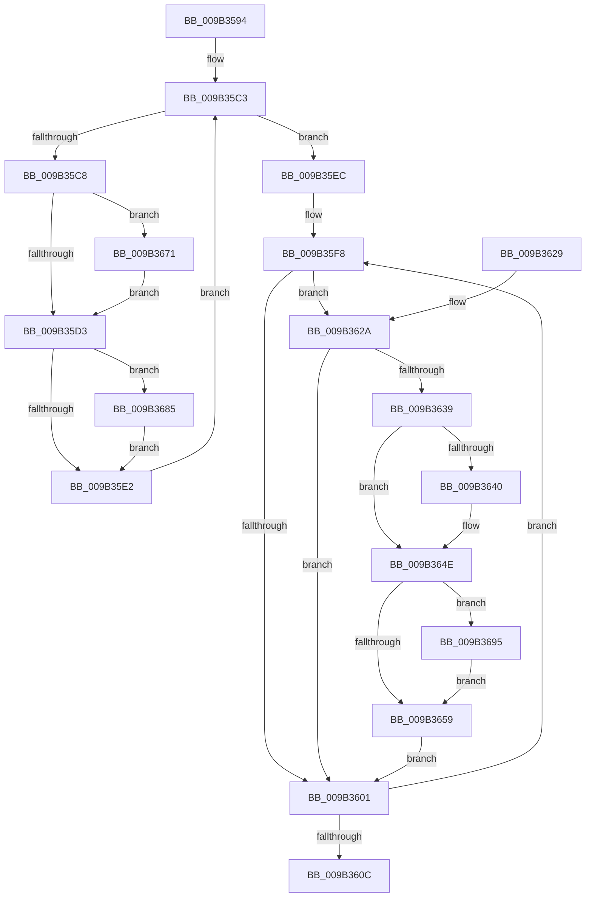

# CmpFlushNotifiesOnKeyBodyList

- RVA: `0x009B3594`–`0x009B36A2` (길이 `270` bytes)
- VA: `0x00000001409B3594`
- 실행 섹션: `PAGE`
- PDB 이름 있음: `예`; PDB Function 태그: `아니요`
- unwind 정보 RVA: `0x0009E47C`
- 디코드: `78`개 명령, `270/270` bytes 표시
- 미해석 바이트: `0` (있으면 어셈블리에 `.byte`로 보존)

> 이 문서는 커널 이미지의 기계어와 PDB 기호를 분석해 생성했습니다. 4번과 5번은 함수 원형과 자료형을 바이너리 사용 방식에서 추정한 C 해석이며 원본 소스 복구 결과는 아닙니다.

## 1. Dependencies

- 직접 호출 지점: **4**; 고유 호출 대상: **2**
- 직접 호출자로 확인된 함수: **16**
- RIP 상대 이미지 참조: **0**

### Outgoing calls
- `0x009B3649` → [CmpFlushNotify](CmpFlushNotify_function_009B36A8.md) (function, `0x009B36A8`)
- `0x009B367B` → [CmpFlushNotify](CmpFlushNotify_function_009B36A8.md) (function, `0x009B36A8`)
- `0x009B368B` → [CmpKeyEnumStackFreeResumeContext](../A6/CmpKeyEnumStackFreeResumeContext_function_00A6DDD8.md) (function, `0x00A6DDD8`)
- `0x009B369B` → [CmpKeyEnumStackFreeResumeContext](../A6/CmpKeyEnumStackFreeResumeContext_function_00A6DDD8.md) (function, `0x00A6DDD8`)

### Direct callers
- [CmDeleteLayeredKey](../../text/41/CmDeleteLayeredKey_function_0041B598.md) at `0x0041B7D0`
- [CmpRemoveHiveFromNamespace](../../text/49/CmpRemoveHiveFromNamespace_function_0049C4CC.md) at `0x0049C52B`
- [sub_006ED542](../../text/6E/Unknown_function_006ED542.md) at `0x006ED634`
- [CmpRefreshHive](../7D/CmpRefreshHive_function_007DEAD0.md) at `0x007DEEDC`
- [CmpRefreshWorkerRoutine](../7D/CmpRefreshWorkerRoutine_function_007DEF60.md) at `0x007DEF8A`
- [CmRenameKey](../7E/CmRenameKey_function_007E8F48.md) at `0x007E91FE`
- [CmRenameKey](../7E/CmRenameKey_function_007E8F48.md) at `0x007E9753`
- [CmpFlushNotifiesPostCallback](../7F/CmpFlushNotifiesPostCallback_function_007F1510.md) at `0x007F1520`
- [CmpInvalidateAllHigherLayerKcbsPostCallback](../7F/CmpInvalidateAllHigherLayerKcbsPostCallback_function_007F15A0.md) at `0x007F15E9`
- [CmDeleteKey](../84/CmDeleteKey_function_00848E5C.md) at `0x00849253`
- [CmpPerformUnloadKey](../9A/CmpPerformUnloadKey_function_009AFA28.md) at `0x009B0090`
- [CmpCompleteUnloadKey](CmpCompleteUnloadKey_function_009B32FC.md) at `0x009B33CA`
- [CmpLightWeightCommitRecreateKeyUoW](../A5/CmpLightWeightCommitRecreateKeyUoW_function_00A543CC.md) at `0x00A54474`
- [CmpLightWeightCommitDeleteKeyUoW](../A5/CmpLightWeightCommitDeleteKeyUoW_function_00A54610.md) at `0x00A54713`
- [CmpInvalidateSubtreeWorker](../AA/CmpInvalidateSubtreeWorker_function_00AA3970.md) at `0x00AA399A`
- [sub_00B16440](../B1/Unknown_function_00B16440.md) at `0x00B1654E`
- [sub_00B1787E](../B1/Unknown_function_00B1787E.md) at `0x00B178FC`

### Static image references
- 디코드된 RIP-relative 메모리 참조가 없습니다.

## 2. Other-region calls and transfers

- 다른 실행 섹션으로 향하는 call: **0**
- 별도 외부 분기/꼬리 이동을 확인하지 못했습니다.

## 3. Assembly (complete function range)

```asm
009B3594  48 89 5C 24 08                  mov qword ptr [rsp + 8], rbx
009B3599  48 89 6C 24 10                  mov qword ptr [rsp + 0x10], rbp
009B359E  48 89 74 24 18                  mov qword ptr [rsp + 0x18], rsi
009B35A3  57                              push rdi
009B35A4  41 54                           push r12
009B35A6  41 55                           push r13
009B35A8  41 56                           push r14
009B35AA  41 57                           push r15
009B35AC  48 83 EC 20                     sub rsp, 0x20
009B35B0  48 8D 79 78                     lea rdi, [rcx + 0x78]
009B35B4  45 8A F9                        mov r15b, r9b
009B35B7  48 8B 1F                        mov rbx, qword ptr [rdi]
009B35BA  4D 8B E8                        mov r13, r8
009B35BD  44 8B E2                        mov r12d, edx
009B35C0  48 8B E9                        mov rbp, rcx
009B35C3  48 3B DF                        cmp rbx, rdi
009B35C6  74 24                           je 0x1409b35ec
009B35C8  48 83 7B F0 00                  cmp qword ptr [rbx - 0x10], 0
009B35CD  0F 85 9E 00 00 00               jne 0x1409b3671
009B35D3  33 C9                           xor ecx, ecx
009B35D5  48 87 4B 38                     xchg qword ptr [rbx + 0x38], rcx
009B35D9  48 85 C9                        test rcx, rcx
009B35DC  0F 85 A3 00 00 00               jne 0x1409b3685
009B35E2  66 44 09 63 10                  or word ptr [rbx + 0x10], r12w
009B35E7  48 8B 1B                        mov rbx, qword ptr [rbx]
009B35EA  EB D7                           jmp 0x1409b35c3
009B35EC  33 FF                           xor edi, edi
009B35EE  48 8D B5 88 00 00 00            lea rsi, [rbp + 0x88]
009B35F5  8D 4F 02                        lea ecx, [rdi + 2]
009B35F8  48 8B 1E                        mov rbx, qword ptr [rsi]
009B35FB  48 83 FB 03                     cmp rbx, 3
009B35FF  73 29                           jae 0x1409b362a
009B3601  FF C7                           inc edi
009B3603  48 83 C6 08                     add rsi, 8
009B3607  83 FF 04                        cmp edi, 4
009B360A  72 EC                           jb 0x1409b35f8
009B360C  48 8B 5C 24 50                  mov rbx, qword ptr [rsp + 0x50]
009B3611  48 8B 6C 24 58                  mov rbp, qword ptr [rsp + 0x58]
009B3616  48 8B 74 24 60                  mov rsi, qword ptr [rsp + 0x60]
009B361B  48 83 C4 20                     add rsp, 0x20
009B361F  41 5F                           pop r15
009B3621  41 5E                           pop r14
009B3623  41 5D                           pop r13
009B3625  41 5C                           pop r12
009B3627  5F                              pop rdi
009B3628  C3                              ret
009B3629  CC                              int3
009B362A  48 8B C3                        mov rax, rbx
009B362D  F0 48 0F B1 8C FD 88 00 00 00   lock cmpxchg qword ptr [rbp + rdi*8 + 0x88], rcx
009B3637  75 C8                           jne 0x1409b3601
009B3639  48 83 7B 10 00                  cmp qword ptr [rbx + 0x10], 0
009B363E  74 0E                           je 0x1409b364e
009B3640  45 33 C0                        xor r8d, r8d
009B3643  41 8A D7                        mov dl, r15b
009B3646  48 8B CB                        mov rcx, rbx
009B3649  E8 5A 00 00 00                  call 0x1409b36a8
009B364E  33 C9                           xor ecx, ecx
009B3650  48 87 4B 58                     xchg qword ptr [rbx + 0x58], rcx
009B3654  48 85 C9                        test rcx, rcx
009B3657  75 3C                           jne 0x1409b3695
009B3659  66 44 09 63 30                  or word ptr [rbx + 0x30], r12w
009B365E  B9 02 00 00 00                  mov ecx, 2
009B3663  8B C1                           mov eax, ecx
009B3665  F0 48 0F B1 9C FD 88 00 00 00   lock cmpxchg qword ptr [rbp + rdi*8 + 0x88], rbx
009B366F  EB 90                           jmp 0x1409b3601
009B3671  45 33 C0                        xor r8d, r8d
009B3674  48 8D 4B E0                     lea rcx, [rbx - 0x20]
009B3678  41 8A D7                        mov dl, r15b
009B367B  E8 28 00 00 00                  call 0x1409b36a8
009B3680  E9 4E FF FF FF                  jmp 0x1409b35d3
009B3685  41 B0 01                        mov r8b, 1
009B3688  49 8B D5                        mov rdx, r13
009B368B  E8 48 A7 0B 00                  call 0x140a6ddd8
009B3690  E9 4D FF FF FF                  jmp 0x1409b35e2
009B3695  41 B0 01                        mov r8b, 1
009B3698  49 8B D5                        mov rdx, r13
009B369B  E8 38 A7 0B 00                  call 0x140a6ddd8
009B36A0  EB B7                           jmp 0x1409b3659
```

## 4. C-style interpretation (structured pseudocode)

```c
__int64 __fastcall CmpFlushNotifiesOnKeyBodyList(__int64 a1, int a2, __int64 a3, unsigned __int8 a4)
{
    __int64 result;
    __int64 v_rdi;
    __int64 v_rsi;
    __int64 v_rsp;
    unsigned __int64 v_stack_p10;
    unsigned __int64 v_stack_p18;
    unsigned __int64 v_stack_p8;

    v_stack_p8 = v_rbx;
    v_stack_p10 = v_rbp;
    v_stack_p18 = v_rsi;
    v_rsp = (v_rsp) - (32);
loc_009B35C3:
    if ((*(unsigned __int64 *)(a1 + 120)) == (a1 + 120)) goto loc_009B35EC;
    if ((*(unsigned __int64 *)(*(unsigned __int64 *)(a1 + 120) - 16)) != 0) goto loc_009B3671;
loc_009B35D3:
    a1 = 0;
    if (0 != 0) goto loc_009B3685;
loc_009B35E2:
    goto loc_009B35C3;
loc_009B35EC:
    v_rdi = 0;
loc_009B35F8:
    if ((*(unsigned __int64 *)(a1 + 136)) >= 3) goto loc_009B362A;
loc_009B3601:
    v_rdi = (unsigned int)((v_rdi) + 1);
    v_rsi = (a1 + 136) + (8);
    if (((unsigned int)(v_rdi)) < 4) goto loc_009B35F8;
    v_rsp = (v_rsp) + (32);
    return result;
loc_009B362A:
    if (condition_is_not_equal) goto loc_009B3601;
    result = v_stack_p8;
    if ((*(unsigned __int64 *)(v_stack_p8 + 16)) != 0) {
        a3 = 0;
        a2 = a4;
        a1 = v_stack_p8;
        result = CmpFlushNotify(a1, a2, a3, a4);
    }
    a1 = 0;
    if (0 != 0) goto loc_009B3695;
loc_009B3659:
    goto loc_009B3601;
loc_009B3671:
    a3 = 0;
    result = CmpFlushNotify(v_stack_p8 - 32, a4, a3, a4);
    goto loc_009B35D3;
loc_009B3685:
    result = CmpKeyEnumStackFreeResumeContext(v_stack_p8 - 32, 0, 1, a4);
    goto loc_009B35E2;
loc_009B3695:
    result = CmpKeyEnumStackFreeResumeContext(v_stack_p8 - 32, 0, 1, a4);
    goto loc_009B3659;
}
```

## 5. (Beta) C Style

```c
int64_t CmpFlushNotifiesOnKeyBodyList(void *Arg1, int32_t Arg2, int64_t Arg3, uint8_t Arg4)
{
    uint8_t *arg1 = (uint8_t *)Arg1;

    int64_t result;
    int64_t local_rdi;
    int64_t local_rsi;
    int64_t local_rsp;
    uint64_t v_stack_p10;
    uint64_t v_stack_p18;
    uint64_t v_stack_p8;

    v_stack_p8 = local_rbx;
    v_stack_p10 = local_rbp;
    v_stack_p18 = local_rsi;
    local_rsp = (local_rsp) - (32);
loc_009B35C3:
    if ((*(uint64_t *)(arg1 + 0x78)) == (Arg1 + 120)) goto loc_009B35EC;
    if ((*(uint64_t *)(*(uint64_t *)(arg1 + 0x78) - 0x10)) != 0) goto loc_009B3671;
loc_009B35D3:
    Arg1 = 0;
    if (0 != 0) goto loc_009B3685;
loc_009B35E2:
    goto loc_009B35C3;
loc_009B35EC:
    local_rdi = 0;
loc_009B35F8:
    if ((*(uint64_t *)(arg1 + 0x88)) >= 3) goto loc_009B362A;
loc_009B3601:
    local_rdi = (uint32_t)((local_rdi) + 1);
    local_rsi = (Arg1 + 136) + (8);
    if (((uint32_t)(local_rdi)) < 4) goto loc_009B35F8;
    local_rsp = (local_rsp) + (32);
    return result;
loc_009B362A:
    if (condition_is_not_equal) goto loc_009B3601;
    result = v_stack_p8;
    if ((*(uint64_t *)(v_stack_p8 + 0x10)) != 0) {
        Arg3 = 0;
        Arg2 = Arg4;
        Arg1 = v_stack_p8;
        result = CmpFlushNotify(Arg1, Arg2, Arg3, Arg4);
    }
    Arg1 = 0;
    if (0 != 0) goto loc_009B3695;
loc_009B3659:
    goto loc_009B3601;
loc_009B3671:
    Arg3 = 0;
    result = CmpFlushNotify(v_stack_p8 - 32, Arg4, Arg3, Arg4);
    goto loc_009B35D3;
loc_009B3685:
    result = CmpKeyEnumStackFreeResumeContext(v_stack_p8 - 32, 0, 1, Arg4);
    goto loc_009B35E2;
loc_009B3695:
    result = CmpKeyEnumStackFreeResumeContext(v_stack_p8 - 32, 0, 1, Arg4);
    goto loc_009B3659;
}
```

### 관측된 메모리 오프셋

구조체 형식이 확인되지 않은 접근은 인자 기준의 오프셋으로만 기록했습니다.

| 기준 인자 | 오프셋 표현 | 폭 (bit) | 접근 |
|---|---:|---:|---|
| `Arg1` | `+ 0x0` | `64` | `R` |
| `Arg1` | `+ 0x78` | `64` | `R` |
| `Arg1` | `+ 0x88` | `64` | `R` |
| `Arg1` | `+ 0x88 + rdi*8` | `64` | `R` |

## 6. Execution-region graph

[열기: 2D/3D 그래프와 함수 탐색 컨트롤 패널](../../../control-panel.html?section=page&rva=0x009B3594&view=graph)

- 2D 그래프는 위에서 아래로 흐르고, 3D 그래프는 빈 공간을 드래그해 회전합니다. Shift+드래그는 이동, 휠은 확대·축소, 함수 노드 선택은 대상 보고서 이동입니다.

### Static fallback


