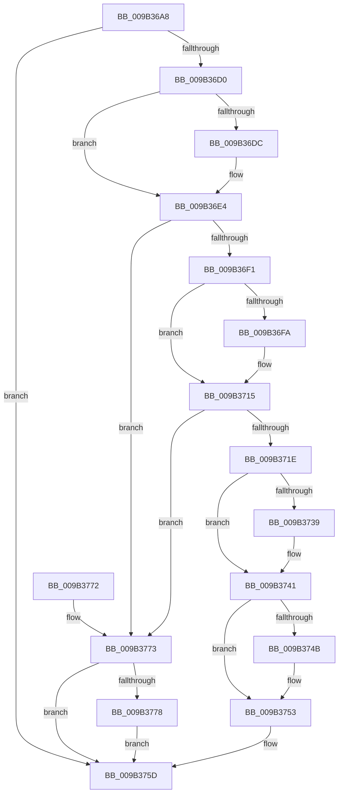

# CmpFlushNotify

- RVA: `0x009B36A8`–`0x009B3782` (길이 `218` bytes)
- VA: `0x00000001409B36A8`
- 실행 섹션: `PAGE`
- PDB 이름 있음: `예`; PDB Function 태그: `아니요`
- unwind 정보 RVA: `0x0009E49C`
- 디코드: `60`개 명령, `218/218` bytes 표시
- 미해석 바이트: `0` (있으면 어셈블리에 `.byte`로 보존)

> 이 문서는 커널 이미지의 기계어와 PDB 기호를 분석해 생성했습니다. 4번과 5번은 함수 원형과 자료형을 바이너리 사용 방식에서 추정한 C 해석이며 원본 소스 복구 결과는 아닙니다.

## 1. Dependencies

- 직접 호출 지점: **6**; 고유 호출 대상: **5**
- 직접 호출자로 확인된 함수: **1**
- RIP 상대 이미지 참조: **0**

### Outgoing calls
- `0x009B36DF` → [CmLockHive](../85/CmLockHive_function_008512B4.md) (function, `0x008512B4`)
- `0x009B3710` → [CmpPostNotify](../86/CmpPostNotify_function_008645D8.md) (function, `0x008645D8`)
- `0x009B3722` → [SeReleaseSubjectContext](../86/SeReleaseSubjectContext_function_0086B710.md) (function, `0x0086B710`)
- `0x009B374E` → [CmUnlockHive](../85/CmUnlockHive_function_00851D6C.md) (function, `0x00851D6C`)
- `0x009B3758` → [ExFreePoolWithTag](../../poolcode/B8/ExFreePoolWithTag_function_00B82870.md) (function, `0x00B82870`)
- `0x009B377B` → [CmUnlockHive](../85/CmUnlockHive_function_00851D6C.md) (function, `0x00851D6C`)

### Direct callers
- [CmpFlushNotifiesOnKeyBodyList](CmpFlushNotifiesOnKeyBodyList_function_009B3594.md) at `0x009B3649`
- [CmpFlushNotifiesOnKeyBodyList](CmpFlushNotifiesOnKeyBodyList_function_009B3594.md) at `0x009B367B`

### Static image references
- 디코드된 RIP-relative 메모리 참조가 없습니다.

## 2. Other-region calls and transfers

- 다른 실행 섹션으로 향하는 call: **1**
  - `0x009B3758` → [ExFreePoolWithTag](../../poolcode/B8/ExFreePoolWithTag_function_00B82870.md) (`PAGE` → `POOLCODE`)
- 별도 외부 분기/꼬리 이동을 확인하지 못했습니다.

## 3. Assembly (complete function range)

```asm
009B36A8  48 89 5C 24 08                  mov qword ptr [rsp + 8], rbx
009B36AD  48 89 6C 24 10                  mov qword ptr [rsp + 0x10], rbp
009B36B2  48 89 74 24 18                  mov qword ptr [rsp + 0x18], rsi
009B36B7  57                              push rdi
009B36B8  48 83 EC 40                     sub rsp, 0x40
009B36BC  48 83 79 10 00                  cmp qword ptr [rcx + 0x10], 0
009B36C1  49 8B D8                        mov rbx, r8
009B36C4  40 8A EA                        mov bpl, dl
009B36C7  48 8B F1                        mov rsi, rcx
009B36CA  0F 84 8D 00 00 00               je 0x1409b375d
009B36D0  48 8B 41 08                     mov rax, qword ptr [rcx + 8]
009B36D4  48 8B 78 20                     mov rdi, qword ptr [rax + 0x20]
009B36D8  84 D2                           test dl, dl
009B36DA  75 08                           jne 0x1409b36e4
009B36DC  48 8B CF                        mov rcx, rdi
009B36DF  E8 D0 DB E9 FF                  call 0x1408512b4
009B36E4  48 8B 4E 10                     mov rcx, qword ptr [rsi + 0x10]
009B36E8  48 85 C9                        test rcx, rcx
009B36EB  0F 84 82 00 00 00               je 0x1409b3773
009B36F1  48 8D 41 10                     lea rax, [rcx + 0x10]
009B36F5  48 39 00                        cmp qword ptr [rax], rax
009B36F8  74 1B                           je 0x1409b3715
009B36FA  48 89 5C 24 30                  mov qword ptr [rsp + 0x30], rbx
009B36FF  41 B9 0B 01 00 00               mov r9d, 0x10b
009B3705  48 83 64 24 28 00               and qword ptr [rsp + 0x28], 0
009B370B  C6 44 24 20 00                  mov byte ptr [rsp + 0x20], 0
009B3710  E8 C3 0E EB FF                  call 0x1408645d8
009B3715  48 8B 5E 10                     mov rbx, qword ptr [rsi + 0x10]
009B3719  48 85 DB                        test rbx, rbx
009B371C  74 55                           je 0x1409b3773
009B371E  48 8D 4B 38                     lea rcx, [rbx + 0x38]
009B3722  E8 E9 7F EB FF                  call 0x14086b710
009B3727  48 8B 4B 08                     mov rcx, qword ptr [rbx + 8]
009B372B  48 8B 03                        mov rax, qword ptr [rbx]
009B372E  48 89 01                        mov qword ptr [rcx], rax
009B3731  48 8B 0B                        mov rcx, qword ptr [rbx]
009B3734  48 85 C9                        test rcx, rcx
009B3737  74 08                           je 0x1409b3741
009B3739  48 8B 43 08                     mov rax, qword ptr [rbx + 8]
009B373D  48 89 41 08                     mov qword ptr [rcx + 8], rax
009B3741  48 83 66 10 00                  and qword ptr [rsi + 0x10], 0
009B3746  40 84 ED                        test bpl, bpl
009B3749  75 08                           jne 0x1409b3753
009B374B  48 8B CF                        mov rcx, rdi
009B374E  E8 19 E6 E9 FF                  call 0x140851d6c
009B3753  33 D2                           xor edx, edx
009B3755  48 8B CB                        mov rcx, rbx
009B3758  E8 13 F1 1C 00                  call 0x140b82870
009B375D  48 8B 5C 24 50                  mov rbx, qword ptr [rsp + 0x50]
009B3762  48 8B 6C 24 58                  mov rbp, qword ptr [rsp + 0x58]
009B3767  48 8B 74 24 60                  mov rsi, qword ptr [rsp + 0x60]
009B376C  48 83 C4 40                     add rsp, 0x40
009B3770  5F                              pop rdi
009B3771  C3                              ret
009B3772  CC                              int3
009B3773  40 84 ED                        test bpl, bpl
009B3776  75 E5                           jne 0x1409b375d
009B3778  48 8B CF                        mov rcx, rdi
009B377B  E8 EC E5 E9 FF                  call 0x140851d6c
009B3780  EB DB                           jmp 0x1409b375d
```

## 4. C-style interpretation (structured pseudocode)

```c
__int64 __fastcall CmpFlushNotify(__int64 a1, int a2, __int64 a3)
{
    __int64 result;
    __int64 v_rsp;
    unsigned __int64 v_stack_m18;
    unsigned __int64 v_stack_m20;
    unsigned __int8 v_stack_m28;
    unsigned __int64 v_stack_p10;
    unsigned __int64 v_stack_p18;
    unsigned __int64 v_stack_p8;

    v_stack_p8 = v_rbx;
    v_stack_p10 = v_rbp;
    v_stack_p18 = v_rsi;
    v_rsp = (v_rsp) - (64);
    if ((*(unsigned __int64 *)(a1 + 16)) == 0) goto loc_009B375D;
    result = *(unsigned __int64 *)(a1 + 8);
    if ((unsigned __int8)(a2) == 0) {
        a1 = *(unsigned __int64 *)(*(unsigned __int64 *)(a1 + 8) + 32);
        result = CmLockHive(a1, a2, a3, a4);
    }
    if (*(unsigned __int64 *)(a1 + 16) == 0) goto loc_009B3773;
    result = *(unsigned __int64 *)(a1 + 16) + 16;
    if ((*(unsigned __int64 *)(*(unsigned __int64 *)(a1 + 16) + 16)) != (*(unsigned __int64 *)(a1 + 16) + 16)) {
        v_stack_m18 = a3;
        a4 = 267;
        v_stack_m28 = 0;
        result = CmpPostNotify(*(unsigned __int64 *)(a1 + 16), a2, a3, a4);
    }
    if (*(unsigned __int64 *)(a1 + 16) == 0) goto loc_009B3773;
    result = SeReleaseSubjectContext(*(unsigned __int64 *)(a1 + 16) + 56, a2, a3, a4);
    *(unsigned __int64 *)(*(unsigned __int64 *)(*(unsigned __int64 *)(a1 + 16) + 8)) = *(unsigned __int64 *)(*(unsigned __int64 *)(a1 + 16));
    result = *(unsigned __int64 *)(*(unsigned __int64 *)(a1 + 16));
    if (*(unsigned __int64 *)(*(unsigned __int64 *)(a1 + 16)) != 0) {
        result = *(unsigned __int64 *)(*(unsigned __int64 *)(a1 + 16) + 8);
        *(unsigned __int64 *)(*(unsigned __int64 *)(*(unsigned __int64 *)(a1 + 16)) + 8) = result;
    }
    if ((unsigned __int8)((unsigned __int8)(a2)) == 0) {
        a1 = *(unsigned __int64 *)(*(unsigned __int64 *)(a1 + 8) + 32);
        result = CmUnlockHive(a1, a2, a3, a4);
    }
    a2 = 0;
    result = ExFreePoolWithTag(*(unsigned __int64 *)(a1 + 16), a2, a3, a4);
loc_009B375D:
    v_rsp = (v_rsp) + (64);
    return result;
loc_009B3773:
    if ((unsigned __int8)(v_stack_p10) != 0) goto loc_009B375D;
    result = CmUnlockHive(*(unsigned __int64 *)(*(unsigned __int64 *)(a1 + 8) + 32), a2, a3, a4);
    goto loc_009B375D;
}
```

## 5. (Beta) C Style

```c
int64_t CmpFlushNotify(void *Arg1, int32_t Arg2, int64_t Arg3)
{
    uint8_t *arg1 = (uint8_t *)Arg1;

    int64_t result;
    int64_t local_rsp;
    uint64_t v_stack_m18;
    uint64_t v_stack_m20;
    uint8_t v_stack_m28;
    uint64_t v_stack_p10;
    uint64_t v_stack_p18;
    uint64_t v_stack_p8;

    v_stack_p8 = local_rbx;
    v_stack_p10 = local_rbp;
    v_stack_p18 = local_rsi;
    local_rsp = (local_rsp) - (64);
    if ((*(uint64_t *)(arg1 + 0x10)) == 0) goto loc_009B375D;
    result = *(uint64_t *)(arg1 + 0x8);
    if ((uint8_t)(Arg2) == 0) {
        Arg1 = *(uint64_t *)(*(uint64_t *)(arg1 + 0x8) + 0x20);
        result = CmLockHive(Arg1, Arg2, Arg3, a4);
    }
    if (*(uint64_t *)(arg1 + 0x10) == 0) goto loc_009B3773;
    result = *(uint64_t *)(arg1 + 0x10) + 16;
    if ((*(uint64_t *)(*(uint64_t *)(arg1 + 0x10) + 0x10)) != (*(uint64_t *)(arg1 + 0x10) + 16)) {
        v_stack_m18 = Arg3;
        a4 = 267;
        v_stack_m28 = 0;
        result = CmpPostNotify(*(uint64_t *)(arg1 + 0x10), Arg2, Arg3, a4);
    }
    if (*(uint64_t *)(arg1 + 0x10) == 0) goto loc_009B3773;
    result = SeReleaseSubjectContext(*(uint64_t *)(arg1 + 0x10) + 56, Arg2, Arg3, a4);
    *(uint64_t *)(*(uint64_t *)(*(uint64_t *)(arg1 + 0x10) + 0x8)) = *(uint64_t *)(*(uint64_t *)(arg1 + 0x10));
    result = *(uint64_t *)(*(uint64_t *)(arg1 + 0x10));
    if (*(uint64_t *)(*(uint64_t *)(arg1 + 0x10)) != 0) {
        result = *(uint64_t *)(*(uint64_t *)(arg1 + 0x10) + 0x8);
        *(uint64_t *)(*(uint64_t *)(*(uint64_t *)(arg1 + 0x10)) + 0x8) = result;
    }
    if ((uint8_t)((uint8_t)(Arg2)) == 0) {
        Arg1 = *(uint64_t *)(*(uint64_t *)(arg1 + 0x8) + 0x20);
        result = CmUnlockHive(Arg1, Arg2, Arg3, a4);
    }
    Arg2 = 0;
    result = ExFreePoolWithTag(*(uint64_t *)(arg1 + 0x10), Arg2, Arg3, a4);
loc_009B375D:
    local_rsp = (local_rsp) + (64);
    return result;
loc_009B3773:
    if ((uint8_t)(v_stack_p10) != 0) goto loc_009B375D;
    result = CmUnlockHive(*(uint64_t *)(*(uint64_t *)(arg1 + 0x8) + 0x20), Arg2, Arg3, a4);
    goto loc_009B375D;
}
```

### 관측된 메모리 오프셋

구조체 형식이 확인되지 않은 접근은 인자 기준의 오프셋으로만 기록했습니다.

| 기준 인자 | 오프셋 표현 | 폭 (bit) | 접근 |
|---|---:|---:|---|
| `Arg1` | `+ 0x8` | `64` | `R` |
| `Arg1` | `+ 0x10` | `64` | `R` |
| `Arg1` | `+ 0x10` | `64` | `R/W` |

## 6. Execution-region graph

[열기: 2D/3D 그래프와 함수 탐색 컨트롤 패널](../../../control-panel.html?section=page&rva=0x009B36A8&view=graph)

- 2D 그래프는 위에서 아래로 흐르고, 3D 그래프는 빈 공간을 드래그해 회전합니다. Shift+드래그는 이동, 휠은 확대·축소, 함수 노드 선택은 대상 보고서 이동입니다.

### Static fallback


